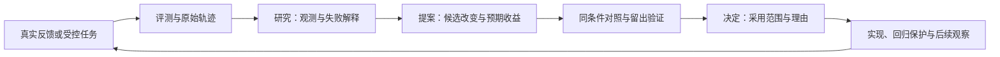

# Agent 系统评测：社区实践与设计启示

性质：**研究证据与设计建议，不是已接受的评测架构或实施规格**。核对日期：2026-09-12。

本研究回答：DSH、Pi、LangChain、Deep Agents、OpenCode、EverMind Raven 怎样评测
自己的系统，以及评测结果怎样进入开发、选型和演进决策。逐项目证据见
[框架调查](frameworks.md)，DSH 的实际调用与复现记录见[调用补充](dsh-invocation.md)，
既有知识治理背景见[前一份社区研究](../framework-governance/README.md)。

## 目录

- [结论与比较](#结论与比较)
- [测试、评测与 benchmark 的区别](#测试评测与-benchmark-的区别)
- [对本项目有价值的评测范围](#对本项目有价值的评测范围)
- [怎样让结果指导迭代和决策](#怎样让结果指导迭代和决策)
- [评测自身怎样保持可信](#评测自身怎样保持可信)
- [当前仓库的边界与后续讨论](#当前仓库的边界与后续讨论)
- [来源版本与核对范围](#来源版本与核对范围)
- [DSH 实际调用与复现记录](dsh-invocation.md)

## 结论与比较

最值得借鉴的是一套能解释变化的测量机制：明确任务与环境，运行真实 agent，保存
行为和产物，独立评分，对照不同版本，调查失败，再决定改什么。一个排行榜或一批
LLM judge 调用只覆盖其中一部分。

六个项目没有采用完全相同的体系；公开程度、测量对象和结果用途也不同：

| 项目 | 已核对的评测构成 | 结果怎样影响开发 | 证据边界 |
|---|---|---|---|
| [DSH](frameworks.md#dsh) | 真实模型行为 smoke、可独立验真的任务、跨包用户路径性能 benchmark | 性能退化促成必需 CI gate；预算调整附测量、对照与原因 | 尚未在所查材料中确认通用 AI 能力排行榜和统一的质量升版协议 |
| [Pi](frameworks.md#pi) | 真实 AgentSession + vitest-evals；提示、工具、模型和扩展的对照实验 | 用相同任务的重复配对结果衡量配置增益及成本 | 比较报告示例不是实测成绩；所查常规 CI 没有自动执行付费 eval |
| [LangChain](frameworks.md#langchain) | 库级测试和性能检查；AgentEvals/OpenEvals 评分；LangSmith 实验与线上反馈 | trace 发现的问题成为离线样例，实验比较支持提示、模型和工具迭代 | 平台具备某能力，不代表所有 LangChain 产品已经以它作为发布门禁 |
| [Deep Agents](frameworks.md#deep-agents) | 特定行为评测、外部端到端任务、模型/配置矩阵、重复试验与报告 | 诊断失败、比较分支、校准任务集；公开展示增补及删减 harness 的实验 | 用例失败、评测进程退出码和最终采用是不同状态 |
| [OpenCode](frameworks.md#opencode) | 产品测试、浏览器性能诊断；Zen 的模型与提供者组合评估 | 性能诊断指导局部优化；组合评估指导推荐名单 | 未在所查公开材料中确认 Zen 完整数据集、评分器和接受阈值 |
| [Raven](frameworks.md#raven) | 能力、上下文、主动性、跨日模拟；独立的 benchmark 驱动演进工具 | 失败归因、候选筛选、对照确认、泛化检查；主动性与克制分项比较 | Evolver 有待退役说明和实测规模限制；宣传成绩不能直接等同于其公开实现验证 |

综合判断：**Deep Agents 最适合借鉴评测组织及开发闭环，Pi 适合借鉴轻量对照实验，
Raven 最贴近长期个人助手的主动性与演进问题，DSH 适合借鉴长会话工程质量的测量纪律。**
LangChain 提供较完整的测量基础设施视角；OpenCode 提醒我们连提供者配置都属于被测条件。
这不是跨框架能力排名。

## 测试、评测与 benchmark 的区别

下表是本研究的分析口径，不要求目录或工具按此机械拆分：

| 问题 | 主要观察 | 典型方法 |
|---|---|---|
| 软件机制是否兑现契约？ | 权限、状态转移、取消、资源回收、序列化等 | 单元、属性、集成、端到端测试与形式验证 |
| Agent 能否完成用户的工作？ | 目标达成、工具选择、产物质量、澄清与恢复行为 | 真实模型任务、受控环境、独立评分与重复运行 |
| 一个版本是否比另一个版本更好？ | 同条件下的质量变化、成本、波动和能力分项 | 固定 benchmark、配对比较、消融与留出验证 |
| 长期使用后是否仍可靠？ | 跨轮连续性、记忆污染、预约执行、主动干扰、演进后的退化 | 连续情景、时间推进、故障注入、长期反馈 |

这些类别会重叠。例如 DSH 的真实模型修复任务既是端到端测试，也提供有限的行为
评测证据；它使用确定性评分，不因此变成一次确定性的模型执行。

这里的 benchmark 是固定任务集合、环境与评分协议组成的比较基准；它既可能测
智能任务成功率，也可能测打开会话的延迟。**基准的名字不说明它测了什么。**

对于会调用工具的系统，最终回复只是证据之一。“我已经创建提醒”不能替代提醒
已被正确注册、到期能执行、取消后不再触发的观察。轨迹用于解释发生了什么，
环境状态和产物用于核对结果，二者需要联合使用。

## 对本项目有价值的评测范围

以下是依据项目目标提出的候选范围，尚待设计确认。长期个人助手不能只用编程
benchmark 代替自己的任务分布，也不能用资源长稳测试代替记忆和行为的长期评测。

| 范围 | 需要回答的问题 | 可观察结果示例 |
|---|---|---|
| 完整任务 | 是否理解并完成真实目标，而非只输出可信的文字？ | 产物、操作后的状态、失败后的有效恢复、必要人工介入 |
| 工具与协作 | 能否选对工具、组合依赖、正确委派和接回结果？ | 工具效果、错误恢复、交接信息与责任是否完整 |
| 会话与上下文 | 压缩、重启、换模型后是否继续正确工作？ | 目标与约束保持、未完成事项恢复、旧信息不被误当新指令 |
| 长期记忆 | 是否记住该记的、修正已过时的，并拒绝无关信息干扰？ | 偏好使用、纠错后的行为、来源与时间敏感性、跨任务污染 |
| 主动性 | 是否在合适时机提供帮助，也能在不该打扰时克制？ | 主动帮助的有效性、遗漏机会、无益打扰、免打扰规则遵循 |
| 完全动态运行 | 能力和绑定变化时，在途工作与后续工作是否保持正确语义？ | provider/plugin 撤除或替换、工具可见性变化、恢复后的行为 |
| 租户与授权 | 系统能否保护隔离，并让模型正确处理越界或需授权的请求？ | 跨租户访问被机制拒绝；模型是否尝试越界、误导授权或重复请求 |
| 长稳与成本 | 能否在可接受资源与预算下持续提供能力？ | 延迟分位数、内存增长、每个成功任务成本、重复操作与无效循环 |
| 持续演进 | 新记忆、skill、提示或插件是否带来可迁移的收益？ | 新任务收益、原有能力保留、失败复发率、留出集表现 |

涉及隔离、授权和副作用的系统保证仍须由机制、契约及对应验证承担；行为评测
补充模型面对真实情景时的表现，不用平均得分抵消一次关键边界违反。

对于“完全动态”，仅保存启动配置不足以解释一次试验。还需要记录试验中发生的
配置/能力变化、实际生效版本、在途工作归属和相关事件。这是从本项目目标导出的
可复现性要求候选，不能声称上述六个项目都已实现。

## 怎样让结果指导迭代和决策

结果的作用可以分为四类：发现能力缺口、定位回归、比较候选、检查泛化。它们
需要的样例和判据不同。例如为了发现新的能力边界，可以保留大量尚未完成的
困难任务；为了检查回归，则要能发现曾经稳定完成的任务何时退化。

一个与现有知识治理相容的闭环可以是：

这不是每次修改都必须经过的新流程。已有契约内的 bug 修复可以直接实施并验证；
改变架构取舍、模型策略或系统承诺时，按[知识流转](../../maintenance/knowledge-flow.md)
处理。评测提供新观测，提案解释为什么采取某种变化，决定拥有采用权限。

特别值得保留的三种实验问题：

- **增加是否值得？** 对比有无某个工具、提示或 hook，检查目标能力收益以及相邻任务退化。
- **删除是否可行？** 对比保留、简化和移除，检查模型是否已能独立完成工作，而非只看 token 变少。
- **谁导致了变化？** 固定模型比较 harness，固定 harness 比较模型；需要联合改变时明确交互，避免混称单项贡献。

“总分上升”还不能直接回答是否采用。还要解释收益发生在哪些任务、牺牲了什么、
改善是否超过波动、是否与预期机制一致、成本是否可接受。排行榜适合指示调查方向，
逐例轨迹和对照证据才支持具体的修改理由。

## 评测自身怎样保持可信

以下是综合建议，并非照搬某个项目的阈值或统计实现：

1. **固定被测条件。** 保存 harness 源码、模型标识与可辨认版本、推理预算、提示、
   工具/插件、初始记忆、任务集、环境和评分器版本。本项目统一经 OpenRouter；
   还应记录路由及 fallback 设置、能获取到的实际服务提供者和执行时间。
2. **分开任务失败与测量失效。** 不隐藏超时、基础设施错误和缺失试验；预先说明
   它们如何进入分母。端到端可用率中的失败，不应无说明地被解读为模型能力不足。
3. **重复且配对。** 相同任务比较双方，报告每项的改善与退化、样本覆盖和不确定性。
   重复次数没有通用常数；少量重复和一个显著性标签都不能消除服务漂移或选择偏差。
4. **保护评分独立性。** 能用产物、数据库状态或外部测试验证时优先使用；语义质量
   再引入明确 rubric 的 judge。让评分者接触必要证据，对其做人工校准；更换 judge
   后重新建立可比基线。模型自述和 LLM 失败归因都不是独立事实证明。
5. **不把理想轨迹固化成唯一解。** 顺序属于契约时才严格比较；存在多种正确解时，
   用结果及必要约束评分，把额外步骤或不同路径作为诊断而非自动失败。
6. **区分调优集与留出集。** 反复看答案并调参的集合已经参与开发，不能继续宣称
   未见过。持续演进还要检查知识向新任务迁移，以及既有能力是否被破坏。
7. **分别表达完成、评分、可信度和采用。** 评测进程成功不等于 agent 成功；分数
   改善不等于可靠归因；统计证据不等于架构接受，更不等于允许自动发布。
8. **维护而不只累加。** 为快速迭代保留有区分度的小集合，重要变更回到完整范围。
   饱和样例可以降频、改版或归档；它保护的真实契约不能因为模型变强就自动消失。

解释 `pass@K` 时尤其要注意：在 K 次尝试中至少成功一次，与每次尝试的平均成功率
回答不同问题。多试几次得到的成绩不能当作单次可靠性；连续质量分也不宜强套
“必须等于 1 才算通过”的二元指标。Deep Agents 的不同评测类别已经暴露这种差异，
详见[具体证据](frameworks.md#deep-agents)。

## 当前仓库的边界与后续讨论

现有 [`docs/evaluation/`](../../evaluation/README.md) 只评估**开发 agent 主力模型及
防御辅助**；它的离线工具检查证据完整性，不执行产品 agent 评测。该边界已有
[D-003](../../decisions/D-003-defensive-evaluation.md) 依据，本研究不改变它。

产品运行时评测需要自己的任务分布、协议与采用依据。两条评测线可以复用未来
成熟的实验记录、评分和报告能力，但不能复用一个总分或直接转移采用结论。

后续设计可以先明确首批产品任务、成功与越界的观察口径、可固定的运行环境和
trace 证据，然后决定 runner、评分器和报告怎样组合。Pi 的轻量适配方式、
Harbor 的任务环境、AgentEvals/OpenEvals 的评分以及 LangSmith 的实验管理均可
作为候选；本研究没有完成它们对本项目动态内核、租户和部署约束的适配选型。

本次仅向仓库新增研究和索引；没有建立新运行时模型、正式协议、评分阈值、项目
工具依赖或自动演进权限。补充验证在仓库外安装 DSH 发布包，执行了三个官方
无密钥 SDK smoke；没有运行任何付费模型 benchmark，详见[调用补充](dsh-invocation.md)。

## 来源版本与核对范围

GitHub 来源固定到下表提交；链接指向具体代码或文档。外部在线文档和文章按上述
核对日期读取，其发布日期与本次源码时间点分别记录，不把历史实验当作当前成绩。

| 项目 | 采用的源码快照 |
|---|---|
| DSH | [c291e7961a51](https://github.com/deepseek-ai/deepseek-harness/tree/c291e7961a515f6d7af9304e7fd1d257929aef26) |
| Pi；原 badlogic/pi-mono 已重定向 | [earendil-works/pi · 71dca871bc80](https://github.com/earendil-works/pi/tree/71dca871bc80b6bc97be37f0ca3189399d651fff) |
| LangChain | [348c9dc57259](https://github.com/langchain-ai/langchain/tree/348c9dc572599947d2d7d33d6a5b8b936e92a1d4) |
| Deep Agents | [9e7d62ff6e71](https://github.com/langchain-ai/deepagents/tree/9e7d62ff6e7131505995a706d717e01837aa8617) |
| OpenCode | [95daf90670b7](https://github.com/anomalyco/opencode/tree/95daf90670b7c039c436c85537da5fbfe2205b41) |
| Raven | [fcf469ae619d](https://github.com/EverMind-AI/Raven/tree/fcf469ae619d91f7adc6fc7a4f963c17d176f9f5) |
| Raven 相关的 EvoAgentBench | [948a17288782](https://github.com/EverMind-AI/EvoAgentBench/tree/948a17288782d5120778da16b4cf1cad9305d8b4) |

实际核对包括六个主仓库的完整路径清单、相关评测说明、代表性评分/运行源码和
工作流配置，以及官方方法文章。DSH 另有三个实际执行的 SDK smoke，其源码与
被测发布包版本分别记录于[执行证据](dsh-invocation.md#实际调用了什么)。没有逐文件
审计整个项目，没有重现文中引用的质量或性能实验，也未验证所有历史 Actions 工件。
文中的“未确认”只限定于这次公开资料调查，
不推断团队内部没有相应体系；第三方同名 benchmark 不计作官方实现。
