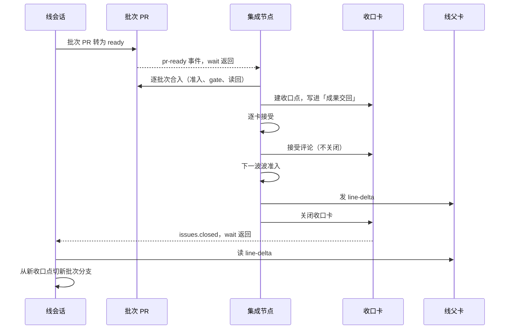

# 集成

本技能是 `docs/engineering/integration.md`「集成节点的清单」的可执行版。批次、波、收口点、不变量、合并顺序、冲突、失败处理与退回的规则都归那一节，权限与 gate 归同页「现行准入」。命令的精确行为归 `tools/dev-flow/src/delivery/README.md` 与 `tools/dev-flow/src/integration/README.md`，PR 与提交的格式归 `CONTRIBUTING.md`。

开始前确认：调度者已在里程碑卡中把集成节点具名给你。本波的波准入已通过。你有里程碑卡、各线父卡、本波收口卡的编号与事件文件路径。代为确认 gate 时，你有该 admin 对本次确认的授权。缺任一项时停下，交回调度者。

事件文件是每台机器一个的 `<主检出>/tmp/github-events/events.jsonl`。主检出指 `.worktrees/` 的上一级目录。接收器与每一条 `wait-cli.ts` 命令都显式传 `--file <事件文件>`。

## 0. 等批次

1. 核对本机的事件接收器在跑：看 `<主检出>/tmp/github-events/receiver.pid` 或接收器端口。没在跑时，在主检出根后台启动它，并持有到里程碑结束：

   ```sh
   node --experimental-strip-types tools/dev-flow/src/delivery/events-receiver-cli.ts serve --port <端口> --file <事件文件>
   ```

   每台机器只有一个接收器，由这台机器上第一个开工的会话启动。
2. 阻塞等下一个批次。等待阻塞在本机事件文件上，不轮询 GitHub：

   ```sh
   node --experimental-strip-types tools/dev-flow/src/delivery/wait-cli.ts pr-ready --base integration/legacy-refactor --ignore <PR>@<head>... --file <事件文件>
   ```

   `--ignore` 列出本波已处理过的 (PR, head)，含已合入的与已退回的。非草稿 PR 的 head 前进（`synchronize`）也算一次 ready，所以退回后修复的批次会以新 head 再到达。命令返回时打印 PR 号与 head。
3. 在 Claude Code 里用 Bash 工具的后台运行（`run_in_background`）跑这条命令。命令退出前会话不被唤醒（Claude Code 后台运行的行为）。不用 `Monitor`：它每 30 分钟到期，要重新启动。Codex 与 Cursor 未覆盖：用各自的后台运行与完成通知机制。没有这种机制的宿主，在里程碑卡的集成节点状态注写明怎样等。
4. 本波还有线没交批次时，处理完到手的批次后回到第 2 步。

## 1. 收批次

批次 PR 转为 ready 即收到。按到达先后处理。几个批次同时到时，按 integration.md「集成节点怎样工作」第 2 步，影响面大的先合。记下每个批次的到达时刻与实际合入顺序。

## 2. 逐批次合入

对每个批次做下列步骤。任一步失败时停在这一步，按[第 5 节](#5-退回)整体退回该线，再处理下一个批次。

1. 读批次 PR、线父卡上的批次报告与各卡的交接报告。报告写明某张卡未进批次时，核对批次分支上没有那张卡的提交。
2. 核对批次改动的文件都在各卡写范围之并内：`git diff --name-only <收口点>...<批次头>`。有越界文件时整个批次不合入。
3. 在本机为线父卡的本波 attempt 建工作树并开工。本机还没有这张卡的树时用 `prepare`。本机有旧树时用 `swap`。`swap` 不删除旧树：它让旧树分离分支，从远端尖端建新树，并列出旧树中 `tmp/issue-<N>/` 以外的未跟踪路径。

   ```sh
   node --experimental-strip-types tools/dev-flow/src/integration/worktree-cli.ts prepare --issue <线父卡> --tree .worktrees/issue-<线父卡>-r<修订>a<序号>
   node --experimental-strip-types tools/dev-flow/src/integration/worktree-cli.ts swap --issue <线父卡> --old <旧树> --tree .worktrees/issue-<线父卡>-r<修订>a<序号>
   ```

   旧树确实不再需要时，按 `docs/engineering/workflow.md` 的清理条件与授权，先运行 `worktree-cli.ts remove --tree <旧树>` 看清单，再加 `--force` 删除。
4. 在新树中同步联调轨道，两步：先 `git merge origin/integration/legacy-refactor` 并提交，再运行 task-sync，输入 `{"kind":"task-sync","target":"<合并进来的轨道提交>"}`。合并出现冲突时，按 integration.md「冲突即退回分解」先看冲突落在哪些文件上。只落在线归属表 `shared` 的路径上时，按该节逐类解决（命令在该节），提交到批次分支，继续下一步，记一条共享路径冲突。其余冲突立即停止，不在集成侧解决，退回该线。
5. 同步合并之后、准入之前，一律重生成投影并跑 `check:agents`：`node --experimental-strip-types tools/dev-flow/src/integration/worktree-cli.ts projections`。批次自己没改 agent 源也要做，因为合并进来的轨道头可能带别的批次的 agent 源改动。
6. 准入排队。同一台机器上的准入一次只跑一个，按准入锁路径排队。用后台 shell 等锁，会话不被唤醒：

   ```sh
   log=<准入日志>; until [ ! -e <准入锁> ]; do sleep 60; done && touch <准入锁> && { OMNE_ADMISSION=1 pnpm run check > "$log" 2>&1; rc=$?; rm -f <准入锁>; echo "exit=$rc" >> "$log"; exit "$rc"; }
   ```

   本技能说的「不轮询」指不轮询 GitHub、不唤醒模型。本机文件的等待在后台 shell 里做。准入包含哪些检查归开发指南与仓库根 `package.json`。记录实际命令与退出码。准入不通过时退回该线，不改批次。
7. 推送批次分支，让批次 PR 的 head 前进到同步后的提交。把线父卡的 Stage 改为 Integrating：`node --experimental-strip-types tools/dev-flow/src/delivery/board-cli.ts integrating --issue <线父卡>`。
8. 派发 gate 并等待：

   ```sh
   gh workflow run gate-publish.yml --ref github-gate -f pr=<PR号> -f head=<PR head 完整提交号>
   gh run list --workflow gate-publish.yml --limit 1
   node --experimental-strip-types tools/dev-flow/src/integration/gate-cli.ts wait --run <运行号> --note tmp/issue-<线父卡>/gate-note.md
   ```

   说明文件写本地运行的检查与结果、已核对的卡上条件，以及代为确认的人，最多 1024 个字符。详细内容写进卡上的评论，说明里给链接。`wait` 缺省只批准 `publish`。PR 改动仓库工具链、gate 另要 `repo-toolchain-review` 的确认时，加 `--environments repo-toolchain-review,publish`，并让说明同时写明两道确认各自要求的内容。gate 失败时把 Stage 改回 In review，退回该线。
9. 读回：联调轨道等于 gate 报告的结果，`omne/gate/*` 记录标签存在，PR 上有发布决定评论。

## 3. 建收口点

本波全部批次合入后，按 integration.md「集成节点怎样工作」第 4 步：

1. 在联调轨道头运行联调命令。命令由里程碑卡给出。没有给出时写明本波没有联调。
2. 运行 `OMNE_ADMISSION=1 FULL=1 pnpm run check`。两者都通过时，这个提交是下一个收口点。任一项不通过时，按批次顺序定位负责的线，把修复排进该线下一波的第一张卡。收口点仍取当前头，集成报告标红。
3. 契约成员破坏性改动的允许时机与申请口子归 integration.md「里程碑内的规则」。各批次 PR 的「契约变化」按各卡的 taskBase 申报。
4. 把收口点提交号、准入与联调结果写进本波收口卡的「成果交回」。收口卡此时不关闭：关闭是下一波的开工事件，放在第 4 节最后一步。

## 4. 波末

收口点建好后按下面的顺序做。顺序不能换：`line-delta` 必须在收口卡关闭之前发出，线醒来时才读得到。

1. 逐卡接受。接受之前按 review-delivery 技能逐卡核对交付边界与验收标准。有权的接受者按 delivery.md「接受、取消与重开」的决定格式写接受评论，代笔时附有权者的明确输入。评论写明修订、精确 head、范围、结论、具名例外与剩余责任。须由负责人本人接受的卡交负责人。决定读回后运行 `node --experimental-strip-types tools/dev-flow/src/delivery/board-cli.ts accepted --issue <N>`，再关闭卡。部分接受不关卡。
2. 在里程碑卡发集成报告：批次的合入顺序与到达时刻、每个批次每一步的结果与命令、退回的批次及原因、共享路径冲突、分解错误清单、收口点、具名例外与剩余责任。
3. 在收口卡写「交付决定 accept」评论，写明收口点提交。此时不关闭收口卡。
4. 按 dispatch 技能第 3 节做下一波的波准入。下一波各卡开工条件的目标是本波收口卡，核对它「已接受」即可，不核对合入提交。
5. 以调度者身份给每条线的线父卡发 `line-delta`（模板在 `.meta_harness/human/map-reduce-delivery/templates/line-delta.md`）。
6. 决定读回后对收口卡运行 `board-cli.ts accepted`，然后关闭收口卡。关闭就是各线开工的事件。



每波至少在里程碑卡发一条集成节点状态注，压缩上下文之前也发一条。状态注以 `<!-- reduce-state -->` 开头，写收口点、各线批次的状态、退回记录。压缩后从最新一条状态注重建，不从记忆重建。

每类记录的落点：

| 落点 | 记录 |
| --- | --- |
| 线父卡评论 | 线包、`line-delta`、`line-return`、批次报告、线状态注、线交接报告、线父卡每波 attempt 的登记 |
| 各线卡 | 认卡评论、登记评论、交接报告、卡的 PR、接受评论 |
| 收口卡 | 收口点提交、准入与联调结果、接受评论 |
| 里程碑卡评论 | 集成报告、集成节点状态注（`<!-- reduce-state -->`） |

## 5. 退回

集成节点不与线会话对话，退回记录以调度者身份写在线父卡上。除只落在共享路径上的合并冲突以外，集成节点不改批次的代码。批次有缺陷时整体退回该线：

1. 把批次 PR 转回草稿：`gh pr ready <PR> --undo`。
2. 在线父卡发一条以 `<!-- line-return -->` 开头的评论，写明批次、原因、要改什么。
3. 把这个 (PR, head) 加进第 0 节的 `--ignore` 列表，回到等待。

线在本波内修复，推送批次分支让 head 前进，再把原 PR 转为 ready。线不新开 PR，沿用线父卡的同一个 attempt。修复后的批次按本技能重走一遍。

## 里程碑收尾

本里程碑最后一波收口后，各线在线父卡发线交接报告。调度者按线交接报告接受线父卡：写接受评论，决定读回后运行 `board-cli.ts accepted`，然后关卡。须由负责人本人接受的线父卡交负责人。

## 已知的坑

- 合并进来的轨道头带了别的批次的 agent 源改动时，不重生成投影就会在准入的 `check:agents` 红。第 2 节第 5 步不能省。
- 准入独占机器。两棵树同时跑准入会互相拖慢、让用例超时。
- gate 说明超过 1024 字会被拒绝。超限后同一运行仍在等待确认，缩短说明后可以对同一运行再确认。
- 求交时加入已关闭的卡会报出假冲突。命令默认排除已关闭的卡。
- 残留的 hook 用 `events-receiver-cli.ts clean` 显式清除。清除前确认本机没有别的接收器在跑。
