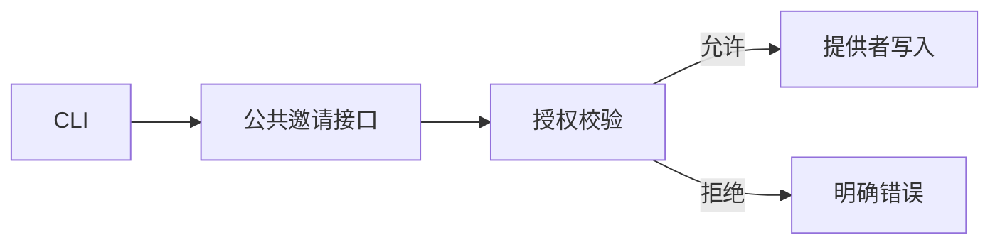

# Feature 填写示例

**教学材料：下列输入、坐标、符号、命令和数字均为虚构；不是本仓库报告或已接受设计。**
不要执行示例命令，也不要把数字/卡状态复制到真实 PR。

## 给定输入

示例能力是管理员撤销未使用邀请，经现有公共接口接入 CLI。卡 A 的单条撤销和重复操作已覆盖，批量不含；未获产品负责人接受。
BASE B0、首个可运行候选 R1、最终 F2 在同一范围/规则下：观察到新偏离 5 条，解决 3 条、保留 2 条；新超阈值函数 3 个，解决 2 个、保留 1 个。旧偏离另解决 1 条。
快层变异 24 个：被杀 21、存活 2、无覆盖 1，其他分类为 0；覆盖 92/100 行。越权分支与日志失败没有足够验证。
用户撤销→反馈路径触发 profile：本地 mock，1000 次顺序操作，p95 18 ms，热点是事务写入；新能力无旧路径，不作性能提升结论。
没有在线 demo；输入提供的虚构 demo CLI 使用本地夹具，不能验证真实网络/部署。

---

管理员可撤销未使用邀请，重复操作返回同一结果。卡 A 的单条撤销场景已交付验证，批量未纳入，产品接受仍待负责人。
**越权与日志失败验证仍不充分；2 条新偏离、1 个超阈值函数和 3 个待核实变异项保留。**

## 接入与边界

CLI 经公共接口使用提供者，授权失败应在写入前拒绝；下面是待 review 的关系，不能由图替代行为证据。



## 质量报告

范围为示例邀请成员；B0/R1/F2 使用同一规则、阈值及工具比较坐标。中间计数仅代表保存的快照，旧问题单列。
教学输入未提供原生结构摘要、约束版本和真实报告地址；这些仍是实际交付要补齐的输入，不能由本表代替。

| 报告 | 结果 | 限制 / 关注点 |
|---|---|---|
| 架构 | 新引入 5、解决 3、保留 2；另消除旧偏离 1 | 保留项见明细；不代表全过程瞬态数量 |
| 复杂度 | 新超阈值 3、解决 2、保留 1 | `createInvite` CC 14，需核对保留代价 |
| 差分变异 | 24：被杀 21、存活 2、无覆盖 1 | 超时/错误为 0；仅快层、本成员 |
| 行覆盖 | 92/100（92%） | 不含跨成员/子进程；没有 BASE 覆盖数据，不声称提升 |
| Profile | 本地 mock，1000 次顺序操作，p95 18 ms | 热点为事务写入；新路径无旧基线，不证明真实网络性能 |
| 行为验收 | 单条撤销、重复操作已覆盖 | 越权与日志失败未充分验证，卡未接受 |

<details>
<summary>保留项与原样变异明细</summary>

| 项 | 位置 | 处置 / 未知 |
|---|---|---|
| 新偏离 1 | `entry.ts:18` | 入口仍选择具体提供者；保留会增加替换成本，未关闭 |
| 新偏离 2 | `events.ts:41` | 事件依赖尚未分离；公共闭包责任未关闭 |
| 超阈值函数 | `createInvite` | CC 14；保留用于审查完整状态分支，不宣称必要性已证实 |

变异原文：

```text
grant.ts:28 EqualityOperator tenant !== owner → tenant === owner  Survived
grant.ts:39 BooleanLiteral false → true  Survived
events.ts:41 BlockStatement { emit(result) } → {}  NoCoverage
```

两个存活项复跑仍存活，是否等价尚未确认；无覆盖项缺少本成员快层验证。
与越权/日志失败有关的行为不能据此写成已完整守住。

</details>

## 体验与重点审阅

没有在线 demo。输入提供的教学 F2 本地 mock CLI 体验只覆盖夹具路径；命令与夹具均为虚构，当前仓库没有这个可运行入口：

1. 使用示例夹具启动 `demo-cli serve --fixture invite`。
2. 执行 `demo-cli invite revoke inv-demo-7` → 返回撤销状态。
3. 重复执行 → 返回同一结果；不代表真实部署、网络或跨租户验证。

请核对 `grant.ts` 的越权拒绝与变异缺口、`entry.ts/events.ts` 的公共边界，以及 `createInvite` 的分支责任。
这些缺口仍可能影响替换和失败路径；卡接受不能仅凭 demo 或分数完成。
