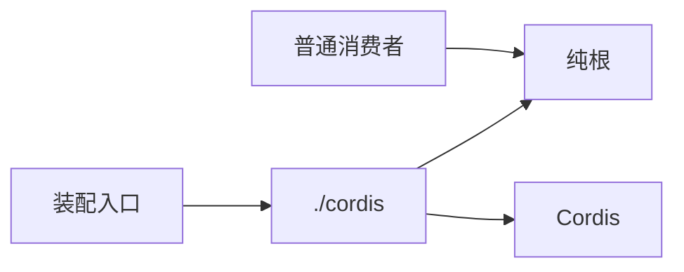

# Refactor 填写示例

**教学材料，非本仓库成果。**输入：示例 manifest 包的纯根引入绑定，改为纯根/cordis 分离，所有给定消费者已迁移。
六操作、Schema 身份与事务语义不变；源码/声明/装载/外部包消费对照已执行。
B0/F1 同规则下偏离 3→0，超阈值函数 2→2；没有中间快照，不知道曾引入后解决多少。
变异已执行但纯导入改动没有可变异目标，覆盖率 80/100；没有 BASE 覆盖数据，未改变运行主路径或性能，无卡/在线 demo。

---

manifest 的纯公开根现在只导出独立能力，Cordis 绑定由单独入口提供。给定消费者已改接对应入口，原混合入口删除。
六操作、Schema 身份及事务保证保持；复杂度没有下降。

## 关系与保持的承诺

消费者选择所需入口；绑定与纯根的职责分别可见。

## 对照与读数

B0/F1 使用同一规则与扫描范围；没有中间快照，不能报告全过程引入/解决数量。
教学输入未提供原生结构摘要、具体工具/约束版本和真实报告地址；实际交付仍须补齐，不由本表代替。

| 项 | BASE → HEAD / 结果 | 判断边界 |
|---|---|---|
| 静态偏离 | 3 → 0 | 是消除基线旧偏离，不是“新引入 3 后解决 3” |
| 超阈值函数 | 2 → 2 | 原 `read/commit` 保留，无新增；需审查维护成本 |
| 差分变异 | 已执行，0 个可变异目标 | 纯导入变化；不表示测试断言很强 |
| 行覆盖 | HEAD 80/100（80%） | 无 BASE 覆盖数据，不声称提高；未覆盖输入损坏路径 |
| 行为/入口 | 六操作与四层入口对照通过 | 不覆盖任意未列出的消费者 |
| Profile | 不适用 | 主运行路径未改变，未提出性能收益 |

没有在线 demo，给定外部包消费对照是验证替代；同一调用输入的结果、持久状态与外部效果保持。
输入未提供对照脚本或体验命令，不能据此声称已有可复跑入口。
请核对 `index.ts/cordis.ts` 的源码/声明闭包、消费者清单，以及复杂度是否只是转移到调用方。
静态变绿与未下降的复杂度都应连同真实对照判断，不能单独决定接受。
