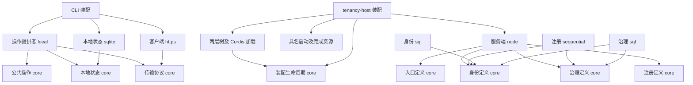

# 服务、包与依赖设计

## 定义与提供者

路径均相对仓库根。表中新增成员在各实现增量创建，D0 不发布空包。
包名为目录最后一段，作用域仍为 `@omne-harness-lite`。
所有根入口的源码、声明和运行装载闭包必须不含 Cordis。绑定只通过 `./cordis` 导出。

| 定义拥有者 | 提供者及改名 | 公开面与保留实现 |
|---|---|---|
| core/account-identity | tenancy/account-identity → account-identity-sql | 原 surface.ts 的账号/登录类型、presentation 解析和品牌边界进定义；SQL 表、迁移、快照、凭据票据实现留提供者 |
| 同上 | tenancy/credential-verification → credential-verification-scrypt | PresentedCredential、CredentialMaterial、VerifyResult、PolicyCheck、CredentialsService 进定义；scrypt 算法/参数和 password 策略实现留提供者纯根 |
| core/account-registration | tenancy/account-registration → account-registration-sequential | 原 types.ts 的终结、失败三分类、RegistrationService、RegistrationStopped 进定义；分步编排及签名实现留提供者 |
| 既有 core/organization-governance | tenancy/organization-governance-sql 不改名 | 复用四个服务定义和完整纯类型，修正事件名及残余具体账号依赖；原 SQL 算法不搬进 core |
| core/client-local-state | frontend/client-local-state → client-local-state-sqlite | 原 surface.ts 的状态/CAS/token/使用错误进定义；文件、SQLite、落盘、schema 生成和打开错误实现留提供者 |
| core/governance-client-operations | frontend/governance-client-operations → governance-client-operations-local | 原 surface.ts 的全部 action/use/报告、ClientUseUsageDefect 及 exitStatus 进定义；状态机、缓存、结算与呈现准备实现留提供者 |
| core/governance-center-entry | tenancy/governance-center-entry → governance-center-entry-node | EC 的路由 ID、中心身份形状/校验、事件、启动/维护资源形状进定义；TLS/Unix、路由执行、维护、迁移和快照留提供者 |
| core/governance-center-entry-https-json | frontend/governance-center-client → governance-center-client-https | 原协议结果/传输接口/配置错误进定义；Node HTTPS、报文成帧和发送实现留提供者；服务端同时消费协议定义 |
| core/assembly-lifecycle | 无第二份业务提供者 | 纯关闭协调器及具名槽位 Service，拥有完整用例结束前的资源保留与关闭结果 |
| core/cordis-plugin-tree | 无第二份可替换业务提供者 | 根拥有树协议、校验、合层纯函数；`./cordis` 是明确的加载机制。只供装配消费，不新增全局 Service 或任务调度器 |

定义来源按 IC-1，不按目录名字猜测。凭据校验是 AI3 的接缝，运维面仍属于 EC，
不另建 credential-verification 或 governance-center-ops 定义包。
插件树是 Cordis 装配机制，不定义组织、租户、Session 或新的业务对象。
它只有一个确定性合层语义与一个 Cordis 绑定，无独立可替换业务能力，故不造双包和空 Service。
有序收尾由 [assembly-lifecycle](retirement.md) 拥有，不能只靠各插件局部 close。

## 公共形状如何迁移

现有签名以 BASE 的以下文件为候选源，具体变更在本文明确列出。
所有未列明的字段、可选性、错误字面、同步/异步方式保持。

| 原文件 | 迁移/保留规则 |
|---|---|
| account-identity/src/surface.ts、presentation.ts | 服务操作与公共解析进 core；随机生成及数据库到领域映射留 SQL；键/Events 移到定义的 cordis.ts |
| credential-verification/src/index.ts 的公共类型 | 公共凭据形状进 core/account-identity；密码算法专用类型不成为所有凭据提供者必须实现的协议 |
| account-registration/src/types.ts | 纯类型全部迁移，REGISTRATION_SERVICE 只从定义的 `Registration.provide` 派生；源码过时 v1 注释改为有效 AR2 |
| core/organization-governance/src/types.ts | 原签名原样；事件属性名按后文映射；参与面边界不扩展 |
| client-local-state/src/surface.ts | ClientStateOpenFailure 属 SQLite 提供者打开过程，仍由其纯根导出；使用错误/token/结果归定义 |
| governance-client-operations/src/surface.ts、report.ts 的 exitStatus | 公共 action/use 与错误归定义；依赖的 LocalRecord 来自 core/client-local-state；只提取 exitStatus 纯映射，报告构造实现留提供者 |
| governance-center-client/src/config.ts、protocol.ts、governance.ts | PublicHealthOptions/CenterTrust/结果/配置错误进 HT 定义；Buffer、解码器、请求发送及生成校验消费留 HTTPS 提供者 |
| governance-center-entry/src/routing/route-ids.ts、center-id/table.ts、events.ts | 词汇、线上 ID 与事件归 EC 定义；SQL 表常量/迁移归提供者，不改已有表或线上 operation 字符串 |

新增传输操作类型 `GovernanceTransport` 恰有两方法：
`readPublicHealth(options: PublicHealthOptions): Promise<PublicHealthOutcome>`，
`exchangeGovernance(options: PublicHealthOptions, input: unknown): Promise<GovernanceOutcome>`。
它保留原单次请求、不重试、不保存信任、不记录凭据及 sendAttempted 语义。
调用方传入的 signal 是取消请求，Promise 完成才表示该调用已收场。

客户端纯工厂 `createGovernanceClient` 改为必需显式传入 `state` 和 `transport`。
`timeoutMs` 的范围和默认值保持。原内部观察时间函数保留为默认，不借此替换业务时钟政策。
取消直接 import HTTPS 工厂。独立使用者通过装配选择传输。

本地状态纯工厂 `openClientLocalState` 接受显式依赖 `storage: LocalStateStorageFactory`。
公共接口 `LocalStateStorageFactory.open(file: string): Promise<LocalStateStorage>`，
`LocalStateStorage extends AtomicStorage { close(): Promise<void> }`。
传入的 file 必须是本地状态提供者已核对的私有 SQLite 文件；工厂以 synchronous=full 打开，不跑中心迁移。
返回实例的独占关闭责任交给本次本地状态实例。调用方负责工厂自身，不能代关已交出实例。
接口归 CLS，因为这是 CLS 的落盘需求，不把 SQLite 文件能力强加给最小 StorageService。
CLI 装配桥接 storage-sql.openStorage。纯提供者不再 import storage-sql。

## 正式 Service 与依赖

下表类全为定义包 `./cordis` 的抽象 Service，implements 同包根操作接口。
类用原接口的索引类型表达方法，避免签名两份。唯一键在 static provide，常量派生于它。
提供者子类只委托同一纯实现。方法内不缓存 Cordis 调用方代理作为持久业务身份。

| 定义类／键 | 提供者必需 inject | 可选依赖／寿命 |
|---|---|---|
| Accounts/accounts、Logins/logins | storage、clock | credentials 逐调用 resolveOptional；缺席沿 AI3 storage-unavailable，不转成凭据不合规 |
| Credentials/credentials | 无 | scrypt 已启动任务不可假取消，原调用保有结果 |
| Registration/registration | accounts、organizations、organizationPurge | 无；三面捕获同一代，逐步检查存活，不把新依赖接入旧调用 |
| 既有 Organizations、Offers、Memberships、OrganizationPurge | storage、clock、accounts、logins | 原四面同一 fiber，同一 SQL runtime；不拆出彼此独立换代的状态 |
| ClientLocalStateService/clientLocalState | clientStateStorage | 关闭准入→等待 CAS/文件工作→关本次存储和目录句柄 |
| ClientStateStorage/clientStateStorage | 无（CLI 装配提供） | 工厂关闭不剥夺已交给 CLS 的实例；应用逆序等待 CLS 后撤此桥 |
| GovernanceTransportService/governanceTransport | 无 | 传输实例停止新请求并等已有请求完成；请求取消沿原 signal；不自动重发 |
| GovernanceClientOperationsService/governanceClientOperations | clientLocalState、governanceTransport | 提供者撤除执行原 close，等待 input/use/network/CAS 真收场 |
| GovernanceClientCloseObserver/governanceClientCloseObserver | 仅 managed CG 必需，应用按行提供 | 分配前接管原关闭尝试；原拒绝不许可撤CLS，详见[CLI生命周期](cli-lifecycle.md) |
| AssemblyLifetimeService/assemblyLifetime | 装配按行提供 | 精确实现根 AssemblyLifetimePort，仅 isCurrent/register；逐行隔离此键；实际资源只由协调器按逆序关闭 |
| StorageStartup/storageStartup、StorageCompletion/storageCompletion | 宿主装配提供 | 形状归 core/storage，细节见装配协议 |
| EntryOpening/entryOpening、EntryMaintenance/entryMaintenance | 宿主装配提供 | 形状归 core/governance-center-entry，细节见装配协议 |

账号与登录同一插件内建立两个 Service；其余同一实现多面也沿原事务/换代边界建在同一 fiber。
公共类标 `@contract`，资源形状没有单独能力契约时标 `@owner`。
业务写入、已提交结果和外部调用不是调用方登记效应；不能用 ctx.effect 撤除数据库业务。
本批没有业务注册表新增 register 操作。监听与绑定资源仍归实际安装 fiber。

入口客户端面必需依赖 storage、clock、credentials、accounts、logins、registration、organizations、offers、memberships、entryOpening。
入口的 credentials 原本是必需依赖，与账号服务逐调用现取的可选依赖分别保持。
运维面只依赖 storage、clock、entryMaintenance、entryOpening，不依赖治理能力。
两个网络面共享同一开放资格，事件监听撤除不解除直接准入检查；原运维隔离检查必须继续抓到反例。
运行资源服务为每个宿主实例私有，装配不得跨 Context 共用可变 guard、开门信号或完成回调。

## 事件改名

载荷、派发模式及通知时点保持，只有名称和声明位置改变。不存在旧名别名或双发。
Events 增补在唯一 core `./cordis`；纯根只放不含 Cordis 的载荷类型。

| 原名 | 新名 |
|---|---|
| account.activated | account-identity/account-activated |
| login.revoked | account-identity/login-revoked |
| account.expired | account-identity/account-expired |
| invitation.issued | organization-governance/invitation-issued |
| membership.changed | organization-governance/membership-changed |
| role.changed | organization-governance/role-changed |
| affiliation.dissolved | organization-governance/affiliation-dissolved |
| organization.purged | organization-governance/organization-purged |
| governance-center-entry/serving | governance-center-entry/serving-started |
| governance-center-entry/stopped | governance-center-entry/serving-stopped |
| governance-center-entry/defect | governance-center-entry/defect-observed |
| governance-center-ops/listening | governance-center-entry/ops-listening-started |

原事件常量的实际值须由源码核对，再按上表业务身份迁移；不得依注释误改值。
所有事件写 @mode 和 @param。提交后通知失败只记录诊断，不改提交结果。
emit 不接受返回 Promise 的监听者。不存在通过更换派发方式改变同步顺序的授权。

## 目标关系及代价

箭头是主要允许源码依赖，不表示已经实现，也不穷举全部边。
树按宿主提供的引用动态装载插件，不从 core 源码导入具体服务端。业务消费者不选择具体提供者。
同提交参与沿既有 StorageUnit 与账号/登录接口完成，不新增直接 import SQL 提供者的例外。
原其他领域的精确事务内读函数例外只按原共同存储对象维持，不推广为基础设施任意导入。

成本是更多定义成员和显式工厂参数。收益须由实际替换与独立打包消费证明。
不采用“原包根留兼容别名”或“把整个提供者搬进 core”，前者违反阶段政策，后者保留实现耦合。
若一个新增资源面只转交单个宿主数据，它仍需明确所有权，不能为了包数减少塞回 JSON 配置。
若未来跨进程，StorageUnit/opaque ticket/Service 调用方/本地完成 Promise 均需新的协议兑现。
本次没有分布式原子性、跨进程凭据票据或网络隔离授权承诺。
