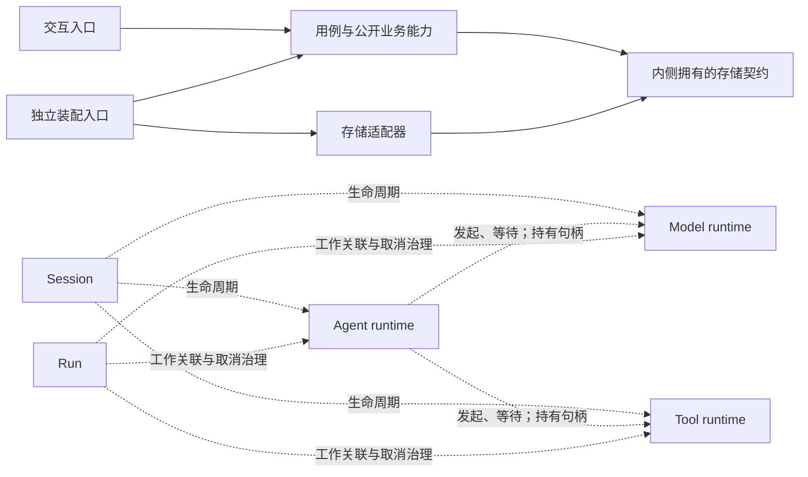

# 系统责任与关系预期

负责人 panqiwei 在当前架构视图会话认可以下责任方向，随后授权 N3。
[接受依据](../record/decisions/system-architecture-intent/decision.md)记录范围；本页是现行全局预期正文。
板块不是产品 topic、包、插件或部署单元的一对一映射。具体源码责任未确认时保留未知。

## 责任方向

| 板块 | 责任 | 产品依据 |
|---|---|---|
| 身份与组织租户 | 自然人身份、登录、成员与组织关系、角色和租户归属 | PF-001 |
| 工作区 | 资源聚合身份、地址、实例、参与与共享；与会话独立存活 | PF-020；PF-002/015 消费 |
| 会话与输入受理 | 长期协作身份、模式、context 注册、执行归属、入站受理、队列与控制指令 | PF-015/014 |
| 资产治理与求值 | 资产定义、组合、采用、配置、复制与分享；按类别展开 | PF-001/002/003 |
| Agent 装配与运行 | 装配、Loop/extensions、Run/尝试推进、恢复与结果承接 | PF-004/012；PF-007 对应入口 |
| 模型调用 | 模型档案、合法目标、模态、单次请求、收场与费用事实 | PF-013；PF-009/010 |
| 工具执行 | 调用快照、执行、等待、取消、结果与外部效果 | PF-006；PF-012 |
| 执行环境与隔离 | 宿主、沙箱、设施、资源作用域与执行落点 | PF-005 |
| 消息与上下文 | 消息及内容块、用户与模型视图、组装与压缩 | PF-009/010；推进记录归 PF-012 |
| 准入与人机决策 | 放行依据、授权与撤回、决策卡片、答复与等待 | PF-001/002/007/008；模式归 PF-015 |

产品正文仍由 [product](../product/README.md) 拥有；本表只规定全局责任聚合方向。
模型档案和知识/文件不加入组装资产目录。Skill 数据不因此获得 runtime。
Connector 保持搁置，Engram 保持占位。PF-007 的入口消费对应能力，不能集中拥有全部业务规则。
PF-011 非常态处置与 PF-000 记录性质跨板块采用，各自事实仍由原责任方拥有。

## 关系与生命周期

图中源码依赖、运行调用与生命周期关系分开。图不证明运行保证已实现。
三类 runtime 在 harness 装配下归 Session 生命周期，Agent runtime 不拥有模型/工具执行的生命。
SYS-OPEN 的独立公开函数仍无需 Session、runtime、租户或存储；harness 消费者承担运行时保证。
工作区共享、执行隔离与业务授权各自成立；目录、实例和注入可见性不授予参与权。
正式切分须核对跨拥有者同提交、重复事实拥有者与反复同步修改。

## 分层约束

领域责任与层次是两个维度。按具体入口的责任确定层次，不按目录名称生成业务分层。
交互入口通过用例或公开业务能力访问业务数据，不直接使用通用业务存储契约或具体存储实现。
用例与领域策略依赖其公开契约，不依赖交互、SQL/ORM、具体存储或框架装配实现。
存储适配器实现内侧拥有的契约；数据库与框架专属表示不泄漏到业务契约。
源码依赖指向策略，运行时经注入调用实现。明确的独立装配入口可以选择提供者。
一个成员可以混合责任，须细到源码入口；apps 目录没有通用分层豁免。

前端本地偏好与缓存的存储范围待负责人裁定。混合装配/业务文件不得自动当作纯装配入口。
IC-5 的精确符号同提交例外继续从原有效节点声明读取，不在这里复制。
已接受例外与分层要求冲突时显示待裁定，不静默撤销或扩张例外。
不强制三层、四层或面向对象类层级，不增加空转发层。

## 证据与逐步采用

[constraints.json](constraints.json) 是本区机读约束和入口定位的唯一源。
adopted 表示本批采用的检查定位；candidate 是推断；unknown 是待裁定。
采用的精确定位须引用已接受的产品/节点责任，不将所有源码映射宣布为负责人亲自确认。
存储适配器与端口的定位只采用 D-023/D-026/D-028 已接受的实现责任。
原 core/storage 协议未获独立契约接受；本批定位不提升它的语义接受或验证状态。
规则格式与机械检查范围归执行仓库的 `tools/ts-checks/src/arch/CONFORMANCE.md`。
新增偏离对照 BASE 的预期；本次预期变更单列，改代码同时放宽预期不能消掉偏离。
存量与未知保留。四条 clean loop 硬线保持，架构符合性只报告。

SOLID 用于边界审阅，不生成总分。SRP 查变化责任，OCP 查真实替换与消费者差分，
ISP 查实际消费，LSP 查失败、生命周期、租户等行为承诺，DIP 在明确责任上查源码依赖。
类型相同和静态图都不证明行为可替换；缺测试或运行证据显示未验证。
参考 [Martin 研究](../../research/clean-code-doctrine-current/research.md) C-9/C-10。
IC-17 的会话作用域机制、插件树加载器和全库 IC 迁移仍待实施。
