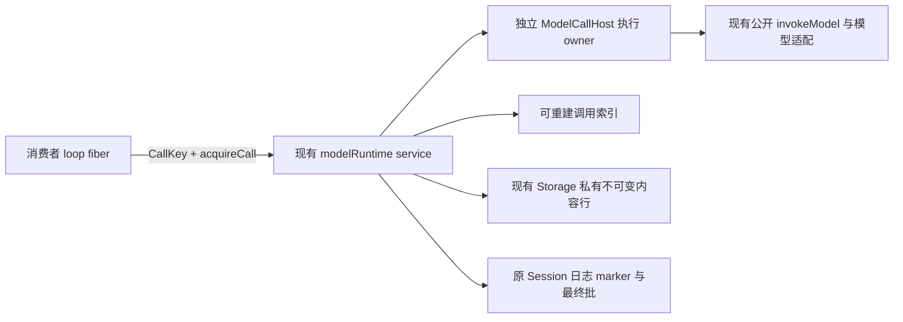

# PF-013 · 模型调用引用与独立消费者技术投影 v5

当前技术采用范围与排除见本页“当前采用范围”；不据此宣称实现或验证完成。

## 1. 目标和严格边界

Session/Run 或其他消费者保存可序列化 CallKey，经既有 modelRuntime service 查回原执行及耐久结果。真实执行 owner 与观察/等待消费者分离，消费者释放、loop fiber结束或换Run不取消原执行。结果归原调用与原费用归属，不因新消费者转移。完整 Session、Run、Agent Runtime、通用 registry/内容平台和未来媒体输出能力均不在本增量。

唯一规范为 [RT11](../../../../spec/capabilities/model-request-runtime/v11/contract.md)、[MR10](../../../../spec/data/model-response/v10/contract.md)、[MS7](../../../../spec/data/messages/v7/contract.md)、[CA3](../../../../spec/data/call-accounts/v3/contract.md)，四者在本快照均为 candidate。SL3 保持原接受；已有公开独立 invokeModel 不依赖 Session/Run 或 Cordis 才能使用。

## 2. Cordis 与数据投影

图中索引和内容行是现有 runtime 的内部构件，不新增 service/plugin/fiber。CallKey 是值而非权限或运行对象；真实受信准入协议负责当前 read/wait/settle/cancel 的资格与撤权次序。模型执行资源由现有 host/container保有；只有真正owner关闭才取消排空，Cordis多个effect的清理次序不冒充业务保证。

| 需求及条款 | 已审提供者映射 | 本次责任与限制 |
|---|---|---|
| RT11 S84–94：创建、ref、独立消费、失联与当前性 | [runtime v20 revision2](../../../../realization/packages/model/model-request-runtime/v20-reference-lifecycle-design.md) | 现service/store/host扩展；十四操作；无完整Session/Run |
| MS7 S9/S51–55：创建内容、marker、首次合法消息关系 | [messages v7](../../../../realization/packages/core/messages/v7-design.md) | 纯值模块，无写权/存储；技术marker不进上下文 |
| MR10 S39/S46–48：原pending与final关系 | [model-response v10](../../../../realization/packages/core/model-response/v10-reference-result-design.md) | 完整原reply/calibration不改；消息派生不回写模型证据 |
| CA3 S40–42：ready/final的唯一费用选择 | [call-accounts v3](../../../../realization/packages/core/call-accounts/v3-design.md) | 纯sum保持；外部reader按原Session/ResponseId选择一次再计费 |
| MS7精确MP6快照资源依赖 | [model-profile资源增补](../../../../realization/packages/core/model-profile/v6-schema-resource-design.md) | root/Schema继续MP5，仅补schema/v6；两Schema断言同形，MP6 token准入仍RT负责 |

四个core节点均为纯模块；runtime仍是现有Cordis服务提供者。全部节点新增bindings为0，已审设计不等于这些包已经实现增量。

## 3. 发布、取回与提前结束

openCall先按显式creationKey判重，原不可变内容耐久确认后才在原日志发布created；dispatch仍独立核当前工作资格与发送门。有reply的完整结果先发布ready，complete/interrupted与尚未处分分别表达；无人消费也保留，不伪造consumed。final与唯一合法Assistant消息仍由原授权写方同批提交，acquire不授予persisted写权，settleReply仍仅接受非persisted处分。

interrupt保持纯控制命令；dispatch/acquire交付runtime原装配的完整事实，不要求消费者从delta重造结果。用户取消、网络/协议/超时及真实owner卸载沿原reply/delivered区别保留已产生且应保留部分；无内容不造回复，已知usage/cost保留、未知不填零。没有逐token持久保证，hardkill前尚未耐久的增量不能假称可恢复。

内容使用既有Storage私有不可变原bytes行，先确认内容再追加现JSONL marker；本次无独立delete/GC，内容与有效引用及尚可能发布writer同存续，关闭、unknown、孤儿不删除。日志仍为执行事实唯一权威，不要求跨Storage/JSONL事务。真实外引用缺可核保留协议只使相关路径unavailable；未来独立回收才须重新兑现共享保留与发布互斥。

正常acquire不发出、恢复或重试。Map缺席不等于lost；只有真实停止与唯一恢复依据才进入追补。按键索引不自证当前：generation来自受信来源绑定，进度对照SL3 readByKey返回tail，过期/重建明确unavailable。opened原执行事实用完整前缀及unfenced+tailEquals，新dispatch仍fenced。

## 4. 十四操作及共同接口

原legalTargets、displayList、effectiveModel、selectModel、openCall、dispatch、dispatchAgain、interrupt、releaseCall、reconcile、readAttempts、settleReply、canDispatchAgain按RT11各自九项及S92迁移；新增acquireCall的九项唯一见S89。ref复接不授予原工作重试/取消/消息写权，不用旧身份重造调用或费用。

CallKey/CreationKey/PayloadRef的唯一值家在MS7，Pending/final在MR10。core分别提供消息关系与原响应关系的纯判断，runtime组合真实来源与准入；接口精确签名以五节点为准。本快照不另发一份DTO。

当前八家官方供给text输出及现text/thinking/tool_call路径继续H19原值回放，不新增replyDerivations或transport v16前置。原来源/摘要已知矛盾仍invalidInput，合法派生缺真实来源或实际选择支持则unavailable；不能full绕过真实性。真正媒体派生与request-local图片准备各沿其独立设计，不在本页采用它们。

## 5. 评审、证据与采用门

契约第二轮评审和最终节点定点复评均无阻断；后者受审语义提交97f04eed，4a49adc1仅归档及残句同步。具体方案与代价见r5。不把产品接受或review结论当技术采用决定。

首轮证据与第二轮证据保留有限TLA正负配置及70项Schema案例、执行输入与局限；无GC条件修订未改模型/Schema字节，但旧有限结果不代证SQL+JSONL、真实授权或物理停止。

实施前仍由主线精确接受四契约和五节点并传播登记；源码/制品与双语README随后同批迁移。验收按runtime R20-V1–V23及四core节点义务执行，包含真实unknown/冷读/关闭/撤权/来源换代/有界读取及完整制品资源图。生产访问/Run来源、实际外引用或媒体派生provider缺席仅限制对应路径，不前置完整Session/Run。

本页不修改registry接受状态、冻结旧版本、D110决定或产品正文。候选来源在主线接收后若实质改变，应生成后继快照，不原地把本页称为已接受。

## 当前采用范围

RT11/MR10/MS7/CA3 引用生命周期增量：CallKey 查回、独立消费者、原执行 owner、不可变私有内容与原日志 marker、原完整 Pending/final 关系及费用唯一选择。

技术采用不表示实现或实际验证已完成。验证义务：各节点当前关联验证义务；runtime R20-V1..R20-V23；SQL/JSONL 分域、unknown 留责、真实停止与来源当前性；正式包制品与全部受影响消费者。
范围之外：ACK 之后永久保管/noGC：已被 ACK 后继取代；完整 Session/Run/Agent/通用 registry 或内容平台。
