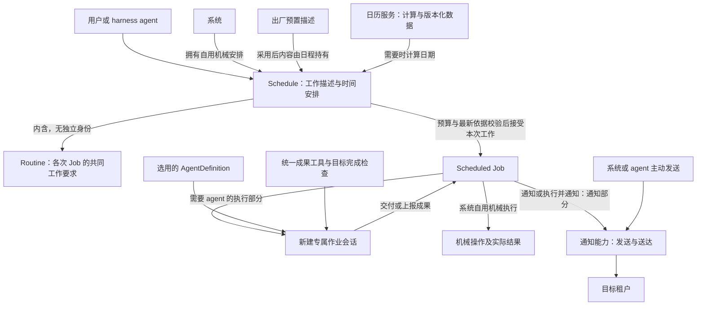

# PF-021：日程与日历

- 修订：rev 8，2026-09-28 · [变更历史](changelog.md)
- 状态：产品设计已正式接受；技术设计、规格、实现与运行验证另行交付。

## 一、背景与问题

agent 要持续推进一个项目、定期回顾进度或在未来交付工作，需要把安排留下来，
并在约定时间再次开展工作。用户也需要自己创建和管理这些安排，而不必每次通过 agent 转述。
一次对话里的交代、当次 Run 的结束和长期目标达成都不能替代这些跨时间的事实。

与此同时，“每月最后一个中国工作日”依赖真实的调休与假日数据。
只有时间规则而没有可持续更新的日历，长期安排就会在数据覆盖耗尽时失去计算依据。
日历供应和日程执行各有责任：前者持续提供可追溯的计算依据，后者决定什么工作何时发生。

没有这项能力，agent 只能依赖用户再次唤起，用户也无法直接管理未来安排；
没有清楚的内容、安排与单次工作分工，则无法解释“规则还有效，但这一次工作没有完成”。

通知与执行同等重要。系统和 agent 都需要把通知送达到对应租户；定时通知只是其中一种来源，
没有日程或 Job 时，也应能发送通知。完成了工作但没有送达要求的通知，不能宣称两项责任都已履行。

## 二、目标与非目标

### 目标

- 为 harness agent 提供可插拔的日程能力，也允许用户手动创建和管理。
- 用同一组概念表达短、中、长期工作，以及线性与非线性时间安排。
- 支持执行、通知、执行并通知三种工作类型，区分执行结果与通知结果。
- 为每次需要 agent 的定时执行建立专属新会话，以统一成果工具和目标完成检查承接 Job。
- 将日历作为独立产品应用交付，提供首批国家数据、离线冷启动与持续更新。

### 系统必须具备的三项能力

| 产品能力 | 系统必须能够做什么 | 使用者与边界 |
|---|---|---|
| 日历配置、管理、切换与更新维护 | 管理可用日历及其配置，选择和切换计算所用日历，持续供应与维护数据并提供计算 | 日历应用、获授权的管理者及计算消费者承担不同职责；不默认全部开放给每个 agent |
| 日程创建、管理、调度与动作触发 | 管理包含 Routine 的 Schedule，计算到期工作，产生 Job 并触发执行、通知或两者 | 系统拥有并管理自用机械日程，也为租户提供出厂 Routine；agent 和用户可管理租户安排，系统承担持续调度与触发 |
| 通知发送与租户送达 | 接受系统和 agent 发出的通知，将其送达到明确的目标租户，并呈现真实交付结果 | 系统和 agent 都是使用者；日程是通知来源之一，发送权限与接收范围需明确 |

三项能力都必须交付；不同使用者持有的操作权限可以不同。这是产品责任划分，
插件、服务数量与部署位置由后续架构决定。agent 工具只是能力的一种使用入口。

### 非目标

| 不在这里确定什么 | 边界 |
|---|---|
| 独立 Routine 管理与跨日程共享更新 | 工作内容随所属 Schedule 管理，不提供独立 Routine ID、CRUD 或共享可变对象 |
| 独立组织治理、跨租户授权体系或日程专用审批流 | 沿既有身份、设置和工具授权规则，仅补本能力操作的授权接入 |
| 出厂预置安装启用与升级管理 | 只保留发现和采用描述的入口，具体预置产品尚无需求，不展开批量升级或版本兼容 |
| 日程时区动态跟随与额外配置继承层 | 安排明确其计算时区；不因环境变化隐式改写日程，不为日历增加配置优先级体系 |
| 业务重试、补偿及积压优化体系 | 补跑、重叠及通知按 Schedule 声明；不因此扩展为自动重试已终止 Job、补偿工作流、跨日程优先级或资源调优系统 |
| Job 专用会话主子关系、归档及日历应用通用运维流程 | 会话沿 PF-015；部署、进程重启和升级机制由后续应用设计承担，本包保留数据供应、查询和故障可见责任 |
| 工具的协议与精确参数 Schema | 产品动作与输入输出含义归本包，协议和数据契约归后续规格 |
| 特定 AgentDefinition 才能执行 Job | 作业会话可选用不同 AgentDefinition，统一要求由会话保证 |
| 在同一会话中承接多个定时任务 | 每个需要 agent 执行的 Job 都新建专属会话；系统自用机械操作不创建会话 |
| 把“非线性”解释为事件条件、任务 DAG 或结果驱动的自适应规则 | 当前含义是确定性的复杂时间计算；agent 调整安排与时间规则本身分开 |
| 把每个长期目标登记成新对象，或把本能力直接当作完整目标管理系统 | 日程是推进目标的原子能力之一，跨会话目标对象尚未定义 |
| 第三方个人日历同步、会议邀请、用户编辑法定日历 | 不在本轮沿用的日历基线内 |
| 协议、存储、进程划分、字段格式、插件数量与具体 hook 绑定 | 归后续架构与规格；独立产品应用不等于异地部署 |

## 三、用户与场景

| 使用者 | 场景 | 需要知道什么 |
|---|---|---|
| harness agent | 管理未来安排，也可主动向目标租户发送通知 | 安排表达什么、目标租户与发送权限、执行和交付结果 |
| 系统 | 管理自用机械日程，提供出厂 Routine，持续调度并触发动作及通知 | 系统自用与租户安排的归属可区分，执行与通知结果可追溯 |
| 用户 | 手动安排一次工作或通知，查看与管理已有安排 | 何时发生、做什么，以及这一次实际怎样了 |
| 作业会话中的 agent | 被装配来完成一个 Job | 本次目标、统一成果工具、完成判据及未完成的反馈 |
| 日历应用的部署维护者及获授权管理者 | 配置、管理、选择切换、初装与更新维护 | 哪些日历可用、覆盖与出处、新版本和失败事实 |
| 日历的程序消费者 | 查询某日性质、计算工作日或解析安排所需日期 | 使用了哪份日历与版本，是否超出覆盖 |

## 四、概念定义

精确定义归下列统一语言词条；本节说明其产品属性、关系及边界。

### 日程能力

沿 [Scheduling Capability](../../ubiquitous_language/terms/capabilities-and-composition.md#ul-scheduling-capability--日程能力--scheduling-capability)。
这是系统可用于自身机械工作、agent 可装配、用户可管理的一项能力。短、中、长期表示它所支持的跨度，
不据此建立三种身份或三套执行生命周期。装卸与在途工作衔接归技术设计交接；能力不可用时不能丢失已发生事实或冒充工作完成。
日程承担创建、管理、调度及动作触发；需要通知时使用通知能力承接发送与送达。

### 通知能力

沿 [Notification Capability](../../ubiquitous_language/terms/capabilities-and-composition.md#ul-notification-capability--通知能力--notification-capability)。
系统和 agent 都能发送通知，通知能力负责将其送达到明确的目标租户。
它可供日程触发，也可用于没有 Schedule 或 Job 的即时通知；不要求为一次通知创建作业会话。
发送、送达和用户已读是不同事实，发起成功不能冒充送达。

目标租户沿 [PF-001 的租户定义](../PF-001-identity-scope-and-agent-constraints/design.md#租户)。
同一账号在不同组织下的通知目的地不能混同；发送方身份与目标租户分别明确，跨租户默认拒绝。
本能力的存在不授予 agent 任意向其他租户发送的权限；授权沿 §6.1，应用内送达判据沿 §6.5。

### 工作例程

沿 [Routine](../../ubiquitous_language/terms/capabilities-and-composition.md#ul-routine--工作例程--routine)。
每份 Schedule 内含一份 Routine，描述这份日程的各次 Job 共用的工作定义。
“共用”指工作要求相同，不表示 Job 共同修改一份进度、上下文或成果。

| 内容 | 产品含义 |
|---|---|
| 工作类型 | 执行、通知、执行并通知 |
| 工作要求与目标 | 系统自用日程描述机械操作；租户日程描述 agent 要完成的工作 |
| 通知要求 | 包含通知时明确目标租户；纯通知给出已定义内容，执行并通知声明触发事件及对应内容要求，见 §6.13 |

Routine 没有独立身份、归属或生命周期，随 Schedule 一起创建、读取和修改。
工作类型和目标是安排的共同定义，各次 Job 的实际输入、进度、成果与通知结果分别属于各自。
Routine 不包含日程的日期与重复规则；通知的执行事件要求属于其工作描述。一次性安排和重复安排都采用相同的包含关系。

出厂 Routine 是系统提供、供创建日程时采用的预置描述。采用后，实际内容由该 Schedule 持有，
不形成指向出厂原件或其他日程的可变共享引用；修改自己的日程不修改预置或别人的安排。
预置来源可以追溯，来源可定位不等于 Runtime 中存在一个可独立管理的 Routine 对象。
本包不将预置判为 PF-002 的 official 资产，也不另建模板／实例生命周期。

### 日程

沿 [Schedule](../../ubiquitous_language/terms/execution-and-outcome.md#ul-schedule--日程--schedule)。
每份 Schedule 同时包含工作描述与时间安排，是创建、修改和管理的单位。

| 属性 | 产品含义与当前边界 |
|---|---|
| Routine | 本日程持有的工作类型、目标与适用通知要求，不是另一个对象的 ID |
| 时间表达 | 一次性时刻，或线性／非线性的确定性重复规则；显式日期处理选择与排除日期见 §6.2 |
| 时间边界 | 规则所需的开始、截止、次数及显式例外；日期解释与计数政策见 §6.11 |
| 时区依据 | 计算本地时间使用的明确时区；不随使用者环境变化隐式切换 |
| 日历依据 | 需要工作日或假日知识时使用日历服务；日历身份在安排中明确；未形成 Job 的工作在调派前按最新已发布依据重算校验，既有 Job 保持依据不变 |
| 补跑声明 | 是否补跑；启用时声明当前时刻前最近最多补多少次漏过工作，见 §6.11 |
| 重叠声明 | 跳过本次、停掉先前工作后执行、独立并行或等待执行，见 §6.12 |
| 执行承接 | 系统自用日程采用机械操作；租户日程明确所选 AgentDefinition 已发布版本、会话运行模式及可选工作区／工作资料；装配沿 PF-004，见 §6.10 |
| 归属与管理 | 系统自用日程归系统；租户日程归明确租户，包含采用出厂预置的日程；管理权限不由内容来源推定 |

Schedule 有可区别的身份，不以“下一次发生时间”代替身份；其内部 Routine 不另有身份。
用户或 agent 一次创建完整安排，一次修改其工作描述、时间或两者，修改范围是这份 Schedule。
对已保存安排的修改不传播到其他 Schedule，也不回写历史 Job 实际采用的内容。
Job 产生时确定本次工作要求、策略与日期依据；Schedule 或日历后续变化只影响尚未形成 Job 的工作，已产生但未开始的 Job 也不被改写。
不可回写的是本次采用内容与已经发生的事实；进度、成果、通知和停止仍按规则推进并留下新事实。
完整且获授权的创建成功即启用；暂停、恢复和结束的规则见 §6.10 与 [工具与命令](tools.md)。
需要 agent 执行时只允许每次新建会话，不提供复用选项。

### 系统日程与出厂内容

沿 [System Schedule](../../ubiquitous_language/terms/execution-and-outcome.md#ul-system-schedule--系统日程--system-schedule)。
系统承担持续调度，也使用日程能力。系统提供的安排需要区分两类：

| 类别 | 日程归属 | 执行边界 |
|---|---|---|
| 系统自用日程 | 系统自身；不归特定账号、组织或租户 | 只触发预先定义、无需模型推理或 Agent Loop 的机械操作，例如自动更新检查；不创建作业会话 |
| 采用系统出厂 Routine 的租户日程 | 明确的租户 | 可由 agent 执行；执行、通知、执行并通知及专属新会话规则沿租户日程模型 |

“出厂提供”描述内容来源，“归租户”描述一份实际安排的归属，两者可以同时成立。
系统日程沿用 Schedule 的身份与生命周期模型，特殊处在于系统归属和机械执行限制。
它不借用管理员个人租户，也不通过建立特殊账号、组织或租户表示系统归属。
某个管理者离职、切换组织或其租户失效，不因曾管理这份日程而改变系统日程归属或使其消失。
管理来路与归属分别可辨。系统自行维护其机械安排；部署侧可通过相应机械功能明确提供的配置管理它，不向普通租户工具开放系统日程写入。

系统自用 Schedule 内的 Routine 随安排归系统，其到期 Job 同样不依赖某个人的租户归属；
Job 的归属随来源 Schedule，出厂 Routine 所形成的租户日程及其 Job 则归该租户。
系统归属不自动授予读取租户私有数据或向任意租户发通知的权限。
机械操作若包含通知，仍由通知能力送达明确目标租户；接收方不会因此成为系统日程的所有者。

出厂 Routine 在这里仅确定存在及供租户采用的概念，不确定具体清单、工作内容、默认频率、
自动创建或启用政策及后续升级采用方式。采用后的内容可随 Schedule 编辑，出厂变化不自动改写已有安排；
不引入另一套模板／实例身份模型。
普通租户日程不能仅靠改标归属就获得系统机械操作的权限；跨归属转换不在本轮承诺内。

### 定时作业

沿 [Scheduled Job](../../ubiquitous_language/terms/execution-and-outcome.md#ul-scheduled-job--定时作业--scheduled-job)。
一份重复 Schedule 可对应多次 Job；某一次工作有自己的来源、工作类型及处置结果。

| Job 工作类型 | 承担的工作 | 作业会话 |
|---|---|---|
| 执行 | 履行执行工作；本类型不附带用户通知义务 | 租户的 agent 执行新建专属会话；系统自用机械执行不创建 |
| 通知 | 向目标租户交付已定义的通知 | 不创建 |
| 执行并通知 | 同一个 Job 同时承担执行工作与目标租户的通知 | 需要 agent 的执行部分新建专属会话；机械执行与通知不另建会话 |

执行并通知不拆成两个到期 Job；执行结果与通知结果分别可辨。
组合 Job 只有执行目标达成，且按本次通知声明实际触发的通知全部送达，才能整体成功；未命中的通知事件明确不适用，见 §6.13。
Job 能说明它来自哪份日程及哪个到期时刻，精确身份与重复处理判定留给后续规格。
预算或预览中的未来时刻不是已经创建的 Job；最终校验并接受为本次工作后才形成 Job，等待执行的 Job 已是事实。

需要 agent 执行的 Job 在开始承接时关联为它新建的专属会话，不要求以某个 Run 作为直接业务关联单位。
尚未建好会话时不能声称执行已开始。纯通知 Job 直接承接通知，不创建 agent 工作会话。
系统自用的机械执行也不创建会话，直接记录该次操作的实际结果；不能把操作触发成功等同于操作完成。
历史工作实际使用的内容、时间依据与结果应能追溯，后来的定义修改不能改写已发生的事实。

Job 完成、失败、停止和中断后的基本处置见 §6.10；本版保留日程、Job 与交付结果的业务历史供获授权者查询，不因结束或停止安排而清除。
删除清理能力不在当前工具面中，不为其另开归档与自动清理策略设计。
关联来源日程或执行会话不表示它随关联方消失。

### 作业会话

沿 [Job Session](../../ubiquitous_language/terms/agent-runtime-loop.md#ul-job-session--作业会话--job-session)。
它专属承接一个需要 agent 执行的租户 Job，使用既有会话身份与生命周期；每次 agent 定时执行都创建新的会话。
系统自用机械 Job 不适用作业会话、统一成果工具和 Loop 目标检查要求。
作业会话继承 PF-015 的会话规则，不另建 Job 专用归档生命周期。

它的特殊要求是两项：

1. 无论选用哪份 AgentDefinition，装配时都附加向关联 Job 提交或上报成果的统一工具。
2. Agent Loop 有检查 Job 目标完成情况的定制，防止目标未完成却正常宣布工作完成。

这是会话的执行子类型，不是新的 AgentDefinition，也不表示派发关系中的“子会话”。
PF-015 的 `coding`、`research` 等是用途分类；用途与 Job 承接要求回答不同问题。
主子关系沿 PF-015 的实际创建关系判断；定时触发本身不建立父会话关系。

### 两种定时动作

沿 [定时执行](../../ubiquitous_language/terms/execution-and-outcome.md#ul-scheduled-execution--定时执行--scheduled-execution)
与 [定时通知](../../ubiquitous_language/terms/execution-and-outcome.md#ul-scheduled-notification--定时通知--scheduled-notification)。
前者依日程归属触发系统机械操作，或让 agent 在租户的专属会话中完成工作；
后者经通知能力向目标租户发送通知。
这两种动作可组合为同一 Job 的执行并通知工作。工作类型是执行、通知、执行并通知；
组合类型按本次声明承担通知义务，通知时机与内容见 §6.13，送达边界见 §6.5。

### 日历服务

沿 [Calendar Service](../../ubiquitous_language/terms/capabilities-and-composition.md#ul-calendar-service--日历服务--calendar-service)。
它是独立产品应用，支持日历配置、管理、选择切换与更新维护，持续供应数据并提供查询与计算。
选择或切换日历后，消费者能明确当前所用日历；Schedule 保存明确的日历选择，不因消费者切换环境而改指另一份；同一日历新版用于尚未形成 Job 的工作，调派前重新校验。
日历管理不等于编辑法定事实；供应数据的维护与消费者采用哪份日历分别表达。
独立产品边界不规定部署位置，首版可以与 harness 同地部署。
日程把它作为“计算器”，不把国家数据抓取、校验和版本发布并入日程工作。
日历供应维护沿部署侧既有管理边界，租户只按授权配置消费者选择；通用部署与停启升级机制归后续应用设计。所需计算依据不可用时明确受阻，不猜日期；恢复后错过时刻按该 Schedule 的补跑声明处理。

### 业务日历与版本

沿 [Business Calendar](../../ubiquitous_language/terms/record-and-context.md#ul-business-calendar--业务日历--business-calendar)
与 [Business Calendar Version](../../ubiquitous_language/terms/record-and-context.md#ul-business-calendar-version--业务日历版本--business-calendar-version)。
业务日历有可指认的身份和明确适用范围，可由多个来源供应；一国可以有不同日历。
每次发布的数据版本不可变，带覆盖日期、信息截至时点和权威出处。
新版本发布不改写旧版本；本版不自动清理已发布版本，保留历史依据可复核。日历下架与自动清理策略不在当前管理动作中。

## 五、模型

Schedule 包含工作描述和时间安排，Job 表达其中某一次实际工作；Routine 的职责可单独理解，但不另立身份。
一个 Job 的成果不能冒充整个长期目标已达成；短中长期不会改变这条区分。
线性／非线性属于时间表达，一次性／重复属于发生方式，执行／通知属于动作，两者组合形成执行、通知、执行并通知三种工作类型。
它们不各自产生一套互不相通的管理模型。

## 六、产品规则

### 6.1 系统、用户与 agent 的归属和管理

用户可以手动创建和管理安排，agent 可以通过装配的日程能力做这些事。
两种入口操作同一组业务概念，不建立“用户日程”与“agent 日程”两套事实。
已保存的安排不随创建它的当次 Run 结束而消失，否则无法承担跨时间工作。
创建会话归档不改变日程的独立身份；执行所需能力或权限不可用时，不能冒充已成功执行，准入与基本处置见 §6.10。
系统自用 Schedule 和 Job 明确系统归属；租户安排及其 Job 明确租户归属；内部 Routine 随 Schedule。
出厂内容来源、操作发起者、日程归属、通知目标租户分别可辨；系统执行调度不接管租户日程的所有权。
agent 作业会话持有其租户身份，系统自用日程不进入这条执行路径。
跨租户默认拒绝，系统归属也不免除面向目标租户的授权检查。
agent 获得日程能力不等于获得系统日程管理权。两类 agent 的工具面见 [tools.md](tools.md)，
租户用户管理自己归属的安排；agent 每项操作沿 PF-002/PF-007 判权。组织超管不因此能访问成员个人安排；系统自用机械安排不产生一个平台管理员角色。

### 6.2 线性与非线性表达

线性示例是每天八点、每周五下午五点等常规规则；非线性示例是每月第一个周一、
每季度最后一个周五等确定性的复杂重复。这里不按相邻两次是否相隔相等秒数分类。
中国调休、法定假日等知识由日历计算参与，不能用“周一至周五”替代实际工作日。

时间安排需要能被明确解释，并能展示下一次和一组有界未来时刻以核对意图。
时间表达无法解释或计算依据不足时，不能给出伪造的可用时间。
夏令时、次数计数、日历平移碰撞与版本采用沿 §6.11；不据此扩展任意规则组合或动态时区跟随。

#### 允许的时间表达与组合

每份 Schedule 使用一组明确的基础规则、计算时区、起始边界及可选截止／次数上限。
重复间隔是正整数，并声明起算日期或周期；多个月份、星期或日内时刻可在同一规则内明确列出，不能靠自然语言歧义或计算库默认补全。

| 基础表达 | 允许的产品含义 |
|---|---|
| 一次性 | 明确的一次本地日期与时刻；“明天下午”等相对表达在保存时解析成明确日期，不随之后的查询滑动 |
| 常规重复 | 按日、周、月、季度或年，以明确间隔、指定日期／星期与日内时刻重复；周从周一开始，季度为自然季度 |
| 位置型重复 | 所选月、季度或年内第 N 个／最后一个指定星期几，或第 N 个／最后一个工作日；N 为正整数，工作日依赖所选日历 |
| 日期边界与例外 | 明确开始、可选截止、可选次数，以及按日程时区解释的排除日期；同一天的全部候选受该排除约束 |

例如每两周周五、每月第一个周一、每季度最后一个周五、每月最后一个中国工作日均可直接表达。
月内指定的日期不存在（例如每月 31 日遇到二月）、第 N 个位置不存在时，该期无候选，不擅自改成月末，也不消耗次数。
时间的存储格式与输入语法归规格；不因选择某种 cron 或重复规则库就自动承诺它的全部扩展语法。
不提供事件条件、任意脚本或多份规则无限嵌套。不能解释成上述表达的输入明确拒绝，并指出不支持之处。

#### 遇到非工作日时的处理

[日程日期处理策略](../../ubiquitous_language/terms/execution-and-outcome.md#ul-schedule-date-policy--日程日期处理策略--schedule-date-policy)
与基础规则分别声明。每份 Schedule 必须明确选择一种；不由系统默选平移方向。

| 可选类型 | 触发条件与结果 |
|---|---|
| 保持原日 | 不因日别改变基础候选；不需要工作日知识的规则可不绑定日历 |
| 跳过非工作日 | 基础候选不是工作日则不安排这次工作；工作日保持原时刻 |
| 前移到工作日 | 基础候选不是工作日则移到此前最近的工作日，工作日保持原时刻 |
| 后移到工作日 | 基础候选不是工作日则移到此后最近的工作日，工作日保持原时刻 |

后三种必须选择业务日历；法定节假日与其他非工作日均触发，中国调休补班日按工作日处理。
前移与后移保留日程时区的日内时刻，允许跨月、季度或年；查找经过的日期必须有日历覆盖，否则明确缺依据，不能跳过未知区间猜一个工作日。
“保持原日”不绕过位置型工作日规则本身对日历的依赖。

一次性与重复安排都允许采用这些处理类型。一次性选择了平移或工作日规则，同样在 Job 接受前按最新日历校验；
若只想锁定一个绝对时刻，可先查询日历，再以“保持原日”的一次性安排保存。一次性被跳过且无候选剩余时自然结束，不暗造下一次。

计算顺序为：生成基础候选 → 检查原日期边界与显式排除 → 应用日期处理 → 检查结果日期边界与显式排除 → 解释夏令时及合并碰撞。
原日期或结果日期被排除均跳过；平移结果被排除时不继续寻找另一个工作日。开始与截止均包含边界时刻；平移不得越过任一边界，也不得移到首次启用之前。
已经合法到期但未处理的候选才进入补跑判断；不把被排除、无效或已明确跳过的日期当漏跑。
次数上限按 §6.11 的实际 Job 计数，预览须说明日期平移、排除、日历依据及次数限制；只读预览不预测未来执行时长或实际重叠结果。
日期处理、规则、边界和排除日期均可随 Schedule 更新，已有 Job 保持自己的采用内容。

### 6.3 机械执行与每次 agent 执行的新会话

系统自用日程只触发预先定义的机械操作，并记录本次执行事实与结果；不启动 agent 或请求模型来完成工作。
操作失败或结果未知时如实呈现，不以拥有系统身份代替成功判据。

需要 agent 执行的 Job 不投进旧会话与其他定时工作共用承接位置。
为本次 Job 新建会话，装配所选 agent 与统一要求，再开始工作。
日程定义不提供“复用上次会话”或“固定既有会话”的执行选项。

Job 的关联对象是专属会话。会话里的 Run、等待与恢复仍由 PF-012/PF-015 定义，
Job 不用某一次 Run 的终态替代自己的目标完成事实。
此规则描述不同到期工作的隔离；同一 Job 的会话内部恢复沿 PF-012，不因一次尝试重启就新建 Job 或会话。已终止的工作不自动重跑，未知外部效果保留未知。

### 6.4 成果工具与完成检查

成果工具面向会话关联的 Job，提供成果提交或上报入口。
它不由 AgentDefinition 的作者选择是否附带；缺少它的会话不满足作业会话的装配要求。
Loop 的目标完成检查同样是作业会话的统一要求。

普通回复、停止输出、调用了上报工具、某个 Run 结束，都不能单独充当 Job 目标已达成的证明。
作业会话的完成检查负责对照 Job 的工作目标与已声明交付要求判断，必须有候选最终成果及可说明的达成依据；进度上报不充当最终成果。未达到要求时不能正常宣告成功；无法继续时说明阻碍并沿既有等待或停止机制处置。判定机制与证据格式归技术交接。
目标无法完成或用户停止时不能假报成功；完成检查也不授权无限续跑或取消已有停止权。
CurrentJob 的命令与提交边界见 [工具与命令](tools.md#六currentjob向当前-job-交付)；精确参数、评估算法或 hook 的实现位置归后续规格与技术设计。

### 6.5 通知发送与租户送达

系统和 agent 均可使用通知能力，无须先创建 Schedule 或 Job。
定时通知到期后由日程触发发送，通知能力负责送达目标租户；纯通知不为此启动作业会话。
若工作内容需要 agent 调查、分析或生成新的成果，则包含执行；同时要求通知目标租户时，类型为执行并通知。
执行并通知的两部分都归同一个 Job，不能把提交成果当作已经通知用户，也不能因通知失败改写已经发生的执行结果。
目标租户是通知要求的一部分；按账号发送不能隐含把所有组织中的身份都当成接收方。
发送失败、尚未确认送达与已经送达应如实可辨；通知在既有 CLI/TUI 的目标租户范围内可获取和查看，持久进入该租户可取回的范围即算送达；不要求用户当时在线或已经阅读，不引入邮件、短信等带外渠道。客户端离线不丢通知，重新进入该租户时仍可查看；不能送入目标范围时明确失败或未知，不改投其他租户。
组合类型按 §6.13 的事件与内容声明发送；整体成功要求执行成功且实际触发的通知义务全部完成。配置中的通知由系统通知能力承担，agent 的 submit_result 不另隐含调用 send。
每次通知发送请求及其交付结果可定位、可查询，并沿目标租户隔离保留业务历史；同一次请求的技术重试不成为多条独立的用户通知。
发送尝试、通知与投递记录怎样分解归技术交接，登记见 [领域对象待裁](../../domain_objects/pending.md#通知发送与投递结果)；不能从工具名推定它就是会话消息。

### 6.6 数据供应与首批范围

| 日历 | 首批范围 |
|---|---|
| 中国 | 法定节假日与调休补班，逐日表达实际工作日 |
| 日本 | 国民祝日与休日，含振替休日、国民休日 |
| 美国 | 联邦假日，含 observed 位移和临时行政令例外；不等于全国统一放假 |

首批不因已有国家扩展提案而增加；美国州级、其他地区级日历也不借国家范围一并承诺。
日别按全日法定状态分类，半日假或半天关闭只保留在供应出处备注中，不推成全天非工作日；
半日分类不是本轮能力。日历数据是系统公共供应，用户上传、编辑或安装私有日历
不在本轮范围。新增国家可以有独立的供应来源和更新节奏，不能迫使既有国家改变其含义。

日历服务提供以下查询结果，查询不会修改日历、安排或已产生的工作：

- 可用日历目录：身份、适用区域、时区、版本集、各版覆盖、出处与供应健康。
- 指定日期的日别：工作日、法定节假日或非工作日，并说明命中的逐日覆盖。
- 前后若干工作日的日期及区间内工作日计数。
- 按明确的规则、时区与日历依据作有界预览，解释日期为何被保留、排除或平移。

查询支持显式选用指定版本或当前已发布版本；相同规则、时区和日历版本必须得到一致结果，
预览与真正到期时采用相同依据的计算也须一致。以已有 Schedule 引用查询，
与展开其实际定义查询应得到同一组日期和解释，不因入口不同改变答案。
工作日算术按日期表达：增减 N 个工作日从起始日之后／之前开始计数，N 为零返回起始日；区间计数包含两端日期。
普通计算查询显式选择指定版本或当前已发布版本，不增加隐式默认版本分支；Schedule 自动调派的最新依据校验沿 §6.11，不因查询过旧版就固定未来调派。

查询面还须能辨认消费者当前生效日历，并使直接在其上计算与先读身份再显式计算一致；
消费者的默认日历接入既有租户设置；日历服务只解析、不另存一份用户环境真相。创建 Schedule 时把采用的日历身份明确保存在安排中，后续消费者切换默认日历不隐式改写它。
无生效日历不代选，覆盖之外的日期明确表示计算依据不足并说明覆盖边界，不猜测它是普通工作日。
自然语言如何变成查询由调用方解释，不能靠日历服务猜一个不同意图。
日历服务发布了新版本，与某份日程何时采用该版本，是两个不同的动作。

### 6.7 冷启动

正式发布物携带中日美三份种子数据，至少完整覆盖发版日所在自然年，
并包含发版时权威已经发布的更远覆盖。承诺不等于从安装日滚动覆盖十二个月。
三份数据均先本地落地可用，再尽力联网刷新；无网络不阻止安装与覆盖内使用。
重复初始化不重复产生相同版本、不退回更旧种子；新发布物带有更新种子时，
经同一校验与发布规则使新数据可用，离线升级也能获得随包的新年份数据。

种子来自受校验的供应版本，带真实的覆盖、信息截至时点与出处；
安装时间不能冒充日历知识的取得时间。刷新失败保留现有可用数据并呈现失败事实。
发布物的数据新鲜度按各日历政策检查，达到严重告警条件不能发行，警告须明确呈现。
各历阈值不在产品正文写成一个全局天数。

### 6.8 热更新与可追溯性

各日历按自己的权威发布节奏持续探测，既追踪下一年度，也复核已发布年度的修订。
能发现新的权威文件，不能只重取固定旧地址后宣称没有变化。
候选通过校验后发布新的不可变版本，并明确当前发布版本；旧版本不原地改写。
版本覆盖累积，允许跨年日期与对既有年份的合法修订，不仅保存“最新自然年”。

重叠区间的变化若有新的可追溯权威出处，可在校验后发布；无新出处的静默变化保留证据并待裁，
不自动接受或丢弃。格式合法与下载成功不能替代语义校验。
覆盖收缩、关键假日缺失等退化候选不替换当前版；多源核对要能说明来源是否独立。
中国首批沿用双源核对要求，不能以同一来源的两份转写冒充独立交叉核对。

覆盖范围与信息截至时点分别可见；最近成功更新、连续失败、待裁候选及覆盖余量可观察。
覆盖临近耗尽时应提前告警。查询可用与数据更新健康分开呈现，更新失败不把已有正确数据抹掉。
这些承诺不表示上游权威一定及时发布，也不自动决定每份 Schedule 自己声明的补跑政策。

### 6.9 完整安排的创建、更新与工具范围

用户在同一创建或编辑入口表达工作内容、时间与交付要求；可选用出厂预置填入 Routine，
核对未来日期后一次保存。agent 通过 Schedules 的 create/update 表达相同意图，不先取得 Routine ID。
create 建立一份包含内容、时间与适用策略声明的 Schedule；update 只修改指定日程，可改内容、时间、策略或其组合。
日期处理、补跑与重叠声明必须明确，执行并通知还须明确通知事件及内容要求；启用补跑须给出正整数上限。
不隐含选择全局日期处理、补跑、重叠或通知默认策略。人或 agent 可以明确选用预置中已展示的声明，但不能把缺失配置默默补成系统偏好。
二者不能留下部分保存或内容与时间部分生效的安排；create 成功即启用，update 保持原管理状态，结果如实呈现。
预览只计算，不创建日程、不生成 Job，也不发送通知；查询或预览不会授予后续修改权限。

两类 agent 的行动范围、五个工具槽和各命令的输入输出与边界，唯一正文见 [工具与命令](tools.md)。
管理安排与交付当前 Job 是不同权限；作业会话必须附加 CurrentJob，但不因此获得日程管理能力。
提交成果只形成供完成检查判断的输入，不直接宣布 Job 完成，也不替代通知送达。

### 6.10 基本操作与结果

| 动作或情形 | 产品规则 |
|---|---|
| 创建 | 工作、时间、归属和必要执行输入完整，校验与授权成立后，一次创建即启用；不另走日程草稿转正或专用审批流。可预览而不保存 |
| 修改 | 一次保存完整一致的安排，之后产生的 Job 采用新定义；已经产生的 Job 保持本次工作要求，不因尚未开始而跟着变 |
| 暂停与恢复 | pause 阻止产生新的到期 Job；resume 只恢复被暂停安排的后续调度。暂停期间的漏过时刻按本日程的补跑声明；重复请求已处于目标状态的操作返回真实状态，不多做工作 |
| 结束 | stop 结束后续安排，不能以 resume 复活；仍需同类工作时创建新安排。一次性工作已产生 Job，或重复安排的合法原定时刻已耗尽且待处理漏过区间也已按声明处置后，自然结束。截止之外不产生新的原定时刻，截止内漏过工作的补跑见 §6.11；已产生的工作自行完成或接受单独运行控制 |
| 业务历史 | 本版不提供日程／Job／通知业务历史删除或自动清理；结束安排、会话归档、权限变更不擦除已发生事实。读取仍须符合当前授权 |
| 到期准入 | 按安排的既定归属使用当前有效权限，不借用创建时的历史成功。失权或所需依赖不可用时明确失败／受阻，不回退到其他租户；已经开始的调用按 PF-001/PF-012 的独立运行控制处理 |
| 执行输入 | 使用该 Job 从 Schedule 取得的工作描述、所选 AgentDefinition 已发布版本、会话运行模式及显式工作资料。装配与运行中允许的变更沿 PF-004/012，不另冻结一套资产副本 |
| 会话上下文 | 普通新会话从自身输入开始，不复制创建者或上次 Job 的整段会话、进度或授权。需要先前成果时，在工作描述中明确引用并按当前权限读取；可选工作区显式指定，不指定即为空，沿 PF-015/020 |
| 授权的作用域 | 创建日程的许可不等于未来每项工具动作都获准。本会话或单次授权不复制到作业会话；租户层授权继续按 PF-007 对未来会话生效。作业会话运行模式显式作为创建输入，不能因无人值守自动设为跳过权限 |
| agent 执行成功 | 有最终成果，且完成检查对照本次目标与交付要求判定达成；普通回复、Run 结束或工具调用成功不能替代这一条件 |
| 机械执行成功 | 已定义机械操作实际报告其成功结果；仅触发成功不算完成，不另调用模型作判断 |
| 纯通知与组合成功 | 纯通知在送达成立时成功；组合 Job 只有执行目标达成且本次声明实际触发的通知全部送达才整体成功；未命中的通知事件不伪造发送或送达，两部分事实分别保留 |
| 失败、停止与中断 | 无法完成不能记成功；用户停止后不由 hook 再拉起来。运行内部恢复沿 PF-012 保持原 Job／会话；终止后不自动新建一次业务重跑。外部效果未知与已知失败分开；迟到成果可留证但不能把已取消的工作改成正常成功 |

系统自用日程只来自明确的机械功能及其部署配置；普通用户与 agent 没有任意创建系统机械操作的通用入口。
这沿用 PF-017 区分部署运维与租户治理的边界，不把组织超管或运维者变成能查看、修改所有租户日程的角色。

### 6.11 日历重算与补跑

时间规则与当前已发布的日历／特殊日期依据共同决定下一次候选工作。未形成 Job 的候选可重算；
调派前须再次校验它在最新依据下是否仍有效，校验不成立就修正候选或说明不再产生工作，不能按旧预算强行执行。
这里的调派指把候选接受为一次工作，包括按策略进入等待；已有 Job 从等待转为执行不重新生成一次到期工作。
最终校验后接受为本次工作并创建 Job，是事实边界；实际采用的定义、来源时刻、日历版本与解释留在该 Job。
此后日历更新不取消、挪动或改写它，也不因同一来源时刻被重新计算到另一天而再创建一份重复 Job。
候选之间落到同一时刻时合并；若新候选的有效时刻与本日程已经接受的 Job 相同，则记录该候选因既有工作而跳过，不创建第二份 Job，也不往旧 Job 回填新的来源。该跳过可关联已有工作供核对。
日期依据不足时明确受阻，不猜日期。预算与校验之间的一致性及已处理来源的去重归技术交接。

重复时间的解释规则如下：

- 夏令时中不存在的本地时刻跳过；重复出现的本地时刻取第一次。
- 多个原计划经工作日平移落到同一时刻时合并为一次工作，保留各自来源。
- 排除或跳过不消耗次数；实际创建一次 Job 计一次，合并后计一次。等待、失败或取消不倒扣已经产生的次数。
- 工作日平移不越过已声明开始或截止，显式排除的前后检查沿 §6.2；不为补跑把原本不合法的时刻变成合法时刻。

[日程补跑策略](../../ubiquitous_language/terms/execution-and-outcome.md#ul-schedule-catch-up-policy--日程补跑策略--schedule-catch-up-policy) 是 Schedule 必须明确的声明：

| 声明 | 行为 |
|---|---|
| 不补跑 | 恢复处理时，漏过的时刻不再产生 Job；漏过与跳过原因可查询 |
| 补最近 N 次 | N 是明确的正整数；以本次恢复处理的当前时刻 T 为界，从 T 之前尚未形成 Job 的合法漏过时刻中，选最近最多 N 次补调派 |

漏过范围来自这份日程曾应处理、却因停机、暂停或依据不可用而未处理的区间；不追溯首次启用之前，
不包含已创建的 Job、已有明确跳过处置的时刻或原定截止之外的时间。T 当刻正常到期的工作单独处理，不算过去漏过。
截止约束原定发生时刻，不要求迟到的受理或实际执行也发生在截止之前。恢复时即使已经过截止，截止内仍合法且未处理的漏过时刻可按最近 N 次声明补跑；处理完这些漏过区间后才自然结束。
手动 stop 则立即结束后续调度，不再接受任何新 Job，包括此前漏过但尚未创建的工作；已经创建的 Job 不被自动取消。次数上限仍按已经创建的 Job 扣减，补跑不能超出剩余次数。
重算使尚未处理的候选落到 T 之前时，也按该声明处理，不绕过上限立即执行。
最近 N 次按最新依据识别有效候选；同一恢复处理中，选中的补跑候选与 T 当刻正常到期候选合并，统一按原定时刻从早到晚处理，再逐个应用重叠策略，各次仍须在形成 Job 前完成最新校验。
T 当刻的正常工作不占 N 的名额，但排序在更早的补跑工作之后；若选择跳过重叠，较早补跑仍在执行时，本次正常工作也可能按声明被跳过，必须呈现这个原因。
超过上限的更早漏过时刻记录为不补；同一漏过区间不能通过下一轮再次取 N 次而被逐批全部补完。
N 是业务补跑上限，不是内部查询分页大小，也不保证一定执行 N 次：当前权限、时间依据与重叠声明仍可能让其中一些受阻或跳过。

补跑产生的新 Job 保留原定发生时刻与实际受理／执行时间，两者不混同。
同一日程的补跑工作与正常到期工作都服从 §6.12，不借“补跑”绕过并发或停止规则。
既有等待 Job 不是漏跑；服务恢复后继续它属于原 Job 的推进，不再次占一份补跑名额。

### 6.12 重叠处理

[日程重叠策略](../../ubiquitous_language/terms/execution-and-outcome.md#ul-schedule-overlap-policy--日程重叠策略--schedule-overlap-policy) 由 Schedule 明确选择。
判断对象是同一 Schedule 先前尚未结束的动作，不将其他日程的工作混入：
含执行的 Job 看执行部分是否结束；纯通知 Job 看本次发送／交付动作是否已得到结束结果。
执行并通知的通知尾部不单独阻止下一次执行，待送达结果仍留在自己的 Job 中继续呈现。

| 策略 | 新工作遇到先前未结束动作时的行为 |
|---|---|
| 跳过本次 | 不为本次候选创建 Job，记录被重叠策略跳过；不能以后再把这次当成漏跑补上 |
| 停掉先前工作后执行 | 接受新 Job 后，请求停止本日程先前仍在执行或等待执行的工作；旧工作停止得到确认后才启动新工作，不把替换偷偷执行成并行 |
| 独立并行 | 为本次独立创建 Job，并为 agent 执行创建新会话；各自的进度、成果、失败、停止和通知相互独立，不合并或级联影响另一个 Job |
| 等待后执行 | 接受本次 Job 并按原定时刻排在先前工作之后；先前动作结束才开始本次动作，不用新的到期工作覆盖等待中的工作 |

等待中的 Job 已通过日历校验并形成事实；开始执行时继续使用其固定工作要求，日历更新不把它重新变成候选。
开始执行仍须通过当前授权及依赖准入；失权或缺依赖明确呈现，不能借排队保证强行执行。
纯预算不会提前制造等待 Job；正常到期或按补跑声明接受本次工作时才可能进入等待。

“停掉先前”是新增控制动作，不回写旧 Job，也不撤销已经发生的外部效果。停止未确认或停止失败时，新工作不得并行启动，替换受阻及原因必须可见。
用户停止与系统机械操作的可停止边界沿既有运行控制；若配置时即可知道动作不支持所选停止策略，应拒绝这份不成立的声明。
选择并行只保证日程与会话层的独立；工作若访问同一外部文件或业务对象，不能从新会话推导外部资源自动隔离。

策略变更只决定之后接受的新工作怎样处理，已创建 Job 自己采用的声明不回写。
若此前并行留下多个先前工作，新的非并行策略针对它们的实际集合判断：跳过不启动，等待排在它们之后，替换须停完它们再启动。
新工作按替换策略停止旧工作，与篡改旧工作的定义是两件事。

### 6.13 通知声明与完成

[作业通知策略](../../ubiquitous_language/terms/execution-and-outcome.md#ul-job-notification-policy--作业通知策略--job-notification-policy) 存放在 Schedule 内的 Routine 中，
让每次执行并通知的 Job 知道何时通知、通知什么；它不另立管理对象。

执行并通知必须选择至少一种执行事件，并声明各选中事件的通知内容要求与目标租户；事件可组合：

| 可选事件 | 何时发生 | 通知要表达的事实 |
|---|---|---|
| 开始执行 | 本次实际开始执行，不是仅创建或排队 | 本次工作已开始及其目标／来源 |
| 执行成功 | 完成检查确认目标达成，或机械操作实际成功 | 成果摘要或明确内容，以及适用的成果入口 |
| 执行失败 | 本次执行已确定失败，无法按当前执行继续 | 已知失败、原因及适用的问题入口；未知不能冒充失败 |
| 执行取消 | 本次执行已被取消，包括被下一次工作的替换策略停止 | 取消事实及已知原因；不声称外部效果已撤销 |

仅成功、全部结局、开始加结局等都是上述声明的组合，不设置统一的成功才通知或所有结局都通知规则。
每个选中事件在同一 Job 中只产生一次逻辑通知；传输重试不产生多份通知，也不因投递失败递归触发“执行失败”通知。
组合中的通知由系统通知能力触发，agent 的成果提交不自动另发一条。执行事实和对应通知分别可查。
声明可以要求引用成果、提供摘要或发送明确内容；失败与取消没有成功成果时按该事件的要求表达实际事实，不能伪造成功文案。

纯通知 Job 在到期时发送已定义内容，不套用 agent 执行事件；执行型 Job 本身没有配置通知义务。
执行并通知中未选中或未发生的事件不产生通知义务，结果呈现为不适用，不能伪称已发送或送达。
整体成功要求执行成功，且实际触发的全部声明通知都已送达；如果没有事件命中，不为凑出一条通知制造发送。
执行失败或取消不会因为对应通知送达变成成功；执行已成功但应送通知未送达，也不能宣布整体成功。
已经创建的 Job 保持其通知声明；更改 Schedule 的事件选择或文案只影响之后接受的工作。

### 6.14 取消单次 Job

获授权的用户可以从日程的实际工作记录中取消单次 Job，管理 agent 通过 ScheduledJobs.cancel 表达同一动作。
查看权限不等于取消权限；普通租户入口不能取消系统机械 Job，系统机械功能的控制入口沿其部署管理边界。
取消针对这次已接受工作，不修改 Schedule、其他 Job 或本次固定输入，不删除历史、不退还已消耗次数，也不把它重新列入补跑。
暂停或结束 Schedule 仍只影响后续安排；需要撤回已经接受的工作时，显式取消所选 Job。

| 本次工作进展 | 取消的产品结果 |
|---|---|
| 已接受但尚未开始，包括排队、等待停止确认、装配前受阻 | 可以取消，不依赖已有会话或 Run；取消成立后不得启动工作。之后依赖恢复、前序结束或服务重启都不能复活它 |
| agent 执行已开始且尚未终结 | 记录对本次工作的停止意图，沿 PF-012 的优雅取消／显式强制停止推进；在停止确认前呈现取消处理中或受阻，不谎报已经停止。完成 hook 不能发起新的执行来抵消取消 |
| 系统机械操作已开始 | 按机械功能实际支持的停止方式处理；不能停止则明确说明，不将请求成功等同于停止成功，不启动 agent 来代替停止 |
| 纯通知尚未送出 | 取消成立后不再发送；不为取消再发送另一条通知 |
| 纯通知已送出或送达结果未知 | 不承诺撤回；报告已发生的发送事实和当前交付结果，不能将未知改记为已取消，也不因此重发 |
| 执行部分已终结，或纯通知已送达／明确终结 | 返回实际结果，说明没有仍可取消的主动作；不把成功或失败改写成取消。组合 Job 尚待送达的声明通知继续承担原义务 |

执行与取消竞争时必须给出可追溯的先后结果：开始前取消先成立则不启动；工作先开始则走停止路径；执行终结先成立则保留该结局。
重复取消不重复工作、不重复通知；请求回执未知时读取同一 Job 的实际结果，不能推定取消已成立。
已请求停止但停止尚未确认时，后续工作仍按重叠策略判断，不能把“申请了取消”当成“前序已结束”。

执行并通知中，执行取消成立后，仅在本次声明选中取消事件时发送对应通知，包括执行前取消；不伪造开始或成功事件。
此前已触发的通知仍保留原交付义务，取消不能撤回已发送内容，也不能删除已有成果或未知外部效果。
替换策略对前序工作发起停止沿相同结果边界。取消正在等待前序停止的新 Job，也不撤销它已经发出的停止控制事实。
技术侧须保证取消与启动、完成的先后及停止事实跨重启成立；这些一致性机制不改变上述产品结果。

## 七、取舍

| 选择 | 产品后果与理由 |
|---|---|
| 内容内含于安排，单次工作独立记录 | 人与 agent 一次表达完整安排；各次工作沿共同定义执行，历史结果不被后续修改覆盖 |
| 每次 agent 执行新建专属会话 | 避免多个定时任务共享一次对话的承接与收尾；需要连续知识时另明确上下文供给，不能默默复用旧会话 |
| 会话子类型统一附加工具与完成检查 | 同一份 AgentDefinition 可用于普通会话或作业会话，Job 的交付义务不会因更换定义而消失 |
| 日历独立应用，部署位置独立决定 | 数据供应可独立维护，同时保留单机同地部署的自然形态 |
| 策略随日程声明，既有 Job 的依据固定 | 不同任务可选择不同补跑、重叠和通知行为；后续配置与日历变化不改写已经形成的工作 |

## 八、边界与依赖

| 相邻定义 | 本 topic 的使用方式 |
|---|---|
| PF-001 rev 22、PF-002 rev 24 | 租户安排沿用既有身份和权限；系统自用安排独立归系统，不伪造租户身份，也不据归属豁免访问检查 |
| PF-004 rev 13、PF-006 rev 20 | 沿用 AgentDefinition、装配与工具机制；本 topic 加上作业会话不可缺的产品要求 |
| PF-007 rev 19 | 沿用普通工具的发现、调用及授权边界，五组工具不新增 meta；既有会话内待办不因本能力承担长期工作就自动变成跨会话目标 |
| PF-012 rev 15 | 沿用 Run 与 Loop 拓展；完成检查的具体承载需后续验证，不能据 hook 名字宣布已经保证成功 |
| PF-014 rev 8 | 沿用受理规则；需要 agent 的工作先确定租户新会话，纯通知不送入 agent 来间接通知用户 |
| PF-015 rev 13 | 沿用会话身份、主子关系及生命周期；作业子类型与现有用途分类区分，不另设专用归档政策 |
| PF-016 rev 10、PF-017 rev 6 | 沿现有 CLI/TUI 与无带外通道边界交付租户通知；沿部署运维与租户治理分界管理系统机械安排，不赋予平台管理权 |
| PF-020 rev 21 | 若会话选用工作区，沿用装配时选择与权限规则；不自动继承创建者的工作区 |

PF-015 的用途分类与作业执行约束分别表达；PF-014 承接需要 agent 的新会话输入，纯通知不进入该队列；PF-016 的租户入口承接通知查看与单次控制。
对应产品引用已对齐，不据此改写既有冻结规格或宣称实现完成。来源与处置见 [decisions §四](decisions.md#四已知的来源问题)。

## 九、未决项

本轮讨论的日期解释、日历新版采用、补跑、重叠与通知声明已有明确规则，日期处理配置和单次取消路径也已明确，当前没有待产品负责人选择的剩余项。
产品接受不等于已经实现；精确协议、一致性、状态表达与运行验证由下面的技术设计交接承接。
技术工作若发现规则无法同时满足，应带具体场景和用户后果回报，不自行增加产品政策。

## 十、技术设计交接事项

下表记录需要技术设计明确的事项。它们不是新增产品功能，也不另列为产品未决项。
技术方案应满足相应产品要求，不能通过选库或实现默认值更改日程已声明的策略。

| 技术侧需明确什么 | 必须承接的产品要求 | 已有产品输入与技术验证重点 |
|---|---|---|
| Schedule／Job 的精确标识、到期实例去重、持久化与关联结构 | 一份安排可追溯到每次实际工作；系统与租户归属可辨，重复处理不能伪造新的工作事实 | §6.10～6.12；同一来源经日历重算换日期也不重复创建，遗漏／跳过与实际 Job 区分 |
| 保存一致性、并发修改、工作定义与日历依据的快照方式及固定时点 | 一次编辑不留下部分生效的安排；历史 Job 保留实际采用内容，不被当前定义改写 | §6.10～6.13 的固定内容、声明与日期依据；校验后到创建前发生更新时不得接受过时结果 |
| 时间表达的数据契约、日期计算算法、日历解析及调度实现 | 同规则、时区与日历依据得到一致日期，预览不产生 Job；覆盖不足明确可见 | §6.11 的日期解释与最新依据校验；不得由库默认决定夏令时、平移或计数结果 |
| 下一次候选预算与调派前重算 | 日常调度每次预算 t+1，即下一次候选时刻；调派前按最新日历及特殊日期情况重算校验，再接受 Job。预算不是已产生事实 | 产品负责人明确给定的技术方向；失效预算如何唤醒／替换、怎样保证不遗漏被新版提前的候选及校验与接受一致，须由技术设计验证。只读多次预览与有界补跑不受单个日常候选限制 |
| 有界补跑与等待／替换的协调 | 最近 N 次按恢复时刻划定，一段积压不得每轮再补 N 次；等待 Job 不是漏跑，替换停止确认前不得偷跑 | §6.11～6.12；验证高频时钟检查、重启和策略变更不绕过上限，不漏记跳过，不凭停止请求成功推断实际停止 |
| 能力依赖、装卸、作业会话创建及统一工具／hook 的接入 | 每次 agent Job 新建会话；任意 AgentDefinition 都具备 CurrentJob 与完成检查；装配失败不能宣称开始工作 | §6.10 的完成、中断与输入规则；沿 PF-004/006/012/015 |
| Job 取消与启动、终结竞争及运行停止接入 | 没有会话的等待 Job 可取消且不再启动；已开始按真实停止结果推进，已发通知不承诺撤回 | §6.14；取消事实跨重启成立，不能只提供 Run 取消；对未开始、已开始、已终结和未知分别验证 |
| 完成检查的执行机制、证据表达及工具协议 | 成果提交与目标完成分别可辨，用户停止权不被撤销，不无限续跑 | §6.4/§6.10 的成功、失败、停止判据；检查算法不能自行改写成功含义 |
| 通知的发送尝试、投递记录、幂等与重试实现 | 发送受理不等于送达，目标租户明确，执行成果不冒充通知结果，不能因重复处理而任意重复通知 | §6.5 的应用内交付、送达与查询要求；§6.13 的事件与内容声明。具体标识、重试参数和存储结构由技术设计确定 |
| 日历应用部署、进程停启、供应任务恢复与监测接入 | 独立产品边界可同地部署；冷启动种子、热更新校验、不可变版本和供应健康承诺保持成立 | 日历供应基线与 §6.6 的不可用／缺依据行为；不要求独立远程控制台或分布式部署 |
| 历史与日历数据的存储、索引、归档和清理实现 | 所承诺的历史查询与日期依据仍可用，不能用存储优化缩短用户可查范围 | §6.10 的业务历史与 §4 的日历版本保留要求；物理归档不改变可查询性，不得自行引入到期删除 |

技术侧发现既有会话、权限或应用规则无法承接时，应报告具体冲突及用户后果；不能为完成实现而新建一套产品政策。
