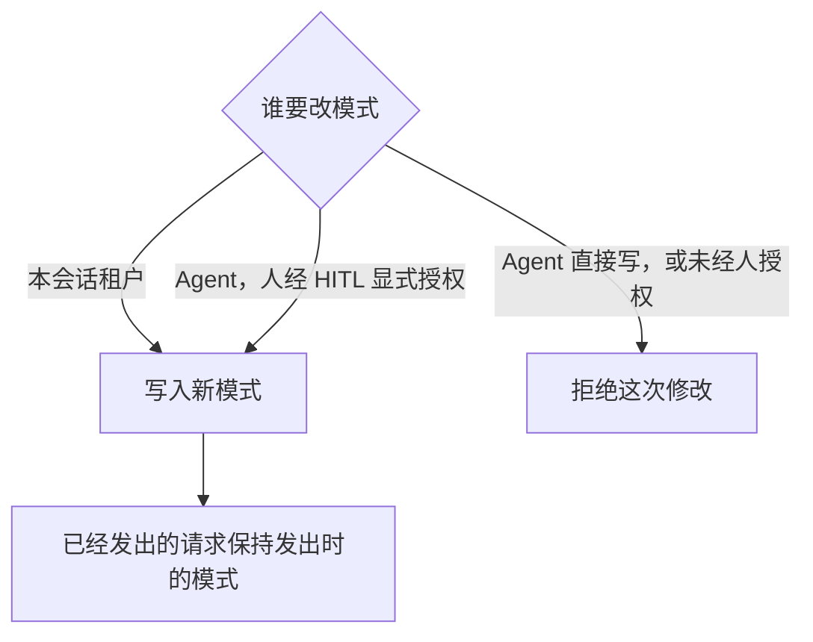

# 会话与工作的产品设计

状态为候选，待产品负责人确认。本文定义持续协作的身份、工作治理及用户可见后果；实现记录与版本承诺分别说明。项目要求以 docs 为准，术语以[统一语言](../../ubiquitous_language/index.md)为锚点。

## 产品需求描述

### 建立一段可以持续协作的会话

用户需要保留一段协作，跨多次工作、进程重启和执行实例重建继续使用。Session 是这段协作的耐久身份与归属边界，保存历史、会话设置、授权、关系和工作事实。它不等于一次模型请求、一个连接或正在运行的 Agent runtime。创建可以先于首次输入，也可以先于执行实例启动；初始化受阻时，用户能够查到所属会话与失败原因。

创建会话须确定有效租户身份、AgentDefinition 标识及会话执行类型。同一会话的 AgentDefinition 标识不可变，租户归属和执行类型也随创建固定。账号切换当前租户不迁移既有会话。会话执行类型规定的必需能力身份集合保持；这些能力的具体实现沿各自有效资产规则演化。用途分类由创建时采用的定义确定，此后不因定义分类变化而改变。

工作区是用户显式选择的可选输入。未选择工作区，才按空工作区创建；已选择但无法加载或没有使用资格时，创建明确失败，不能将用户的选择默默丢弃。工作区提供资产和工作材料，不授予额外权限。工作区的身份、参与关系和使用资格归工作区域，会话按其公开事实决定是否可采用该工作区。

### 会话治理工作，三个 runtime 分别承担实际运行

用户需要一段协作在执行实例退出、调用等待或局部故障后仍能继续。Session 承担会话业务与逻辑治理，决定输入能否受理、工作能否开始或继续、控制应作用于什么范围，以及怎样保留协作历史。Run 表达其中一次逻辑工作，attempt 标识承担该 Run 推进责任的一次执行尝试。三个 runtime 承担实际运行，不能用它们的启动、退出或一次调用收场代替会话的业务判断。

| 主体 | 在会话协作中的责任 | 不能据此认定的事 |
| --- | --- | --- |
| Session 与 Run | 保存会话与工作事实，按业务规则治理受理、推进资格、等待、取消、归档及工作终态。 | Run 已取消或会话已归档，不证明相关执行已物理停止或外部效果已撤回。 |
| Agent runtime | 执行 Agent Loop，按有效推进资格承接输入、发起获准调用、等待并消费结果，按适用规则推动工作收束。 | 实例退出不证明 Run 已结束；等待模型或工具不取得对方的生命周期所有权。 |
| Model runtime | 管理模型请求的真实发出、内容交付、实际收场及原调用结果。 | 模型回复或请求成功不证明业务工作完成，也不直接执行回复中的工具动作。 |
| Tool runtime | 管理工具的实际执行、执行内部等待、结果、收场及已知外部效果。 | 工具成功不证明整个 Run 完成；调用方退出或解除等待不证明工具已停止。 |

这里的“物理运行”指实际执行及其结果，不规定一个 runtime 必须对应独占线程、进程或机器。模型与工具仍遵循各自的运行契约，Agent Loop 的推进规则由 Agent 推进领域维护。治理规则可以由执行中的组件落实，但规则及会话事实不因执行实例重建而失去效力。通过工具访问其他领域时，被访问领域仍拥有自己的业务状态与完成条件，会话不接管其全部业务。

三个 runtime 的生命周期彼此独立。Agent runtime 等待模型回复才能推进下一步，是数据依赖，不表示模型调用必须随 Agent runtime 一同创建、销毁。工具同样可以在当前步骤解除等待后继续执行。重建 Agent runtime 时，应接续原调用、原等待和原消费位置，而不是重新发出已经在途的请求。三个 runtime 的协作也不要求共享执行栈或随父实例销毁的对象树。

会话按明确业务规则向相关执行发出控制，实际停止、失败和效果由执行拥有者报告。取消一个调用、取消 Run 和归档会话分别有自己的范围，不能靠释放执行实例或连接隐式替代。归档生效后，会话不再等待原工作的成果，也不允许迟到结果恢复任务资格；独立执行仍须交代真实收场、结果与费用。逻辑收口和物理收场可以发生在不同时间，二者须可分别辨认。

会话保存“这份工作是否仍有资格继续”的治理事实，执行方保存“原调用实际发生了什么”的执行事实，消费方保存“原结果是否已可靠接住及处理”的消费事实。控制意图不能冒充实际停止，可靠接住结果也不能冒充业务完成。模型与工具还可由独立程序按其公开契约调用，由该调用方承担业务治理及消费责任，无须为复用能力暗建 Session 或 Run。详细分工沿[总体结构](../../../../docs/architecture/structure.md#session-治理与三类-runtime)和[运行架构](../../../../docs/architecture/runtime/README.md#生命周期与状态转换)。

### 定义版本可以更新，定义身份不随之改变

固定 AgentDefinition 标识不表示会话永久冻结在创建时的版本。同一 AgentDefinition 可以发布新版本；会话采用哪个版本，与是否需要重建执行实例是两个不同问题。新 Run 采用该定义最新合法发布版本。同一 Run 的普通恢复保留原采用版本，不因发现新版本而暗换行为。

会话只在两种时刻采用新的装配：新 Run 开始，以及用户显式 reload。在这两种时刻之外，定义、资产、使用资格、工作区来源或设置的变化都不改变正在使用的采用。保留采用不延续已经撤销的授权，每次动作仍按当前资格核对。原执行实例崩溃或失联后，新实例以新的 attempt 接续原 Run，沿用原 Run 的采用，系统不为此重新求值。

运行中切换模型、修改三轴模式、改动会话设置或更换工作区选择，都不重建执行实例，也不改写已经发出的调用。新选的模型用于后续尚未固定的请求，修改后的模式由相应消费者在后续请求与动作中感知，见[模型选择](#按协作需要选择和切换模型)与[三个模式](#按协作需要调整三个独立模式)。设置的新值由读取它的消费者在后续使用时取得。工具及 MCP 的合法刷新可以改变后续调用可用的定义，同样不构成新的采用，见[工作区与能力变化](../../../../docs/architecture/runtime/assembly-and-change.md#工作区与能力变化)。工作区选择与设置的变化还在下一个采用时刻参与比对，工作区一侧的规则见[工作区的更换选择](../workspaces/design.md#j-ws06-更换选择或显式采用新的来源)。

用户发出下一条消息时，不因系统重新判断该用哪个版本而多等。参与装配的每类来源（例如资产与定义、使用资格、工作区来源、设置）都由其拥有者按作用域维护一个只增不减的采用变更计数。来源或会话自己的工作区与设置选择一旦变化，下一个新 Run 开始时一定会发现这次变化。来源和会话选择都没有变化时，系统沿用当前采用，不重读来源。比对步骤、计数的维护者和预先校验的候选见[比对代替求值](../../../../docs/architecture/runtime/assembly-and-change.md#比对代替求值)。

新 Run 开始前，系统先核对会话租户仍然有效。租户已失效时（例如账号已退出该组织），系统拒绝开始新 Run，并在会话里向有访问资格的用户显示拒绝原因。已受理的输入保留在历史中，也保留待处理资格，不被丢弃。会话的其他历史与已有工作按既有规则保留。租户有效时，系统按上一段确定这次的采用。新求得的候选校验失败时，结果取决于原合法采用：

- 原合法采用的当前条件仍适用时，系统用原采用开始新 Run，并说明新候选失败的原因。
- 会话没有原合法采用（例如首个 Run），或原采用的条件已不适用时，系统不建立 Run。输入保留待处理资格，系统向用户说明原因。

因租户失效或候选失败而没有开始 Run 时，用户不需要重新发送已受理的输入。

用户显式 reload 时，系统总是重新求值并校验，不靠比对跳过。原 Run 未终结时，系统可在合法、安全的交接点采用同一 AgentDefinition 的新版本，保留原 Run 并建立新的 attempt。会话没有未终结 Run 时，通过校验的候选成为会话当前采用，供下一个 Run 使用，系统不为此建立 Run 或 attempt。新候选无效或不能安全采用时，须说明原因并保留原合法采用状态，不让半份新旧组合进入工作。定义版本变化、执行实例重建和正在执行的模型或工具调用分别可辨；更新不能改写已发调用的输入，也不能丢掉原等待、待答卡片或尚未消费的结果。精确采用边界沿[装配与动态变更](../../../../docs/architecture/runtime/assembly-and-change.md#定义清单与实例)。

产品不提供在原会话中改绑另一个 AgentDefinition 标识的语义。使用另一个定义建立协作时，须有独立会话身份及相应归属，不能把它记成原会话的一次版本更新。

### 按协作需要选择和切换模型

用户可以为会话选择模型，并在持续协作中切换。会话保存的是选中的模型路由名及变更事实；某次请求实际采用哪份档案、哪些参数及供应商，由模型调用领域按有效规则求得。当前选择、当前可选目标和上一回复实际使用的模型分别展示，不能因切换改写历史调用。模型列表、档案求值、凭据和模态合法性沿[模型调用产品](../model-invocation/design.md#用户看到的列表与切换)维护，会话不复制另一套模型规则。

切换须有对应会话操作资格及当前合法目标。Agent 可以代表用户执行明确的合法切换指令，不能因失败、窗口较小或自行判断模型优劣而改选。这个入口与三轴模式修改分开；允许代办模型切换，不授予 Agent 修改模式的资格。缺凭据的合法目标仍可选择，但须说明暂时无法调用；非法目标明确拒绝，保留原选择。

切换事实可靠保存后，用户即能看到新的选择。正在执行的模型请求保留原模型与输入，后续尚未固定的请求采用新选择并重新组装与检查。切换选择本身不要求更换 AgentDefinition、建立新 Run 或新 attempt。切换成功不保证下一请求一定成功；必要压缩后仍无法满足新模型输入条件时，按原工作规则报告失败，不反向撤销已保存的选择、删除历史或暗换其他模型。保存结果未知时沿原操作核实，不假报成功或换身份重复切换。

### 在协作历史中看清发生过什么

用户需要在同一会话内回看输入、回复、工作和控制事实，理解系统为什么走到现在这一步。会话日志归 Session，跨多次 Run 保存；Run 关联日志中属于原工作的事实，不各自另建一份会话历史。消息只是日志的一部分，工作开始与终结、attempt 交接、采用版本变化、等待与答复、调用及结果关联、取消与归档等非消息事实也有各自记录。具体调用的真实执行与费用由其拥有者提供，会话保留可追溯关联。

会话日志只增不改，append only。日志条目可靠提交后，其内容、归属与顺序不可原地修改。更正、补充、撤销和状态变化通过追加新条目表达，并使读者能辨认它们作用于哪份已有事实；新条目不能抹掉原来确实发生过的事。已提交历史中的请求、回复和人工决定不能因后续更新而被覆写。重复提交须认回原已提交事实，不能仅因通知、恢复或回执重试多出一份相同业务记录。

尚未收齐的流式回复是正在变化的展示，不冒充完整历史消息。按原声明的交付方式，可以逐片追加或更新同一个未封口块的当前值，不等于修改已经提交的日志条目；更新不能覆盖已经形成的其他块或历史消息。

用户在流式过程中看到的内容只有两个来源：一是会话日志里已经可靠提交、不再改变的历史，二是生产方已经可靠保管的在途增量。进程内存里的临时缓冲不是可见来源，生产方尚未保管的片段不展示。会话不逐片保存回复，回复收场后形成的消息才进入会话日志。重连或故障后，已展示的内容从这两个来源恢复。生产方没有保管的片段从未展示，故障后可以缺失；恢复后的展示说明这处缺口，不把缺失部分冒充为已保存的内容，也不补造。具体协议沿[流式交付](../../../../docs/architecture/runtime/streaming-and-consumption.md)。

日志同时记录控制意图与实际结局。用户请求取消不表示外部执行已经停止；迟到成功、失败、费用及未知效果沿原调用追加，不伪装成新执行。工具未实际启动而产生的不可用逻辑结果须说明原因，不能虚构物理执行或其用量。归档保留历史，撤销归档追加新的治理事实，不删掉原归档及取消记录。

会话日志记录发生过什么，模型上下文决定一次请求获准看什么，两者不能混同。日志中的非消息事实不会因为需要保存就全部成为模型消息。压缩只追加摘要、压缩覆盖范围和保留名单，不覆写原消息、原条目或原标注；采用压缩视图仍能定位其依据。保留名单只决定模型之后看到哪些旧消息。用户回看历史时仍看到全部原消息：历史视图把覆盖范围内未保留的消息标为已压缩进摘要，把保留名单里的消息标为保留。这些标记由压缩记录派生，不写回消息，也不改块标注。显示视图和日志投影可以更新，但不能成为第二份历史权威，也不能通过修改视图反向改写日志。Agent 推进与模型上下文组装分别由相应领域消费日志，不由会话领域决定全部模型输入。

文字、图片和语音的历史应保留原内容或有效、可恢复的引用。工具完整结果可由结果拥有者保管，会话日志保留必要摘要和有效关联，不把临时地址当作唯一恢复依据。读者获得的是按资格筛选的历史视图；可查看费用不自动授予消息、附件或凭据读取资格。会话日志不等于控制台工程日志或遥测，后两者不能代替应持久保存的协作事实，秘密值也不能因诊断方便进入普通日志。

长程积累不应让用户每次打开会话都等待完整历史重放。历史浏览、定位原工作及恢复读取须能够按所需范围进行；分页、导出与模型上下文组装的成本须对应实际读取量。数据规模持续增长时，累积、加载和读取的性能均须验证，不在产品正文钉死统一耗时或容量值。只增不改是日志的业务语义，不承诺无限保存全部原始副本；内容副本的清理仍须遵守数据保护、有效引用及恢复责任，不能借清理改写应保存的历史事实。规则沿[数据与状态](../../../../docs/architecture/data-and-state.md)。

### 提交输入后，知道系统是否已经接下工作

发送方需要区分输入送到入口、系统可靠受理、等待处理、被某次工作承接，以及工作已经完成。只有输入及其明确去处责任可靠保存后，系统才可确认受理。已受理后，系统承担接续责任，不要求发送方保持在线或再次提供输入。未确认时，发送方保留原输入及提交依据；回执未知不能直接解释为未受理。

普通消息保存为消息并取得待处理资格，按到达顺序等待工作承接，不按来源另设优先级。每轮开始处理新输入时，接下当时全部具备处理资格的普通消息，保留顺序和同一批次边界。系统可以分块搬运这些内容，但不能把搬运方式变成用户看到的多次不同批次。已受理输入不能因队列变长而丢弃；这不承诺无限物理容量，存储不可用时也不能假报新受理成功。

受理使用可辨认同一次发送的提交标识，范围包含租户、会话及来源。回执丢失后的查询或重试沿用原标识，不产生重复消息、Run 或处理。用户主动再次发送相同文字是新的提交，不能按文字相同去重；原标识也不能用来覆盖已受理的不同内容。来源无法指认同一提交时，系统不代替来源猜测。

对已有人工卡片的答复回到原卡片和等待位置，不进入普通消息队列。控制指令交控制处理方，不等普通队列清空。系统业务流程输入由对应业务处理，不因使用同一入口就强制变成模型消息。明确“不回答”是一份真实卡片答复，解除该卡等待、计为已处理，并计入本批答完的判断。本批全部卡片处理后，解除相应批次阻塞。选择不回答的卡片向原等待位置返回没有答案的结果，其余答复照常返回；不回答不授予依赖批准的动作。普通聊天不能冒充卡片答复。

启用用途提醒时，明显偏离会话用途的请求在受理前交回用户确认。被拦正文不由系统受理或保管，未确认不产生待办或超时；用户确认后重新发送。提醒可以关闭，判定只有匹配和不匹配两种，不改变授权及能力。系统还可以在受理边界按内容政策否决输入。被否决的正文不取得受理资格，系统向用户反馈否决原因。与用途提醒不同，内容否决保留必要的否决事实。

斜杠命令的名称、可用性及权限由命令拥有者定义。受理内容型命令时，保存原命令及实际展开内容；系统流程型命令保存原目标和处置责任，交对应业务。已失效命令不能被悄悄降为普通消息。会话只承接受理与分流后果，不接管命令类别的完整业务。

### 一次工作可以等待、恢复和并行调用

Run 是一次逻辑工作及其结果，保存承接范围、等待、结果、失败、取消，以及实际调用与效果关联。同一会话至多有一个未终结 Run，同一 Run 至多有一个有效推进者；多个会话可以并行，同一 Run 内也可并行执行多个工具。单活跃约束决定谁有资格推进工作，不限制一切计算都必须串行。

触发只要求检查工作条件。没有未终结 Run 且有合法待处理输入时，才建立新 Run；原 Run 未终结时，新消息由原 Run 后续批次承接。原推进者有效就继续原 attempt，确需重新建立推进实例时才产生新 attempt。普通追加、原实例恢复等待及模型内部重试不增加 attempt；丢失通知不能永久遗失已受理工作，重复通知不能产生第二个有效推进者或没有合法输入的空 Run。

交互登录入口开始新 Run 时核对登录有效性。登录到期不强停已经推进的 Run，同一 Run 的新 attempt 不重新通过新 Run 的登录门；这不解除实际动作的当前授权检查。系统及后台工作沿自己的可信身份入口开始，不能伪造人的登录或绕过权限。身份事实与授权含义归身份与授权领域，会话决定这些事实在工作受理和治理中的检查位置。

等待模型、工具或人的答复时，工作仍未终结，执行实例可以释放后再建立。前台与后台指当前步骤是否继续等该工具结果，不表示两种独立的物理工具执行。转后台解除当前等待，原工具执行仍可继续；原 Run 结束后也可有尚在执行的后台工具。工具领域拥有是否允许后台、转换契约及最终结果交付，会话拥有插队等业务控制的意图与处置责任，Agent 推进消费有效转换结果并继续原工作。独立工具调用也可使用转换契约；会话不是后台许可的来源。产品约束见[工具等待与交付](../tool-execution/design.md#前台和后台是等待与交付方式)，该契约不自动承诺后台转回前台。

HITL 由独立的[人在回路领域](../../../../docs/domains/human-intervention/README.md)维护卡片关联、面向获准人的呈现、一次有效答复及可靠交回。会话保存原工作的等待、答复去处和继续资格；工具或扩展解释其提出的问题及答复后果，身份与授权解释批准的权限含义。信息询问、方案选择和授权审批都可以使用 HITL，会话不建立第二份卡片决定，也不把所有答复解释为授权。

人工等待没有超时上限，时间流逝不能替人同意、拒绝或回答。恢复必须认回原调用、等待位置、卡片与结果处理责任。原执行仍在途就接续等待，已收场则使用原结果；查询暂时失败保持未知，不能据此重发请求或重做工具。内部扩展或压缩调用的结果回原判断位置，不能误当成主流程回复。

Run 的终态只有完成、失败和被取消，成立后不可反转。队列暂时为空、模型没给动作或执行实例退出都不足以证明完成，还须满足原工作及适用完成检查。已受理的输入交给 Agent 推进时，若因校验或保存失败无法成为消息，这次工作以失败结束并说明原因。等待和非常态上交不增加第四种终态，工作失败也不自动使会话归档。

原 Run 终结后不能再为它发起新工作。后台工具结果的投递资格随原调用成立。会话归档或单独取消这次原调用会撤销它。取消原 Run 不撤销它，因为后台工具不跟随 Run 取消。仍有投递资格的结果作为新输入受理。会话有未终结 Run 时，由该 Run 的后续批次承接；没有时，系统按上面的触发条件自动开始后继 Run，不要求用户再发消息。后继工作始终保留原执行关联，不复活原 Run。结算或补记取消事实不因此产生新任务。Run 终结后，用户的下一条消息也不回到原 Run。会话没有其他未终结 Run 时，这条消息按上面的触发条件开始一个新 Run。

### 按协作需要调整三个独立模式

用户需要分别决定遇到审批需求怎样处理、执行落在哪里，以及是否持续向人提问协作。三个模式彼此独立，运行期间修改一维不改另外两维，也不改写已经发出的请求。

| 模式维度 | 对协作的影响 |
| --- | --- |
| 权限处理 | `never` 在已有有效表达仍不能决定、需要询问时拒绝该操作。`auto_permission` 沿表达判断，仍不能决定时询问人。`bypass-permissions` 跳过这一步询问，不授予越过结构化权限限制的资格。 |
| 执行环境 | 为实际工具和每次执行求取合法落点，不将会话永久固定到一个物理环境。具体策略及环境能力由执行环境领域提供。 |
| 协作 | `co-work` 支持人机共创，Ask 提问仍受权限限制。`auto-drive` 关闭 Ask 提问能力并增加目标完成检查，未达目标不能正常完成，但用户仍可停止，工作仍可失败或被取消。 |

组织、租户或会话主动配置的“不允许执行该权限所控制的操作”不能被模式改为允许。这是操作权限限制，不是禁用资产。关闭 Ask 也不等于替人批准动作。切回 `co-work` 只解除协作模式附加的目标检查，作业执行类型强制要求的检查仍须成立；模式变化不删掉必需能力，也不扩张装配能力。

这个会话的租户可以改这三个模式。Agent 不能直接写模式，也不能借未经人授权的工具或委托去改。Agent 要改模式，必须走 HITL，由人显式授权。已经发出的请求保持发出时的模式。通用创建入口没有显式初值时，采用租户默认并形成本会话值；专用入口既有必填初值要求仍须满足。租户默认后来变化只影响后续创建，会话恢复或重新装配不重新套默认。修改会话模式不同时修改租户默认或共享资产，这一初始化规则也不扩大到所有可继承设置。

模式合法变更须能被相应消费者感知。运行中沿 Runtime Context 的公开协议提示，未运行时由下次使用取得当前值；会话提供模式事实，不接管 context 内容或模型组装算法。其他设置、权限和资产仍由各自拥有者求值，运行期变化不能改写已捕获调用。

执行环境模式变化时，会话在保存新模式的同时写一条会话层的目标环境设置。这条设置的有效值由设置拥有者按各层求出，组织与租户层的锁定照常生效。目标环境设置缺项，或决定它的各层设置读不到时，工具调用不发出。拒绝原因作为这次调用的结果回到原消费位置，系统不按工具声明的缺省落点执行。缺项时无法知道会话是否设了更严的限制，按缺省执行会让这项会话限制静默失效。这与[执行环境](../execution-environments/design.md#产品需求描述)产品页「没有配置或无法取得允许依据时，不能猜测许可」一致。

### 插队、取消工作和归档有不同影响范围

普通追加消息不自动中断在途模型或工具。插队是显式加急路径，须共同保存加急消息、当前等待的处置及必要提醒；它不等于取消整个 Run。等待模型时请求中断并保留已到达内容，被中断回复中的未执行动作不再执行。等待允许转后台的工具时解除当前等待并保留原执行，说明因插队转后台；工具不允许转后台时请求中断，保留真实效果及说明原因的逻辑结果。

插队遇到 Ask 或 Run 人工卡片时，按主动控制语义解除原等待，记录实际控制来源及明确拒绝回复的逻辑结果，不伪造用户没有提交的答案或授权。加急文字仍按普通消息承接。正在取批或组装时，只保存队首加急消息，不重复中断不存在的等待。

单独控制一个调用只影响原指定模型或工具，不自动控制兄弟调用或整个 Run。取消 Run 时，系统在同一次提交里可靠保存取消意图和 Run 的被取消终态，这一刻就是取消生效的时刻。生效同时撤销原工作的新发起资格，系统随后向该 Run 的模型及前台工具传播控制。Run 已有终态时，这次取消不生效，发起者看到已经成立的终态。后台工具、子会话和无关 Run 外调用不自动跟随。优雅取消给相关执行收尾机会，强制停止把停止请求催得更急。两者都不改变取消生效的时点。实际执行和效果仍未知时保持未知。被取代的 attempt 不能再推进新工作，原已发执行仍可保存真实结果与费用。取消从不表示外部效果自动撤回。

归档收起整段协作。归档事实可靠保存的时刻就是归档生效的时刻。原 Run 尚未终结时，它的被取消终态与归档在同一次提交里保存。从生效时刻起取消原工作推进、业务等待及尚未承接任务的待处理资格，向所有相关在途模型和前后台工具传播控制，并按会话关系向下级联。归档不等待独立执行全部物理停止，用户能够看见仍待收尾的实际执行及未知效果。归档期间拒绝新任务并反馈原因，不暗中排队，也不因消息到达自动撤销归档。迟到结果和费用仍记原归属，但不重新取得任务处理资格。

归档保留会话身份、历史和授权流水，不提供任何角色删除会话的业务能力。单次许可按原批准范围消费并最迟在对应 Run 终态失效，会话许可的撤回沿授权规则。撤销归档只让该会话回到休眠、可以接收明确的新工作；已取消任务、模型或工具等待、人工卡片和原调用的迟到结果均不自动复活，子会话也不自动恢复。

### 管理主子关系和自动归档

主会话与子会话都具有完整会话身份、历史及独立逻辑工作。父会话归档向下级联，子会话归档不影响父方或兄弟；父方撤销归档只恢复父方，子方须分别撤销。独立 handoff 创建的主会话不在原会话的子方级联范围内，取消父 Run 也不自动取消子会话。派发与通信的授权及可靠投递归相应业务，会话提供关系与治理后果，不补造完整跨会话协议。

| 会话状态 | 用户可理解的含义 |
| --- | --- |
| 创建或初始化 | 身份已确定，尚未完成协作所需初始化。 |
| 运行或活跃 | 有未终结 Run，可能正等人或结果，不要求 Agent runtime 持续驻留。 |
| 休眠 | 没有未终结 Run，保留会话并可再次工作；仍可能有后台执行。 |
| 归档 | 协作已被收起，拒绝新任务；历史及实际收尾事实继续保存。 |

运行与休眠可以反复切换。自动归档采用的“连续空闲”比休眠更严格：本会话及级联相关子方均没有未终结 Run、在途模型或工具及待处理任务。等待人、后台工具和 Run 外调用仍算未结工作，无法查询执行不能当成空闲。查看历史不重置空闲，新工作使连续空闲重新计时。

自动归档默认关闭，允许显式开启。启用开关和空闲时限由租户配置，修改须具相应租户设置资格；产品不规定固定天数。具会话管理资格的用户可将自己的主会话标记常驻，豁免自动归档；子会话不能常驻。常驻不要求执行实例持续驻留，也不禁止手动归档，父方归档的既定级联仍成立。

普通重启、关闭自动归档、成员资格失效或常驻豁免均不清零已经成立的连续空闲。开启自动归档或解除常驻时采用已有空闲时间，操作前提示可能立即归档，不重新给予完整时限。撤销归档则从撤销时刻重新计时。系统执行自动归档不冒用已失效成员的身份；实际归档必须满足有效配置、无豁免及连续空闲条件。

### 故障后接续原工作，并保留真实结果与成本

已确认的受理、控制、设置和结果消费事实须在普通进程崩溃、操作系统崩溃及断电后仍可恢复，前提是介质可读且部署满足声明条件。恢复对账原终态、取消、输入承接、有效推进资格、原调用及消费位置，而不是创建一个空实例后把原动作重做一遍。当前权限、可用性和共享来源仍从实际拥有者取得，历史日志不能无限期授权新操作。

结果内容或有效引用、原归属和后续处理责任可靠接住后，生产方才可按其契约解除相应交付责任。看到内容、开始处理或发通知不算可靠交接，可靠交接也不表示原业务已完成。模型侧副本获准清理不删除消费侧历史，工具全文不套用模型的副本清理规则。取消、归档和执行实例重建均不能冒充结果消费成功。

已知工具不可用时，可以为原动作产生带原因的不可用逻辑工具结果，回原消费位置。它不表示真实工具被执行过，不能因恢复补做原工具或虚构效果、用量；这份逻辑结果自身的真实开销按事实保存。执行查询失败同样保持未知，不用零结果或零费用替代未知。

用户须能追溯真实调用及其适用的 Session、Run 和 attempt 关联。存在原发起 Run 或 attempt 时才记录相应关联，Run 外调用保留原消费者，不伪造逻辑工作。更换等待者、重复通知及恢复不重复计费，真实合法重发也不能被抹掉。租户可看自己的成本账目，组织管理员可看本组织全部账目；费用事实归账目拥有者，会话只承接关联与合法展示，不凭遥测估计生成完整账单。

本领域不定义日历与 Job、资产类别、模型请求、工具执行、context 内容或执行环境的完整业务。不要求程序独立调用暗建 Session，也不增加跨组织委托、灾后恢复角色、会话删除或持续利益对齐的具体实现。跨会话协议、自动归档时限的精确配置与校验、模式授权机制、提交与认领、生产方的在途内容保管及性能尺度继续由相应拥有者细化，见[问题登记](#未决问题与待定事项)。正文不指定数据库、线程模型、API、重试参数或统一资源上限。

### 关键用户旅程

以下 J-SW 定位号只用于文档导航，不是产品对象或公开接口。旅程串起本域贡献；详细规则仍由前述需求拥有，架构流程和成员规格分别说明协作与持续验证。

#### J-SW01 建立会话并更新同一定义版本

具创建资格的用户为持续协作确定租户、AgentDefinition 标识与执行类型，并按需要选择工作区。系统先核对输入和资格，再保存会话身份及初始化责任。用户可以先建会话、稍后发送任务。指定工作区不可用时明确失败，不替用户改成空工作区；初始化受阻仍能定位原会话，重复创建沿原操作认回。

新 Run 采用同一定义的最新合法发布版本。新版本校验失败时，原合法采用仍适用就用它开始并说明原因，否则不开始 Run，输入继续等待并说明原因。普通故障恢复保持原 Run 采用版本；原 Run 存在、未终结且具当前继续资格时，用户显式 reload 的候选通过校验并可安全交接后，原 Run 才采用同标识新版本并更换 attempt。用户看到的是版本更新，历史、原调用、卡片和待消费结果仍可接续。没有未终结 Run 时，通过校验的 reload 只更新会话当前采用，供下一个 Run 使用。候选无效时保留原合法采用，取消或归档先成立时不能靠 reload 重启工作。使用另一个定义须建立独立会话。精确规则见[创建](#建立一段可以持续协作的会话)与[版本采用](#定义版本可以更新定义身份不随之改变)。

能力为 [CAP-SW01](#cap-sw01-会话创建与固定身份)、[CAP-SW02](#cap-sw02-同定义版本采用与执行实例交接)。协作见[流程 F-SW01](../../../../packages/session/session-contract/docs/flows/scenarios.md#f-sw01)，持续验证见[旅程验证 V-SW01](../../../../packages/session/session-contract/SPEC.md#v-sw01)。

#### J-SW02 发送输入并确认工作去处

发送方携原提交标识向可受理的会话发送文字、图片、语音或有效命令。启用用途提醒且请求不匹配时，系统先交回用户确认，不保管被拦正文；用户确认后重新发送。按内容政策被否决的输入不取得受理资格，用户看到否决原因。命令拥有者提供有效展开内容或业务目标，失效命令明确拒绝。

系统可靠保存输入及去处后才确认受理。普通消息按顺序等待，卡片答复回原卡片，控制交控制处理方，系统业务输入交原业务。用户可区分已受理、待处理、某 Run 已承接和工作完成。每轮承接当时全部合格普通输入，搬运分块不产生新批界。回执丢失时沿原标识查询或重试，结果未知仍保留原输入及提交依据；不能换标识重发来猜结果。同文的新发送仍是新输入。受理后通知丢失，由系统接续责任恢复；归档竞争只能明确拒绝或先受理后取消资格。规则见[受理与分流](#提交输入后知道系统是否已经接下工作)。

能力为 [CAP-SW04](#cap-sw04-输入可靠受理与提交认回)、[CAP-SW05](#cap-sw05-输入分流与完整批次承接)、[CAP-SW06](#cap-sw06-受理前提醒与命令衔接)。协作见[流程 F-SW02](../../../../packages/session/session-contract/docs/flows/scenarios.md#f-sw02)，持续验证见[旅程验证 V-SW02](../../../../packages/session/session-contract/SPEC.md#v-sw02)。

#### J-SW03 等待执行并在故障后继续原工作

已有合法待处理输入时，用户希望系统开始工作，并在断线或重启后继续原工作。治理确认工作条件后建立唯一未终结 Run 与有效 attempt，或让原推进者继续。交互入口开始新 Run 时核对登录，原 Run 的恢复不重新走新 Run 登录门，实际动作仍检查当前资格。没有合格输入的通知不产生空 Run。

Agent 推进可并行调用独立模型或工具，等待期间 Run 仍未终结。用户重连后看到原调用及等待进度。需要重建推进实例时建立新 attempt，旧推进者失去新动作资格；原调用仍在途就继续等，查询失败就保持未知，不能重发。结果可先可靠保管后处理，也可先完成处理并保存必要完成事实，两条路径都须能恢复原责任。工具不可用逻辑结果按原因回原位置，不虚构执行。

只有原工作及适用完成检查成立才报告完成；失败或取消沿原依据形成唯一终态。模型流结束、队列暂空和实例退出均不能替代该判断。原 Run 终态后，仍有投递资格的后台结果作为新输入受理，没有未终结 Run 时自动开始后继工作，保留原关联。被归档或单独取消原调用撤销的投递资格不能恢复。规则见[一次工作](#一次工作可以等待恢复和并行调用)与[故障接续](#故障后接续原工作并保留真实结果与成本)。

能力为 [CAP-SW07](#cap-sw07-run-与-attempt-的单活跃治理)、[CAP-SW08](#cap-sw08-原等待与人工答复接续)、[CAP-SW09](#cap-sw09-完成检查与不可反转终态)、[CAP-SW15](#cap-sw15-故障恢复与可靠结果消费)。协作见[流程 F-SW03](../../../../packages/session/session-contract/docs/flows/scenarios.md#f-sw03)，持续验证见[旅程验证 V-SW03](../../../../packages/session/session-contract/SPEC.md#v-sw03)。

#### J-SW04 回答人工卡片并回到原等待位置

工作在工具或扩展处需要人的信息、方案选择或授权时，HITL 向获准用户呈现原卡片。会话保留原工作与等待位置，用户可以答复或明确不回答。普通聊天不充当卡片答复；多端答同一卡片沿 HITL 认回一次有效决定，不再生成一份会话批准。

明确不回答计为原卡片已处理但不授予批准。扩展发起的同批卡片分别处理，全部处理后 Agent 才回原扩展位置继续，不能提前执行已获准部分。工具内部 Ask 的答复则回到工具自身的原等待，由工具继续执行，不改送 Agent 扩展位置；该路径见[工具内部人工等待](../../../../packages/tool/tool-contract/docs/flows.md#tl-f04)。授权含义由授权拥有者解释，信息答复不自动成为许可。时间经过或进程释放不自动替人决定，恢复认回各自原卡片及原等待。插队、取消或归档可以改变原等待资格，迟到答复仍保持真实来源，不能复活原工作。规则见[人工答复与等待](#一次工作可以等待恢复和并行调用)及[分流](#提交输入后知道系统是否已经接下工作)。

能力为 [CAP-SW05](#cap-sw05-输入分流与完整批次承接)、[CAP-SW08](#cap-sw08-原等待与人工答复接续)、[CAP-SW15](#cap-sw15-故障恢复与可靠结果消费)。协作见[流程 F-SW04](../../../../packages/session/session-contract/docs/flows/scenarios.md#f-sw04)，持续验证见[旅程验证 V-SW04](../../../../packages/session/session-contract/SPEC.md#v-sw04)。

#### J-SW05 调整协作方式和后续请求使用的模型

本会话租户分别调整权限处理、执行环境或协作模式。Agent 要改模式，必须走 HITL，由人显式授权。直接写，或未经人授权的工具与委托，均拒绝。系统保存本会话当前值并让相应消费者感知。通用创建缺初值时才采用租户默认，专用入口必填要求仍须满足。修改一维不改另外两维，运行恢复不重新套用新默认。合法修改也不能突破结构化禁止。切换到 auto-drive 后关闭 Ask 并采用目标完成检查，切回 co-work 不解除执行类型强制检查。

用户也可选择合法模型路由名，Agent 只能代办明确合法指令。选择可靠保存后立即可查，缺凭据的合法目标须说明暂时不可调用。已固定请求保持原模型与输入，下一尚未固定请求才重新组装并使用新选择。切换不新建 Run 或 attempt。非法目标保留旧选择，保存未知沿原操作认回；下一请求压缩后仍不能满足条件时按原工作失败，已保存选择和历史不回滚，也不暗换模型。规则见[三轴模式](#按协作需要调整三个独立模式)与[模型选择](#按协作需要选择和切换模型)。

能力为 [CAP-SW10](#cap-sw10-三轴模式与会话设置)、[CAP-SW17](#cap-sw17-会话模型选择与切换)。协作见[流程 F-SW05](../../../../packages/session/session-contract/docs/flows/scenarios.md#f-sw05)，持续验证见[旅程验证 V-SW05](../../../../packages/session/session-contract/SPEC.md#v-sw05)。

#### J-SW06 插队或停止指定范围的工作

用户需要尽快补充信息时显式插队，系统共同保存加急消息及当前等待的处置责任。等待模型则请求中断并保留已到内容，未执行动作不再执行；等待工具则按工具契约转后台或请求中断。转换须得到工具实际确认，原执行及费用保持。遇人工卡片按主动控制保存拒绝回复的逻辑结果和来源，不伪造用户答案。正在取批或组装时仅保存队首加急输入。加急信息由原 Run 承接，插队不等于取消 Run。

用户单独控制某个调用时，其兄弟调用和 Run 不自动取消。取消整个 Run 时，系统在同一次提交里保存取消意图与被取消终态，取消由此生效并撤销新推进资格，系统再向该 Run 模型及前台工具传播。Run 已有终态时取消不生效，用户看到已经成立的终态。优雅取消给相关执行收尾机会，强制停止把停止请求催得更急。两者都不改变取消生效的时点。未确认的停止或效果仍显示未知。后台工具、子会话及无关 Run 外调用不自动跟随。控制重试认回原事实，恢复继续未结控制，不能重做加急输入、外部效果或生成第二终态。规则见[插队与取消](#插队取消工作和归档有不同影响范围)。

能力为 [CAP-SW09](#cap-sw09-完成检查与不可反转终态)、[CAP-SW11](#cap-sw11-插队及按目标控制)。协作见[流程 F-SW06](../../../../packages/session/session-contract/docs/flows/scenarios.md#f-sw06)，持续验证见[旅程验证 V-SW06](../../../../packages/session/session-contract/SPEC.md#v-sw06)。

#### J-SW07 归档会话并按需重新开启协作

具资格用户收起一段协作时，系统取消本会话原工作推进、等待和未承接任务资格，保存对全部关联在途执行的控制与子会话级联责任。归档事实可靠保存时归档生效；若原 Run 尚未终结，它的唯一被取消终态与归档在同一次提交里保存。已完成或失败的 Run 保持原结局。用户可以确认本会话已归档，同时看到物理执行及子方级联仍待收尾，不必等所有远端执行停止。

归档期间新任务明确拒绝，不隐式排队。迟到结果和费用继续记原归属，不使任务重开。父方归档向子方级联，独立 handoff 主会话不在该范围；子方归档不影响父方和兄弟，取消父 Run 也不自动取消子方。级联中断后从原责任继续。

用户撤销归档后，本会话回休眠并从撤销时刻重新计空闲。用户须显式提交新任务才能开始新工作，旧 Run、卡片、等待、取消输入和子会话均不自动恢复。历史及授权流水保留，单次许可仍按原范围和失效条件判断。会话没有删除业务入口。规则见[归档](#插队取消工作和归档有不同影响范围)与[主子关系](#管理主子关系和自动归档)。

能力为 [CAP-SW12](#cap-sw12-会话归档与撤销归档)、[CAP-SW13](#cap-sw13-主子关系及独立治理)。协作见[流程 F-SW07](../../../../packages/session/session-contract/docs/flows/scenarios.md#f-sw07)，持续验证见[旅程验证 V-SW07](../../../../packages/session/session-contract/SPEC.md#v-sw07)。

#### J-SW08 配置自动归档并保留需要常驻的主会话

自动归档默认关闭。具租户设置资格的用户显式配置开关与时限，具会话管理资格的用户可将自己的主会话标记常驻。子会话常驻请求拒绝；常驻不要求 Agent 持续运行，也不阻止手动归档。

开启自动归档或解除常驻前，入口提示可能立即归档，并采用已有可确认的连续空闲时间。治理须确认本会话及级联相关子方没有未终结 Run、待处理任务或任何在途模型和工具。人工等待、后台工具及 Run 外调用均阻止成立空闲，查询失败也不能当作空闲。满足当前配置、无豁免及连续时限后才沿归档路径执行。

普通重启、关闭开关、成员失效和常驻不清零已经成立的连续空闲。新工作使连续空闲重新计时，查看历史不重置；撤销归档从撤销时刻计时。恢复只能采用可确认区间，未知时间不能补造为空闲。系统使用自己的限定资格，不冒用已失效成员身份。规则见[自动归档](#管理主子关系和自动归档)。

能力为 [CAP-SW13](#cap-sw13-主子关系及独立治理)、[CAP-SW14](#cap-sw14-自动归档与主会话常驻)。协作见[流程 F-SW08](../../../../packages/session/session-contract/docs/flows/scenarios.md#f-sw08)，持续验证见[旅程验证 V-SW08](../../../../packages/session/session-contract/SPEC.md#v-sw08)。

#### J-SW09 回看历史并核对结果与费用

具读取资格的用户按所需范围浏览会话历史，定位原输入、工作、调用、控制和结果。文字、图片及语音保留原内容或有效可恢复引用，工具全文由原拥有者保管并保持有效关联。尚在流式增长的展示与已提交历史分别表达，中断内容不冒充完整回复。更正和压缩追加依据，原条目及标注不覆写。

读取每页仍核对当前资格，新增历史不混入本轮固定范围；过滤造成空页不代表已经读完。用户撤权、读取范围不匹配或来源无法核验时明确拒绝或报告故障，不返回其他租户内容。历史展示落后时可显示追赶进度，不能据此决定当前工作资格。故障后能从有效历史恢复的内容继续可读，不能恢复的部分明确说明，不补造过去事实。

租户查看自己的费用，组织管理员查看本组织账目，账目资格不自动开放正文、附件或凭据。调用成本保持原身份及实际存在的 Run、attempt 关联，Run 外调用不补造工作。迟到结算与未知效果可继续追踪，未知费用不当零，重连、恢复和重复通知不重复计费。规则见[协作历史](#在协作历史中看清发生过什么)与[结果与成本](#故障后接续原工作并保留真实结果与成本)。

能力为 [CAP-SW03](#cap-sw03-会话日志与不可变历史)、[CAP-SW15](#cap-sw15-故障恢复与可靠结果消费)、[CAP-SW16](#cap-sw16-原工作追溯与成本可见)。协作见[流程 F-SW09](../../../../packages/session/session-contract/docs/flows/scenarios.md#f-sw09)，持续验证见[旅程验证 V-SW09](../../../../packages/session/session-contract/SPEC.md#v-sw09)。

## 能力定义与实现状态记录表

### CAP-SW01 会话创建与固定身份

建立耐久 Session，固定租户、AgentDefinition 标识、执行类型及其必需能力身份；可选工作区须有有效资格，初始化与失败能定位到会话。需求见[建立持续协作](#建立一段可以持续协作的会话)。

### CAP-SW02 同定义版本采用与执行实例交接

在 AgentDefinition 标识不变的条件下采用合法版本，分别处理新 Run、普通恢复和显式 reload，保留原工作及原执行事实。需求见[定义版本更新](#定义版本可以更新定义身份不随之改变)。新 Run 开始时的比对使用资产与规则的 CAP-AR03、05、09、10 和工作区的 CAP-WS15 维护的采用变更计数。

### CAP-SW03 会话日志与不可变历史

提供跨 Run 的只增不改日志，已提交条目不可原地修改；更正与控制追加表达，消息和非消息事实可关联原工作。历史读取与视图保持依据、访问资格、多模态引用及长期读取性能，压缩不覆写原记录。需求见[协作历史](#在协作历史中看清发生过什么)。

### CAP-SW04 输入可靠受理与提交认回

可靠保存输入与去处后确认受理，支持文字、图片及语音的有效引用，回执丢失后按原提交认回，不按内容相同误去重。需求见[输入受理](#提交输入后知道系统是否已经接下工作)。

### CAP-SW05 输入分流与完整批次承接

区分普通消息、卡片答复、控制与业务输入；普通消息有序排队，每轮承接当时全部合格输入，搬运分块不改变可见批次。需求见[输入受理](#提交输入后知道系统是否已经接下工作)。

### CAP-SW06 受理前提醒与命令衔接

按用途提供可关闭提醒及确认后重新发送的路径；消费有效斜杠命令的展开或业务目标，不将失效命令误收为普通消息。命令专有行为仍归命令领域。需求见[输入受理](#提交输入后知道系统是否已经接下工作)。

### CAP-SW07 Run 与 attempt 的单活跃治理

保证同一会话至多一个未终结 Run、同一 Run 至多一个有效推进者，认回原工作并区分继续与新 attempt，同时允许跨会话及工作内部并行。治理事实与三个 runtime 的独立执行事实分别维护，不能以实例退出代替工作终态。需求见[责任关系](#会话治理工作三个-runtime-分别承担实际运行)及[一次工作](#一次工作可以等待恢复和并行调用)。

### CAP-SW08 原等待与人工答复接续

执行实例释放后仍可等待原调用或原卡片，认回结果消费位置；人工等待无自动超时，明确不回答和普通聊天分别处理。需求见[一次工作](#一次工作可以等待恢复和并行调用)。

### CAP-SW09 完成检查与不可反转终态

按原工作与适用检查确定完成、失败或被取消；原 Run 终态后禁止新发起，合法后台后续投递保留原执行关联。需求见[一次工作](#一次工作可以等待恢复和并行调用)。

### CAP-SW10 三轴模式与会话设置

本会话租户分别修改权限处理、执行环境和协作模式。Agent 要改模式，必须走 HITL，由人显式授权。维护创建初值、会话当前值与变更感知，不突破权限或扩大能力。需求见[三个独立模式](#按协作需要调整三个独立模式)。

### CAP-SW11 插队及按目标控制

共同保存加急输入与等待处置，分别控制单个调用或原 Run；区分逻辑收口、控制传播、实际停止与外部效果。需求见[插队与取消](#插队取消工作和归档有不同影响范围)。

### CAP-SW12 会话归档与撤销归档

取消原协作处理资格、向相关执行传播控制并保留历史；拒绝归档期间新任务，撤销只恢复新工作资格，不复活原调用、卡片或子方。需求见[归档后果](#插队取消工作和归档有不同影响范围)。

### CAP-SW13 主子关系及独立治理

维护完整主子会话身份及向下归档级联，子方不反向影响父方，父 Run 取消不隐式取消子会话，独立 handoff 不进入原子方级联。需求见[会话关系](#管理主子关系和自动归档)。

### CAP-SW14 自动归档与主会话常驻

提供默认关闭的租户配置及主会话常驻豁免，按真实连续空闲判断与计时，开启或解除豁免前提示立即归档风险。需求见[自动归档](#管理主子关系和自动归档)。

### CAP-SW15 故障恢复与可靠结果消费

恢复已确认工作事实及原消费责任，区分查询未知与执行失联，可靠接住结果后才解除交付责任；不盲目重发或虚构工具执行。需求见[原工作恢复](#故障后接续原工作并保留真实结果与成本)。

### CAP-SW16 原工作追溯与成本可见

按真实调用关联工作、控制、消费与费用，区分未知结果和零成本；租户和组织管理员按各自范围查看，不因账目资格扩大内容权限。需求见[原工作恢复](#故障后接续原工作并保留真实结果与成本)。

### CAP-SW17 会话模型选择与切换

维护当前选中的路由名、合法切换及可靠变更事实，区分当前选择和实际调用；切换作用于后续请求，不打断或改写在途请求，失败与未知均有明确反馈。模型合法性由模型调用领域提供，Agent 只在明确合法用户指令下代办。需求见[选择与切换模型](#按协作需要选择和切换模型)。

### 实现状态记录

观察日期为 2026-10-16，依据为 legacy-refactor 同步候选 `6e1cea7567a3ec343dd3bfb44e99cf5deb022d3c` 的新成员源码与规格。封存实现不计入当前支持。Session 的源码仍为空导出。协作、日志提交、结果认回和控制等行为已有技术接受，生产业务尚未实现。CLI 只支持 help 和 version，不提供会话入口。全部十七项阶段目标继续保留，下表按对应技术拥有者登记实现缺口。

| 能力 | 定义与范围 | 实现支持及限制 | 验证与接受 | 依据或未覆盖 |
| --- | --- | --- | --- | --- |
| CAP-SW01 | 创建与固定身份 | 创建、持久预留及同语义创建认回尚未实现 | 本次未重验行为或作交付接受 | [Session 承接](../../../../packages/session/session-contract/SPEC.md#固定事实及当前状态) |
| CAP-SW02 | 同定义版本及交接 | 定义版本采用、安全 reload 和普通恢复保版尚未实现 | 本次未重验行为或作交付接受 | [Session 承接](../../../../packages/session/session-contract/SPEC.md#固定事实及当前状态) |
| CAP-SW03 | 只增不改日志及阅读 | 授权追加、固定范围读取、分页及多模态引用耐久尚未实现 | 本次未重验行为或作交付接受 | [Session 承接](../../../../packages/session/session-contract/SPEC.md#日志读取投影及恢复) |
| CAP-SW04 | 可靠受理及提交认回 | 输入受理、共同提交、认回及未知回执查询尚未实现 | 本次未重验行为或作交付接受 | [Session 承接](../../../../packages/session/session-contract/SPEC.md#耐久及受理确认) |
| CAP-SW05 | 分流及完整批次 | 普通输入分流及全部待处理输入的完整批次承接尚未实现 | 本次未重验行为或作交付接受 | [Session 承接](../../../../packages/session/session-contract/SPEC.md#分流及命令边界) |
| CAP-SW06 | 提醒与命令衔接 | 用途提醒、命令展开及业务分流尚未实现 | 本次未重验行为或作交付接受 | [Session 承接](../../../../packages/session/session-contract/SPEC.md#分流及命令边界) |
| CAP-SW07 | Run、attempt 及单活跃 | Run 单活跃、attempt 推进资格及并发接管尚未实现 | 本次未重验行为或作交付接受 | [Session 承接](../../../../packages/session/session-contract/SPEC.md#批次run与attempt) |
| CAP-SW08 | 原等待及人工答复 | 原模型等待、人工答复及原位置接续尚未实现 | 本次未重验行为或作交付接受 | [Session 承接](../../../../packages/session/session-contract/SPEC.md#等待与结果交接) |
| CAP-SW09 | 完成检查及终态 | 完成条件、终态前检查及合法后台后继投递尚未实现 | 本次未重验行为或作交付接受 | [Session 承接](../../../../packages/session/session-contract/SPEC.md#终态与控制) |
| CAP-SW10 | 三轴模式 | 创建模式保存和运行期模式调整尚未实现 | 本次未重验行为或作交付接受 | [Session 承接](../../../../packages/session/session-contract/SPEC.md#自动归档与模式变化) |
| CAP-SW11 | 插队及目标控制 | 插队、Run 取消及指定范围控制尚未实现；停止本地推进不能代替逻辑取消 | 本次未重验行为或作交付接受 | [Session 承接](../../../../packages/session/session-contract/SPEC.md#终态与控制) |
| CAP-SW12 | 归档及撤销 | 归档、撤销归档及相应停止范围尚未实现 | 本次未重验行为或作交付接受 | [Session 承接](../../../../packages/session/session-contract/SPEC.md#归档与撤销) |
| CAP-SW13 | 主子关系 | 主子治理、向下级联及 handoff 尚未实现 | 本次未重验行为或作交付接受 | [Session 承接](../../../../packages/session/session-contract/SPEC.md#归档与撤销) |
| CAP-SW14 | 自动归档及常驻 | 租户配置、空闲判断、常驻豁免和自动归档尚未实现 | 本次未重验行为或作交付接受 | [Session 承接](../../../../packages/session/session-contract/SPEC.md#自动归档与模式变化) |
| CAP-SW15 | 恢复及可靠消费 | 原工作恢复、模型或工具结果保管及可靠消费交接尚未实现 | 本次未重验行为或作交付接受 | [Session 承接](../../../../packages/session/session-contract/SPEC.md#等待与结果交接) |
| CAP-SW16 | 工作追溯及成本 | 工作关联、真实费用汇总、未知费用呈现及授权查询尚未实现 | 本次未重验行为或作交付接受 | [Session 承接](../../../../packages/session/session-contract/SPEC.md#故障读取与维护) |
| CAP-SW17 | 会话模型选择与切换 | 当前模型选择、合法切换及后续请求采用尚未实现 | 本次未重验行为或作交付接受 | [Session 承接](../../../../packages/session/session-contract/SPEC.md#模型选择与切换) |

实现拥有者在实现和验证变化时更新覆盖、限制及证据。产品能力及阶段承诺保持不变。下表的规格链接说明承接责任，不能作为实现通过或整卡接受的证明。

## 阶段与版本支持承诺

0.0.0 -> 0.1.0 阶段完整支持 CAP-SW01 至 CAP-SW17 全部十七项能力，沿产品负责人已确认的全部能力完整支持范围，包含会话模型选择与切换。支持范围以各项能力定义及其引用的产品需求为准，包含适用的业务规则、关键用户路径、失败与恢复后果。

| 阶段或版本 | 已确认支持能力 | 支持程度及范围 |
| --- | --- | --- |
| 0.0.0 -> 0.1.0 | CAP-SW01 至 CAP-SW17，全部十七项 | 每项完整支持，遵循本文的资格、配置、生命周期、日志与恢复规则 |

自动归档默认关闭是功能的初始配置，完整支持包括显式开启、租户配置及主会话常驻豁免。阶段承诺不改变各项能力的资格、条件和例外，也不指定固定部署参数。

版本承诺是交付目标，不表示观察到的实现已经完整支持或通过验收。第二块继续按实际证据记录覆盖、偏离与未核实范围；技术候选及后续交付须承接全部十七项能力的完整支持目标。

## 未决问题与待定事项

本节登记有效未决：SW-Q07、SW-Q08 两项技术默认待产品负责人确认，SW-M01 登记跨能力的技术兑现义务。它们都不改变阶段承诺。

### 技术默认待产品负责人确认

下表两项由技术设计推出，产品负责人尚未裁定，确认前不作为产品规则，精确条件随 [Session 能力组](../../../../packages/session/README.md)正文维护。

| 问题标识 | 待确认的行为及用户可见后果 | 当前技术默认 | 确认责任 |
| --- | --- | --- | --- |
| SW-Q07 | 恢复时 Agent 侧的工作记录无法解释，或 Agent 侧执行已经结束而会话没有记下该 Run 的终态，用户会看到原 Run 以失败结束并说明原因，不会一直停在运行中。 | 恢复依据会话已保存的原事实把 Run 收束为失败，不等待 Agent 给出结论；已发调用的真实结果与费用仍按原关联保存。 | 产品负责人确认，同时核对 [Agent 推进](../agent-progression/design.md)产品页的恢复规则。 |
| SW-Q08 | 是否提供「按模型视角看」的历史视图，只显示模型在压缩后看到的摘要与保留消息。不提供时，用户只能从历史视图的「已压缩进摘要」与「保留」标记推断模型看到了什么。 | 历史视图显示全部原消息并按压缩记录加标记，不提供按模型视角看的视图。 | 产品负责人决定是否提供；作为调试视图提供时，还须决定谁有资格查看。 |

### SW-M01 提供者与跨能力兑现

用户已受理的输入、已展示的在途内容、原工作及历史必须按既定规则保存与恢复。Session 成员、实际调用及控制拥有者、身份与设置、模型、Context/Agent、工具/HITL、流式及存储提供者须完成公共格式与 API、共同提交、跨进程围栏、控制与子方级联、原等待和 ACK、合法模型选择与设置计时接口，并取得真实并发、故障和规模证据。完整分工及各流程缺项在 [session 唯一技术义务](../../../../packages/session/session/docs/architecture/mechanisms.md#sw-m01-技术兑现义务)。

技术机制不能为方便缩减可靠受理和用户已见内容的保证，或改变十七项完整支持目标，确需改变既定可见行为时只就局部影响交产品负责人裁定，具体机制约束见 [SW-M01 技术兑现义务](../../../../packages/session/session/docs/architecture/mechanisms.md#sw-m01-技术兑现义务)。
