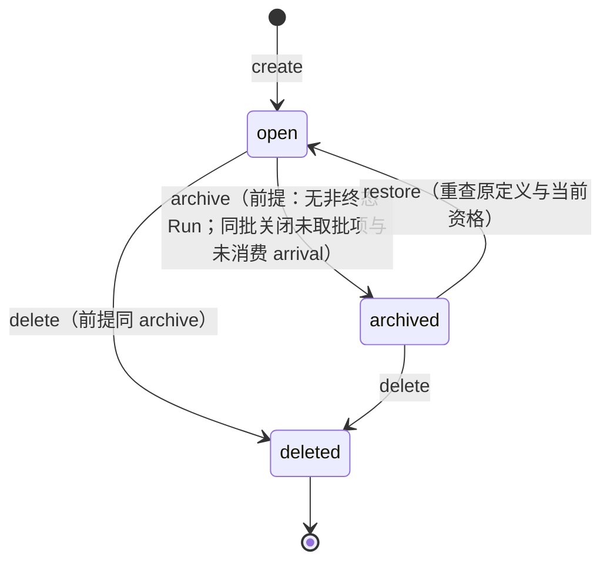
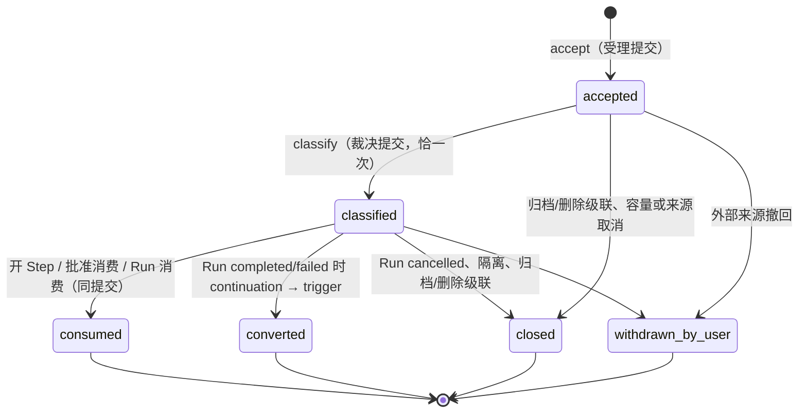

# Session 状态提供者设计映射

状态：基础 Session fork 有实际源码和测试，但完整 queue/inbound/scheduler/links 仍是目标设计。 本页保留后续实现会持续消费的端口、状态、失败与撤除协议；来源中的旧
接受和旧坐标仅作 provenance。本 baseline 对应契约均为 candidate、`acceptance:null`。

## 投影共同约束

- Host 是长期状态与异步责任 owner；Cordis plugin 只注册受限服务/贡献并拥有本代资源。
- 链接插件固定双方 registration/generation，先封闭正向使用再撤回；它不复制业务状态。
- 每次 effect 前核对当前 Fiber、tenant、资格、binding、epoch 和取消；Context/AgentRef 不代授权。
- 撤除先关新工作、排空本代短门与私有资源；已耐久请求、调用、结果、费用与 unknown 留给长期 owner。

## 来源协议（重基输入）

## 1. 插件与服务

本包拥有四个插件加三个 link 插件；Run 另成 run 包（legacy source: `../run/design.md`）。`omneSession` 与
`omneRun` 互不 required inject（作者裁决
A-12（legacy source: `../../../docs/proposals/session-run-agent-lifecycles/README.md#作者裁决`）），凡同时
改动两者的操作落在组合者、裁决者或调度者。

| 插件 | 服务键 | required inject | 职责 |
|---|---|---|---|
| `SessionPlugin` | `omneSession` | `omneAdmission`、`omneRecords`、`omneDiagnostics`、`omneIdentity`、`omneTenant`、`agents` | session / queue / inbound 三条流的 owner；§4～§7 的操作面；附着提供者；状态贡献注册面；读面 |
| `InboundAdjudicatorPlugin` | `omneInboundAdjudicator` | `omneSession`、`omneRun`（`readRun`、`waitingPositions`）、`omneAdmission` | §7.3 的裁决算法；启动扫描（SE-18（legacy source: `../../../spec/capabilities/session/v1/contract.md`）），扫描完成是调度者重取的前提 |
| `SessionSchedulerPlugin` | `omneSessionScheduler` | `omneLifecycleCompositions`、`omneSession`、`omneRun`、`agents`、`omneInboundAdjudicator`（扫描完成信号） | §8 的铃与判定；先找 ready 实例再 `agents.activate`；不轮询 |
| `LifecycleCompositionsPlugin` | `omneLifecycleCompositions` | `omneSession`、`omneRun`、`omneAdmission`、`agents` | §9 的具名组合，每个是普通代码里的一次 batch 提交；协调者只管提交，不登记组合名 |
| `SessionTenantLinkPlugin` | 见 §10 | `omneSession`、`omneTenant` | 向 TG 交引用清单（§12） |
| `SessionAuthorizationLinkPlugin` | 见 §10 | `omneSession`、`omneAuthorization` | 向 AU 交 Session/工作事实，接当前配置面 |
| `SessionAgentLinkPlugin` | 见 §10 | `omneSession`、`agents` | 向 AR 交 RuntimeAccess / SessionAttachment |

候选默认入口 `@omne-harness-lite/session` 导出 `createSessionHost`、上述插件、公共事件
decoder 与纯 fold、提交面与读面类型。应用单次创建 host；同一 coordinator 重复创建返回
`authority_already_bound`；第二 Context 复用原 host。先由 persistence（legacy source: `../persistence/design.md`）
在同一 Watermark 校验纯 fold、跨记录关系、必需状态贡献与定义/配置兼容性，再 provide；
坏前缀或未知必需事件不默认空；投影可读不证明恢复完成。

## 2. 对象、流与事件

### 2.1 身份与共享数据

SessionRef、AgentRef、UserRef、MembershipRef、DefinitionVersion、RunRef、StepRef、
WorkOwner、Input、ContentBlock、CallRef、RequestRef、OperationRef 直接用 CD v1；
Principal、Causality、Counter、StreamRef、Position、Watermark、Receipt 来自 records；
GateFrame、OwnerPublication 来自 admission。不加第二套提交状态或 envelope。
`Input.revision` 是 CD Schema 的正整数；queue、control、inbound 修订与序号用 Counter。
存储键用 core-json/1 的具名元组规范串；namespace 为部署固定值；同 operationId 换
tenant 或输入即冲突。

| 不可混用的身份 | 含义 |
|---|---|
| `Session.owner: Principal` | 长期对象所有者，create 固定为实际创建主体；本批不开放转让 |
| `Session.initiator` | `{principal, agent \| null}` 的原始归因，之后不变 |
| `Session.source` | `{parentSession \| null, parentWork \| null, sourceOperation}`；关系不授予权限 |
| AR runtime owner | 宿主发行的活能力，独立于 owner / parent / 调用者 Context |
| 工作委托（RunDelegation） | Run 包发行（run 设计（legacy source: `../run/design.md`）），绑定 principal、tenant、Run、epoch |
| incarnation / generation / epoch | 实例代际 / Factory 与附着绑定代际 / Run 执行权（RN-01（legacy source: `../../../spec/capabilities/run/v1/contract.md`））；writerEpoch 只隔离记录写者 |

### 2.2 权威对象

| 对象 | 最小 shape | 说明 |
|---|---|---|
| Session | `{session, tenant, owner, initiator, source, definition: DefinitionVersion, acquisition: {tenantId, acquisitionId}, lifecycle: open \| archived \| deleted, title, manualTitle, pin, modelChoice, historyThrough: Watermark, controlRevision, queueRevision, inboundRevision}` | SE-01/02（legacy source: `../../../spec/capabilities/session/v1/contract.md`）；tenant/owner/initiator/原定义/acquisition 不可变；acquisition 只是 TG 原 Acquisition 的身份投影，不按版本另找一条 |
| QueueItem | `{input: Input, kind: text \| command \| trigger, acceptedOrder: Counter, order: Counter, state: queued \| taken \| withdrawn \| closed, acceptedBy, membershipBasis, arrival: ArrivalId, takenBy: RunRef \| null, closedReason}` | SE-04（legacy source: `../../../spec/capabilities/session/v1/contract.md`）；每项记来源 arrival（用户输入也先受理，§7.1）；hold 是 Session 级集合，不是项状态；closed 原因词表沿 SE-04 |
| Hold | `{operation, revision, reason: explicit \| session_force_stop}` 的活动集合 | SE-09（legacy source: `../../../spec/capabilities/session/v1/contract.md`）；有任一 hold 就不取新批 |
| Arrival | `{arrivalId, tenant, target: SessionRef \| WorkRef, source, dedupKey, payloadRef, refs: {call \| request \| continuation \| gate \| run} \| null, originWork \| null, policy \| null, state: accepted \| classified \| consumed \| converted \| closed \| withdrawn_by_user, intent: queue \| continuation \| context \| control \| null, observedRun: {run, epoch, state} \| null, acceptedOrder: Counter, closedReason}` | SE-12（legacy source: `../../../spec/capabilities/session/v1/contract.md`）；`(source, dedupKey)` 唯一 |
| ContextWatermark | `{watermark: Counter, lowerBound: Counter}` | SE-16（legacy source: `../../../spec/capabilities/session/v1/contract.md`）；由 Inbound 拥有 |
| Contribution | `{stateKey, scope, owner, kind: authoritative \| projection, schemaVersion, inputVersions, initialize, upgrade, withdrawPolicy, generation}` | SE-10（legacy source: `../../../spec/capabilities/session/v1/contract.md`） |
| Attachment | `{agent: AgentRef, session, state: held \| revoked \| releasing \| released, generation}` | CB-05～07（legacy source: `../../../spec/compositions/agent-session-binding/v1/contract.md`）；不耐久，随实例重建 |

占位不是对象：`placeholder(S)` 由 `omneRun.listPlaceholder(session)` 派生
（LC-02（legacy source: `../../../spec/compositions/session-run-agent-lifecycles/v1/contract.md`））。Run、Step、
epoch、控制与等待位置归 run 包（legacy source: `../run/design.md`）。

### 2.3 三条流

记录 owner 固定 `session`；tenant-scoped stream 为 `session(S)`（目录、生命周期、hold、
状态贡献注册）、`queue(S)`（队列项内容、修订、顺序、取用）、`inbound(S)`（arrival 的受理、
裁决、消费、context 水位；用户裁决
U-22（legacy source: `../../../docs/proposals/session-run-agent-lifecycles/README.md#裁决记录2026-09-14用户`））。
一个 batch 每条流至多一条 append，修订每 batch 加一。四条流（含 `run(R)`）首版同一
协调域（CC-01（legacy source: `../../../spec/compositions/core-work-coordination/v2/contract.md`））。持久格式
语言与后端无关：流身份、envelope 与事件词汇在 DR-01（legacy source: `../../../spec/capabilities/durable-records/v1/contract.md`）
的记录模型层；JSONL 只是 DR-04（legacy source: `../../../spec/capabilities/durable-records/v1/contract.md`） 的一个提供者。

### 2.4 事件命名、去重键与词汇

事件 kind 一律三段式 `<流>.<对象>.<事实>`（用户裁决
U-33（legacy source: `../../../docs/proposals/session-run-agent-lifecycles/README.md#裁决记录2026-09-14用户`）），
全小写，段内 `_` 连词，version 字符串 `"1"`；进程内广播的 Cordis 事件名同一风格：
`records.envelope.committed`。

每条事件带去重键（U-34（legacy source: `../../../docs/proposals/session-run-agent-lifecycles/README.md#裁决记录2026-09-14用户`））：`eventId`（提交者在 prepare 时生成、幂等重试沿用）、位置
`(stream, seq)`、产生它的 `operationId`。投递去重：广播可能重复，消费者以 `eventId`
或 `(stream, seq)` 判重。消费去重：凡"消费"一条事实的动作自己也是耐久事件并引用被
消费事件的 `eventId`（`inbound.arrival.consumed{by}`），第二次消费在门内被拒。来源级
去重是另一层：`(source, dedupKey)` 相同的到达只有一条 arrival。铃驱动的反应可用
`(stream, seq)` 水位记住已处理位置，只是加速，权威仍是门内重读。

| 流 | 事件 kind | data 与 fold 义务 |
|---|---|---|
| session | `session.lifecycle.created` | Session 初始完整值；已有 Session 不可重复创建 |
| session | `session.lifecycle.changed{to: archived \| open \| deleted, reason}` | 只由 §4 的操作产生；deleted 之后拒绝一切 append |
| session | `session.meta.renamed{title, manual}` / `session.meta.pinned{pin}` | 人工标题锁定后自动标题只作建议 |
| session | `session.model_choice.set{modelSelection}` | 供下一 Run 使用，不改当前 Run |
| session | `session.hold.set{operation, reason}` / `session.hold.released{operations, previousControlRevision}` | 释放列明目标，不用过期清空覆盖新 hold |
| session | `session.contribution.registered{stateKey, kind, schemaVersion, generation}` / `.withdrawn` | 同 scope/key 重复拒绝 |
| queue | `queue.item.enqueued{input, kind, acceptedOrder, order, acceptedBy, membershipBasis, arrival}` | text 只接受用户/命令解析结果；trigger 只由裁决产生 |
| queue | `queue.item.edited{inputId, previousItemRevision}` / `queue.order.changed{orderedInputIds, previousQueueRevision}` / `queue.item.withdrawn{inputId, itemRevision}` | 只对未取批项；完整范围与当前成员一致 |
| queue | `queue.items.taken{kind, items, run, operation, previousQueueRevision}` | LC-04 行 3（legacy source: `../../../spec/compositions/session-run-agent-lifecycles/v1/contract.md`） 同提交中队列侧的记录；fold 验证成员/修订/顺序 |
| queue | `queue.item.closed{inputId, reason}` | 词表沿 SE-04（legacy source: `../../../spec/capabilities/session/v1/contract.md`） |
| inbound | `inbound.arrival.accepted{arrivalId, source, dedupKey, payloadRef, refs, originWork, policy, acceptedOrder}` | 受理提交；同 `(source, dedupKey)` 返回原项 |
| inbound | `inbound.arrival.classified{arrivalId, intent, observedRun}` | 裁决提交；每个 arrival 恰一次 |
| inbound | `inbound.arrival.consumed{arrivalId, by: {step \| approval \| run}, eventId}` | 由消费它的提交写入 |
| inbound | `inbound.arrival.converted{arrivalId, item}` / `inbound.arrival.closed{arrivalId, reason}` / `inbound.arrival.withdrawn{arrivalId}` | converted 与 Run 终态同提交（SE-17（legacy source: `../../../spec/capabilities/session/v1/contract.md`）） |
| inbound | `inbound.arrival.refused{source, dedupKey, reason: refused_capacity}` | 记录拒绝，不占 arrivalId |
| inbound | `inbound.context.advanced{watermark, lowerBound}` | SE-16（legacy source: `../../../spec/capabilities/session/v1/contract.md`） |
| session（审计） | `session.operation.denied{operationKind, target, code, observed}` | 独立审计流，披露按读权裁剪 |

去掉的词汇：`driver_reserved` / `driver_released` / `epoch_parked`（占位派生，
A-13（legacy source: `../../../docs/proposals/session-run-agent-lifecycles/README.md#作者裁决`））、
`checkpoint_saved`（位置是投影，缓存归 projection（legacy source: `../projection/design.md`））、
`call_proposed` / `call_linked` / `result_linked` / `continuation_*`（接续由 arrival 承载，
调用绑定归 run 流）。envelope 与事件数据的 JSON Schema 在实现前按本节约定与
spec/data（legacy source: `../../../spec/data/README.md`） 的风格具体设计（U-35（legacy source: `../../../docs/proposals/session-run-agent-lifecycles/README.md#裁决记录2026-09-14用户`））。

### 2.5 读面

`omneSession` 提供：`readSession(session)`、`listSessions(filter, page)`
（SE-01（legacy source: `../../../spec/capabilities/session/v1/contract.md`） 的过滤维度）、
`history(session, range)`（带水位，SE-03（legacy source: `../../../spec/capabilities/session/v1/contract.md`）：
只含已取批有效内容与明确切点）、`queue(session)`、`holds(session)`、
`inbound(session, filter)`（按 state / intent / refs 查 arrival，供裁决者与驱动器读
classified 且未消费的 continuation、审批就绪、context 水位）、`contextWindow(session)`
返回 `(lowerBound, watermark]`。读面在披露时再查权限；权限丢失关闭订阅的新披露。
不导出 raw RecordReader。

## 3. 生命周期状态机

| 转移 | 门内守卫（形状 1） | 同批效应（形状 2） | 提交后反应（形状 3） |
|---|---|---|---|
| create | 当前认证、TG 对 acquisition 的 use 资格、定义可用；同 operationId 认回原 Session | `session.lifecycle.created` | 无 |
| archive / delete | `omneRun.listPlaceholder(S) = null` 且无 interrupted Run（LC-05（legacy source: `../../../spec/compositions/session-run-agent-lifecycles/v1/contract.md`））；否则 busy 并给有权披露的原因，不隐式 cancel | `session.lifecycle.changed`；queued 项 `queue.item.closed{closed_by_archive \| closed_by_delete}`；accepted 与 classified 未消费的 arrival `inbound.arrival.closed{同}`；hold 集合保留（LC-04 行 1（legacy source: `../../../spec/compositions/session-run-agent-lifecycles/v1/contract.md`）） | AR 宿主关闭该 Session 的空闲实例并释放附着（LC-06（legacy source: `../../../spec/compositions/session-run-agent-lifecycles/v1/contract.md`））；附着资格随之失效 |
| restore | Session archived；原定义仍获准且可用，当前资格成立；不换定义 | `session.lifecycle.changed{open}`；不重新入队 | 无 |
| rename / pin / model_choice | 元数据写权；`manualTitle` 锁定后自动标题只作建议 | 对应 `session.meta.*` / `session.model_choice.set` | 无 |

归档可受权读历史；删除只保留治理允许的墓碑与审计（SE-02（legacy source: `../../../spec/capabilities/session/v1/contract.md`））。
归档后仍有后台调用的政策归工具设计（备忘（legacy source: `../../../docs/proposals/tool-system/v1/session-run-cascade-memo.md`））；
本包对到达已归档 Session 的内部事实来源 arrival 的处理见 §7.3 的 D2 列。

## 4. 队列原语

| 原语 | 输入 | 门内守卫 | 记录 | 说明 |
|---|---|---|---|---|
| `enqueue` | operationId、Session、Input（text 或 IN-01（legacy source: `../../../spec/capabilities/command-input/v1/contract.md`） 解析后的 text）、kind=text、期望 queueRevision | Session open；`session.enqueue` 权；容量（项目数/字节）；附件引用在同一受理中取得占用；到达行为由用户偏好求值为 `queue` 或 `interrupt_then_run` 并入账 | 同批两条流各一条：`inbound.arrival.accepted{user_text}` + `queue.item.enqueued{arrival}`；裁决者随后写 `inbound.arrival.classified{queue}`（§7.3） | 重复操作认回原结果；plain text 不充当 HITL 答复（SE-04（legacy source: `../../../spec/capabilities/session/v1/contract.md`））；未裁决前调度者不取批（§8） |
| `enqueueCommand` | 同上，kind=command，命令定义与参数修订 | 有序命令声明默认位置、让行规则、清除目标集合在受理时固定（SE-07（legacy source: `../../../spec/capabilities/session/v1/contract.md`）） | `inbound.arrival.accepted{user_command}` + `queue.item.enqueued{kind: command}`；即时清除类同批 `queue.item.closed{superseded}` | "立即清除等待文本"是即时控制，不等轮到队首 |
| trigger 项 | 只由裁决者产生（§7.3 intent=queue 的非用户来源） | 无用户入口 | `queue.item.enqueued{kind: trigger, arrival}` | 与用户输入同一队列、同一受理序，一项一 Run |
| `edit` | inputId、期望 itemRevision 与 queueRevision、新文本块 | 项未 taken；媒体不可变，增删附件作为内容修订 | `queue.item.edited` | 冲突返回当前修订（SE-05（legacy source: `../../../spec/capabilities/session/v1/contract.md`）） |
| `reorder` | 有序成员集合或目标位置、期望 queueRevision | 只动未取批项；不用过期全列表覆盖新加入项 | `queue.order.changed` | 用户显式调序覆盖命令的自动让行位置 |
| `withdraw` | inputId、itemRevision | 项在 queued | `queue.item.withdrawn` + `inbound.arrival.withdrawn`（同批） | 只关闭这次投递；taken 后改走 Run 控制 |
| `hold` / `continueQueue` | operationId、期望 controlRevision、明确 hold 集合 | `session.control` 权 | `session.hold.set` / `session.hold.released` | continueQueue 只解除列明的 hold，不越过 stopping 占位（SE-09（legacy source: `../../../spec/capabilities/session/v1/contract.md`）） |

取用（`take_batch` / `take_command` / `take_trigger`）不是本插件的单独操作，是 §9 的
组合：队列侧的 prepare/check 端口 `prepareTake{kind, items, expectedQueueRevision}` 只固定
队首连续合格项并写 `queue.items.taken`；Run 建立与 epoch 发行由 `omneRun` 与 AR 在同一
batch 记录。合批规则：连续 text 项，遇 command 或 trigger 停止；队首失权返回具名
blocked，不跳过；后到输入进入下一批；重试认回原 Run（SE-06（legacy source: `../../../spec/capabilities/session/v1/contract.md`））。
operationId 从 `(SessionRef, queueRevision, kind)` 派生。

## 5. 控制原语

| 原语 | 范围 | 受理点效应 | 后续 | 依据 |
|---|---|---|---|---|
| Run 级 `interrupt` / `resume` / `cancel` / `force_stop` | 精确 RunRef 与 observedEpoch | 转交 `omneRun.prepareControl`；本包不持 Run 状态 | 旧目标 ended / stale_target 由 Run 返回 | RN-03～05（legacy source: `../../../spec/capabilities/run/v1/contract.md`） |
| Session 级 `force_stop` | 整个 Session | 组合 `session_force_stop`：`session.hold.set{session_force_stop}` 与当前占位 Run 的 `prepareControl{force_stop}`、epoch 撤销同批（LC-04 行 2（legacy source: `../../../spec/compositions/session-run-agent-lifecycles/v1/contract.md`））；无占位 Run 时只 hold | 只有用户显式 `continueQueue` 解除 hold；不越过 stopping 占位，不恢复被强停的 Run | SE-09（legacy source: `../../../spec/capabilities/session/v1/contract.md`） |
| `interrupt_then_run` | 新输入加当时精确 Run | 组合 `interrupt_then_run_accept`：新 input 入队、当时 Run 与复合意图 `{input, run, epoch, basis, configVersion?}` 耐久，旧 Run 关新 Step 同批（LC-04 行 8（legacy source: `../../../spec/compositions/session-run-agent-lifecycles/v1/contract.md`）） | 旧 Run 的处置归 RN-04（legacy source: `../../../spec/capabilities/run/v1/contract.md`）；新输入按确认顺序由取批处理，不获优先通道；停止未知时复合意图显示 pending，原责任继续阻止新驱动 | SE-08（legacy source: `../../../spec/capabilities/session/v1/contract.md`） |
| 系统发起的 `interrupt_then_run` | connector_condition 按 policy | 同上，新 input 是 trigger 项，意图记发起依据与配置版本 | 同上 | SE-08（legacy source: `../../../spec/capabilities/session/v1/contract.md`）、§7.3 |
| keyboard command | 即时控制，不入队 | 映射到上面某个原语 | — | IN-02（legacy source: `../../../spec/capabilities/command-input/v1/contract.md`） |
| 命令 Run 结算 | 命令处理者 | 转交 `omneRun.prepareSettleRun`；unknown 保留占位可见 | — | RN-06（legacy source: `../../../spec/capabilities/run/v1/contract.md`） |

否定事实（hold、终止意图、epoch 撤销、TG/AU 收紧）立即封闭后续位置；正向事实
（解除 hold、resume、人类答案）必须耐久才供新准入；当前允许集合与所有未耐久收紧取
交集，hold→clear 都 pending 时不能让 clear 掩掉 hold。控制权限不自动给正文读权；
`session.emergency_control` 是 TG 登记的独立权限，只允许精确 interrupt / cancel /
force_stop。

## 6. 附着提供者与当前资格

`omneSession` 向 AR 提供 `attach(session, agent) / guardActivation(session) / release(agent)`
（CB-05～07（legacy source: `../../../spec/compositions/agent-session-binding/v1/contract.md`））。附着资格 =
当前认证与 TG 资格 ∧ Session open ∧ 该 Session 无更早未释放实例。资格变化只封闭后续
准入（LC-05（legacy source: `../../../spec/compositions/session-run-agent-lifecycles/v1/contract.md`））；
`session.lifecycle.changed{archived \| deleted}` 使资格失效，AR 宿主据广播关闭空闲实例
（形状 3）。附着不耐久，恢复从空重建；旧 attachment revoked 不复活。CB 模型的对应见 §13。

## 7. Inbound：受理、裁决与消费

### 7.1 受理（`accept`）

| 输入 | 门内守卫 | 记录 |
|---|---|---|
| tenant、target（SessionRef 或 WorkRef）、source（SE-13（legacy source: `../../../spec/capabilities/session/v1/contract.md`） 的封闭枚举）、dedupKey、payloadRef、refs、originWork、policy | 目标存在且调用方有投递权（跨会话消息未获准则不受理也不泄漏存在）；Session 未 deleted；外部来源要求 Session open；`(source, dedupKey)` 已存在则返回原项；外部来源未消费 arrival 数达上限则拒绝（`inbound.arrival.refused{refused_capacity}`），内部事实来源不适用上限；policy 的去抖/合并在受理时执行 | `inbound.arrival.accepted` |

受理与裁决是两次提交（SE-18（legacy source: `../../../spec/capabilities/session/v1/contract.md`））。来源与
调用方：user_text / user_command 来自 `enqueue`（用户输入先受理成 arrival 再入队，保证
同一受理序）；call_settlement 来自工具执行 owner（载荷至少含 call、attempt、outcome、
发起 Run；调用方式等工具设计，见 §14）；human_answer 与 provisional_outcome 来自 HD；
gate_restored 来自 BG 与依赖可用性提供者，仅当存在等待该门的 Run；connector_* 与
schedule_due 来自连接器与日程提供者；cross_session_message 来自另一 Session 的工具调用。

### 7.2 裁决与消费的状态机

`consumed` 只由消费它的提交写入：开 Step 消费 continuation 与 context 水位、批准消费
写审批就绪、命令处理者消费 user_command。不设 delivered 之类的中间态。

### 7.3 意图路由（裁决者算法）

裁决者对每条 accepted 的 arrival 做一次短提交：门外读 arrival 与 Session；门内用
`omneRun.readRun` 读被 refs 引用的 Run（call_settlement 读发起 Run，不是当前占位 Run），
用 `omneRun.waitingPositions` 判断是否仍在等待该位置，再按
SE-14（legacy source: `../../../spec/capabilities/session/v1/contract.md`） 的决定表落 intent。判定列：

| 列 | 条件 |
|---|---|
| A | 被引用 Run 非终态且尚在等待该位置（interrupted Run 保留其等待位置，RN-04（legacy source: `../../../spec/capabilities/run/v1/contract.md`）） |
| B | 被引用 Run 非终态但已不在该位置等待；或无引用而当前占位 Run 非终态 |
| C | 被引用 Run 为 completed/failed；或无引用且 Session 无 Run；或调用没有发起 Run |
| D1 | 被引用 Run 为 cancelled 或 stopping，Session open |
| D2 | Session 已 archived/deleted |

落点（同一提交内的记录）：

| intent | 记录 | 后续 |
|---|---|---|
| queue | `inbound.arrival.classified{queue}` + `queue.item.enqueued{kind: trigger, arrival}`（用户输入已在 enqueue 时入队，只记 classified） | 调度者响应队列变化的铃 |
| continuation | `inbound.arrival.classified{continuation, observedRun}` | 驱动器在下一次 Step 收束判定或开 Step 时消费；审批型答复是审批就绪，由批准消费处理 |
| context | `inbound.arrival.classified{context}` + `inbound.context.advanced{watermark+1}` | 不启动、不唤醒；开 Step 时读水位入切点 |
| control | 不生成 arrival 项；映射为 §5 的 `interrupt_then_run_accept`（connector_condition 按 policy）或 Run 控制 | — |
| closed | `inbound.arrival.closed{cancelled_run \| isolated \| closed_by_archive \| closed_by_delete \| refused_origin_cancelled}` | 不复活 |

裁决与被引用 Run 的终态转移在同一协调域全序（LC-04 行 9（legacy source: `../../../spec/compositions/session-run-agent-lifecycles/v1/contract.md`））：
首版同域，门内读到的 Run 状态就是当前状态；`continuation` 只指向裁决时非终态的 Run。
schedule_due 的判定依据是 originWork（被人取消或强停 → closed(refused_origin_cancelled)）。
裁决提交的 operationId 从 arrivalId 派生，重扫、重启收敛到同一结果。

### 7.4 启动扫描

裁决者装载或恢复时扫描本提供者拥有的全部 Session（含无 Run、无实例的空闲 Session），
把 accepted 而未 classified 的 arrival 在当前 Run 状态下裁决完（SE-11/18（legacy source: `../../../spec/capabilities/session/v1/contract.md`））。
扫描完成前调度者不重取、不取批；扫描以 `(stream, seq)` 水位分页，重复扫描幂等。

### 7.5 context 水位与容量

context 意图的 arrival 按受理序号形成 Session 级序列；开 Step 读当前水位记入切点；
可见范围 `(lowerBound, watermark]`；撤回与保留期只推进 lowerBound（`inbound.context.advanced`），
不改已记录切点；装配按 payloadRef/callId 去重。外部来源未消费 arrival 数有界，满时
拒绝并记录；内部事实来源的数量由各自权威的有界性承担（SE-16（legacy source: `../../../spec/capabilities/session/v1/contract.md`））。

## 8. 调度者

订阅 `records.envelope.committed`，只对本租户、本 Session 作用域的铃反应：队列变化、
Run 终态、hold 解除、arrival 判为 continuation 或审批就绪、epoch 封闭、门恢复、resume。
每次铃的处理：

1. 门外读 Session、队列头、hold、`omneRun.listPlaceholder`、占位 Run 的执行者是否为空、
   裁决者是否已完成本 Session 的扫描。
2. 判定：无占位 ∧ 队列非 hold ∧ Session open ∧ 队首合格 ∧ 无未裁决 arrival → 取批 /
   取命令 / 取 trigger；占位在 ∧ 执行者空 ∧ 有可干的事（就绪 continuation、审批就绪、
   门恢复、resume 意图）∧ 无未裁决 arrival → 重取；否则不动。
3. 先查该 Session 是否有 ready 实例；有则经受限 Handle 交驱动；无则 `agents.activate`
   （SE-15（legacy source: `../../../spec/capabilities/session/v1/contract.md`）、LC-07（legacy source: `../../../spec/compositions/session-run-agent-lifecycles/v1/contract.md`））。
4. 调用 §9 的组合提交；门内重读上述条件，变化即放弃本次，等下一次铃。

不轮询；铃丢失由启动扫描兜底（同一趟扫描先裁决后调度）。判定只读已提交事实与
派生关系，不据通知推进。

## 9. 具名组合

每个组合是一次 batch：各参与 owner 门外 prepare、门内 check、一次 submit
（CC-01～04（legacy source: `../../../spec/compositions/core-work-coordination/v2/contract.md`））。协调者不知道
组合名。

| 组合 | 参与 owner 与记录 | LC-04（legacy source: `../../../spec/compositions/session-run-agent-lifecycles/v1/contract.md`） 行 |
|---|---|---|
| `take_batch` / `take_command` / `take_trigger` | queue：`queue.items.taken`；run：`run.lifecycle.created` + `run.epoch.issued`；AR：`pinWork` 交入 requiredUses；trigger 项另核来源权威仍有效，不合格则 `queue.item.closed` 并记录 | 3 |
| `run_settle` | run：`run.lifecycle.settled` + `run.state.changed` + `run.epoch.closed`；inbound：指向本 Run 的未消费 continuation → `inbound.arrival.converted` + `queue.item.enqueued{trigger}`（completed/failed）或 `inbound.arrival.closed{cancelled_run}`（cancelled） | 4 |
| `session_archive` / `session_delete` | session：`session.lifecycle.changed`；queue：未取批项 closed；inbound：accepted 与 classified 未消费者 closed；门内读 Run 状态作前提 | 1 |
| `session_force_stop` | session：`session.hold.set`；run：`run.control.requested{force_stop}` + `run.epoch.closed{force_stop}` | 2 |
| `interrupt_then_run_accept` | queue：新 input 入队；session：复合意图记录；run：`run.control.requested{interrupt, supersededByInput}`，关新 Step | 8 |
| `reacquire` / `resume` | run：`run.epoch.issued{compat}` 同批封闭旧 epoch（resume 另记 state_changed）；AR：工作许可；前提：裁决扫描完成 | 7（重取）|

## 10. 链接与当前资格

| link / required inject | 两端具名关系与失联结果 |
|---|---|
| `SessionTenantLinkPlugin` / `omneSession`,`omneTenant` | 向 TG `registerReferenceSource` 交 §12 的引用清单；create 与附着的引用更新与 TG retire/disable 同门核 stamp；缺来源不能报告无引用 |
| `SessionAuthorizationLinkPlugin` / `omneSession`,`omneAuthorization` | 向 AU `registerSessionFacts` 交 Session/工作事实，接 AU 当前配置面；失联关闭相应设置写与新 Run，受权读控不因 AU 缺席消失 |
| `SessionAgentLinkPlugin` / `omneSession`,`agents` | 向 AR `registerSessionProvider` 交 RuntimeAccess 与 §6 的附着提供者；未登记不能激活，原收口能力独立保有 |
| `registerProjection` / 无反向 inject | 宿主登记 projection（legacy source: `../projection/design.md`） 的只读查询适配、水位与代次；缺失显示 rebuilding/unavailable |

注册管理面只给受信 link options。两端门外 prepare，同一 coordinator.enter 核精确
host/source/mount/registration/generation 后建立；部分装载失败撤原精确登记。每个 apply
捕获 `c.fiber` 与本次 mount generation；最终 gate 检查原 mount/link 与所有 required
provider 的代次与真实存活，覆盖消费者仍 ACTIVE 而 provider 已 UNLOADING、同 Fiber 重载
两个窗口；旧 closure 不因 Fiber 再 ACTIVE 复活。

## 11. 当前调用者、对象权限与运行委托

create 的 owner 是当前真实 Principal；owner 的 `session.read_metadata / read_content /
enqueue / edit_queue / control / activate / settings.write.confirmation_mode` 逐项授予，前提
仍是当前认证与 TG 资格；其他同租户成员默认无这些权利；`tenant.members` 等管理权不扩大
为 Session 读权；`session.emergency_control` 是 TG 登记、可撤销的独立权限。无权与不存在
对普通调用者统一 inaccessible。

设置写权与 control/read 独立求值：AU 的 `setOverride / clearOverride(scope=session(S))`
门外调用 `prepareSessionFacts`，同门 `checkSessionFacts` 返回当前 owner 的写权；只由 AU
写 override 与审计，本包是只读参与者。`settingsUser` 取自被代表的用户（Session.owner.user），
不是查询者或工具参数。

用户 enqueue 只授本次受理；每项保存 acceptedBy 与成员加入依据。取批由调度者以真实
内部系统身份、携带限定派发意图代表 owner 执行，在当前 TG 根重新核对 owner、每项输入
主体资格与定义 use 权；失权返回具名 blocked。RunDelegation 由 run 包发行；resume 与
重取按原耐久 delegationBasis 与当前资格形成新委托与新 epoch，不反序列化旧句柄。

## 12. 提供给 TG 的引用清单

实现 TG 的 ReferenceInventory 消费协议（依赖方向 SR→TG）：`prepareReferences(target)`
门外取得私有候选 `ReferenceReport={sources, references:[{owner, target: ResourceRef,
relation, blocksDiscard}], complete}`；`checkReferences(frame, candidate)` 同门验证原实例、
查询与当前引用根。引用项：Session 的原 DefinitionVersion 与 acquisition
（relation=session_definition / session_acquisition）、当前 held/revoked/releasing 附着
（agent_attachment，来源是本包附着登记）；Run 的定义与 acquisition 引用归 run 包，
由 TG 分别汇总。draft 只在完整根恢复后返回 complete=true 的空项。已发布引用
blocksDiscard=false；provider 缺失或重建未完为 unavailable / complete=false。引用根随
同批 publishLogical 或附着登记推进 referenceRevision。

## 13. 装载效应、撤除责任与依赖政策

| 效应 | 所有者 | 撤除与完成判据 | 保留 |
|---|---|---|---|
| `omneSession` 服务与三条流 owner 登记 | SessionPlugin | 关新操作 → 等在途提交 completion → 撤服务；authoritative 贡献不删记录 | 三条流全部事实 |
| 裁决者订阅与扫描任务 | 裁决者插件 | 取消订阅、等当前短提交结束；未裁决 arrival 留在 accepted，重装后扫描 | arrival 事实 |
| 调度者订阅与开机扫描 | 调度者插件 | 取消订阅；进行中的 activate 由 AR 账目收口 | 占位 Run 与队列 |
| 具名组合 | 组合者插件 | 关新组合 → 等在途 batch → 撤服务 | 已提交 batch |
| 三类 link、projection 与状态贡献注册 | 各 owner | 撤本次 generation；未知/缺失必需贡献关依赖工作；projection 只关视图 | 记录不删 |
| 附着登记 | 本包 | AR 确认真实 release 才去原引用，非一条卸载通知即减引用 | 无（不耐久） |

复合退出顺序：先撤调度者与裁决者订阅，再撤组合者，再撤 Run 与 Session 服务，最后撤
协调者。计划退役实例沿 AR 协议：关新工作 → 驱动器 Yield → 静止 → 释放；不是用户 cancel。

| 依赖 | 失效时的处置 | 依据 |
|---|---|---|
| records writer / 协调者 | 写入权丢失封闭新提交，所有 Run 停在已确认水位；广播停止，重装后开机扫描 | DR-03（legacy source: `../../../spec/capabilities/durable-records/v1/contract.md`）、CC-01/03（legacy source: `../../../spec/compositions/core-work-coordination/v2/contract.md`） |
| `omneRun` 撤除 | 先让持有 epoch 的实例 Yield，无未封闭 epoch 后撤；不可 Yield 则拒绝 | CB-13（legacy source: `../../../spec/compositions/agent-session-binding/v1/contract.md`） |
| 裁决者缺席 | arrival 停在 accepted；外部来源受容量拒绝；重装后扫描 | SE-16/18（legacy source: `../../../spec/capabilities/session/v1/contract.md`） |
| 调度者缺席 | Run 不推进、队列不消费；重装后扫描 | LC-06（legacy source: `../../../spec/compositions/session-run-agent-lifecycles/v1/contract.md`） |
| TG / AU / AR link 失联 | 关相应新准入，不失原收口能力 | CB-06/14（legacy source: `../../../spec/compositions/agent-session-binding/v1/contract.md`） |

`f98ac926` 基线对 CB 模型（legacy source: `../../../spec/compositions/agent-session-binding/v1/Binding.tla`）
的有限对应（Publish / StartWork / Invalidate / LoseDependency / PrepareReturns）与其
未证明部分保留在独立判断（legacy source: `../../../apps/local-harness/evidence/runtime-mapping-applicability/README.md`）；
目标提供者的符合性须重新验收。

## 14. 与工具、人类决定、模型的端口

本包只定义受理侧：所有异步到达经 §7.1 的 `accept` 成为 arrival，以 arrival 的 eventId
被消费。各来源的调用方式与载荷细节归其提供者设计：

| 来源 | 调用方 | 本包要求 | 待对方设计确认 |
|---|---|---|---|
| call_settlement | 工具执行 owner（TL-07（legacy source: `../../../spec/capabilities/tools/v1/contract.md`） 终态） | 载荷含 call、attempt、outcome、发起 Run；dedupKey=(call, attempt)；settling 视图直到裁决完成 | 后台调用晚到结算的存续政策；停止进度作为隔离证据的形状（备忘（legacy source: `../../../docs/proposals/tool-system/v1/session-run-cascade-memo.md`）） |
| human_answer / provisional_outcome | HD | requestId、contentVersion、outcome；审批型只承载决定 | HD-08（legacy source: `../../../spec/capabilities/human-decisions/v1/contract.md`） 同域交付形状 |
| gate_restored | BG、依赖可用性提供者 | gateRef；只在存在等待该门的 Run 时发出 | 生产者义务与去重键 |
| connector_* / schedule_due / cross_session_message | 连接器、日程、跨会话工具 | policy、originWork、目标权限 | 各自设计 |

驱动器直接读工具/人类决定权威只用于 fold 非结算视图、收口与重连，不据此第二次
呈现或解除同一位置（SE-13（legacy source: `../../../spec/capabilities/session/v1/contract.md`））。

## 15. 恢复、投影与可观测性

恢复顺序归 persistence（legacy source: `../persistence/design.md`）（records 重同步 → 各流 fold → Session
校验 → 裁决扫描 → 投影重建 → 在途核实 → 资格重取 → 调度重取）；历史读面可在校验后带
水位开放。状态贡献注册面沿 SE-10（legacy source: `../../../spec/capabilities/session/v1/contract.md`）：
authoritative 贡献（三条流、Inbound、context 水位）只经具名操作更新；projection 贡献
（列表、历史 surface、队列展示、驱动位置 reducer）由 projection（legacy source: `../projection/design.md`）
按 fold 重建，投影缓存只加速。各运行 owner 注入 Diagnostics；准备、准入、耐久确认、
等待、控制、恢复与清理分别留阶段；正文、工具参数与秘密不进普通 log；通知与诊断失败
不改已耐久结果。

## 16. 实施与验证

实施顺序：三条流的 decoder/fold 与 `SessionPlugin` 的操作面 → 裁决者与扫描 → 组合者
（先 `take_batch` 与 `run_settle`）→ 调度者 → link 插件。验收沿
Session 验证范围（legacy source: `../../../spec/capabilities/session/verification.md`）的场景映射：
LC 场景（legacy source: `../../../spec/compositions/session-run-agent-lifecycles/v1/scenarios.md`） S01～S12、
run-driver 场景（legacy source: `../../../spec/capabilities/run-driver/v2/scenarios.md`） S02/S04/S11/S12/S15/S16/S18，
以及 Inbound 模型的两个配置。崩溃注入按恢复顺序逐步做。

缺口表（本轮不发 session v2，闭环成形后一次处理）：

| 缺口 | 现状 | 处置 |
|---|---|---|
| user_text 先受理成 arrival 再入队的顺序 | SE-04（legacy source: `../../../spec/capabilities/session/v1/contract.md`） 与 SE-12 都成立，但契约未明说用户输入也经 Inbound 受理 | 本页按"经受理"设计，保证受理序统一；若工具设计要求分离再议 |
| 归档后内部来源 arrival 的 D2 处理 | SE-14（legacy source: `../../../spec/capabilities/session/v1/contract.md`） D2 列为 closed；后台调用存续政策未定 | 归工具设计（U-37（legacy source: `../../../docs/proposals/session-run-agent-lifecycles/README.md#裁决记录2026-09-14用户`）） |
| 事件与 envelope Schema | 未写 | 实现前（U-35（legacy source: `../../../docs/proposals/session-run-agent-lifecycles/README.md#裁决记录2026-09-14用户`）） |

## 17. 基线来源

现有源码为定向 fork 的 `/baseline`：保留 scope 路由、快照与纯 fold，移除绕门裸写、
无代次贡献与假 flush；官方 Cordis 4.0.2 与固定 DSH `c291e796` 的依据见
原证据（legacy source: `../../../docs/proposals/core-capabilities/implementation/evidence/runtime-provider-design/README.md`），
状态、记录、端口与算法的迁入来源为 `cd16f1` 输入（快照
`7e758f21f8f92c1d46fab194fdaf120239b8e11c`），历史身份归
Session 接口（legacy source: `../../../docs/proposals/core-capabilities/implementation/session-runtime-interfaces.md`）。
基线只到 allow 最小闭环，没有实现本页任何目标操作。
