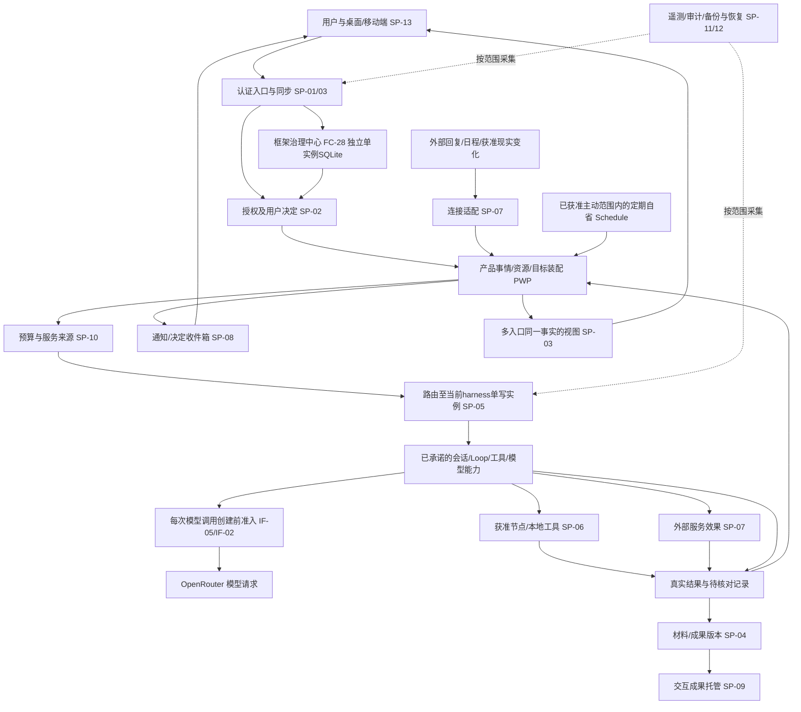

# 从用户动作到真实结果：12 条执行路径

本章的 EP / SP / PWP 是报告定位符，不是新增的 harness 契约。框架事实引用逐功能表和基线；外围提交边界是本报告的候选实现责任。箭头表示调用、交付或因果关系，不表示跨数据库事务。所有路径消费用户/租户/事情/动作等实际可用身份；没有授权的缺省答案是拒绝新效果，而不是让模型猜授权。

## 共同的持久事实与交接规则

| 事实 | 唯一写入者与保管位置 | 其他组件如何消费 | 恢复时必须保留 |
|---|---|---|---|
| 自然人、租户成员与框架身份绑定 | 框架身份权威保管其身份；SaaS只写经过核实的IdP到框架身份映射 | 入口核实认证事实后读取当前成员关系，客户端传入的tenant不能自行成为授权 | 原身份、绑定创建回执与撤销事实；不能重注册变成另一个人 |
| 一件事的目标、参与范围与业务选择 | 产品事情服务的关系存储；运行内Ask/审批由PF-008待决池拥有，SaaS只投影；框架会话/运行事实仍由对应能力拥有 | 会话、通知、视角引用同一事情/决定，读模型可以落后但须带版本 | 决定身份、版本、依据、当前范围；不要从推送状态重建决定 |
| 已接受的输入与工作 | 接收方的持久回执；框架自己接受的输入由其存储权威拥有 | 发送方重试原请求，接收方先查回执再决定是否进入执行 | 请求指纹、回执、关联执行与终态；同id不同内容拒绝 |
| 框架发起的外部效果 | PF-012 §5.14规定的Run日志拥有幂等键与真实结局；SP-06/07只保存适配回执/核对输入 | 框架按(会话,Run,第几步)交付稳定效果键，适配器透传/去重；不得按attempt或自己的request id铸新业务键 | 原效果键、调用关联、远端引用与已知/未知结局；重试同一步不产生第二业务动作 |
| SaaS自有运营动作 | 订阅/导出/发布等自身owner保管独立业务意图与回执 | 不冒称框架Run步骤，也不反向改写Run结局 | 各自业务幂等键与外部回执，不混用框架效果键 |
| 原件与成果版本 | 对象存储保留字节，元数据存储发布可引用版本 | 下载、模型读取、分享都再经相应授权；索引是可重建的派生信息 | 内容校验值、版本引用、可见范围、保留/删除状态；元数据提交前上传物不是已发布成果 |
| 预算与用量 | 商业用量账本记录预留/观察/结算，模型/工具账本保留自己的执行事实 | 同一次消费使用稳定消费id核对；不把模型自报费用当实收 | 来源、授权上限、未知费用和仍占用预留；恢复不重新创建收费动作 |
| 派发权与迁移代际 | 装配拥有者控制一个harness实例的执行权；SaaS保管路由/迁移记录 | 使用该事实的入口必须检查当前有效代际；单纯改DNS无围栏效力 | 原写入者的停止证据、未决动作、数据快照与新持有者激活依据 |

长期保存的理解还需关联来源、适用事情、当前版本和可用于哪些后续工作；授权记录关联真正的决定及动作范围；效果回执关联原请求和实际结果。纠正改变未来理解，撤权限制新的准入，停止关注关闭后续触发，删除清理已说明的数据范围；这四种动作不能互相替代。

SaaS库与harness库不默认为同一个库，更不默认拥有跨库原子性。跨边界默认是“发送方记录意图 → 接收方按稳定id提交接收 → 回执确认 → 超时查询接收方”。如方案真的把一个不可拆的不变量放在同一数据库事务内，必须在实施前明确双方共同访问的具体行/对象和唯一事务拥有者。邮件、收费等不可逆外部效果不加入假想回滚事务。

## 总体运行拓扑

图里的“已承诺能力”不是已运行的实现清单。具体 feature 消费哪层承诺、还需哪个框架工作包见覆盖表。SP 与 PWP 也不要求一框一个进程：种子期可将同信任级别的服务合并部署，保留状态与责任边界。治理中心先沿用独立单实例SQLite和自身备份恢复范围；外围托管PostgreSQL不默默替换框架存储。治理短时不可达按框架既有规则影响必须现读的操作，不等于停止所有既有离线会话。

## EP-01 注册、供给与首次真实委托

关联 S01；M15、M14、M16；SP-01/02/03/05/10/13。

1. 客户端发起注册/登录，IdP完成身份核实；入口验证发行方、受众及必要的会话绑定，获得可核实身份。
2. SP-01先按IdP(issuer,subject)持久保存供应意图与稳定关联，再调用框架注册组合。跨边界必须经IF-01明确框架可接收的幂等引用或查回已提交账号的方式，恢复时核对该引用；SaaS意图存在本身不证明能查回框架提交。缺少查回能力的超时保持“待核对”，不能重新注册造第二个账号。个人所需组织/租户/成员由框架owner建立，产品界面不要求用户先建组织。
3. 供应协调者持久保存各步骤回执：身份绑定、成员建立、基础能力配置、实例路由、默认服务来源。只有全部必需项可核实时，才显示“可以开始”；中断后从回执续接。
4. 用户明确选择平台来源或支持目录内的自带来源；缺额度/无效凭据时保留输入，不能偷换来源。默认授予的只有已明确说明的基础服务，不包括邮箱与本地文件。
5. 首个材料进入EP-02，首个委托进入EP-03，跨端重登查同一事实。

**提交与恢复**：供应状态的提交只表示该步骤已完成，不能让SaaS数据库一次提交声称harness已注册。供应意图/IdP绑定可以同属SaaS事务，但框架账号建立是另一个明确接收步骤。重复回调/重登必须复用已创建身份；孤立的中间资源由供应协调者核对接续。注销本端认证会话与停止用户后台工作是两个操作。

**验收**：注册每个步骤后断线再继续，最终仅一个正确身份绑定；首次委托真正取得成果。新设备登录后不得自动列出或读取整盘文件。

## EP-02 材料交付、草稿与可见版本

关联 S15/S16；M07/M08/M14/M17.10；SP-03/04/13。

1. 本地拖放、剪贴板候选、暂存与发送分别记录用户意图。候选留在当前账号本地，未确认不上传、不交模型；30秒预览窗口只影响UI候选，不代表远端租约。
2. 明确发送后，以输入id协调上传；对象存储完成字节与校验，再由元数据权威提交原件版本及相应输入引用。失败保持草稿和可续传凭据。
3. 多模态读取只消费已提交且当前获准的版本；OCR/摘要等派生结果有自己的版本和来源，不覆盖原件。
4. UI显示接收、可读取、处理中、已形成成果的实际区别。内容大小/格式/客户端支持由产品支持表决定，不以模型声称可读作为证明。

**提交与恢复**：上传字节与发布引用分两步，悬空字节可按保留策略清扫；已引用字节不能因上传重试清扫。账号切换隔离草稿、上传凭据和接收目标；完整原件与缩略图不混用。

**验收**：仅复制秘密文本且不发送，服务端与模型请求中无字节；发送附件时断网、切账号，再恢复不会丢稿、错发或用摘要替代原件。

## EP-03 一次委托、模型判断、工具效果与交付

关联直接工作主路径；SP-02/03/04/05/06/07/08/10。

1. 已持久接受的用户意图绑定事情与会话；产品给出目标、资料版本、明确约束与当前授权。
2. 入口确认当前成员/资源权限，商业层预留可知的支出，按已选择来源经OpenRouter调用模型。模型得到的能力说明不构成管理权授予。
3. 框架按PF-012 §5.14为同一(会话,Run,第几步)提供稳定效果键，作为IF-02/07的必需接缝透传至SP-06/07及支持它的外部服务；不能用新attempt生成新发送键。产生工具动作时，框架按其准入契约检查，SaaS适配器在实际资源/账户/节点边界再核实当前范围。缺重要参数转澄清；未确认的不可恢复动作转EP-06的决定链。
4. 执行者先保留原效果键及尝试关联，再调用工具/外部服务；适配器持久保存观察回执并交回框架Run日志结算，不能独立宣告框架动作成功。执行开始、远端接受、动作完成与用户价值完成分别表达。
5. 产物按EP-02规则成为版本化成果，产品更新事情进展，通知只是提示用户读取事实。

**提交与恢复**：对外发送前保存意图不等于外部发送已成功；收到回执后崩溃也不能直接重发。支持幂等键的提供者复用同键；不支持时查询远端引用/已发送记录，查不清就保留“结果不明”并指定处理者。

**验收**：工具调用在远端成功、回执本地尚未提交时断进程，恢复后核对原动作，不制造第二封邮件/第二笔消费。

## EP-04 无新指令的主动工作与持续关注

关联 S03/S04/S05/S09/S10/S11；M01/M02/M03/M04/M06/M10。

1. 产品装配持久保管连续目标、记忆修正、事情使命、获准感知范围和投入约束。事件可来自现实变化、时间窗口或对已有经验的新判断；必须能够在没有用户新命令、没有既有待办的情况下形成新工作意图。
2. SP-07以webhook或机械轮询取得外部变化，不为每次空轮询启动模型。变化先归入SaaS产品事情的持久待处理意图，带来源时点与读取状态并去重。有新意图且符合用户策略时，PWP-10经IF-04以真实租户和获准用户/agent创建者创建一次性Schedule；同一事情尚未到期的触发可以按版本归并，声明错过触发、重叠和通知策略，具体默认值仍待产品选定。Job建立新会话，通过获准工具读取意图并推进；竞态下已无待处理内容时只核实无需行动。定期简报/检查按用户选择；无外部事件的S04类主动改善，则在用户已授权的主动工作范围内，由PWP-10以合法创建者装配有预算的定期自省Schedule，唤醒后重新检验既有经验。不要求用户为每次新发现先发命令；默认启用、频率与投入额度沿D03待定。Job首条是否采用scheduled_trigger须由IF-04/HWP-06明确，尚不是已冻结技术保证。data.messages/v3 S-18的source kind是闭合集，不造万能system、不伪装user/extension、不恢复Connector。已有后台工具回传仅适用于仍存活的原runtime及有效callId；停止/重启按PF-006 §6.12失败或中断处理，跨天接续消费已持久意图并走Schedule路径，不能复活旧callId。
3. 策略判断是否值得行动、等信息或停止，保存可向用户解释的来源与时点，不记录/编造内部思维链。可装配仅能读取获准业务资料、写产品私有研究记录的调查角色；其研究结果不直接取得外发/修改资格。形成新意图后走EP-03同一授权与预算路径，是否采用该角色及其投入仍由产品策略决定。
4. 执行结果或用户反馈回到同一事情/理解，调整下一次行动。期限临近时可以收敛，不以调用数量衡量收益。
5. 使命结束或用户暂停后提交后续触发关闭状态；已在途工作仍核对结果。长期账户连接和历史材料不随使命结束被删除。

**提交与恢复**：唤醒事实、已发起的工作身份与后续计划需要可核对交接；不能由一个易失计时器承担跨周责任。错过唤醒后依据当前窗口判断继续/失效，不重放过期机会。框架日程能力兑现调度承诺，主动发现的产品策略另有建设责任。

**验收**：没有新指令/既有任务时，从重复返工记录形成有依据的调查并交付可用检查表；用户纠正后下一次使用受影响。暂停后不再创建新工作，但已外发动作仍显示真实状态。

## EP-05 手机委托、三台服务器与受限材料

关联 S12/S13/S14；M05全量。

1. 用户经登录引导接入节点，明确节点信任、可用工具与数据范围。节点上报能力、当前观察时点与工作状态；离线/过期信息不等于仍可用。
2. 分派依据区分算力更合适（甲）、资料只在当地（乙）、空闲/软件合适（丙），记录为什么选、是否已获接收。
3. 本候选选择中心cell持久保管Session/Run，远端节点作为有界工具适配器执行；节点保存接收/观察回执，中心Run日志拥有结局。IF-03/HWP-05补齐接缝，不迁移同一个Run，也不另建与中心争夺权威的节点Run。远端独立会话是后续可选模式，不混入本路径。接收方持久接受后才承担该工具工作。
4. 节点仅使用当前获准材料和工具，在节点侧完成出站判断及记录后，按允许范围返回结果。返回并进入云Agent上下文的内容先落框架会话日志，受其历史保留/不可任意擦除规则约束；不能先把原文传云再判断能否外发。原件、模型提示、工具stdout、检索摘要、trace与最终结果分别检查能否出节点。若违规字节已进入追加式云日志，不能声称擦除回滚：停止继续交模型/外发、隔离事故范围，依真实保留与处置能力处理。
5. 手机锁屏不终止远端执行。节点离线时先查询回执与终态，允许替代的前提同时包括能力、资料、授权和原动作不会重复；不能仅因原节点失联而重做外部副作用。

**受限材料**：统一OpenRouter约束下，原文禁止离开节点就不能发入远端模型。可执行的候选路径是云模型仅见获准元信息，在原节点用经授权的确定性工具处理，返回获准结果；若任务确需远端模型看到受限原文，则该子任务等待范围调整或停止，不能声称通过“本地处理”绕过限制。本报告没有接受一个绕开框架路由的本地模型方案。

**单写与迁移**：候选安全基线是一个harness实例同一时间只有一个可写执行拥有者。迁移先停接单、排空/记录未决、证明旧拥有者已失去效果权限，再恢复新拥有者；无法证明就保持停顿待核对。仅租约时间到、路由切换或Pod重建都不证明旧外部效果不会继续。候选A将cell持久文件放在可detach的持久卷；SP-11执行云API停止原VM、卸载/分离卷、撤销旧工作负载资格并保管证据，SP-05消费这些证据后重路由；任何一步无法证明则停顿。已泄漏/复制的BYOK不能由平台虚称轮换，旧调用或失联窗口费用保留未知，必要时等用户/provider处置后再接续。共享cell只在所有租户宿主工具均禁止、非可信执行另隔离、凭据不可被工具读取等前提下采用，不以注册人数开一万个VM。

**验收**：实际记录甲执行计算、乙读取限定资料、丙受允许条件选择；禁止外传的原文不出现在OpenRouter请求、遥测与返回结果。网络分区期间不能对同一发送动作形成两个执行者。

## EP-06 用户决定、撤权与停止

关联 S19/S20；M13/M17。

1. 先区分权威：活跃Run内Ask/审批归PF-008待决池，SaaS显示卡片和通知投影；独立业务选择归SaaS事情/决定owner。两者都保存具体动作、材料版本、后果和等待条件，但不双写为两个决定。
2. 用户从任一入口接受、修改或拒绝。框架卡片经IF-07明确reply-to-card送待决池，等池提交回执才显示已答；普通自由文本中断输入按PF-014会否决待决卡，不能拿它代替答复。SaaS自有选择按期望版本提交。重复点击查原回执，冲突显示现状；关闭/未读/超时不等于同意。
3. 执行消费决定时再次核对动作内容与当前授权，原材料/金额/目标发生实质变化不能拿旧决定套用。
4. SaaS资源撤权由SP-02在同一事务提交grant变化与outbox，网关拒绝新增准入；凭据停止分发另等FC-08唯一custodian回执，不伪装跨库原子。首选邮箱/日历路径统一SP-07网关和单一custodian，vault只是存储，不允许同一连接另开MCP直持令牌绕过。设备注册归SP-01，其撤销与框架登录代际失效分别核对，不能连带撤销无关设备。传播到运行/节点后分别显示收到、已停止、不可取消、不明。
5. 结束关注、停止新派发、取消在途执行、撤回可恢复修改、补偿外部后果是不同动作，各自留结果。

**一致性边界**：这里的现查只发生在SaaS管理的资源/外部效果网关，核实该外部服务权限；不是要求harness每次工具调用现读治理中心。PF-016 rev10 §5.6/§6.17保留既有离线会话继续工作的承诺，只有建会话/治理/切身份三类要求现读中心，不能把会话改造成有期限租约。SaaS在线高风险效果入口现查自身资源权限、查不到就不发该类新效果；断连本地进程已取得的数据/已获准进行的动作不能被中心凭空收回。对SaaS拥有的离线外部效果授权若另设有限委派凭证，须说明其范围/有效期及风险政策；它限制该外部能力，不决定harness离线会话寿命。种子期可选择不给离线节点新的平台外部效果授权。权限收紧对旧缓存、分享链接、下载票据与托管成果也要有实际生效路径。治理中心离线可继续不等于所有外部服务永远可用：新平台模型调用仍需预算和秘密取用可核实；SP-10或保密服务不可用时，在新模型invocation创建/发送之前由SaaS准入接缝等待，既有会话保留、已发调用继续核对；已创建的MRR invocation遇凭据不可用仍遵v2 released终态，不能伪造可恢复等待。

**验收**：手机确认后桌面不再待答；修改动作内容使旧确认失效。撤销邮箱权限时新发送被拒，已发出的邮件如实保留，离线节点尚未确认停止时界面不得显示已停止。

## EP-07 可操作成果的发布、修改、分享与下线

关联 S18；M12/M08/M17；SP-04/09/02。

1. 将用户意图、材料版本、外部依赖和允许交互范围交给成果建设任务；产出代码/文件仍只是构建材料。
2. 在受隔离的构建与运行环境验证成果入口，形成可访问版本；生成页面与主客户端不共用高权限cookie、密钥或网络权限。
3. 发布登记绑定确定版本、访问范围、运行数据归属和保留期限，只有真实访问验证后显示可用链接。
4. 持续修改针对同一成果身份发布新版本，保留重要旧版与回退条件；涉及应用数据迁移时不能用静态文件回退冒充数据回退。
5. 分享参与者经独立范围核实；页面存在不自动拥有邮箱/设备权限。停止分享/下线关闭未来访问，已被下载的数据不声称收回。

**提交与恢复**：构建成功、版本发布、路由指向、权限放行分开核对；不出现UI宣称发布但链接仍指向半成品。成果自己的用户数据进入导出/删除/备份清单，不能只备份源代码。

**验收**：一个小工具真实可打开、操作、继续修改；恶意生成页面无法读主应用会话或内网凭据。停止分享后新访问拒绝，旧下载行为被如实说明。

## EP-08 断线、重启、备份与可核对恢复

关联 S14/S22；M18。

1. 客户端先恢复账号隔离的草稿、输入回执及阅读位置，以稳定请求id查询已接受工作；流断开不自动取消远端任务。
2. 服务端从权威事实重建读模型，客户端游标过旧则返回有界快照+后续变化；流事件不是唯一成果存储。
3. 恢复框架实例前确认采用版本与存储快照相容，先禁止新外部效果，再核对所有未决动作、预算预留、节点责任和撤权/删除事实。
4. 对可证未发生且可重试的步骤接续；已发生的步骤复用结果；无法核实的外部副作用保留不明并安排专门处理。
5. 备份同时覆盖关系数据、原件/成果、加密密钥可恢复性、账本与删除清单，并实际验证引用可读和恢复后不会重复收费/发送。

**恢复重点**：备份恢复可能让本地记录“回到过去”，却不会让外部世界回滚。撤权/删除/已发送/已收费等灾备窗口内的事实必须从独立回执或对账中补齐，未核清前不开新效果闸门。任何权威回滚（含治理SQLite、凭据权威、SaaS控制库）都先关闭平台效果闸门；这不补写PF-017内部尚未决定的恢复协议，平台在可信现权威恢复前保持关闭。旧generation不能简单加一复用：由不随该库回滚的受保护恢复控制点激活一个从未使用的新restore_epoch，所有受控入口拒旧epoch、旧路由代际及旧平台凭证。恢复控制点置于不随上述库回滚的独立恢复域：候选采用托管、多可用区、强一致对象存储的不可变激活记录和条件更新current指针（S3官方原语仅作例证）。每次受控效果强读当前值、不可达就关闭该类效果，明确接受同步依赖的延迟与可用性成本，不以旧缓存放行。它不是笼统“外部epoch表”；若这个锚点也丢失，保持全闸关闭，建立受保护的新信任根、使旧平台资格失效，并逐入口核实。不能据此声称复制出的BYOK已失效。若独立审计/回执也无法补齐丢失撤权，则旧平台授权、分享和能力票据全部标可疑不可用，逐项重新核实/授权后恢复，不能以“对账完成但没找到撤权”推定仍有权。无法证明旧VM/直连凭据失效时继续停顿并告知未知窗口；此措施限制平台能力，不改变自有据点既有离线会话寿命。只做数据库备份不等于整条用户旅程可恢复。

**验收**：断流、进程重启、节点失联与恢复旧备份四种情形分别测试；草稿可找回，原动作只产生允许数量的效果，不能把所有未知标失败后批量重跑。

## EP-09 服务来源、预算与费用闭环

关联 S21；M16；SP-10。

1. 用户选定允许的模型/算力来源、预算范围与预授权切换规则，密钥进入保密存储，业务记录只持引用。
2. 每次可计费工作关联消费id、事情、来源和预留；平台托管cell由可信模型请求实现短期取用秘密，秘密不交任意工具或客户端；框架规定的自有据点凭据副本按其原有规则处理，不能把副本说成纯引用。IF-05/IF-02须提供每次新模型调用前可替换的SaaS准入钩子；SP-10/保密服务不可达时在创建/发送invocation之前等待，不影响已发调用结算。已创建请求遇credential unavailable仍按model-request-runtime/v2 released处理，不修改为框架等待态。并行派发共同消费同一预算权威，不能各看余额后同时花掉同一份钱。
3. 模型请求统一经OpenRouter；自带API仅在可验证支持目录内接入。平台服务与用户来源失效时保持原选择或按已有规则切换，不能悄悄替用户付费。支持验证同时核对OpenRouter/provider的数据留存与路由政策；平台额度滥用、异常消耗和全局付费熔断由SP-10/11处理，阈值待产品选择。
4. 真实用量到达后结算预留，外部缺准确计量则标估计/未知。结果不明保留保守预留或明确风险范围，不把超时视作免费。
5. 展示模型、执行算力、持续关注及平台服务分别的支出，并支持停止未来投入；支付回调不能直接证明所有子工作已停止。

**前提**：严格支出上限需要能获得并执行单次上限/最坏情况预留；提供者不给可约束上限时，只能提供明确的估算/软预算语义，不能宣称绝不超支。具体收费与预算耗尽政策仍须产品确定。

**验收**：并行子任务和重复计量回调不重复扣费；用户API失效后平台来源没有新增收费，除非已经明确允许该切换。

## EP-10 导出、停续费与退出使用

关联 S23；M15.8/M18.5/M12.7。

1. 用户选择本端退出、停续费、停后台工作、导出或关闭账号；展示这些动作不同的后果，不将其合成隐蔽的全量删除。
2. 导出任务在明确的可见范围/版本边界内收集材料、事情、记忆、成果及可导出的托管应用数据，生成可核对清单与受控下载。
3. 生命周期动作只调用各owner已支持接口，不绕过harness追加历史规则直接擦库；框架未支持清理的范围进入明确保留/未覆盖清单，不能先承诺所有聊天立刻抹除。关闭账号先阻止新工作/分享/连接使用，核对在途外部效果和未结算费用；撤销设备、OAuth以及临时访问凭据。
4. 按已公布政策删除或保留各数据层，区分主存储、索引、缓存、日志、备份和第三方残留，保留适当删除证明而非秘密内容。
5. 若从旧备份恢复，重放删除/撤权清单以避免复活已关闭账号；导出文件到期规则也须说明。

**验收**：停续费不导致资料即时消失；账号关闭不再触发后台发送，导出清单与实际可打开内容匹配。尚未确定的保留期限不填一个默认天数冒充商业承诺。

## EP-11 记忆依据、纠正与后续生效

关联 S02/S03；M01。

1. 产品记忆建设保留用户原话、事实观察、推断、适用情境、来源时间与当前理解之间的关系；原件并不自动等于记忆。
2. 新会话按当前事情和权限取用相关理解，向用户提供可追溯依据而不是内部推理过程。检索失败显示不可用，不伪装成遗忘。
3. 用户纠正形成新理解版本与适用范围，原始历史保持真实；修正成功只在权威提交后显示。
4. 索引/缓存异步更新时带版本可见性约束，后续行动须使用已生效版本或等待；查到旧理解不能继续作出与已纠正事实冲突的新动作。
5. 受影响的正在推进事项被标记重新判断，已发生外部效果仍保留，后续工作按新的方向调整。

**上下文组装的责任**：用户原话、工具/资料的转述和助理推断在进入后续决策时应可区分。PF-009的消息类型表明消息产生者；PF-010将摘要内容划归压缩策略，并未提供摘要内部关键要求归属保真的默认保证。PWP-01/PWP-11应明确所采用的组装/压缩策略保护什么，再验证它；不能将产品策略的更强判据冒充现行框架不变量。可通过闭包策略、压缩前保留关键依据或后续模型/动作边界检查实现；压缩后stop只结束当前Run，已持久化摘要仍在，不能当成永久隔离。

**边界**：框架记忆相关占位/接口与外部记忆组件接入，不自动提供完整的长期理解产品。这个路径有明确的产品建设包与版本/索引验收责任，不能以“有向量库”标成已完成。

**验收**：把一次项目受限偏好误当长期偏好后，用户纠正只改变相应情境；跨端下一次建议采用修正，历史原话不被篡改，旧索引版本不静默胜出。

## EP-12 外部往来、协作资源与使命收尾

关联 S06/S07/S08/S17；M04/M09/M10/M11。

1. 长期连接通过官方支持的授权流程取得明确范围；一次事情里建立的是指向特定往来/参与者/目录/助理任务的资源绑定。
2. 入站事件先核实来源、去重、确定当前可见范围，再关联SaaS原事情；通过EP-04的有意图才建一次性Schedule Job+获准工具读取进入harness；后台工具仅在原runtime仍存活且callId有效时可回传，不新增source kind，不假冒用户发送或连接件。用户真正再次发送相同内容仍是新输入；只有同一网络提交重试在SaaS边界先查已受理事实，不能要求框架违反PF-014 §6.3把用户内容去重。不因邮件内容含命令就增加助理授权。
3. 委派带目标、材料范围、允许动作、预算与交付要求；其他人或助理的意见保留自身来源，不冒充用户决定。
4. 回复、版本和结果推动原事情后续步骤，外发走EP-03；日历约定、提醒和执行触发保留各自含义。
5. 使命结束关闭该绑定的后续关注，历史/成果保留，整个邮箱或其他事情的授权不被误删。

**实现起点**：可复用的Plexus/个人版机制及语言迁移范围见[外围资源适配](peripheral-design.md#45-协作资源的实现资产与复用边界)。provider代际、凭据或能力语义变化后，旧绑定不能静默获得新的调用资格；旧任务结果核对与新调用分开授权。job终态观察不能代替邮件/日历业务changefeed，也不能自动路由到另一个Session。

**提交与恢复**：连接凭据归连接拥有者、使命状态归产品绑定、真实往来归外部服务/同步记录；把三者合成一个删除操作会破坏其他事情。外部游标过期时限定范围补拉，不能默默遍历整个邮箱。

**验收**：供应商回复准确回到原项目，设计助理只得到获准材料；关闭一个项目后不再催促，但同邮箱另一个项目继续工作，已发送/对方确认分别显示。
