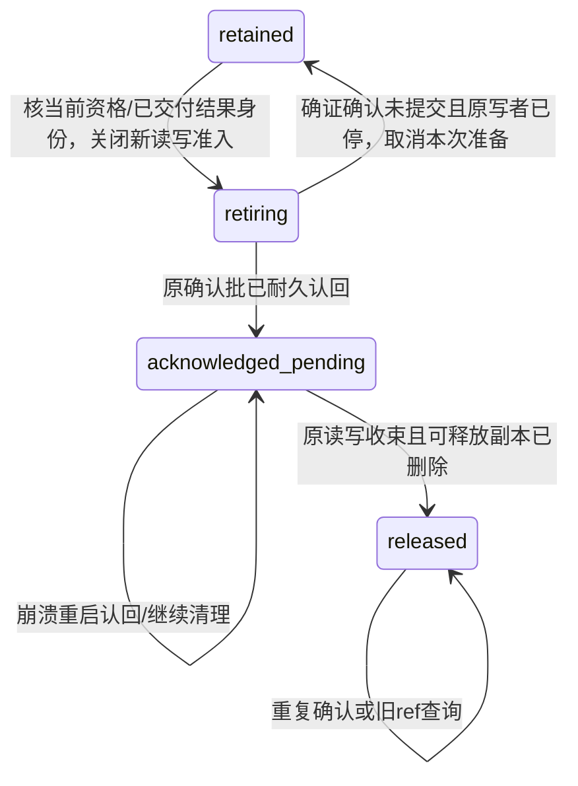

# ACK差分机制读数与首个接口候选

2026-09-29，working candidate，未评审/未接受。对应[差分领域性质](ack-domain-reading.md)；PF013后继尚在起草。此页是技术候选，不以旧无GC选择覆盖用户新要求。唯一范围是模型调用自己的内容/引用/消费者。

## 现有对象与最小增量

- RT11 CallKey/creationKey、原origin和三个终态保持；consumer.release仍仅解除自身观察，不是ACK，不取消执行。
- MS7 created/ready marker已按精确payload ref引用runtime私有内容；final ModelResponse在原日志中保留原结果/账事实。ACK不改这些不可变条目。
- 现有私有ModelCallContent行通过Storage写入；JSONL日志是另一提交域。不能靠“先查引用再删”或虚构跨库事务安全回收。
- 新增仅为既有调用的确认及释放阶段、现有内容行的保留/读取/发布门和一个模型专属操作；不新建通用GC registry或公开内容服务。

首个待审接口草案：`acknowledgeCall({ref, expectedResult})`。expectedResult指确已交付的那次终结事实身份，防止旧结果确认误释放后来重试产生的新结果。授权使用独立ack动作，不能由read/wait权限推出。结果区分确认已耐久且cleanup_pending、已released；未确认回执沿unavailable，不能假报accepted。重复确认按同一CallKey/终结事实认回原确认/清理进度，不生成新的模型请求。

**待产品对齐的最小选择**：要求整个调用已有真实终态，非仍可在原CallKey重发的awaiting_decision/resumable。后者经既有releaseCall完成放弃后再确认，不因ACK自动取消或放弃；已完成但disposition_pending时，若ACK明确表达已消费，拟组合既有consumed处分与确认，同一日志原子批写final+ack，不把确认当persisted权或要求正式Session消息。已有final保持原处分。此选择未接受；若产品规则不支持则精确退回，不编造隐式处置。

## 生命周期候选

retiring是提供者准备状态，不对外冒充已确认；acknowledged_pending/released是可观察的清理进度，不改模型complete/interrupted/handed_up终态。存在不确定原批时不允许退回retained并开第二写方；必须按原unknown责任认回。

## 两个共享裁决对象

1. **同一Session日志的ACK/final判重键及尾条件**裁决原最终结果与确认事实的先后。必要时final+ACK同批，事实源仍一份；不修改原created/ready。ACK之后查询明确released，不靠丢payload推notFound。成本继续按原ResponseId的ready/final唯一选择，ACK不新增一次费用。
2. **同一Storage事务内的调用保留控制行及该调用内容行**裁决新读者/发布者准入与删除。所有可能发布相关marker的owner和实际内容读取必须通过该门。ACK准备先关闭新准入，已进入者保留到实际完成/停止；确认批被认回后才删除。不能只检查门后放任晚写；清理须等待具体旧任务真实结束并认回原批，不等所有曾存在的consumer。读取占用只覆盖实际复制/核验，不跨消费方业务处理或无限等待。

崩溃后由既有唯一恢复owner认回原日志和清理阶段；进程锁、超时或host开始关闭不能当旧writer已死的证明。旧writer未排空时允许cleanup_pending但保留可恢复责任；公平恢复、存储可用及旧任务最终实际结束的前提下必须最终释放。新的日志费用补记可继续保留真实账，不需要原巨大创建输入。

## 释放与保留分界（待精确规格化）

删除：已经确认结果且不再承担执行/恢复/发布责任的模型自有created/ready等重复payload，以及模型自己额外持有且可合法解除的引用。保留：最小CallKey/creationKey判重、原归属/终态、确认事实/清理进度、原ResponseId与账定位、内容身份/版本防复用及必要错误事实。不删除消费者自行存下的结果或不可变日志，不从模型ACK推出外部Attachment/raw.body内容的删除权。

原创建输入回收后的同key幂等需要保留可验证的原输入等价依据；当前原规范要求完整值比较，不能随手用普通JSON.stringify摘要代替。须明确规范化精确数字/缺席/数组/源版本与摘要假设，或保留另一个足够小且仍忠实的现有判重表示。这是后继规格必须闭合的点，不能留实现自由发挥。

实际启用的外部引用保留/释放须成对沿现有provider责任；当前只提供inline路径时不以未来所有CB类型扩平台。ModelResponse、账和原消息的保留是既有权威数据，ACK只释放模型侧副本，不能宣传为清空全部会话数据。

## 精确后继预估与未定

预计RT后继（操作、读视图、发布/释放、unknown/恢复）、MS后继（ACK记录与判重/内容存续引用）和runtime节点后继必需；若MR现有final/CA现有唯一计账与SL3泛载荷足以承接，则保持它们版本，不自动升全家。旧noGC义务须逐条列取代范围，执行只走新轨，不加默认永久模式。有限TLA须覆盖读/确认/迟写/删除/崩溃交错及进展，不把“不能删已引用内容”直接作为环境公理。
