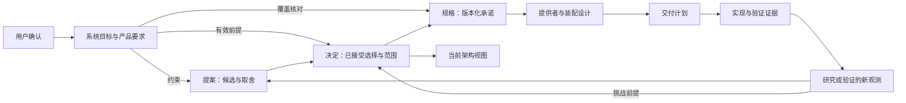

# 需求、研究、提案、决定与规格的流转

本规范落实 [D-002](../decisions/D-002-decision-authority.md) 与 [D-004](../decisions/D-004-requirements-foundation.md)。四类材料回答不同问题：研究记录可核对的观察及其局限；提案组织候选和待决取舍；决定记录已经接受的选择及范围；规格定义特定版本必须兑现的对象、行为和组合承诺。它们互相引用，但不能相互冒充。

[系统目标与产品要求](../requirements/README.md)是后续系统建模、能力定义、设计、
决定与产品化的前提。用户明确要求直接确认，不要求逐项产生设计决定；具体确认
范围、继承来源、消费基线及变更影响归[需求维护](requirements.md)。

图表达可追溯关系，不要求每项小改动经过固定流水线。用户已明确的选择可直接成为决定，但每份决定仍至少关联一份提案或研究。一个提案可产生多个决定；部分接受时，入口逐项写明已接受、拒绝或待决部分及其目标。接受决定不表示已实现、已验证或普遍适用。

在既有契约内实施，先读精确的当前采用版本；需要变更职责、保证、边界或前提时，读关联决定及其取舍；形成候选方案时，读相关提案并沿 evidence 核对研究。资料冲突或前提不确定时展开原始证据，区分事实变化与政策选择。候选、archive 和上游约定都不能作为已接受项目规则。

在有效需求前提和适用范围内，缺少新观测时有效决定优先于研究或提案；设计接受不能豁免已确认要求。新研究发现不会自行改变政策；它应标明受影响决定，说明被挑战的前提，并形成提案或取代决定。取代要求见[版本规范](versioning.md)：新观测、因果解释、可复现步骤和可验证证据缺一不可。审阅记录应说明沿用的决定/契约、证据支持的事实、本次提出的变化和仍待决定的部分。

每项研究至少标明来源和版本、实际观察、推断、适用范围和未覆盖范围。研究过时后保留原观察的版本范围，追加勘误或新的核对，不让旧证据代表新环境。决定应保持简短而可解释，提案和研究按[持久化准入](organization.md#持久化知识的准入)保留足以解释选择、复核观察和必要复现的讨论及证据；这使当前默认阅读不累积历史材料，同时保持历史可检索。

## 各环节留下什么

架构设计在候选阶段就开始；“决定后进入当前架构”指已接受选择的投影，不是
要求先作决定再开始设计。候选规格、证明、技术研究和计划可以与设计相互校准，
但必须保留候选身份与输入依赖。图中的箭头是消费关系，不要求所有材料按序建档。

| 环节 | 应交出的知识 | 下游核对 |
|---|---|---|
| 需求与研究 | 确认范围、具体问题、版本化观察及局限 | 设计消费哪些要求，哪些事实仍待核对 |
| 提案中的架构设计 | 候选边界/机制、取舍、性质及证据义务 | 哪些选择能成立，哪些仍缺决定性证据 |
| 决定 | 已接受选择、理由、范围、依据、必要前提及未决项 | 接受的是目标、语义范围、具体机制还是其他明确对象 |
| 当前架构 | 有效选择、精确契约、系统关系及覆盖缺口 | 不把候选或尚无实现的方向投影成已完成能力 |
| spec 与提供者设计 | 精确承诺、前提、消费者关系，以及具体兑现映射 | 语义、实现接口、装配和证据分别是否足供本任务消费 |
| 交付计划 | 产物/证据的生产、依赖、负责人和完成判据 | 未完成义务影响哪些工作，真实组合由谁验收 |
| 实际验证 | 固定对象、范围和环境下的结果及反例 | 证明/测试支持什么，哪些变化使结论失效 |

资料落盘先按[持久化准入](organization.md#持久化知识的准入)判断。单次施工
安排不会仅因位于流程中就成为长期 proposal；长期正文与临时任务状态分别维护。

## 提案需要留下什么

符合[提案准入](organization.md#提案的持久化准入)后，以能审阅该选择为准，说明
问题及要求、范围、候选和必要比较、推荐理由、影响与未决项；引用相关有效决定
及实际证据。职责、身份、授权、所有权、失败和跨能力交接沿架构指南展开。

系统建模和架构设计先沿[需求推导性质](../architecture-guide/assurance/invariants.md#从目标与需求推导性质)，
明确不变量及适用的安全/进展约束、保护位置和覆盖缺口，再评估候选机制。

涉及动态组件或依赖某项正确性性质时，逐项辨认建立/撤除/保留的效应、受控
范围、允许交错和顺序条件，并留下以下对应，可以直接引用既有契约与记录：

| 内容 | 应能核对的事实 |
|---|---|
| 性质与用途 | 稳定名称或条款引用、适用状态/操作/配置，以及哪个选择依赖它 |
| 前提与责任 | 哪项由提供者、消费者、装配兑现，哪项仍是外部假设，谁拥有含义 |
| 证据要求 | 按[组合性质](../architecture-guide/assurance/composability.md#证据要求何时触发)判断适用门槛；不适用时给出具体理由 |
| 当前结果 | 精确版本的证明、模型、实验或测试及其局限；缺口、失败、未执行分别保留 |
| 未完成义务 | 负责产物、受影响选择/消费者，以及消费前必须闭合的条件 |

这不是新的 Schema、catalog 或独立台账，也不要求纯计算、文字修正具有装卸
证明。完整性相对于本次选择及其后果；目录或文件齐全不能替代上述判断。

## 接受与交付怎样闭合

接受提案时，决定链接来源提案或研究并记录选择、理由、适用范围、接受依据和未决项；
产品或系统设计同时按[需求维护](requirements.md#下游依据与覆盖)固定所采用的要求与基线，纯治理选择记录其治理来源；
提案入口反向链接所产生的决定，部分接受逐项列明。正文不靠改名从“候选”变成“规格”。
需要可复现实现的具体承诺另发布精确契约版本，登记接受依据和冻结文件，更新当前架构投影。
只接受组织方向时不需要顺带创造业务契约。

初审允许未完成证明，审阅者核对义务是否已被识别。接受要求或语义范围时可以
保留实现未验证状态；接受具体机制时，该选择所依赖的必要证明或决定性探针
必须已有相应证据。不能借“部分接受”或“待后续验证”同时放行依赖缺口的选择。
无关部分和获准研究可继续；限定本轮接受范围不能撤销仍有效的系统要求。

决定引用支撑其选择的命题、前提与证据快照，说明剩余义务阻止什么；不抄写整份
证明。已有依据仍适用时沿用，当前架构及契约可变入口保留同一接受范围和缺口。
评审、工具结果或执行授权不自行增加接受范围；用户明确的接受按其实际对象记录。

计划按[交付规划](delivery-planning.md)安排证据生产和消费。语义就绪与提供者、
装配、实际验证的区别沿[规格维护](spec-maintenance.md#设计就绪与实施入口)判断；
尚未完成的强制证明不能被排在已经消费它的实施之后，再用完成百分比掩盖。

后续实现与验证记录绑定所采用的规格版本。观察到偏差时先区分实现不符合契约、规格遗漏、
事实前提变化或新需求；修复实现不必重新选择架构，改变承诺则回到其来源和决定。
研究保存观测与局限，提案解释候选及代价，决定记录这次究竟接受什么；各自只维护自己的事实。
资料齐全且不存在新的取舍时结束展开，不将这套关系当作每次小修改的固定审批流程。
