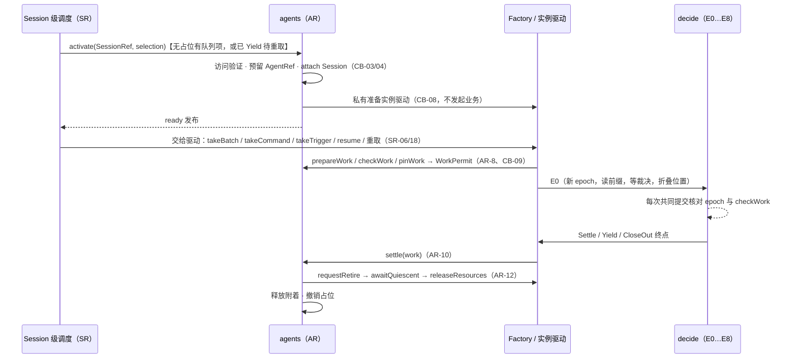

# Run 驱动器的 Cordis 视角与提供者边界

[提案索引](README.md) · [Loop](loop.md) · [Inbound](inbound.md) · [不变式](invariants.md)

本文件补齐 [D-012](../../decisions/D-012-run-driver-and-inbound.md) 接受的语义层之外的
一层：驱动器作为 Cordis 系统里一个可装卸组件，谁消费它、它建立什么效应、卸载时
撤除什么、四类提供者接口如何对接、依赖变化时进行中的 Run 怎么办，以及提供者
设计归到哪里。方法沿[总体范式](../../architecture-guide/foundations/paradigm.md#从目的到可演化的实现)、
[生命周期指南](../../architecture-guide/runtime/lifecycle.md#装载效应与撤除责任)与
[Cordis 映射参考](../../architecture-guide/reference/cordis-mapping.md#核对本项目的具体提供者)。
Cordis 事实按 `c291e796` 修订的官方文档核对（见[装载清理来源](../../research/design-spec-maintenance/effect-cleanup-sources.md)），
项目采用官方包 4.0.2；下文凡是"本项目如何使用 Cordis"的说法都是推论，不是框架保证。

## 1. 目的、消费者与消费方式

驱动器为一个 Session 的 Run 解决"在已提交事实上决定下一步并经共同提交推进"的
问题。按[能力消费方式](../../architecture-guide/modeling/capabilities.md#系统机制与-agent-消费方式)
分别回答：

| 消费方式 | 回答 |
|---|---|
| 系统机制与服务 | 驱动器是 Factory 为每个活体实例准备并拥有的**实例驱动**（D-007 四类接口之"谁准备和驱动实例"），不是全局服务。它消费 session-run v2、tools v1、human-decisions v1、model-execution v1、CC v1、DR v1 的服务读面与提交面，产出只有共同提交。`decide` 是无状态纯函数，不需要 Fiber。Session 级裁决者与调度者是 session-run 提供者的宿主级服务，不随实例生灭 |
| Agent 工具 | 驱动器不暴露为工具。Agent 影响 Run 走向的途径只有普通工具调用（含派发子代理，U-15）、跨会话消息与日程，它们都经 Inbound 裁决；interrupt/cancel 等是用户或系统控制，不给模型 |
| Agent 技能 | 无。驱动器没有需要模型学习的使用方法；系统提示词与技能贡献属于装配（MC-07、system-prompt），驱动器只消费装配结果 |
| 应用装配 | 选择 Factory 绑定（driverKey/version）、配置到达行为求值提供者、接入观测；不由应用决定 Run 语义 |

由此推出：驱动器包提供两样东西——Factory 贡献（准备实例驱动）与 SR-13 的驱动
位置投影 reducer；其余都是对既有能力的消费。没有"Loop 服务"、"Loop 事件总线"
这样的新对象。

## 2. 语义对象与运行位置

| 语义对象 | 运行位置与所有者 | Cordis 机制 | 语义权威 |
|---|---|---|---|
| Factory 贡献 | 驱动器包的贡献插件，登记到 agents 服务的 `registerFactory`（[Agent 提供者设计](../../../packages/core/agent/design.md#registryfactory-与实例插件)） | 受管贡献 + effect 撤回 | live-agent v1 AR-15 |
| 实例驱动 | AR 在预留后由 Factory 私有准备，挂在私有 `AgentInstancePlugin` 的稳定 runtime Context 下；生命周期等于该 incarnation | Fiber（实例）内的受管对象 | live-agent v1 AR-5～12、CB-08～10 |
| `decide` 与节点拓扑 | 纯函数模块，无运行实例 | 无 | run-driver v1 RD-01～16 |
| 驱动位置投影 | 驱动器包提供 reducer，注册为 SR-13 projection 贡献；fold 自 Run/Step/调用/请求事实 | SR-13 注册与撤回 | session-run v2 SR-08/13 |
| 工作许可与执行 epoch | SR 在 E0 提交时发行 epoch，AR `prepareWork/checkWork/pinWork` 发行 WorkPermit；实例只持有引用 | 门内联合准入 | SR-08/18、AR-8/9、CB-09 |
| Session 级裁决者 | session-run 提供者的宿主级服务；启动扫描随宿主启动 | 服务 | SR-15～17、SR-21 |
| Session 级调度者 | 同上；无占位开 Run、已 Yield 则重取，经 AR activate/admit 进入 E0 | 服务 | SR-18 |
| 对 Inbound 与执行 owner 的订阅 | 实例驱动持有（E5W/E6 唤醒、TL-11 `subscribe`） | 实例 Context 的 effect | RD-10/11、CB-11 |
| 帧投影 | 实例驱动发出进程内通知（assistant-stream、工具帧转发）；事实不在通知里 | 类型化事件（emit） | 研究结论 4；出站流协议待设计 |
| 扩展站点（RD-17） | 到达行为求值（SR 拥有）、装配贡献（MC-07/system-prompt）、TL-13 守卫、TL-12 投影选择 | 各能力自己的贡献点 | 各能力契约 |

驱动器本身不开放 hook：没有 pre-step、turn-stopping 或请求改写站点（DSH 取舍表）。

## 3. 装载效应与撤除责任

| 效应 | 建立条件与所有者 | 消费者可见时点 | 撤除动作与完成判据 | 保留 |
|---|---|---|---|---|
| Factory 贡献登记 | 驱动器包插件装载，向 agents 登记 driverKey/scope/version（AR-15） | 装配选择后可被 activate 解析 | 先关新激活准入，请求使用者按 AR-12 退出，最后撤销登记；旧撤回器只作用于本登记 | 已发行的实例与其工作按各自账目收口，不因贡献撤除删除 |
| 实例驱动 | AR 预留 AgentRef 后，Factory 私有准备（CB-08：不发起业务） | ready 发布后 | AR-12：关准入 → 驱动进入退役收口（§4） → 静止 → 释放资源 → 释放附着 → 撤销占位 | Run、Step、调用、请求事实全部保留；Session 驱动占位随 Yield 保留 |
| 工作许可（WorkPermit）与 epoch | E0 联合准入（SR-06/18 + AR-8/CB-09） | Run 进入 running | `settle(work)`（AR-10）：Run 终态、interrupted、Yield 三种收口都结算本实例的许可；Yield 不结算 Run | Run 状态与占位（Yield）；接续与阻塞集合 |
| 驱动位置投影贡献 | 实例或包级注册 reducer（SR-13：stateKey、版本、owner） | 注册后按水位可读 | 撤回 reducer；不删除任何 authoritative 事实；重装校验 schema/reducer 版本，不激活旧句柄 | fold 的输入事实；SR-14 的恢复兼容证据 |
| Inbound / 执行 owner 订阅 | 进入 E5W/E6 或 E0 重连时登记（effect） | 无 | 取消订阅；CB-11：释放观察只解除观察使用，不重判工作 | arrival 与 TL 事实；后台调用继续由独立 owner 持有 |
| 在途模型 attempt | 不是驱动器拥有：MC 持有请求事实，adapter 持有连接 | 帧投影 | 退役时前台 attempt 阻止 Yield（RD-14 前提）；热宽限到期按 interrupt 收口（MC-06 cancelled） | dispatched 记录与费用暴露 |
| 在途工具调用 | 独立执行 owner（TL-07/08）持有；前台等待关系归 Run | E5W 视图 | 前台 executing/admitted/detach_in_flight 阻止 Yield；可转后台者转（SR-11 处置表），已后台者继续 | 调用与 attempt 事实、结果 |
| 帧投影监听 | 实例 Context 的 emit 监听 | 客户端 | 卸载即停；不承诺重放 | 无（事实在各能力） |

Cordis 4.0.2 的 `ctx.effect()` 在显式清理或 Fiber 卸载时调用 disposer，重复调用不再
执行；异步清理的顺序与异常容纳按[映射参考](../../architecture-guide/reference/cordis-mapping.md#必须补足的契约)
须由业务顺序补足。上表第 2 行的复合退出过程正是这样的补足：它由 AR 的共享退出
过程与驱动的 `requestRetire/awaitQuiescent/releaseResources` 端口承担，不拆成多个并发
disposer（沿 Agent 提供者设计已接受的做法）。

## 4. 四类提供者接口的对接

D-007 的四类接口分别回答"谁验证当前权限、谁附着已有 Session、谁准备和驱动实例、
谁记录使用并释放资源"。驱动器落在第三类，对接如下：

| 组合/运行时条款 | 驱动器侧的对应 |
|---|---|
| CB-09 驱动只在 ready、精确工作许可与业务准入同时成立时执行工作 | RD-04 的 E0 三种进入都在同一提交取得 epoch 与 WorkPermit；RD-03 的每次共同提交携带 epoch，AR `checkWork` 在 Step/工具联合准入时复核 |
| AR-9 一次工作使用同一份装配；驱动代码或必要服务换代走"关实例 → 释放 → 新 incarnation" | Run 的装配随 E0 固定（SR-08 模型固定到 Run）；换代对进行中 Run 的处置见 §5 |
| AR-12 步骤 1：驱动停止发起新 Run/独立任务，处理当前工作到允许的停止或移交位置 | 实例驱动收到退役意图后不再 OpenStep/RequestModel/ProposeCalls；到达安全边界即 Yield（RD-14）。Yield 前提是本实例无在途前台工作；不满足时等到收束或热宽限到期，后者按 interrupt 收口并记 `yield_forced` |
| AR-12 步骤 2：等待本实例拥有的工作结算；独立工作只在权威确认接管后移交 | 前台调用/attempt 是本实例拥有的工作；后台调用与 HITL 请求从一开始归独立权威（CB-11），不需要移交，释放订阅即可 |
| AR-12 步骤 3 与 CB-10：`awaitQuiescent` 成立 = 在途准备已交还、实例拥有的工作已结算、驱动不再发起独立业务操作 | 静止的判据是：Run 已 Yield/终态/interrupted/stopping 之一、驱动位置已可由投影重算、本实例的 WorkPermit 已 settle。stopping（隔离未证实）不阻止静止：隔离责任归 SR/TL，实例只需不再提交 |
| AR-13 挂起工作或清理不设隐含超时成功 | 热宽限到期的 `yield_forced` 是驱动的收口政策，产生真实 interrupted 事实，不是把等待超时当静止 |
| AR-10 `settle(work)` 只结算许可；旧实例晚到回调不改新实例状态 | Yield 结算许可但 Run 不终态；晚到的模型/工具事实沿 MC/TL 权威进入 Inbound，由裁决表处理（I-3、SR-12） |
| CB-06 资格失效封闭新工作准入，不隐式解释为 cancel | 驱动器在下一安全边界的联合准入被拒 → 不再推进，等待实例关闭 → Yield 保留占位；重取门（§5）决定何时继续 |
| CB-11 独立工作的事实权威不依赖临时实例 | 驱动器不是任何调用、请求或 arrival 的记录者；它只是消费者与提交发起者 |
| AR-16 / CB-13 依赖变化 | §5 |

## 5. 依赖变化对进行中 Run 的政策

按[能力指南](../../architecture-guide/modeling/capabilities.md#依赖与解析)逐项写明
必需性、失效响应与旧绑定的去留。原则：**能力配置在各自契约的工作边界重新求值
（AR-9），实例存续必需绑定的变化走关实例/重取，操作必需条件的变化走门等待，
调用级绑定的变化沿 TL-06 结算**；驱动器不为任何一种引入新的状态。

| 依赖 | 必需性 | 变化/失效时对进行中 Run 的处置 | 依据 |
|---|---|---|---|
| 驱动器实现（Factory 绑定换代） | 实例存续必需 | 关旧实例：驱动在安全边界 Yield（保留占位）；新实例重取时须通过 SR-14 的恢复兼容证据，其中包含 Run 记录的驱动绑定与投影 reducer 版本；不兼容则 Run 保持 Yield 前状态并保留占位，等待用户 interrupt/cancel 或兼容实现 | AR-9/15、SR-14、RD-04 |
| Session 提供者（存储 writer、SR 服务） | 实例存续必需 | 计划撤除先关准入协作退出（CB-13/14）→ Yield → 重取；意外丢失（writer 隔离）驱动停在已确认水位不推进（RD-16），新操作 unavailable，不伪造停止 | AR-16、DR-04、CB-14 |
| 模型路由 / OpenRouter 可达性 | 操作必需 | 只影响依赖它的操作：E3 准入不可用 → `waiting_gate(dependency, E3)`，由依赖可用性提供者的 `gate_restored` 唤醒；实例保持可查询 | AR-16、RD-08/12 |
| 模型档案/选择变化 | 能力配置 | 本 Run 固定，下一 Run 生效（SR-08、MC-11） | SR-08 |
| 工具贡献换代（TL-06） | 调用级绑定 | 在途调用保留旧绑定继续；旧 manifest 未准入调用 `stale_binding` 结算，模型下一 Step 看到；Step 所需绑定整体不可用才进 `waiting_gate(dependency, E1)` | TL-06、RD-06/09 |
| 工具贡献被工作绑定后的计划撤除 | 可选贡献的在途依赖 | 消费能力登记使用关系，贡献 owner 兑现撤除门；无在途政策则繁忙撤除原子拒绝；不由驱动器中断调用 | AR-16、CB-13 |
| 预算额度 | 操作必需 | BG-03 预留被拒 → `waiting_gate(budget, ret)`；额度恢复由预算提供者发 `gate_restored` | RD-08/09/11/12、PF-019.C6 |
| 附着资格、租户权限、定义授权 | 实例存续必需 | 封闭新工作准入（CB-06），不解释为 cancel；驱动器无法通过联合准入 → 实例关闭 → Yield；重取门在资格恢复后由调度重试，占位期间普通排队输入被阻塞（与 waiting_gate 同一后果） | CB-06、AR-16、SR-06 |
| 执行 owner 失联 | 调用级 | TL-11：标 unknown/lost，Run waiting 等待重连或人工处置；不换 epoch | RD-16 |
| 依赖重现 | — | 不复活旧实例或旧绑定；完成原退出后以新代际重取（AR-16） | AR-16 |

两点作者裁决，用户可否决：

- **A-10（政策级）**：驱动器换代后的重取必须兼容 Run 记录的驱动绑定，不兼容不
  自动迁移；代价是不兼容升级会把持占位的 Run 留在原地直到人工处置。备选是允许
  新实现声明"可接管任意前缀"，但那要求新版本对旧版本的每种意图序列给出等价
  决策，缺少证据前不采用。
- **A-11**：资格失效不新增门种类（`gateRef.kind` 仍只有 budget|dependency）；它由
  实例关闭与重取门承担，Run 状态保持 Yield 前的值。备选是加 `eligibility` 门并推送
  恢复事实，但 TG/AU 当前版本没有这样的生产者义务，而重取门本来就要重查资格。

## 6. 性质、前提、证据与未完成义务

按[知识流转](../../maintenance/knowledge-flow.md#提案需要留下什么)的对应表，只列
本文件涉及的动态组件性质；语义层性质的证据见 [invariants.md](invariants.md) 与
[验证范围](../../../spec/capabilities/run-driver/verification.md)。证据义务按
[组合性质](../../architecture-guide/assurance/composability.md#证据要求何时触发)判断。

| 性质与用途 | 前提与责任 | 证据要求 | 当前结果 | 未完成义务 |
|---|---|---|---|---|
| 装载效应可撤除且不删事实（§3 表） | 驱动器包：贡献与订阅经 effect 登记；AR：复合退出过程；SR/TL/HD：事实权威 | 自定义局部效应：前后条件与所有权论证（本文），实现阶段覆盖部分失败、重入与清理结果 | 论证已给；无实现 | 提供者实现的装卸测试、清理失败保留 retained 的测试 |
| 静止判据与 Yield 前提一致（§4） | 驱动器：RD-14 前提；AR：AR-12/13 不设隐含超时；TL：前台调用真实停止/转后台结果 | 自定义代际替换协议：需行为模型或复用已有契约证据 | RunDriver 模型的 Yield/Reacquire 动作覆盖占位与重取（sched/sched-progress），未与 live-agent Runtime.tla 组合 | 组合场景：实例关闭期间 Yield 前提不满足 → 热宽限 → interrupt；作为实现验收场景，不新建组合模型 |
| 换代重取不破坏 I-18/I-20（§5 A-10） | 驱动器：兼容证据核对；SR-14 恢复兼容证据含驱动绑定 | 复用既有契约（SR-14），核对映射 | 未建模；RD-04 的重取前提以文字表达 | 提供者设计定义兼容性声明的形状与核对位置 |
| 依赖变化不引入新 Run 状态（§5） | 各依赖的 owner 兑现 AR-16/CB-13 撤除门；BG/依赖可用性提供者发 `gate_restored` | 复用既有契约 | 逐项映射已给 | `gate_restored` 生产者义务（已在 README 未决项）；TG/AU 无 eligibility 恢复推送（A-11 接受这一点） |
| 帧投影不成为第二事实源 | 驱动器：只 emit，不据通知推进；出站流协议未定 | 复用研究结论，无证明义务 | 无 | 出站流协议设计（下一轮） |

## 7. 提供者设计归属与实施入口

按 D-009 与[实现设计归属](../../maintenance/organization.md#当前实现设计的归属)：

- **包归属（建议，待实施计划确认）**：新建叶子包 `packages/agent/run-driver`，拥有
  Factory 贡献、`decide` 与节点拓扑、驱动位置投影 reducer 及其 `design.md`；现有
  `packages/agent/loop`（runtime-context、assistant-stream 的 fork 切片）保持投影层身份，
  是否并入由流帧设计决定。Session 级裁决者与调度者归 `packages/session/session`。
- **留到 Session 与工具提供者设计之后的映射**：具体服务键与注入、订阅接口形状、
  投影 stateKey 命名、Factory 的 driverKey/version 约定、兼容性声明形状。这些是
  被消费者依赖的映射，按[设计就绪](../../maintenance/spec-maintenance.md#设计就绪与实施入口)
  记录缺口：负责产物 `packages/agent/run-driver/design.md`；受影响消费者为应用装配
  （Factory 选择）、session-run 提供者（调度 → activate 链）、tools/HD/MC 提供者
  （读面与订阅接口）；闭合时点为 Session 与工具提供者设计接受后、工作 E 实施前。
- **不阻塞的部分**：`decide` 的内部算法组织、投影 fold 的实现、节点拓扑的代码结构
  属于实施者在授权范围内的选择。

## 8. 对已发布规格的影响

本文件不改变 run-driver v1 与 session-run v2 的承诺，只补充其运行位置与责任。
唯一需要写进契约的是 §5 的重取前提（A-10）：RD-04 的"重取"应明确经 SR-14 的恢复
兼容证据核对 Run 记录的驱动绑定；按用户 2026-09-14 的口径，在合并前原地修正并
重算哈希。其余映射由架构投影与提供者设计承载。
