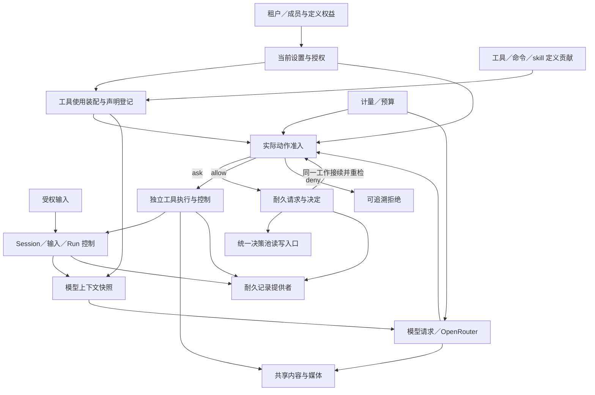

# 能力、状态权威与组合边界

本页为[计划](plan.md)阶段 1 的候选识别，承接
[D-007](../../decisions/D-007-runtime-composition.md)，不按上游包或存储表划分能力。
能力名表示职责；是否成为独立服务键、插件或包，由实际替换与所有权边界决定。
需求依据及尚缺设计见[覆盖记录](requirements.md)。

## 状态与依赖

| 能力 | 唯一拥有的状态／操作 | 依赖及边界 |
|---|---|---|
| 租户与成员治理 | 个人／组织租户、自然人与成员关系、当前角色和管理资格；创建、变更、撤回及关闭 | 认证边界提供可信自然人身份；不把当前组织写回全局用户身份，不给组织管理员私人会话读取权 |
| 定义、权益与选用 | 四类顶层定义的草稿、不可变发布、来源与 owner；使用权益、租户选用的精确版本 | 三种关系分别管理；选用不等于装载、行动授权或所有权转移；组件成员随定义版本治理 |
| 设置与当前授权 | 各设置的作用域与缺席规则；定义级／对象级授权和撤回；按实际动作求值 | 使用当前成员、权益、会话设置、专属同意和动作声明；只允许用户在有权范围内覆盖默认；动作准入参与 D-007 撤销屏障 |
| Session 生命周期与历史 | SessionRef、owner、发起者、原定义关联、目录与归档／删除；历史与模态事实 | 持久化提供者保存事实；附着遵循现有组合 v1；活动 Run 阻止归档／删除，实例是否 ready 不代替该判定 |
| 输入与 Run 控制 | 耐久队列、项修订与顺序、取批；Run／Step、执行权、控制意图、等待和接续位置 | 输入内容、Session 资格、当前授权、模型／工具／HITL 的实际结果；同一 Session 最多一个活动 Run |
| 状态声明与投影 | 有明确 owner 的状态键／Schema／版本，投影定义及水位；注册、读取与重建 | 每项先判断是原始状态还是历史投影；投影消费所属事实，不能反写第二份权威；不是任意 runtime-state 字典 |
| 耐久记录 | 有序追加、条件提交、操作去重结果、独占写入、读取／校验／关闭和恢复证据 | 不判断租户角色或 Run 业务；存储调用面仍验证访问范围。JSONL 是具体提供者，不能用 append 代替耐久确认 |
| 工具定义、发现与使用装配 | 工具／命令精确定义、实现贡献和依赖绑定、可披露目录、skill 使用激活；声明解析与受管登记 | 定义权益、当前授权、真实执行环境和 skill 内容；工具与命令帮助由同一声明派生，动态变化必须撤回相关效用 |
| 工具执行与控制 | 调用／attempt、准入、执行者绑定、状态／终态、单次控制、前后台关联和恢复 | 执行提供者实际接纳／核实，系统授权门，预算，耐久记录；从启动时明确独立 owner，不将 Promise 留在 Loop 中当后台能力 |
| 工具过程披露 | 调用关联、披露投影、读取游标／缺口、读取订阅与披露策略 | 原始帧生产、顺序和终态归工具执行；披露只消费其序列，Session 仅引用选择结果，模型上下文不自动包含全量帧 |
| 人类请求与决定 | 主动问题／批准、系统事前确认及合格暂行决定的身份、耐久待答、首个合法答复和后果交付 | 当前请求专属授权、精确动作及来源工作；不把一次批准写成持续授权。统一池索引同一请求，不另造决定权威 |
| 模型目录与请求 | official／customized 档案、能力事实与提供者绑定；请求／attempt、流、结果、未知及实际模型 | 所有用途经 OpenRouter；当前资格、内容快照、预算及提供者实际支持；模型档案不拥有 Session 内容类型 |
| 模型选择与上下文装配 | 会话选择及下一 Run 生效关系；请求的历史切点、工具别名表、skill 核心正文和压缩视图 | Session 模态事实、模型能力、设置解析、当前贡献；持久选择归 Session，装配服务只产生请求快照；切换不改写旧回复 |
| 内容与媒体 | 有序内容块、租户媒体引用、上传暂存／受理引用／有效保留、取得与部分交付 | 具体字节存储、配额与读取权限；原生模型媒体和工具产物汇入同一内容契约；独立于供应商 wire shape 和宿主路径 |
| 计量与预算 | 计费 attempt、实际／估算／未知、预留及调整；租户预算、账期和 Step 归因 | 授权和订阅使用权分别成立；供应方回执由具体提供者核实；后台迟到费用仍归原 Step，不因重建重置预算 |
| 订阅、额度与账单管理 | 本租户的订阅变更意图、来源关联与对账状态；读取／申请变更／核实结果 | 外部供应方拥有其订阅、授予额度／周期和实际账单事实，受信提供者取得版本化依据；本地管理不得伪造供应方确认。自有额度由具名签发者拥有，预算余额不能替代使用资格 |
| 工程观测 | 各能力生产阶段／拒绝／异常证据；观测读面拥有采集水位、查询／导出、保留政策与缺口状态 | 关键事实仍归业务权威，观测索引不改变结果；采集失败和采样有可辨状态，正文／秘密及工程访问继续受治理；不要求另建全局日志权威 |

Session、Run 控制与持久化可以首版共同部署，仍须分别表达业务转移、存储确认和
失败；工具执行的独立 owner 不意味着首版一定另起进程。需要跨越哪一层故障边界，
由执行提供者的可验证声明决定。不能以同一进程替代精确交接，也不提前增加集群协调。

## 组合关系

箭头表示消费或交接，不是所有权树或同一数据库事务。已接受的 Registry/Factory/
附着和释放继续按 D-005/D-007 工作，不在本页重建一套生命周期内核。
工具实现可以消费底层服务，但所有受控调用必须经过同一执行准入，不允许模型、
程序化消费者、后台路径或插件自测直接绕过授权。

## 系统审批的职责落点

工具注册贡献包含定义及授权声明；装载能力拥有声明校验、解析器版本、命名冲突和
随贡献撤回的索引。登记成功只说明声明可被查询和解析，不证明某个用户已授权。
同一工具的命令可以解析出不同动作和资源范围，不能将它压成工具名上的一个开关。

授权能力消费实际动作及当前规则，返回许可、硬拒绝或需询问。请求能力负责先保存
待答事实，再使 Run 等待并向用户呈现；Run 控制拥有能否继续驱动，工具执行拥有
是否真正准入与执行。三者须有同一请求／调用关联及可核实交接，不能依赖观察事件
的送达顺序实现“先显示再补存”。批准后仍重检当前权限、精确绑定和工作状态。

注册表不复制授权配置，决策池不复制批准事实，Session 日志中的结果引用不接管
工具执行，后台转换不授予先执行资格。所有外部效果的停止、未知和撤销分别表达。
暂行确认的资格、产物与级联撤销由该动作的领域能力承担，通用审批布尔值不能证明。

## 需要共同收敛的接口

| 交接 | 必须先解决的问题 |
|---|---|
| 授权 → 耐久受理／实际准入 | 权限撤回与提交如何排序；一次判定的有效范围；权威不可用时怎样明确阻塞 |
| 工具装配 → 调用 | 声明与实现同代可见；请求别名定位原绑定；待批期间换代、卸载或撤权怎样结束旧请求 |
| HITL → Run／工具 | 请求与等待的耐久关联；答复和取消竞争；重复交付只形成一次合法接续；放行仍需当前门 |
| Run → 独立执行 | 普通 interrupt/cancel 与 interrupt_then_run 的前后台传播差异；原调用控制与收口证据 |
| 内容 → 输入／回复 | 先保存可引用媒体再确认输入或交付；引用占用、删除及保存失败如何避免悬空或假成功 |
| 历史／模态 → 模型切换 | 队列未消费内容不泄入模型；压缩保留原文及模态事实；切换与 Run 取批的共同提交 |
| 预算 → 请求／工具 | 并发预留、权限通过但预算失败、发网结果未知、迟到费用与实际多次计费的分别结算 |

## 来源到目标的差异

本轮沿用 D-006 的精确来源 `c291e7961a515f6d7af9304e7fd1d257929aef26`。
下表用已固定的源基线定位实际采用机制及目标差异，不扩张已接受来源集合。

| 固定来源与差异拥有者 | 可保留的机制 | 必须由本项目设计的差异 |
|---|---|---|
| [Loop/prompt 源基线](fork/loop-source.md) | 受管提示词贡献、确定排序、来源快照、纯投影 | 三类上下文分离；租户权限、内容与工具一致快照、恢复及贡献撤回 |
| [Session 源基线](fork/session-source.md)、[JSONL 源基线](fork/jsonl-source.md) | 连续追加、flush、尾部校验与写失败处理 | 耐久受理、Session/Run 生命周期、独占写入、队列并发；恢复历史不冒充恢复外部工作 |
| [工具源基线](fork/tools-source.md)、[历史工具/审批来源](../tool-system/v1/assembly.md) | 工具注册／定义／调用阶段、明确批准结果的参考 | 命令级声明自动登记、独立调用、内部帧、运行中转后台、可恢复请求与统一池；不纳入已排除的 jobs/user-approval 源码 |
| [模型源基线](fork/llm-source.md) | 内容转换、adapter 绑定、请求准备和流处理 | 统一中立内容、原生音频等实际链路、OpenRouter 唯一出口、预算与会话切换；缺失模态不能静默丢块 |
| [Loop 源基线](fork/loop-source.md)、[原运行时差异](../agent-runtime/v1/source-mapping.md) | 输入身份、取消与 drain 的源码参考 | 耐久队列和修订、整体 interrupt_then_run、精确 Run 与按调用控制 |

精确上游页面由[D-006 来源](../dsh-core-adoption/sources.md)和
[工具来源映射](../tool-system/v1/assembly.md)导航。库的 API 与具体 JSONL/OpenRouter
映射须在专题设计时核对；本页未声称这些目标已由上游或当前产品代码兑现。
