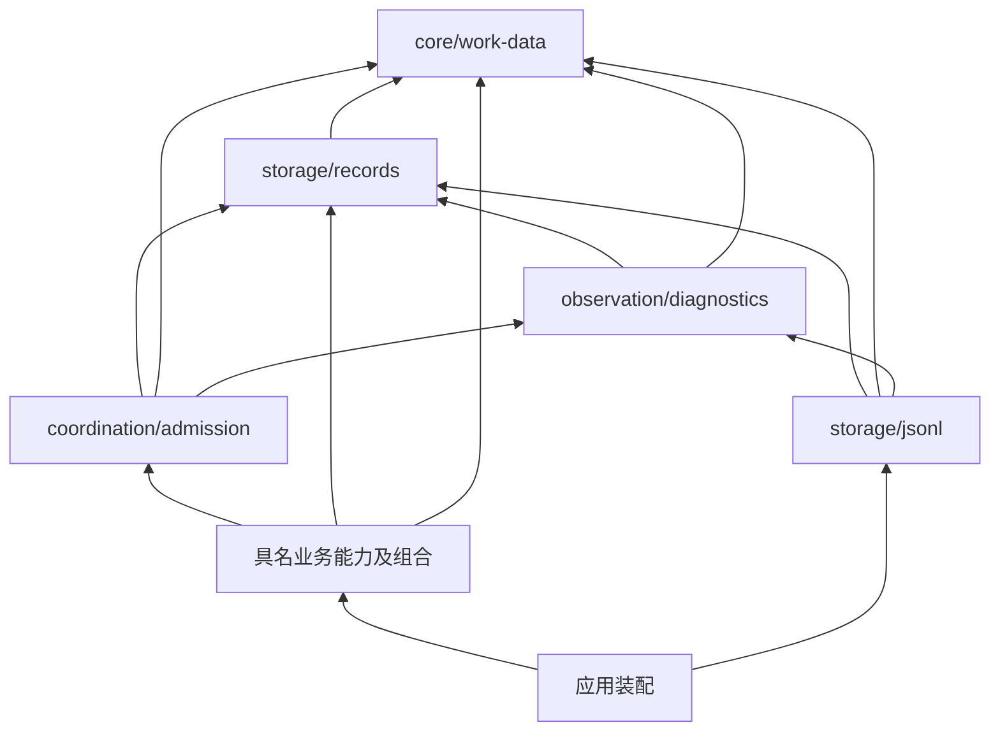

# P0 共享接口实施稿

本稿消费四份开工输入 [scope](scope.md)、[acceptance](acceptance.md)、
[implementation-spec](implementation-spec.md)、[plan](plan.md) 的
`e11cc6990c1354e7baf138cc2f501effc7b413f6` 版本。它固定 P0/P1 的 TS 表达与
`core-journal/1` 实施格式。`8f4cfa9` 的 I1–I5 经独立复核闭合，主调度在 HUB
整合复验后接受为施工输入，证据见[设计验证](evidence/p0-shared-interfaces/README.md)；
尚未表示产品实现、验收或正式规格发布。
后续 [D-010](../../../decisions/D-010-shared-diagnostics.md) 接受共享诊断施工面；
本稿仅对两个 P1 factory 增加必需 Diagnostics 注入并补齐依赖方向。work-data、
records 数据/端口/codec 及 core-journal/1 保持 `8f4cfa9` 语义，历史探针保留原版本范围。
精确语义仍归下列已接受 v1，不原地修改其 Schema：

- [data.agent-runtime-identity](../../../../spec/data/agent-runtime-identity/v1/contract.md)
  与其 [Schema](../../../../spec/data/agent-runtime-identity/v1/schema.json)。
- [data.core-work](../../../../spec/data/core-work/v1/contract.md) 与其
  [Schema](../../../../spec/data/core-work/v1/schema.json)。
- [capability.durable-records](../../../../spec/capabilities/durable-records/v1/contract.md)
  的 DR-01–05。
- [composition.core-work-coordination](../../../../spec/compositions/core-work-coordination/v1/contract.md)
  的 CC-01–07 及本批适用的 [组合场景](../../../../spec/compositions/core-work-coordination/v1/scenarios.md)。

本次提供者正文迁移以 `7af250ee19df1077a5143cac817558caa959a392` 为固定来源，
仅将 JSONL/admission 的当前实施映射归入所属包，本稿保留共享数据、records、
codec、黄金样例与原评审记录。迁移已按下述内容核验接受，未宣称产品交付。
[JSONL 当前设计](../../../../packages/storage/jsonl/design.md) 与 [admission 当前设计](../../../../packages/coordination/admission/design.md)
各自拥有后续映射维护；本页相关章节仅导航，不再维护第二份 factory/协调接口。
[迁移对应与检查](evidence/p1-provider-mapping/README.md)逐项保留来源范围。

### P1 映射迁移的采用

主调度接受 `2c3aede7c9b33d381b266bbfbef0ad8d8dec7959` 的归属迁移，已通过
`6d4b87cf75b130f271c1987e61ccb1c55a33549c` 合入 HUB。原方案继续采用既有
`8f4cfa9`/D-010 的接受依据，没有新的语义选择；本次不重复原架构审阅或机制实验。
主调度独立运行固定源的迁移核验，18 段内容保持所列同义表达关系，13 份原证据
字节不变；合入后再逐字节核对全部 13 个来源文件并通过 455 份文档检查，见
[HUB 核验](evidence/p1-provider-mapping/hub-verification.json)。
factory/短门/资源管理仍待实际实现，D1、P1 组合及原验收前置保持关闭。

### 现有共享数据实现

work-data 与 records 已有公开产品实现，精确签名分别引用
[work-data 源码](../../../../packages/core/work-data/src/index.ts) /
[README](../../../../packages/core/work-data/README.md) 和
[records 源码](../../../../packages/storage/records/src/index.ts) /
[README](../../../../packages/storage/records/README.md)。
本页保留的 DTO、records 与 codec TS 块属于原固定设计来源；后续不在这里维护
另一套已实现声明。原 `8f4cfa9` 探针按当时的完整稿运行，迁移后复现历史探针须
检出其固定输入版本，不能将旧单模块声明结果当作当前多包编译结果。

## 依赖与实现所有者

箭头表示消费公开入口；类型依赖同样计入无环检查。



| 目录 / 包名 | 唯一职责与公开入口 |
|---|---|
| `packages/core/work-data` / `@omne-harness-lite/work-data` | 默认入口导出本页共享 DTO、精确 Schema 验证、无损 JSON 值与规范编码；无运行状态、Cordis 或业务服务依赖 |
| `packages/storage/records` / `@omne-harness-lite/records` | 默认入口导出下述 DR 端口、批次/回执、实施 envelope 校验与 codec；无文件、锁或业务 reducer |
| `packages/coordination/admission` / `@omne-harness-lite/admission` | [当前提供者设计](../../../../packages/coordination/admission/design.md)维护默认目标入口；产品尚未实现 |
| `packages/storage/jsonl` / `@omne-harness-lite/jsonl` | [当前提供者设计](../../../../packages/storage/jsonl/design.md)维护默认目标 writer；当前仅有 `/baseline` 普通文件实现 |
| `packages/observation/diagnostics` / `@omne-harness-lite/diagnostics` | 默认入口提供共享结构化日志、标准 trace 上下文、有界输出与管理面；精确接口归[当前观测设计](../../../../packages/observation/diagnostics/design.md) |

不新建「transaction」「event bus」「universal state」包。JSON 值与规范编码放
work-data，是因为 Action 精确比较、operation 输入和 records 都要使用同一语义；
物理行和 envelope 的编码归 records。业务事件定义、校验与 reducer 留在各 owner。
原 `8f4cfa9` 的 TS 块已按同一模块验证可编译；落包按上表分开，以公开 import 连接。
新增 Diagnostics 仅由 jsonl/admission 从其公共包导入；完整消费编译在 D1 实现后验证，
records 不导出或 import 该类型。

自有新包使用 `private:true`、`license:"UNLICENSED"`，provenance 为
`format:1`、非空 scope、`files:[]`、完整覆盖 src 的
`project_files:[{path,purpose}]`，省略上游 repository/commit/archive 字段；
不伪造 LICENSE/UPSTREAM 或新增许可授予。DSH 派生包仍保留原 provenance、
MIT 与 UPSTREAM。默认导出是 `".":{types:"./dist/index.d.ts",import:"./dist/index.js"}`；
整合者将新增 Schema 资源列入 files。该元数据沿 P0 checker 的共同输入，
源码来源分类不由各包另造。

## 共享值、完整 DTO 与 Schema 消费

TS 表达是 Schema 的静态投影。`string` 本身不证明非空/来源可信，`number` 本身
不证明整数范围，结构对象不授予操作权；这些在解析或行为边界验证。所有输出
深拷贝并深冻结，拒绝 accessor、原型实例、循环、稀疏数组、symbol、undefined、
函数、bigint 和非有限数；不调用输入的 `toJSON`。普通或 null 原型对象的自有
可枚举数据属性可接纳；不可枚举属性也拒绝，避免隐藏输入被丢弃。

```ts
export type JsonValue = null | boolean | number | string | JsonObject | readonly JsonValue[];
export type JsonObject = { readonly [key: string]: JsonValue };
export type OpaqueId = string;
export type SessionRef = Readonly<{ tenantId: OpaqueId; sessionId: OpaqueId }>;
export type AgentRef = SessionRef & Readonly<{ incarnationId: OpaqueId }>;
export type UserRef = Readonly<{ userId: OpaqueId }>;
export type MembershipRef = Readonly<{ tenantId: OpaqueId; userId: OpaqueId }>;
export type DefinitionRef = Readonly<{ ownerTenantId: OpaqueId; definitionId: OpaqueId }>;
export type DefinitionVersion = Readonly<{ definition: DefinitionRef; version: OpaqueId }>;
export type RunRef = Readonly<{ session: SessionRef; runId: OpaqueId }>;
export type StepRef = Readonly<{ run: RunRef; stepId: OpaqueId }>;
export type WorkRef = Readonly<{ tenantId: OpaqueId; workId: OpaqueId }>;
export type WorkOwner = StepRef | WorkRef;
export type MediaRef = Readonly<{ tenantId: OpaqueId; mediaId: OpaqueId }>;
export type MediaMetadata = Readonly<{
  media: MediaRef; sha256: string; byteLength: number; mimeType: string; filename?: string;
}>;
export type ResourceRef = Readonly<{
  tenantId: OpaqueId; kind: string; resourceId: OpaqueId; version: OpaqueId;
}>;
export type SecretRef = Readonly<{
  kind: "secret_version"; tenantId: OpaqueId; secretId: OpaqueId; version: OpaqueId;
}>;
export type Binding = Readonly<{
  implementationId: OpaqueId; generation: OpaqueId; configurationRevision: OpaqueId;
  environment: ResourceRef; parserVersion: OpaqueId;
}>;
export type Confirmation =
  | Readonly<{ confirmation: "none" | "before_effect"; provisionalContract?: ResourceRef }>
  | Readonly<{ confirmation: "provisional"; provisionalContract: ResourceRef }>;
export type Action = Readonly<{
  tenantId: OpaqueId; callId: OpaqueId; attemptId: OpaqueId; owner: WorkOwner;
  definition: DefinitionVersion; toolKey: OpaqueId; commandKey: OpaqueId;
  declarationVersion: OpaqueId; binding: Binding; params: JsonObject;
  resources: readonly ResourceRef[]; permissions: readonly string[];
  grantorKinds: readonly string[]; impact: string;
}> & Confirmation;
export type CallRef = Readonly<{ owner: WorkOwner; callId: OpaqueId; attemptId: OpaqueId }>;
export type RequestRef = Readonly<{ tenantId: OpaqueId; requestId: OpaqueId }>;
export type Money = Readonly<{ integer: string; scale: number; currency: string }>;
export type OperationRef = Readonly<{
  namespace: OpaqueId; principalId: OpaqueId; operationId: OpaqueId;
}>;
export type Decision = Readonly<{
  request: RequestRef; contentVersion: OpaqueId; outcomeVersion: OpaqueId; actor: UserRef;
}> & (
  | Readonly<{ outcome: "answer"; answer: JsonValue }>
  | Readonly<{ outcome: "approve" | "reject"; answer?: never }>
);
export type TextBlock = Readonly<{ blockId: OpaqueId; kind: "text"; text: string }>;
export type MediaBlock = Readonly<{
  blockId: OpaqueId; kind: "image" | "audio" | "video" | "file"; media: MediaRef;
  delivery: "model_native" | "agent_attachment";
}>;
export type ToolCallBlock = Readonly<{
  blockId: OpaqueId; kind: "tool_call"; call: CallRef; action: Action;
}>;
export type ToolResultBlock = Readonly<{
  blockId: OpaqueId; kind: "tool_result"; call: CallRef;
  outcome: "succeeded" | "failed" | "denied_before_execution" |
    "cancelled_before_execution" | "interrupted" | "unknown";
  value: JsonValue;
}>;
export type DeferredReceiptBlock = Readonly<{
  blockId: OpaqueId; kind: "deferred_receipt"; call: CallRef; request: RequestRef;
  continuationId: OpaqueId; status: "pending";
}>;
export type ContentBlock = TextBlock | MediaBlock | ToolCallBlock | ToolResultBlock | DeferredReceiptBlock;
export type InputBlock = TextBlock | MediaBlock;
export type Input = Readonly<{
  session: SessionRef; inputId: OpaqueId; revision: number; content: readonly InputBlock[];
  busyBehavior: "queue" | "interrupt_then_run"; literal: boolean;
}>;
export type ProtocolVersion = Readonly<{ protocolId: string; version: string }>;
export type BackgroundDeclaration =
  | Readonly<{ mode: "unsupported" }>
  | Readonly<{
      mode: "supported"; executionOwnerProtocol: ProtocolVersion;
      requiredResources: readonly string[]; reconnectProtocol: ProtocolVersion;
      form: "independent_execution";
      automatic?: Readonly<{ thresholdMs: number; stopMarginMs: number }>;
    }>;
export type AuthorizationDeclaration = Readonly<{
  version: string; permissions: readonly string[];
  resourceResolver: Readonly<{ resolverId: string; version: string }>;
  grantorKinds: readonly string[]; impactTemplate: string;
}> & Confirmation;
export type Command = Readonly<{
  commandKey: string; inputSchema: JsonObject | boolean; outputSchema: JsonObject | boolean;
  authorization: AuthorizationDeclaration; effect: "read" | "write" | "external";
  cancellation: "supported" | "unsupported"; background: BackgroundDeclaration;
  requiredSkills: readonly DefinitionVersion[]; environmentCapabilities: readonly string[];
}>;
export type ToolDefinition = Readonly<{
  definition: DefinitionVersion; toolKey: string; commands: readonly Command[];
}>;
export interface DataTypes {
  OpaqueId: OpaqueId; SessionRef: SessionRef; AgentRef: AgentRef; UserRef: UserRef;
  MembershipRef: MembershipRef; DefinitionRef: DefinitionRef; DefinitionVersion: DefinitionVersion;
  RunRef: RunRef; StepRef: StepRef; WorkRef: WorkRef; WorkOwner: WorkOwner;
  MediaRef: MediaRef; MediaMetadata: MediaMetadata; ResourceRef: ResourceRef; SecretRef: SecretRef;
  Binding: Binding; Action: Action; CallRef: CallRef; RequestRef: RequestRef; Money: Money;
  OperationRef: OperationRef; Decision: Decision; Input: Input; ContentBlock: ContentBlock;
  AuthorizationDeclaration: AuthorizationDeclaration; Command: Command;
  ToolDefinition: ToolDefinition; BackgroundDeclaration: BackgroundDeclaration; InputBlock: InputBlock;
}
export type ValidationIssue = Readonly<{
  path: string; code: "invalid_json" | "schema" | "unsupported_number" | "capacity";
  message: string;
}>;
export type Checked<T> =
  | Readonly<{ ok: true; value: T }>
  | Readonly<{ ok: false; issues: readonly ValidationIssue[] }>;
export type JsonLimits = Readonly<{ maxBytes: number; maxDepth: number; maxNodes: number }>;
export declare function parseJson(text: string, limits: JsonLimits): Checked<JsonValue>;
export declare function copyJson(value: unknown, limits: JsonLimits): Checked<JsonValue>;
export declare function parseData<K extends keyof DataTypes>(
  type: K, value: unknown, limits: JsonLimits,
): Checked<DataTypes[K]>;
export declare function canonicalJson(value: JsonValue): string;
export declare function equalJson(a: JsonValue, b: JsonValue): boolean;
```

`DataTypes` 覆盖两个 Schema 的每个 `$defs`（SessionRef 的别名不重新定义）。
顶层 Schema 的 `oneOf` 不是每个命名类型的验证器；`parseData("OperationRef", …)`
解析精确 `#/$defs/OperationRef`。类型不枚举权限/授予者/资源词汇，词汇注册与
当前语义由 AU/TG/TL owner 校验。SecretRef 是可传输值，不允许把秘密原文放入 params。

共享包打包两份**逐字相同**的正式 Schema 资源；构建检查来源路径、SHA-256 和
全部 `$defs` 名称映射，独立 tarball 不依赖仓库根 `spec/`。不另维护改写版 Schema，
不通过 HTTP 解析 `.invalid` 引用。使用 `ajv@8.20.0` 的 draft-2020-12 入口，
先注册两个完整 `$id`，再编译每个精确 `$defs` 引用。关闭 coercion、默认值注入、
删除额外属性和远程加载；`strictSchema=true`、`strictNumbers=true`、
`strictTypes=false`、`strictRequired=false`、`allowUnionTypes=true`、
`ownProperties=true`。后两项 strict 的放宽仅适配正式 Schema 中父级类型/条件
结构，不跳过结构校验或接受未知关键词。配置依据是
[Ajv options](https://ajv.js.org/options) 和
[draft-2020-12 入口](https://ajv.js.org/json-schema.html#draft-2020-12-breaking)。

JSON 文本用 `jsonc-parser@3.3.1` 的 visitor 取得词法位置、对象边界和属性名，
`disallowComments=true`、`allowTrailingComma=false`、`allowEmptyContent=false`，
任何 parse error 都拒绝。每个对象独立保存已见的**解码后**属性名，重复键即拒绝；
构造对象使用 null 原型和数据属性，不让 `__proto__` 成为原型操作。该库本身
允许容错，项目必须检查所有错误并禁止把部分解析当有效值；API 来源见
[官方 README](https://github.com/microsoft/node-jsonc-parser/blob/main/README.md)。

规范编码命名 `core-json/1`：递归按 UTF-16 code unit 顺序排序对象键，数组保序，
字符串使用 JSON 字符串转义，不裁剪、折叠大小写或做 Unicode 归一化；无空白。
数字使用有限 JS number 的 JSON 十进制表达；整数须在安全整数范围，负零拒绝。
文本数字 token 与重新编码后的十进制值必须数学相等（符号/系数/十进制指数比较，
不靠两次 Number 相等）；例如 `1e3` 与 `1000` 等价，
`9007199254740993`、`0.100000000000000005` 不可先舍入后接纳。
这是此 JS 实施支持范围，错误为 `unsupported_number`，不声称正式 Schema
禁止所有更大整数。Money.integer 保持字符串，绝不转 Number。
`canonicalJson` 只接受已通过上述验证的值，遇到无效运行时输入抛具名编程错误；
外部入口先使用 Checked API。摘要仅辅助索引，最终仍比较规范串。

| Schema 的宽边界 | 后续必须消费的额外校验 |
|---|---|
| `Action.params: object` | TL 固定命令的完整 inputSchema；AU 固定 resolver/声明词汇；对象解析及跨 tenant 关系；冻结后执行完全同一值 |
| `tool_result.value: {}` | TL 原调用 outputSchema 与实际终态；错误结果的具名契约；用户不能导入为可信结果 |
| `Decision.answer: {}` | HD 原请求的答复 Schema/选项；本批系统 approve/reject 不开放任意 answer |
| `Command.inputSchema/outputSchema` | TL 在发布前验证 Schema 方言、全部引用可离线解析及支持关键词，编译失败不可发布；不允许网络载入或执行扩展关键词 |
| ID、版本、权限/资源名、Money | 分配权威、不复用、版本资格、词汇当前有效性和精确财务单位由各 owner 负责 |

共享包仍表达完整 ContentBlock/Input/Background/Confirmation v1；本批业务入口
单独拒绝非 text 输入、interrupt_then_run、provisional、background supported 等
未开放操作。不能修改共享类型把后续合法数据变成不存在，也不能因 Schema 接受
就开放本批未实现功能。

## Records 的批次、身份和读取边界

以下是实施数据，归 records，不混入正式 work-data。非空字符串字段须验证；
seq、stream revision 使用十进制非负整数字符串，内部可用 bigint，磁盘不用
JSON number。`"0"` 是空前缀/空 stream，完整提交前缀的 seq 从 1 连续递增。
修复未提交尾部后新 epoch 可占用曾分配但未成立的 seq；完整 Position 与 commitId
不复用，消费者不能仅凭 seq 将旧 pending 票据认作新批次。
一个批次对一个 stream 至多有一个 append，**每个批次令被触及 stream 的修订加 1**，
不是每条事件加 1；记录在 append 内有序，stream 顺序按 canonical StreamRef 排列。

```ts
export type Counter = string; // /^(0|[1-9][0-9]*)$/; never compare lexically
export type Principal =
  | Readonly<{ kind: "user"; user: UserRef }>
  | Readonly<{ kind: "system"; systemId: OpaqueId }>;
export type StreamRef = Readonly<{
  namespace: OpaqueId; owner: OpaqueId;
  scope: Readonly<{ kind: "tenant"; tenantId: OpaqueId }> | Readonly<{ kind: "system" }>;
  streamId: OpaqueId;
}>;
export type Causality = Readonly<{
  parentOperation?: OperationRef; initiator?: Principal; session?: SessionRef; work?: WorkOwner;
  call?: CallRef; request?: RequestRef; agent?: AgentRef;
  definition?: DefinitionVersion; binding?: Binding;
}>;
export type OwnedRecord<Kind extends string = string, Version extends string = string,
  Data extends JsonValue = JsonValue> = Readonly<{
  kind: Kind; version: Version; data: Data;
}>;
export type StreamAppend = Readonly<{
  stream: StreamRef; expectedRevision: Counter; records: readonly OwnedRecord[];
}>;
export type OperationInput = Readonly<{
  format: "core-operation/1"; operationKind: string;
  tenantId: OpaqueId | null; principal: Principal; target: JsonValue;
  arguments: JsonValue; preconditions: JsonValue; causality: Causality;
}>;
export type CommitRequest = Readonly<{
  operation: PreparedOperation;
  appends: readonly StreamAppend[]; result: JsonValue; requiredUses: readonly UseRequirement[];
}>;
export type UseBinding = Readonly<{
  owner: string; resourceId: OpaqueId; generation: OpaqueId; epoch: OpaqueId;
}>;
export type UseRequirement = Readonly<{ recordOwner: string; binding: UseBinding }>;
export type Position = Readonly<{
  coordinationDomain: OpaqueId; writerEpoch: Counter; commitId: OpaqueId; seq: Counter;
}>;
export type Watermark = Readonly<{
  coordinationDomain: OpaqueId; seq: Counter; commitId: OpaqueId | null;
}>;
export type Receipt<Outcome extends RecordedOutcome = RecordedOutcome> = Readonly<{
  position: Position; operation: OperationRef; inputDigest: string; outcome: Outcome;
  streams: readonly Readonly<{ stream: StreamRef; revision: Counter }>[];
}>;
export type CommitEnvelope = Readonly<{
  formatVersion: "core-journal/1"; position: Position; operation: OperationRef;
  inputEncoding: "core-json/1"; canonicalInput: string; inputDigest: string;
  appends: readonly StreamAppend[]; outcome: RecordedOutcome;
  requiredUses: readonly UseRequirement[];
}>;
export type Rejection = Readonly<{
  code: "invalid" | "capacity" | "stale_writer" | "closed" | "wrong_domain" |
    "namespace_denied" | "invalid_owner" | "unsupported_format";
  message: string;
}>;
export type RecordConflict =
  | Readonly<{ kind: "operation_input"; operation: OperationRef }>
  | Readonly<{
      kind: "revision"; currents: readonly Readonly<{ stream: StreamRef; revision: Counter }>[];
    }>;
export type RevisionConflict = Extract<RecordConflict, { kind: "revision" }>;
export type RecordedOutcome =
  | Readonly<{ status: "committed"; result: JsonValue }>
  | Readonly<{ status: "conflict"; conflict: RevisionConflict }>;
export type CommittedReceipt = Receipt<Extract<RecordedOutcome, { status: "committed" }>>;
export type ConflictReceipt = Receipt<Extract<RecordedOutcome, { status: "conflict" }>>;
export type CommitResult =
  | Readonly<{ status: "committed"; receipt: CommittedReceipt }>
  | Readonly<{ status: "conflict"; conflict: RevisionConflict; receipt: ConflictReceipt }>
  | Readonly<{ status: "conflict"; conflict: Extract<RecordConflict, { kind: "operation_input" }>; receipt: null }>
  | Readonly<{ status: "rejected"; reason: Rejection; receipt: null }>
  | Readonly<{ status: "unavailable"; reason: string }>
  | Readonly<{ status: "unknown"; operation: OperationRef; diagnosticId: OpaqueId }>;
export type Head = Readonly<{
  watermark: Watermark; streams: readonly Readonly<{ stream: StreamRef; revision: Counter }>[];
}>;
export type ReadResult<T> =
  | Readonly<{ status: "read"; value: T }>
  | Readonly<{ status: "not_at_watermark"; available: Watermark }>
  | Readonly<{ status: "rejected"; reason: Rejection }>
  | Readonly<{ status: "unavailable"; reason: string }>;
export type OperationLookup =
  | Readonly<{ status: "committed"; receipt: CommittedReceipt; watermark: Watermark }>
  | Readonly<{ status: "conflict"; conflict: RevisionConflict; receipt: ConflictReceipt; watermark: Watermark }>
  | Readonly<{ status: "pending_durability"; position: Position; watermark: Watermark }>
  | Readonly<{ status: "not_committed"; verifiedThrough: Watermark }>
  | Readonly<{ status: "unknown"; operation: OperationRef; diagnosticId: OpaqueId }>
  | Readonly<{ status: "unavailable"; reason: string }>;
export interface RecordReader {
  readHead(streams: readonly StreamRef[]): Promise<ReadResult<Head>>;
  readRange(query: Readonly<{
    afterSeq: Counter; through: Watermark; limit: number;
  }>): Promise<ReadResult<Readonly<{
    envelopes: readonly CommitEnvelope[]; through: Watermark; nextAfterSeq: Counter; complete: boolean;
  }>>>;
  lookupOperation(operation: OperationRef): Promise<OperationLookup>;
}
declare const preparedOperationBrand: unique symbol;
export type PreparedOperation = Readonly<{
  [preparedOperationBrand]: true; operation: OperationRef; canonicalInput: string;
}>;
declare const preparedCommitBrand: unique symbol;
export type PreparedCommit = Readonly<{
  [preparedCommitBrand]: true; operation: OperationRef; canonicalInput: string;
  owners: readonly string[]; requiredUses: readonly UseRequirement[];
}>;
export type PendingCommit = Readonly<{
  status: "pending_durability"; position: Position; operation: OperationRef;
  disposition: "apply" | "record_conflict";
  completion: Promise<CommitResult>;
}>;
export type Submission = PendingCommit | CommitResult;
export interface RecordPreparation {
  prepareOperation(operation: OperationRef, input: OperationInput): Checked<PreparedOperation>;
  prepare(request: CommitRequest): Checked<PreparedCommit>;
}
export interface RecordWriter extends RecordReader, RecordPreparation {
  readonly coordinationDomain: OpaqueId;
  readonly writerEpoch: Counter;
  lookupPrepared(operation: PreparedOperation): Submission | Readonly<{ status: "not_seen" }>;
  commit(prepared: PreparedCommit): Submission;
  quarantine(diagnosticId: OpaqueId): void;
  closeWriter(): Promise<CloseResult>;
}
export type CloseResult =
  | Readonly<{ status: "closed"; watermark: Watermark }>
  | Readonly<{
      status: "blocked"; watermark: Watermark; diagnosticId: OpaqueId;
      pending: readonly OperationRef[]; lockHeld: boolean;
    }>;
export type AcquisitionCleanupState = Readonly<{
  cleanupId: OpaqueId; coordinationDomain: OpaqueId;
  phase: "retained" | "releasing" | "released";
  lock: "held" | "released" | "unknown";
  diagnosticId: OpaqueId;
}>;
export interface AcquisitionCleanup {
  readonly cleanupId: OpaqueId;
  inspect(): AcquisitionCleanupState;
  retryRelease(): Promise<AcquisitionCleanupState>;
}
export type AcquireResult =
  | Readonly<{ status: "acquired"; writer: RecordWriter; recovered: Watermark }>
  | Readonly<{ status: "busy" }>
  | Readonly<{
      status: "unavailable"; reason: string; diagnosticId: OpaqueId;
      cleanup: Readonly<{ status: "released" }> |
        Readonly<{ status: "retained"; owner: AcquisitionCleanup }>;
    }>;
export interface RecordProvider {
  readonly reader: RecordReader;
  acquireWriter(): Promise<AcquireResult>;
}
export type RecordLimits = CodecLimits & Readonly<{
  maxPendingCommits: number; maxPendingBytes: number;
}>;
export type NamespaceBinding = Readonly<{
  namespace: string; owners: readonly string[]; allowSystemScope: boolean;
}>;
export type JsonlProviderOptions = Readonly<{
  coordinationDomain: OpaqueId; directory: string;
  bindings: readonly NamespaceBinding[]; limits: RecordLimits;
}>;
```

业务的窄准备/查询入口归 [admission 业务消费边界](../../../../packages/coordination/admission/design.md#业务消费的窄边界)；
writer 的 prepare、同步 commit、lookupPrepared 与 quarantine 归
[JSONL 准备与提交](../../../../packages/storage/jsonl/design.md#纯准备与同步提交)。
factory 记法也已迁到该包的[公开入口](../../../../packages/storage/jsonl/design.md#公开入口依赖与实际状态)，
其中配置、返回端口及数据类型继续复用上列 records 公共源码。

可信 namespace、允许写的 owner/stream scope 由装配给 writer 的写入绑定限定；
这层检查防内部误接，不替代 TG/AU 的用户授权。核心域使用一个部署分配的稳定
namespace（如 `core`），**不以操作名或 tenant 替换去重 namespace**。
principalId 是 `core-json/1` 对 Principal 的规范串，由认证边界/内部系统身份构造；
tenant、目标、操作种类、调用者输入的前置修订和因果关系全部进入 canonicalInput。
因此同一用户同一 operationId 换 tenant/目标/输入会冲突，不能变成另一操作。
operationId 是去重键，不能作为 Principal、Action 或执行许可。

canonicalInput 取上面完整 OperationInput 的规范串，inputDigest 为其 UTF-8
SHA-256 小写十六进制。动态权限查询结果、生成的 commitId/时间/结果/事件不加入
原用户操作输入；已提交的同输入重试先返回原结果，不再生成对象身份或执行事件。
PreparedCommit 中 appends/result 是 owner 固定的拟提交后果，pending 重试也只能
认回第一次内容，不能用相同键替换它们。读取原结果前仍由入口检查当前读取资格。

### 结果何时占用 operation 身份

接纳、同输入认回、异输入冲突、provider-owned 条件冲突结果与 unknown 的当前映射
统一见 [JSONL 原操作结果](../../../../packages/storage/jsonl/design.md#结果何时占用-operation-身份)；
本处保留原入口，历史 R3/G10 的出处与字面量仍在下文。

多 stream 批次须至少有一个 append，每个 records 非空，owner 与 scope 明确，
不重复 StreamRef。tenantId 非 null 的业务操作只能写属于该租户的业务 stream；
需要跨 ownerTenant 的引用保留在数据中，不意味着可以写外租户 stream。
全局个人租户唯一性/自然人和部署初始化的联合关系可使用系统 scope stream，
但只由明确授权的 TG 管理组合列名声明；普通工具调用不因此得到系统写权限。
系统记录同样保存 Principal、操作输入和因果引用，不能借 null 隐藏租户归属。
causality.initiator 与已认证 Principal 分别保留；成员/委托和当前准入依据由相应
owner 的记录保存，不能因为 operation.principalId 相同就省去授权证据。
各 owner 用 `OwnedRecord<自己的 kind, 精确 version, 自己的数据类型>` 定义封闭
联合，调用 records 前用该 owner 的 Schema 和纯不变量检查验证，再在端口处
放宽为 OwnedRecord。records 只检查 envelope/JSON/所有者与修订，不运行任意
事件 validator 回调；恢复时未知 kind/version 由消费 owner 明确拒绝，不用 cast
让 JsonValue 自动变成 Session/批准/预算记录。

readRange、provider.reader、lookupOperation 的完整批次、精确水位、可信前缀与
not_committed/unknown 边界归 [JSONL 精确前缀读取](../../../../packages/storage/jsonl/design.md#精确前缀读取)。
原始 reader 仍是受信恢复边界，业务投影的授权义务不因迁移改变。

## 同步短门、两份视图与精确使用

该节已迁入 [admission 当前设计](../../../../packages/coordination/admission/design.md#同步短门两份视图与精确使用)：
AdmissionHost/factory、同步 frame、participants/publication、双视图、
ExactUseIssuer/capture/claim/release 与真实 owner 的责任都由该包维护。
[调用顺序实例](../../../../packages/coordination/admission/design.md#调用顺序实例)和
[关闭与失败责任](../../../../packages/coordination/admission/design.md#关闭与失败责任)随之迁入。
原 `8f4cfa9` 的声明/机制探针仍只证明原固定稿范围，不表示本包已有实现。
## JSONL codec、writer epoch 和锁

物理行为严格 UTF-8、无 BOM，**一行一个完整 envelope**，每行只有末尾 LF；
CRLF、空行、尾随垃圾或重复键均不接纳。外层仅四字段：

```ts
export type JournalLine = Readonly<{
  formatVersion: "core-journal/1"; payload: string; byteLength: number; sha256: string;
}>;
export type CodecLimits = JsonLimits & Readonly<{ maxLineBytes: number; maxPayloadBytes: number }>;
export type DecodedLine = Readonly<{
  envelope: CommitEnvelope; payload: string; byteLength: number; sha256: string;
}>;
export declare function encodeEnvelope(envelope: CommitEnvelope, limits: CodecLimits): Checked<Uint8Array>;
export declare function decodeLine(completeLine: Uint8Array, limits: CodecLimits): Checked<DecodedLine>;
```

payload 是 canonicalJson(envelope)；外层也是 canonicalJson 后加 LF。
byteLength 和 sha256 针对 payload 字符串实际 UTF-8 字节，先核对再解析；双层
JSON 都用上面的严格 parser，拒绝未知/多余字段和超限。解码必须验证 payload
本身已是规范串、canonicalInput 也是 core-json/1 的规范 OperationInput、摘要
与 Principal/operation.principalId 对应；不能验证一份规范副本后执行另一份原文。
长度是实现限制内的安全整数，seq/epoch/revision 则保留十进制字符串。
UTF-8 有效性、重复键、结构和摘要通过后，再由恢复校验 epoch、seq、commitId
唯一、stream 前置修订/归属与操作键唯一性；codec 的单行成功不等于日志前缀有效。

writer epoch、DomainLock 内部测试端口、同锁 acquire/恢复/保全、串行写入与
closeWriter 的当前实施正文见
[JSONL writer 生命周期](../../../../packages/storage/jsonl/design.md#writer-epoch锁恢复与关闭)。
该包同时保留 `f712e025` / HUB `04b8dbf` 的原生锁证据身份与环境局限。
本页只继续维护 records 的 codec 格式来源及下列字面量样例。

### 黄金样例与反例

正式 records 作者建立以下固定夹具，字段顺序/字节/摘要由实现测试逐项核对，
不是只拿 encode 的输出再喂 decode 自证。G01 已由隔离 P0 生成器计算，下面是
完整外层**字面量**（末尾另有一个 LF）。实现直接将其保存为 fixture，测试不能
调用自己的 encode 动态更新期望值。

```json
{"byteLength":957,"formatVersion":"core-journal/1","payload":"{\"appends\":[{\"expectedRevision\":\"0\",\"records\":[{\"data\":{\"epoch\":\"1\"},\"kind\":\"writer.epoch\",\"version\":\"1\"}],\"stream\":{\"namespace\":\"core.writer\",\"owner\":\"durable-records\",\"scope\":{\"kind\":\"system\"},\"streamId\":\"writer-epochs\"}}],\"canonicalInput\":\"{\\\"arguments\\\":{\\\"epoch\\\":\\\"1\\\"},\\\"causality\\\":{},\\\"format\\\":\\\"core-operation/1\\\",\\\"operationKind\\\":\\\"writer.acquire\\\",\\\"preconditions\\\":{\\\"previousEpoch\\\":\\\"0\\\"},\\\"principal\\\":{\\\"kind\\\":\\\"system\\\",\\\"systemId\\\":\\\"local-host\\\"},\\\"target\\\":\\\"domain-1\\\",\\\"tenantId\\\":null}\",\"formatVersion\":\"core-journal/1\",\"inputDigest\":\"0479c584729c1c75fff3736735fd2ebcb1648fb6a1b962e30a0e96ea209b923e\",\"inputEncoding\":\"core-json/1\",\"operation\":{\"namespace\":\"core.writer\",\"operationId\":\"epoch:1\",\"principalId\":\"{\\\"kind\\\":\\\"system\\\",\\\"systemId\\\":\\\"local-host\\\"}\"},\"outcome\":{\"result\":{\"epoch\":\"1\"},\"status\":\"committed\"},\"position\":{\"commitId\":\"commit-1\",\"coordinationDomain\":\"domain-1\",\"seq\":\"1\",\"writerEpoch\":\"1\"},\"requiredUses\":[]}","sha256":"89422b4553ddcb718fa7866d264b9f6f1874b9cc69cb789cdb7d3992cf475928"}
```

该样例的 OperationInput 是：

```json
{"format":"core-operation/1","operationKind":"writer.acquire","tenantId":null,"principal":{"kind":"system","systemId":"local-host"},"target":"domain-1","arguments":{"epoch":"1"},"preconditions":{"previousEpoch":"0"},"causality":{}}
```

| 固定样例 | 要保护的差异 |
|---|---|
| G01 epoch:1；G02 epoch:2 及其前后普通批次 | epoch 是耐久权利记录；崩溃认回无回执完整行后递增；没有普通批次冒充 acquire |
| G03 两个 tenant stream 的 owner-change（同一租户、不同 owner） | 一批多个 append，修订各加一；输入与输出结果完整保留；单 stream 失败整批不成立 |
| G04 `{"b":2,"a":"中\\n文"}` 与重排键形式 | 两份规范输入相等、UTF-8 字节长度与 JS string.length 不混用 |
| G05 `false` / `null` / 字段缺失 / 空数组 | 不隐式清除设置、不吞空值、不排序数组 |
| G06 `{"a":1,"\u0061":2}`、嵌套重复键、两个 payload 键 | 先词法拒绝，不能采用 last-key-wins 后再验摘要 |
| G07 不安全整数、非精确数、-0、稀疏数组、undefined、getter、toJSON | 不通过数字舍入/隐式序列化改变输入；指明非法值或实施不支持 |
| G08 同完整批次删最后 LF / 改中间字节并保留 LF | 前者可保全修尾，后者完整坏行拒绝恢复；不能把任意 parse error 当断尾 |
| G09 同 operation 同输入但替换拟提交 result；异输入同摘要的受控夹具 | 返回原结果；规范输入异值仍冲突，不仅看 digest；不重建 Run/重复执行 |
| G10 期望 revision=3、当前=2 的合法条件提交；后来当前=3，同键重试/重启 | 原 conflict 和原回执不变；原业务 appends 从未执行；冲突行未耐久时为 pending/unknown，完整恢复才认回 conflict |

G01 的 payload 为 957 UTF-8 字节，完整物理行为 1294 字节；含 LF 的物理行
SHA-256 为 `922232e653e4196bcdda9624769766eb65784c624caf2661f38051543917e63a`。
G03 不涉及跨租户原子写授权；跨 tenant 的写要先被明确组合范围拒绝。
G02–G09 的正式固定输入/期望由 records/测量作者在本稿评审固定后落实，并在
P2/P3 消费前提供实际 codec round-trip 与反例证据。

G10 固定 R3 的条件冲突：session-1 当前修订 2，edit-1 期望 3，第一次提交记录
冲突。随后另一个操作将 session-1 改为 3，edit-1 同输入重试仍认回下列原冲突，
不产生原 edit 的业务 appends。完整物理行为 1747 字节（含 LF），SHA-256 为
`f29ce05cd8e294b61d0e1ffeb6ed79745dcba2792d96bc4dfe0577f07a06fef8`；该字面量只
表达 seq=4 的冲突行，P1 测试还要建立真实的 epoch/先前 stream 修订前缀。

```json
{"byteLength":1329,"formatVersion":"core-journal/1","payload":"{\"appends\":[{\"expectedRevision\":\"0\",\"records\":[{\"data\":{\"currents\":[{\"revision\":\"2\",\"stream\":{\"namespace\":\"core\",\"owner\":\"session\",\"scope\":{\"kind\":\"tenant\",\"tenantId\":\"tenant-1\"},\"streamId\":\"session-1\"}}],\"kind\":\"revision\"},\"kind\":\"operation.conflict\",\"version\":\"1\"}],\"stream\":{\"namespace\":\"core.records\",\"owner\":\"durable-records\",\"scope\":{\"kind\":\"tenant\",\"tenantId\":\"tenant-1\"},\"streamId\":\"operation-outcomes\"}}],\"canonicalInput\":\"{\\\"arguments\\\":{\\\"text\\\":\\\"hello\\\"},\\\"causality\\\":{},\\\"format\\\":\\\"core-operation/1\\\",\\\"operationKind\\\":\\\"session.edit\\\",\\\"preconditions\\\":{\\\"expectedRevision\\\":\\\"3\\\"},\\\"principal\\\":{\\\"kind\\\":\\\"user\\\",\\\"user\\\":{\\\"userId\\\":\\\"user-1\\\"}},\\\"target\\\":{\\\"sessionId\\\":\\\"session-1\\\"},\\\"tenantId\\\":\\\"tenant-1\\\"}\",\"formatVersion\":\"core-journal/1\",\"inputDigest\":\"f4c5354196c6d3973f2d68f9fbdb5cfd7e92b94854a1f3f64218964a3a68be69\",\"inputEncoding\":\"core-json/1\",\"operation\":{\"namespace\":\"core\",\"operationId\":\"edit-1\",\"principalId\":\"{\\\"kind\\\":\\\"user\\\",\\\"user\\\":{\\\"userId\\\":\\\"user-1\\\"}}\"},\"outcome\":{\"conflict\":{\"currents\":[{\"revision\":\"2\",\"stream\":{\"namespace\":\"core\",\"owner\":\"session\",\"scope\":{\"kind\":\"tenant\",\"tenantId\":\"tenant-1\"},\"streamId\":\"session-1\"}}],\"kind\":\"revision\"},\"status\":\"conflict\"},\"position\":{\"commitId\":\"commit-4\",\"coordinationDomain\":\"domain-1\",\"seq\":\"4\",\"writerEpoch\":\"1\"},\"requiredUses\":[]}","sha256":"0556331ec651033a80cb0a4a2760db00ca095769cc96c47074ec02c168efed6d"}
```

## 已实现公共面与原证据的范围

work-data 的当前 DTO/Schema 消费、严格 JSON 与不可变值归
[公开源码](../../../../packages/core/work-data/src/index.ts)；records 的当前端口与
core-journal 单行 codec 归[公开源码](../../../../packages/storage/records/src/index.ts)。
上文共享接口代码块、格式选择与 G01/G10 字面量保留原受审身份，用于解释单行
表示、条件冲突与固定黄金值；不在此继续演进精确签名。实际 P0 结果分别归
[数据证据](evidence/p0-work-data/README.md)与[记录证据](evidence/p0-records/README.md)。

同步门/ExactUse/关闭及 R1/R2 反例归[admission](../../../../packages/coordination/admission/design.md)，
R3/R5 去重恢复与 acquire 双重失败归[JSONL](../../../../packages/storage/jsonl/design.md)。
这些设计证据不等于真实 writer/准入/业务组合已通过；应用组合与范围沿
[local-harness](../../../../apps/local-harness/design.md)。

## 本稿的实际检查与待审范围

以下保存原设计轮次的检查、待审措辞与 R1–R5 处置，接受状态以页首固定依据为准；
不是本次迁移执行结果。原始证据字节不动，本轮结果另见
[迁移检查](evidence/p1-provider-mapping/README.md)。

隔离探针与包锁已由[原件归档](evidence/p0-shared-interfaces/README.md)保留，未进入产品包。实际 Node 为
`v24.18.0`；以 `npm install --ignore-scripts --no-audit --no-fund` 安装精确
ajv 8.20.0、jsonc-parser 3.3.1、TypeScript 6.0.3。
`node probe.mjs` 已编译两个原 Schema 的 30 个 `$defs` 引用，核对 DataTypes
覆盖去重后的 29 个定义；执行 5 个 parser 条件和 2 个 OperationRef 有效/无效
条件，并生成上述 G01/G10 字面量。`tsc --strict --target ES2024 --module NodeNext
--moduleResolution NodeNext --noEmit interfaces.ts type-consumer.ts` 对全部 TS 声明
及受限消费方通过。消费方能准备/查询/submit，同时 7 条预期类型错误确认其不能
直接 writer.commit/quarantine、mint 任意 owner、赋入三种 async 回调或伪造 ExactUse。
`node review-probe.mjs` 对三个同步回调和三个晚到拒绝去向、三个参与者错配、
四个快照修改条件、两条文档内完整黄金行逐字/长度/摘要核对通过。
`node claim-probe.mjs` 对单次交接的 9 个机制场景通过：原 pending 票据重复、
跨 operation 拒绝、只清理重试新 pin、releasing/released 不可 claim、claimed
拒绝 not_admitted、unknown 保留责任、释放失败、并发释放合并和释放后的旧结果查询。
该探针使用内存票据与模拟资源 owner，仅核对私有状态协议；真实资源收口仍待 P1。
这仅是 Schema/API/样例可行性证据，不是完整严格 JSON 实现、业务状态转移、
TDD 产品交付、native 构建或耐久性验证。

`make docs-check BASELINE=e11cc69` 通过 393 个 Markdown 文档及其关联检查，
本轮修订的 `make docs-check BASELINE=979d80f` 同样通过 393 个文档；
单次交接修订的 `make docs-check BASELINE=199af4c` 同样通过 393 个文档；
`git diff --check` 通过。Python 环境/安装缓存和探针输出均放本任务允许的 tmp，
没有修改产品源码、根依赖或正式冻结文件。检查日志为 `docs-check.log`、
`docs-check-review.log`、`probe-result.json`、`tsc-result.log`、`review-probe-result.json`；清理 spoke 前由
整合者按交付证据要求保全。
单次交接的结果另在 `claim-probe-result.json` 与 `docs-check-use.log`。

独立评审重点是：受信 owner publications 是否足够约束半发布/未知；同步排位
与去重、双视图/普通撤权和精确控制是否吻合 CC；epoch/尾部恢复是否保护 DR；
共享 DTO/宽对象与完整业务校验是否明确，且本接口没有把业务状态集中到核心。
所有 P1 真实 writer/联合准入验收仍未执行；native 探针已按上文固定版本和环境
交付，由主调度验收为 P1 的有效前提，其证据不扩大为正式 writer 验收。

### 独立评审处置

以下处置对应 reviewer 对 `979d80f` 的最终 R1–R5。该 reviewer 定点复核
`199af4c` 后确认 R2–R5 文档层面闭合，R1 仅余真实 ExactUse 的单次交接与释放
后失效反例；本次只修订该残余，等待复核。作者没有自行宣布整体接受或闭合评审。
“共享值、完整 DTO 与 Schema 消费”整节与 `979d80f` 逐字一致，段落内容的
SHA-256 为 `147f458a5402394ec3875c0142008f474192296e4e23b495010e8ceeaa0155a9`；
本轮只改变 records/admission 实施边界及其说明，work-data 可继续消费原固定子集。

| 项目 | 本稿处置位置与证据 |
|---|---|
| R1：参与者与批次/使用闭合、可变列表 | Records 的 PreparedCommit.owners/requiredUses 与提交段的一一校验；受限 ExactUseIssuer 和私有实例归属；submit 先捕获冻结列表/字段/函数。残余修订增加 ExactUseLifecycle 与原 operation/输入/Position 的单次 claim、原票据和临时 pin 的清理分界、释放守卫与永久失效；claim-probe 的 9 个场景通过，正式组合测试仍待 P1 |
| R2：内层 async 被 void 忽略 | OwnerPublication/ExactUse 改为严格 undefined 返回；每个调用独立守卫、隔离和晚到拒绝诊断，不提前 ready。三个 async 的负向编译检查及三个晚到拒绝实际探针 |
| R3：失败结果去重/恢复 | “结果何时占用 operation 身份”表；RecordedOutcome/ConflictReceipt/OperationLookup、record_conflict 分支和保留结果 stream；G10 完整字面量及 P1 的 revision2→3/重启验收映射。拒绝明确留在未接纳边界，业务拒绝沿 owner 的耐久审计普通提交 |
| R4：业务无法合法准备 | RecordPreparation 由 AdmissionCoordinator 提供，调用示例已改；type-consumer 真实编译并禁止获取 writer 的直接写入权 |
| R5：acquire 失败遗留无 owner | AcquireResult.cleanup + 稳定 AcquisitionCleanup.inspect/retryRelease、并发认回和再次 acquire 封闭；消费类型检查通过，真实双失败/fd/锁结果留给 P1 正式提供者 |

这些临时机制探针用于确认修订可表达、语言行为与黄金字段相符，不是业务实现
或一次完整 RED/GREEN 交付；P1 仍按工作包先写目标失败测试再实现真实提供者。
