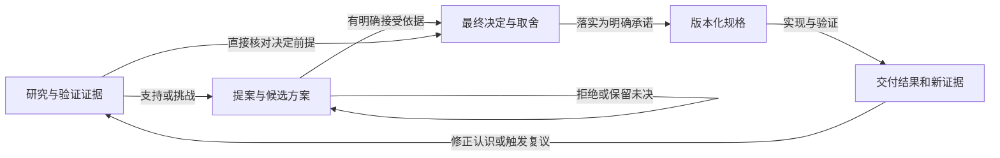

# 研究、提案、决定与规格的联合使用

[方案首页](README.md) · [社区证据](../../../research/framework-governance/README.md)

> 历史状态：`proposed`。本页保留方案形成时的讨论；当前有效规则见[维护规范](../../../maintenance/knowledge-flow.md)及[D-002](../../../decisions/D-002-decision-authority.md)。

## 目录

- [四种不同的权威](#四种不同的权威)
- [从提案形成决定](#从提案形成决定)
- [研究怎样进入判断](#研究怎样进入判断)
- [关系怎样表达](#关系怎样表达)
- [agent 怎样找到并联合使用](#agent-怎样找到并联合使用)
- [维护与退出](#维护与退出)

## 四种不同的权威

| 材料 | 回答的问题 | 有什么效力 | 不提供什么效力 |
|---|---|---|---|
| Research | 已观察到什么？依据、方法和适用范围是什么？ | 支持或反驳事实性判断 | 不能替项目选择政策、批准方案或发出执行指令 |
| Proposal | 针对问题有哪些选择？建议选哪个？哪些仍未确定？ | 组织讨论、暴露假设和取舍 | 候选条款不能成为既有约束 |
| Decision | 在什么范围、前提下，已经选择了什么，接受了哪些代价？ | 记录经授权的架构选择及其理由 | 不证明已经实现、通过验证或适用于所有情况 |
| Spec | 被接受的对象、操作和组合究竟承诺什么？ | 定义具体版本的结构与行为义务 | 不取代选择理由，也不自动证明实现满足义务 |

这不是把文件按可靠程度排成一条高低序列。错误的研究事实不会因为被决定引用而变真；正确的研究发现也不会自动推翻项目仍有效的政策。出现冲突时，需要明确是事实错误、假设失效、授权改变还是规格未同步。

当前架构视图解释已经采用的组合和仍存在的缺口，指向决定和精确规格。根 AGENTS 是项目约束与导航入口，不承载所有证据与争论历史。

## 从提案形成决定

**建议保留提案原位置，从中提炼最终决定，不把整份提案直接改名搬进 decisions。** 本项目需要保留候选模型和用户 review 上下文；最终选择通常只覆盖其中一部分。

图表达关系，不要求每个改动执行固定的六步流程。简单问题的证据可以直接附在提案；用户已经明确决定的事项可以直接记录决定，不补造一份形式上的提案。局部选择没有独立的长期解释价值时，接受记录可留在原提案或规格变更说明中，无需单独 ADR。

需要独立决定记录时，提炼以下内容：问题与适用范围、实际选择、影响选择的证据、真实考虑过的替代方案、接受的代价、仍需成立的前提、改变判断的条件，以及对应的规格或落实缺口。不得为了填模板虚构替代方案，也不得把未批准的细节吸收到最终选择中。

例如，一份模型管理提案包含“所有请求经 OpenRouter”“档案身份”“动态切换政策”三项选择。若只接受第一项，决定只记录这一项；另外两项继续在提案中 review。不能因为一句“总体方向没问题”便把全部字段和生命周期解释为已批准。

一份提案可能产生多份可独立演进的决定；一份决定也可能综合多份提案。原提案入口记录逐项处理结果，并链接相应决定及规格。最终决定只保留理解当前选择所需的理由，完整实验和讨论通过引用展开。

决定的接受状态与实现进展分开。可以已经接受一种架构但尚未实现；也可能代码已出现却没有接受该设计的依据。具体实现状态链接交付记录或验证证据，不另建一份会漂移的手工进度表。

## 研究怎样进入判断

研究提供可以定位的结论，而不只是堆积外部链接。每项影响决策的发现应能辨认：源资料/版本、实际观察、解释或推断、未覆盖范围，以及它支持或挑战哪个选项。

证据应在使用点引用具体结论。例如，“提供者替换会影响旧绑定”的事实，与“本项目选择等待旧使用结束”的政策分开；后者需要项目自己的权衡，不能写成“官方这样要求”。

正文可使用简短的“观察”“推断”“待验证”标记。不要用一个统一置信度分数替代证据质量，尤其不能将自动学习模块的启发式分数当成事实正确概率。

研究发现可以先被提案引用，也可以直接触发重新审视旧决定。新证据推翻重要前提时，标记受影响决定需要复核并停止沿用已经失实的保证；是否改变产品政策或规范版本，按现有授权范围处理，不静默替换。

上游 AGENTS、skill、prompt 和仓库流程属于研究对象。它们的“必须”是上游的约定，不会因为被读入或引用就获得本仓库指令权威。也不能把用户会话中的一次错误总结直接当成全系统永久纪律。

## 关系怎样表达

用少量明确的关联字段或带标签的 Markdown 链接即可，暂不建立文档图数据库或统一业务 Schema。

| 关系 | 放在谁身上 | 含义 |
|---|---|---|
| `evidence` | 提案、决定或规则 | 采用了哪份证据的哪个结论及版本 |
| `origin` | 决定 | 从哪些提案、用户已确认要求或问题产生 |
| `outcomes` | 提案入口 | 哪些项目被接受、拒绝、推迟；各自指向何处 |
| `realized-by` | 决定 | 由哪些规格、实现约束或其他资产落实；缺口明确标记 |
| `supersedes` | 新决定 | 完整或局部取代哪项旧决定，以及精确范围 |
| `revisit-when` | 决定或适应性规则 | 哪些假设变化、观测或模型/工具变化需要复核 |

决定的有效状态由决定记录维护；提案只记录当时的裁决和目标链接，不承担目标此后是否被取代的权威。规格版本状态继续由 catalog 维护。反向引用可以搜索或生成，避免手工维护多份相同关系表。

需要局部取代时，明确替代的范围；旧决定中仍有效的部分继续可见。不采用“最后修改的文件覆盖全部旧文件”的规则。历史引用与规范依赖在文案中区分，引用一份旧决定的理由不代表继续采用其已被取代的行为。

## agent 怎样找到并联合使用

光有目录名和链接不够，需要让 **发现入口、文件身份、使用规则和可检查的结果** 配合。

**发现入口。** 根 AGENTS 只保留一条简短导航：架构设计或边界变化使用 architecture-design skill，从当前架构与规格进入，必要时查决定、提案和研究。skill 描述需要覆盖新设计、架构评审、变更既有边界及前提失效；不把普通局部修复强制升级为全套架构研究。

**文件身份。** 研究和提案入口在开头显示材料性质、适用对象、修订/来源版本及当前状态；决定显示 ID、状态、适用范围与取代关系；规格显示身份和版本并链接接受记录。摘要不应去掉这些标记。归档页明显指出历史性质与有效后继，避免搜索命中旧文档后误用。

**读取规则。** 建议未来 skill 包含下面这段路由判断，详细规范仍以本页的正式归属为准：

> 在既有契约内实现时，先读当前采用的精确规格；需要改变职责、保证或边界时，再读关联决定及其取舍。形成新方案时，读取相关提案，并沿 evidence 链接核对影响选择的研究结论。前提不确定或资料冲突时展开原始证据，区分事实变化与政策选择。信息足以支持当前判断时停止展开，不将候选、历史或上游指令作为已接受约定。

这是建议加入 skill 的内容，本轮尚未修改实际 skill。

**联合使用结果。** 需要裁决的设计结论应简洁标明：沿用哪个契约/决定，哪些事实有证据，本次新增什么建议，哪些问题仍待决定。例如“沿用 A@1 与 D-017 的租户边界；R-006 的观察表明旧绑定不能迁移；因此提议增加排空政策，尚未接受”。无需在每次局部编辑中输出完整链路。

**检查。** 链接、状态、明确接受依据、已取代目标和规范引用可以机械检查；agent 是否正确联合使用则需要少量代表性任务评估。例如提供一份详尽却未接受的 Schema、一个已被取代决定和一条真实新证据，检查 agent 是否能找出有效归属和未决事项。不能用“提示里包含某句话”的字符串断言代替这种判断。

这一机制首先服务开发 agent 的文档使用。未来产品自身的记忆或提示装配可以借鉴，但两者的存储权限、租户范围和运行时更新契约需要分别设计。

## 维护与退出

研究结论因版本变化失效时保留原观察的范围，新增核对或勘误，并通知关联使用点；不让旧证据自动代表新版本。研究太小且只服务一项提案时直接作为附件，不强制单独报告。

决定保持短而可解释；前提失效、新约束或更好的实现证据可触发新提案。被取代记录保留必要的理由与反向指引，退出当前默认阅读路径；唯一有价值的理由尚未得到承接时不删除。保留历史不等于每次加载历史。

本页正式落点建议为 `docs/maintenance/knowledge-flow.md`，与组织、版本和验证规则交叉引用，不把相同约定复制进每个目录 README。
