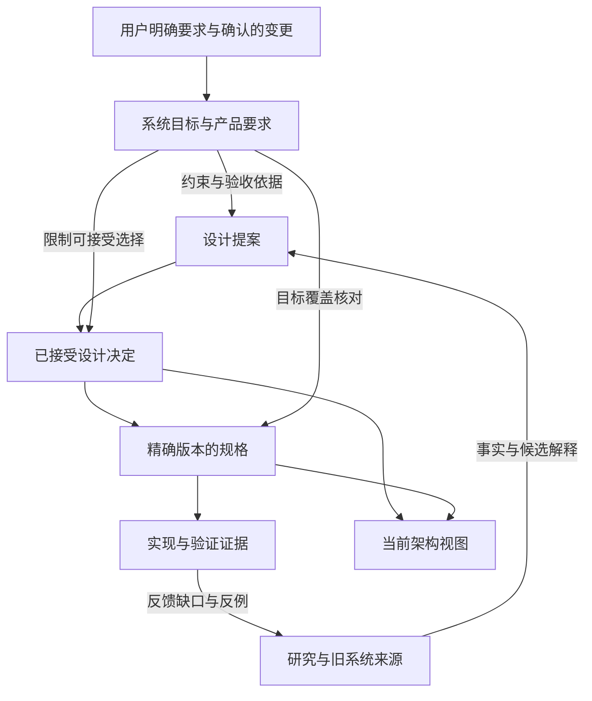

# 组织与权威设计

[提案入口](README.md) · [迁移与验证](migration.md)

本文为候选设计，尚未成为维护规则。

## 1. 文档按独立变化的主题拆分

建议布局如下；文件名展示归属，不表示已经建立这些目录或批准其中的精确语义。

```text
docs/requirements/
├── README.md                         目标、产品三维、确认范围与阅读入口
├── system/
│   ├── README.md                     系统目标与全局要求索引
│   ├── fully-dynamic-system.md        完全动态目标及来源定义、待澄清边界
│   ├── long-running-and-evolving.md   超长期待机、稳定运行、持续进化
│   ├── interest-alignment.md          与服务对象始终保持利益对齐
│   ├── omne-next-continuity.md         功能继承范围及来源基线
│   └── constraints.md                用户已指定的跨系统约束
└── product/
    ├── README.md                     三维入口与产品特性发现
    ├── environment/
    │   ├── README.md                 本维度主条目与副维度引用
    │   └── PF-002-external-change-response.md
    ├── user/
    │   ├── README.md
    │   └── PF-001-tenant-organization-context.md
    └── agent/
        └── README.md                 当前仅引用其他主维度的相关特性
```

README 负责发现与概览；规范性正文只有一处。一个主条目增大后，只有出现可独立
解释、接受或演进的子主题时才拆分；单个主题需要多个附件时可改成同名目录，保留
身份与唯一正文入口。暂未介绍的内容保留已知目标和具体缺口，目录不靠虚构需求填满。

三维的含义沿用当前产品框架：环境关注与外部世界的关系，用户关注服务对象及其
协作，智能体关注自身能力与行为。它们组织产品要求，能力、数据和组合契约继续
按原有 `spec/` 语义划分；一项特性可以由多个能力共同兑现，一个能力也可服务多项特性。

### 主归属与副维度

产品条目拥有一个全局稳定 ID，维度是可调整的分类。例如 `PF-001` 主归属用户、
副归属智能体；`PF-002` 主归属环境、副归属用户与智能体。主维度变动保持 ID，
更新路径与引用。ID 不重用；拆分、合并或替代时保留旧身份的去向记录。

主条目声明主、副维度；各维度 README 链接对应正文。副维度引用必须说明该项
如何影响本维度，不能复制一份稍改措辞的要求。目录位置与声明一致性可机械检查；
主归属是否恰当仍是产品判断。

跨层共用的义务也只有一个拥有者。例如 SYS-TENANT 拥有全局租户隔离义务，
PF-001 引用它并定义多组织归属、组织上下文下协作效用的用户侧要求；可作简短
投影，但两处不能分别修改同一隔离义务。

系统要求中已有的 `SYS-*` 身份保留，按语义迁移其拥有者；新增且独立的目标再分配
身份。章节序号仅导航。治理条款的 `GOV-*` 仍指向其决定与维护规则，不为统一目录
另造同义要求。精确 ID 去向由迁移表逐项确认。

## 2. 一项要求最少需要表达什么

每项正文以产品或系统可观察含义为中心，具备以下信息；短条目可以用几个段落完成。

| 信息 | 作用 |
|---|---|
| 身份、标题、适用范围；产品项的主副维度 | 保持发现、引用和归属稳定 |
| 已确认要求及其确认依据 | 说明必须兑现什么、谁在何时明确了哪些范围 |
| 来源补充、解释与假设 | 标出来自旧系统或整理者的内容及采用依据 |
| 场景、行为差异与达成判断 | 解释目标如何被观察；缺少指标时明确缺口 |
| 待澄清问题和明确排除的内容 | 限制推断及依赖这些问题的定稿范围 |
| 相关目标、要求与后续设计链接 | 提供必要关系，不复制别处的正文 |

允许一页中既有已确认要求，也有待展开内容。确认作用于具体条款或清楚界定的
正文范围，不用一个整页 `accepted` 标签批准所有未来补充。需要分别引用或裁决的
条款再赋予稳定子 ID，例如 `PF-002.C1`；普通解释段不强制逐句编号。

区分三件事：要求是否确认、承诺适用于哪个交付范围、兑现证据覆盖到哪里。某项
已确认但尚未实现的最终目标仍然是设计前提；目标确认不推定第一版必须完整交付。
阶段范围由用户要求及相关交付选择明确，并且不能削弱“从第一天成立”等已有约束。

### 用户要求与继承来源怎样确认

用户明确的新要求直接构成确认依据，在条目中记录原话或忠实摘要、日期、来源
场景与确认范围；有可访问的会话或材料链接时附上。整理工作不需要先编造一份研究
来授权用户的要求，也不要求每次叙述都重新走 决定。

对继承内容，已确认的“继承 omne-next 现有与已承诺功能”方向具有约束力。逐项
建立来源映射：源仓库与提交、文件及条款、当时的接受/承诺范围、本项目对应含义。
能无歧义映射到已授权继承范围的内容，可凭继承授权与源依据登记；存在冲突、
适用对象差异或解释选择时，把该部分列为待澄清，不将整个继承方向降成可选建议。
来源的代码结构、部署策略和未接受设计不能只因邻接于功能正文就自动获得接受。

继承授权的时间与版本范围需要单独明确：建议先固定采用的来源提交或截止范围，
以后上游新增的承诺作为需求变更输入；是否持续继承后续新增承诺由用户决定。
当前已核对的 `6263fed545e48ad9efb5714f3fe76a7c1a0af1b5` 可作为待确认的来源基线，
其可读性本身不等于用户已授权继承该提交的一切内容。两个允许检索的目录是发现
入口，不自动界定全部继承范围。范围未定时，只确认已能追到用户明确要求的部分。

当前第二项的用户原始要求与来源补充在迁移时分别保留。当前原定义的“任一结构
维度”与“全部 MVC-4”歧义仍需澄清；拆文件不会解决或批准这个量词问题。

## 3. 上游要求怎样约束架构与决定



这是依据与约束关系，不要求每个局部修改走完整流水线。

| 材料 | 权威职责 |
|---|---|
| 已确认的系统目标、产品要求与明确用户约束 | 定义所需结果、边界及范围，限制下游可接受方案 |
| 提案 | 说明如何满足要求、候选取舍、无法满足之处和待决问题 |
| 决定 | 在其明确需求基线与适用范围内，记录已接受选择及理由 |
| 规格 | 拥有所采用版本的精确身份、不变量、操作和行为含义 |
| 当前架构 | 汇总已采用选择、规格及它们对要求的覆盖和缺口 |
| 研究与验证证据 | 提供事实、前提、局限或反例，支持确认和复议 |
| 指南、skills、AGENTS | 提供方法、判断和导航，引用要求与决定的权威拥有者 |

已确认目标与产品要求共同约束设计。目标、特性、交付范围或用户指定技术约束
之间发生冲突时，明确指出不可同时满足的部分，由有权作该选择的用户解决；不能
凭目录层级、文档新旧或抽象程度自动判定胜者。用户明确的新取代要求按其范围生效。

一条产品特性可能需要技术支撑决定，也可能直接沿已有规格实现。支撑性决定应
说明服务的目标或全局约束，无须强行绑定一项前台功能。纯文档治理决定使用其
治理要求和来源依据，不能靠随便挂一个产品 ID 来满足形式。

### 对 D-001、D-002 的拟议调整

- D-001 的单义归属与 spec 分类继续沿用；增加需求层的职责和正文归属，当前架构
  从原来的目标承载位置转为对上游要求与接受结果的投影。
- D-002 的无新依据不重复争论原则继续沿用；明确决定最终权威作用于其有效的
  需求前提和范围，不能通过设计接受削弱已确认要求。
- 用户新要求仍是可复核的输入变化；以记录、对比和因果场景说明旧前提受到怎样
  的影响，不为这类复议伪造性能实验或要求先证明用户需求“客观正确”。
- 正式采用本方案时，用新决定明确补充或部分取代的范围，链接本提案及用户接受
  记录；保留旧决定原文，不将本讨论稿直接写成已生效规则。

## 4. 需求变化、决定适用性与规格版本

建议采用当前 Markdown 页持续演进、Git 保存历史的方式。稳定 ID 识别要求；
在设计接受时用 `要求 ID + 已确认条款范围 + Git commit + 当时路径` 固定所依据
的需求快照。初稿可以引用当前工作区文件，定稿的基线须先形成可读取的提交。
Git 记录不代替确认依据；已有 Git bundle 的历史证据继续按其原范围保留。

正式消费基线还须具备持续保留条件：建议在需求基线提交上建立明确的保留引用，
例如 `requirements-baseline/<name>` 的 Git tag。该引用随仓库交付保存，不依赖
开发分支继续存在；维护者负责其保留，不得因 squash、rebase、分支清理或 GC 丢失
被已接受决定引用的提交。保留引用不能被改指或删去；确需迁移历史存储时，先用
自包含历史包等方式保全对象并更新恢复入口。只在本机 reflog 中可找回不满足条件。

每次正式基线交付至少核对：清理开发分支后的独立新检出，通过交付的保留引用
仍能恢复所记 commit、当时路径及确认范围。记录提交哈希和建立一个尚未交付的
本地 tag 不足以声称长期保留已完成。这项规则服务于设计依据的可复查性，不为
每次草稿编辑建立基线。

该方式不为每次讨论复制需求 `vN/`。已发布规格仍按原有精确版本和冻结机制管理，
需求的可变当前页不能成为覆盖旧规格语义的方式。

当要求发生实质变化时：

1. 在所属条目记录新增、修正、撤回或取代的范围与依据，保留旧快照可读。
2. 沿下游引用定位相关提案、决定、规格和交付承诺；给出具体冲突或说明仍相容。
3. 对冲突部分，在需求变更记录与当前架构中显式标为待处理。新的依赖工作暂停
   采用该冲突选择；不受影响的范围继续成立。已有决定的原接受记录仍是历史事实。
4. 形成需要的候选修订与取代决定；精确承诺变化时发布新规格版本。旧消费者的
   迁移另有范围和安排，不能自动升级。
5. 在变更来源处保留最终处置链接；当前架构的待处理记录随结论收敛，避免长期
   同时维护两套消费依赖事实。

旧规格可以继续用于解释旧实现或重现旧验证结果，但不能据此宣称符合新的需求。
同一要求的确认范围变化与设计选择改变是两件事：前者约束后者，前者不会自动
选择新的存储、唤醒机制、权限算法或部署拓扑。

未确认内容保持可见，允许在其余已知范围设计和实验；只有依赖缺失含义的定稿或
实施需要暂停。例如，租户的多组织归属已明确，可以继续整理身份要求；具体 effect
含义未明确，不据此冻结权限继承算法。

## 5. 追溯与实际执行入口

下游材料拥有它消费了什么的记录。提案列出需求依据、覆盖与未满足项；决定固定
采用基线和取舍；规格在背景或接受依据中关联需求与决定；实现依据已采用规格并
记录验证覆盖。规范正文的精确契约依赖继续按现有版本规则处理。

一项普通修复可以沿已有规格与决定获得需求依据，不要求每次在所有文件重抄同一
引用链。新能力、新边界或新的取舍必须能追到相应要求；无法关联时说明是否是必要
技术支撑、待验证假设，或需要补充的需求，不能静默造产品目标。

初期在正文使用“需求依据”及必要的覆盖说明即可。现有决定 Schema 拒绝未知字段，
所以本方案不假设可以直接给 决定 front matter 填入 `requirements` 并通过当前检查。
如后续选择结构化字段，应连同 Schema、工具和迁移规则一起变更；既有 `sources`
至少包含一份提案或研究的规则保留。

初期复用现有链接检查，并拟增加唯一需求 ID、主维度与路径一致、副维度引用可达
的机械检查。历史基线可用 `git show <commit>:<path>` 复核。需求是否忠实、确认范围
是否充分、方案是否满足要求由审阅判断；结构检查通过不能宣称这些判断已经完成。

反向影响查询先使用 ID/链接检索，由变更任务核对漏项。规模需要时从下游声明
生成索引；不维护与正文独立演化的全局要求 JSON 清单或人工双向关系库。
