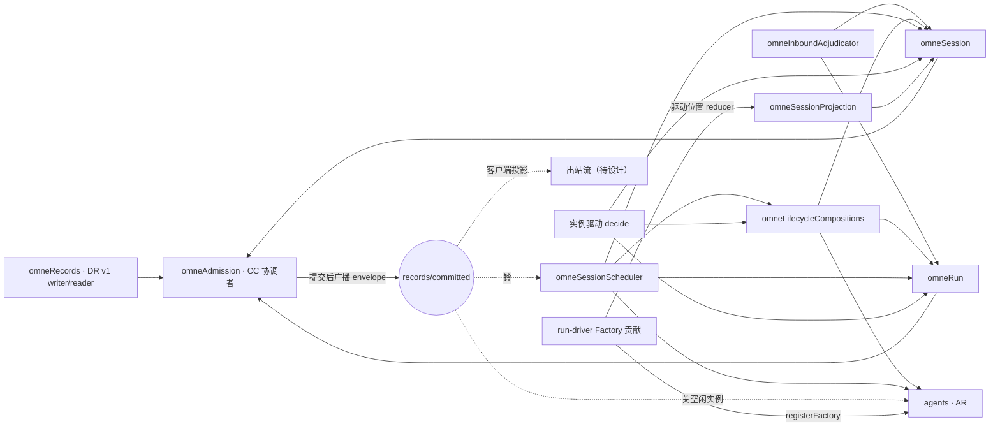
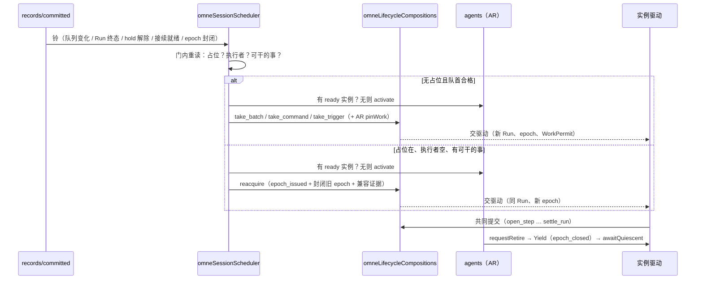

# Cordis 视角：三个插件、组合者、事实广播与装载效应

[提案索引](README.md) · [状态机与级联](lifecycles.md) · [Session](session.md) · [Run](run.md) · [实例](agent.md)

方法沿[总体范式](../../architecture-guide/foundations/paradigm.md#从目的到可演化的实现)、
[生命周期指南](../../architecture-guide/runtime/lifecycle.md#装载效应与撤除责任)与
[Cordis 映射参考](../../architecture-guide/reference/cordis-mapping.md#核对本项目的具体提供者)；
Cordis 事实按 `c291e796` 修订的官方文档核对（分发模式见
[研究笔记 §3.1](../../research/agent-loop-events-and-hooks/README.md#31-deepseek-harness一切皆插件事件即扩展点)），
项目采用官方包 4.0.2；"本项目如何使用 Cordis"的说法都是推论。驱动器自身的 Cordis 视角
已由 [D-013](../../decisions/D-013-run-driver-cordis-boundary.md) 接受，本文件不复述。

## 1. 消费方式

| 对象 | 系统机制与服务 | Agent 工具 / 技能 | 应用装配 |
|---|---|---|---|
| Session | 插件 `SessionPlugin` 提供 `omneSession`：目录、队列、Inbound 受理与读面、状态贡献注册面、三条流的 prepare/check 端口 | 跨会话检索与消息是普通工具（PF-017），经 Inbound 受理；无技能 | 选择 records 提供者、容量与到达行为求值提供者、link 插件 |
| Run | 插件 `RunPlugin` 提供 `omneRun`：Run/Step/控制的 prepare/check 端口、按 Run 的读面、epoch 发行与封闭 | 无 | 选择命令处理者绑定 |
| Agent 实例 | `agents` 服务（AR）与 Factory 贡献（run-driver 包）；私有 `AgentInstancePlugin` | 无 | 选择 Factory 绑定与资源政策 |
| 裁决者 | 插件 `omneInboundAdjudicator`，宿主级 | 无 | 随 Session 提供者装载 |
| 调度者 | 插件 `omneSessionScheduler`，宿主级 | 无 | 随 Session 提供者装载；资源政策参数 |
| 组合者 | 插件 `omneLifecycleCompositions`：LC 声明的每条形状 2 的行一个具名组合 | 无 | 随 Session 提供者装载 |

## 2. 插件与服务依赖

硬规则（作者裁决 [A-12](README.md#作者裁决)）：`omneSession` 与 `omneRun` 互不
required inject。凡同时涉及两者的操作都在 `omneLifecycleCompositions` 或裁决者/调度者里，
它们注入双方的 prepare/check 端口与读面。Session 三条流与 Run 流写同一协调域，由同一个
`omneAdmission` 协调者提交（[CC-01](../../../spec/compositions/core-work-coordination/v1/contract.md)）。
链接插件（TG/AU/AR 的登记）沿现有 `packages/session/session/design.md` 的 link 模式。

## 3. 事实即事件的广播机制

用户认可的三形状中，形状 3 依赖一条广播：协调者在 `commit` 返回 committed 后，把该
envelope 原样以 emit 模式分发一次，事件名唯一（候选 `records/committed`），载荷就是
[DR-01](../../../spec/capabilities/durable-records/v1/contract.md) 的 envelope，按租户与
Session 作用域过滤（Cordis scope 只做可见性路由，不做授权；反应者在门内重查权限）。
机制归 `packages/coordination/admission` 的提供者设计：它是唯一知道提交何时完成的地方。
语义义务归组合契约：广播只是提示，反应者幂等、在门内重读事实、不据通知推进；通知失败
按 [DR-02](../../../spec/capabilities/durable-records/v1/contract.md) 单独报告 delivery 状态，
不改已提交事实；丢失由开机扫描兜底。emit 不等待处理者、无逐回调异常隔离（映射参考记录
的 4.0.2 语义），因此反应者自己容纳异常，不得在监听器里抛出影响其他监听者。

这就把未决项 U-5 的一半闭合：事件名与载荷定了，作用域过滤的实现与验收仍待提供者。
与 DSH 的 `session/event` 同型，差别是我们的载荷是 DR envelope 而非单条 Session 事件。

## 4. 装载效应与撤除责任

| 效应 | 建立条件与所有者 | 撤除动作与完成判据 | 保留 |
|---|---|---|---|
| `omneSession` 服务与三条流的 owner 登记 | SessionPlugin 装载，经 persistence 恢复校验后 provide | 关新操作 → 等在途提交 completion → 撤服务；authoritative 贡献不删记录（[SR-13](../../../spec/capabilities/session-run/v2/contract.md)） | 三条流全部事实 |
| `omneRun` 服务与 run 流 owner 登记 | RunPlugin 装载 | 有未封闭 epoch 的 Run 存在时计划撤除先请求持有实例退役（Yield）再撤；繁忙且无在途政策则原子拒绝（[CB-13](../../../spec/compositions/agent-session-binding/v1/contract.md)） | run 流事实、占位派生 |
| 裁决者订阅与扫描任务 | 插件装载时订阅广播并启动扫描 | 取消订阅、等待当前短提交结束；未裁决 arrival 留在 accepted，重装后扫描 | arrival 事实 |
| 调度者订阅与开机扫描 | 插件装载 | 取消订阅；进行中的 activate 由 AR 账目收口；Run 不推进但不受损 | 占位 Run 与队列 |
| 具名组合登记 | 组合者插件装载，向协调者登记组合名与参与 owner | 关新组合 → 等在途 batch → 撤登记 | 已提交 batch |
| 广播监听（调度者、AR 宿主反应、投影、客户端） | 各监听者的 Context effect | Fiber 卸载即撤；不承诺重放 | 无（事实在流里） |
| 驱动位置投影贡献 | run-driver 包 reducer 注册到 Session 贡献面 | 撤回 reducer，视图 unavailable，不删事实 | run 流事实、投影缓存可弃 |
| 实例、Factory、许可 | 沿 D-013 §3 | 沿 D-013 | 沿 D-013 |

复合退出的顺序由业务顺序补足（Cordis disposer 逆序、异步并发，不保证业务顺序）：
先撤调度者与裁决者的订阅，再撤组合者，再撤 Run 与 Session 服务，最后撤协调者。

## 5. 四类提供者接口的对接

[D-007](../../decisions/D-007-runtime-composition.md) 的四类接口：谁验证当前权限、谁附着
已有 Session、谁准备和驱动实例、谁记录使用并释放资源。

| 接口 | 提供者 | 本轮变化 |
|---|---|---|
| 验证当前权限 | TG/AU 经 link 插件；每次提交的撤销屏障 | 无变化；组合者与裁决者的提交同样过屏障 |
| 附着已有 Session | `omneSession` 的附着提供者（`attach` / `guardActivation` / `release`，[CB v1](../../../spec/compositions/agent-session-binding/v1/contract.md)） | 附着资格增加"Session open"与"该 Session 无更早未释放实例"；归档事实使资格失效 |
| 准备和驱动实例 | run-driver Factory（D-013） | 调度者成为唯一的激活发起者（用户控制 resume 也经它） |
| 记录使用并释放资源 | AR | 对 `lifecycle_changed{archived / deleted}` 广播的反应：关闭空闲实例（形状 3） |

## 6. 依赖变化政策

| 依赖 | 必需性 | 变化/失效时的处置 | 依据 |
|---|---|---|---|
| records writer（DR） | Session/Run 存续必需 | 写入权丢失封闭新提交，所有 Run 停在已确认水位；不伪造停止 | [DR-03](../../../spec/capabilities/durable-records/v1/contract.md)、[RD-16](../../../spec/capabilities/run-driver/v1/contract.md) |
| 协调者（CC） | 同上 | 同上；广播随之停止，重装后开机扫描 | CC-01/03 |
| `omneRun` 计划撤除 | 对执行中的 Run 必需 | 先让持有 epoch 的实例退役（Yield），无未封闭 epoch 后撤；不可 Yield 则拒绝撤除 | CB-13、AR-16 |
| `omneSession` 计划撤除 | 全部必需 | 先撤调度者、裁决者、组合者与 Run，再撤 Session | CB-14 |
| 调度者缺席 | 进展必需，安全无关 | Run 不推进、队列不消费；重装后开机扫描 | LP-1 |
| 裁决者缺席 | 进展必需 | arrival 停在 accepted，外部来源受容量限制拒绝（refused_capacity）；重装后扫描 | SE-16/18、I-17 |
| run-driver Factory 换代 | 实例存续必需 | 沿 D-013 §5：Yield → 重取须过兼容证据 | RD-04、A-10 |
| TG/AU/AR link 失联 | 各自 | 沿现有 design.md 的 link 政策：关相应新准入，不失原收口能力 | CB-06/14 |

## 7. 性质、前提、证据与未完成义务

| 性质与用途 | 前提与责任 | 证据要求 | 当前结果 | 未完成义务 |
|---|---|---|---|---|
| 三插件互不 required inject 且级联无环（§2） | 组合者/裁决者/调度者是唯一的双方注入点 | 结构检查：依赖图无 Session↔Run 边 | 本文件 §2 图 | 实现阶段的依赖静态检查 |
| 形状 2 的行在同一协调域一次提交（[L-4](invariants.md#关系与级联)） | 协调者兑现 CC-01；组合者登记具名组合；CC v2 承认组合契约的声明 | 复用 CC v1 证据 + Lifecycles 模型（TRUE 配置作回归） | 待模型 | CC v2 发布 |
| 形状 3 的反应幂等且不据通知推进 | 反应者在门内重读；广播只是提示；开机扫描兜底 | 反应者重复投递测试 | 论证已给 | 实现阶段测试 |
| 撤除不删事实（§4） | 各插件的 effect 与业务顺序 | 自定义局部效应：前后条件论证 | 论证已给 | 装卸测试 |
| 跨域义务清单（[L-6](invariants.md#关系与级联)） | 见 lifecycles.md 末节 | Lifecycles 模型 FALSE 配置 | 待模型 | 跨域前发新版契约 |

## 8. 提供者设计归属与实施入口

- `packages/session/session`：`SessionPlugin`（`omneSession`）、`omneInboundAdjudicator`、
  `omneSessionScheduler`、`omneLifecycleCompositions` 四个插件与 link 插件；设计正文原地修订。
- `packages/session/run`（新建）：`RunPlugin`（`omneRun`）、run 流事件与 fold、提交面与读面。
- `packages/session/persistence`：恢复顺序按 [session.md §7](session.md#7-恢复顺序persistence-设计的输入)。
- `packages/session/projection`：投影缓存与贡献注册适配；接受 run-driver reducer。
- `packages/agent/run-driver`（新建）：Factory 贡献（driverKey 候选 `omne.run-driver`，
  version 1）、decide、驱动位置 reducer（stateKey 候选 `run.driver_position`）、兼容性声明形状。
  这闭合 [D-013 §7](../agent-loop-inbound/cordis.md#7-提供者设计归属与实施入口) 中依赖
  Session/Run 的映射：服务键 `omneSession` / `omneRun` / `omneLifecycleCompositions`，
  订阅接口即 `records/committed` 广播加各读面。
- `packages/core/agent`：按 [agent.md §5](agent.md#5-对提供者设计的要求packagescoreagentdesignmd-修订输入) 修订。
- `packages/coordination/admission`：提交后广播。
- 不阻塞的部分：各插件的内部算法组织、fold 实现、组合者的代码结构。
