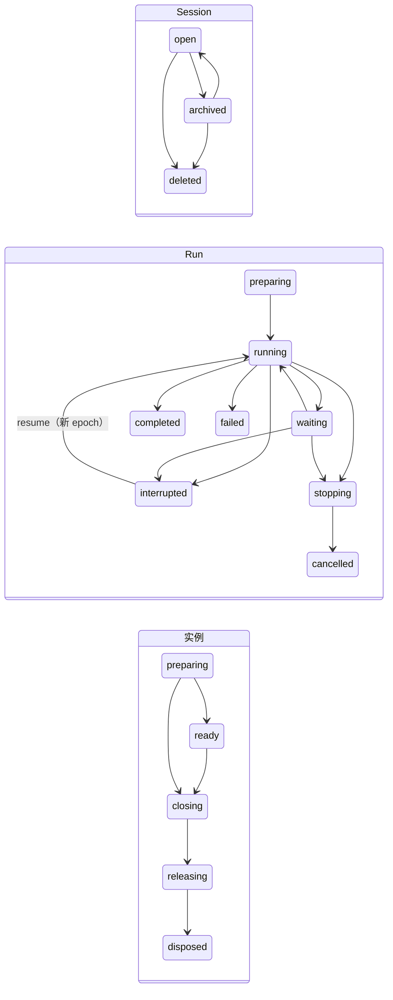

# 三台状态机、三条关系与级联

[提案索引](README.md) · [不变式](invariants.md) · [需求](requirements.md)

本文件把 Session、Run、Agent 实例三台已接受的状态机放在一起，定义连接它们的三条
关系，并逐行给出级联规则、采用的形状与条款依据。它是组合契约候选正文的来源：
接受后三台状态机仍归各自能力契约，本文件的关系与级联矩阵归组合契约（D6），
不在任何第二处复述。

## 三台状态机（引用，不改写）

| 对象 | 状态与转移 | 权威 | 耐久性 |
|---|---|---|---|
| Session | `open ⇄ archived → deleted`；deleted 不可恢复、身份不复用 | [SR-02](../../../spec/capabilities/session-run/v2/contract.md) | 耐久事实（session 流） |
| Run | `preparing → running ⇄ waiting / waiting_human / waiting_gate → completed / failed`；非终态 `→ interrupted → resume`；非终态 `→ stopping → cancelled`；completed/failed/cancelled 为逻辑终态 | SR-08～12；推进规则归 [run-driver v1](../../../spec/capabilities/run-driver/v1/contract.md) | 耐久事实（run 流） |
| Agent 实例 | `preparing → ready → closing → releasing → disposed`；preparing 失败 `→ closing`；清理失败保留原阶段并记 blocked | [AR-4～7、AR-11～13](../../../spec/capabilities/live-agent/v1/contract.md) | 不耐久：Registry 重启从空重建（AR-17 通知也不是耐久凭据） |

Run 图中 waiting 代表 waiting、waiting_human、waiting_gate 三者；Yield 与崩溃不改变
Run 状态，只改变下面的执行者关系。

## 三条关系

| 关系 | 方向与取值 | 拥有者 | 耐久性 | 依据 |
|---|---|---|---|---|
| 附着 | 实例 → Session；`held → revoked/releasing → released`；一个实例一生只附着一个 Session，一个 Session 同一时刻至多一个未释放实例 | live-agent Registry 与 Session 附着提供者 | 不耐久；随实例重建 | [CB-04～07](../../../spec/compositions/agent-session-binding/v1/contract.md)、[AR-4](../../../spec/capabilities/live-agent/v1/contract.md) |
| 占位 | Session → Run；`null | RunRef`；表示"该 Run 仍拥有本 Session 的驱动权"，Yield 保留、interrupted 不占 | Session | 候选：由 Run 事实派生（见下），不单独记录 | [SR-08](../../../spec/capabilities/session-run/v2/contract.md)、[I-1](../agent-loop-inbound/invariants.md) |
| 执行者 | Run → 实例；`null | {agent, epoch, workPermit}`；表示"当前谁可以为该 Run 提交" | Run 的 epoch 与 AR 的 WorkPermit 共同表达 | 不耐久：epoch 耐久，持有者关联不耐久 | [SR-08](../../../spec/capabilities/session-run/v2/contract.md)、[AR-8/10](../../../spec/capabilities/live-agent/v1/contract.md)、[CB-09](../../../spec/compositions/agent-session-binding/v1/contract.md) |

**占位的派生规则（候选）**：`placeholder(S) = 唯一的 R ∈ Runs(S)`，满足
`R.state ∈ {running, waiting, waiting_human, waiting_gate, stopping}`；没有这样的 R 则为 null。
这与 I-1 的陈述逐字一致，SR-08 的"由 `(SessionRef, RunRef)` 精确持有"由派生关系的唯一性
兑现，不需要 `driver_reserved/driver_released` 这类独立事实。代价是取批门要在同一门内读
Run 的当前状态；收益是占位永远不可能与 Run 状态不一致。

**执行者的派生规则**：`executor(R) = {agent, epoch}` 当且仅当 `R.epoch` 未被封闭且 Registry
中存在持有该 epoch 工作许可的 ready/closing 实例；实例消失则执行者为 null，Run 状态不变。
"占位在、执行者空"就是所有崩溃与退役之后的统一状态，恢复路径只有重取一条。

## 级联的三种形状

用户 2026-09-14 认可的规则，判断顺序固定：

1. **派生与守卫**：不写不传。级联结果是其他已提交事实的函数，由 fold 得到；或依赖方在
   自己转移的门里查对方当前状态（CB-06、CC-02/04 的撤销屏障就是这一形状）。
2. **同提交共写**：结果必须成为新事实，且不变量禁止中间态。用 CC v1 具名组合，反应者
   作为 co-owner 参加同一 batch，各自只核自己的事实。
3. **提交后反应**：已提交的 envelope 原样广播（DSH `session/event` 同型，按租户/Session
   作用域过滤，observer 失败被容纳，见[研究 §3.1](../../research/agent-loop-events-and-hooks/README.md#31-deepseek-harness一切皆插件事件即扩展点)），
   反应者幂等地做第二次提交或资源动作；动手前在自己的门里重读权威状态；恢复靠开机扫描。

能派生就派生；不能派生看不变量允不允许中间态；允许就提交后反应，不允许才同提交。
形状 2 只在同一协调域成立，且 CC-01 规定原子关系仅限该契约明确列出的组合（现列有
"输入/取批与 Run"，没有"裁决与 Run 终态""结算与接续转换""终态与占位""生命周期与
队列/arrival 关闭"）。在 session-run v2 内这些是能力内部承诺；一旦 Session 与 Run 的权威
拆开（D1），它们成为跨能力承诺，必须由组合契约逐行声明，并且 CC 的声明规则要改为
"本契约及同一协调域内发布的组合契约明确声明的组合"（CC v2）。跨域的同类级联降为
CC-05 耐久意图，见末节。

## 级联矩阵

每行：触发 → 对三个对象与关系的效应 → 形状 → 依据。"守卫"指效应只是封闭未来准入。
依据列的编号分别指向：SR = [session-run v2](../../../spec/capabilities/session-run/v2/contract.md)，
RD = [run-driver v1](../../../spec/capabilities/run-driver/v1/contract.md)，
AR = [live-agent v1](../../../spec/capabilities/live-agent/v1/contract.md)，
CB = [agent-session-binding v1](../../../spec/compositions/agent-session-binding/v1/contract.md)，
CC = [core-work-coordination v1](../../../spec/compositions/core-work-coordination/v1/contract.md)，
DR = [durable-records v1](../../../spec/capabilities/durable-records/v1/contract.md)，
TL = [tools v1](../../../spec/capabilities/tools/v1/contract.md)，
I / P = [agent-loop-inbound 不变式](../agent-loop-inbound/invariants.md)，
A = [agent-loop-inbound 作者裁决](../agent-loop-inbound/README.md#作者裁决2026-09-14cordis-层)，
PF = [产品要求](../../requirements/product/README.md)。

| # | 触发 | Session | Run | 实例与关系 | 形状 | 依据 |
|---|---|---|---|---|---|---|
| 1 | 归档 / 删除请求 | 前提：无非终态 Run，否则 busy（守卫，门内读 Run 状态）。成功后：未取批队列项 closed_by_archive/delete，accepted 与 classified 未消费的 arrival closed，同一提交；封闭新激活 | 无 | 空闲实例由宿主对已提交的 archived 事实反应：AR close → 附着 released。新激活被 Session 附着资格拒绝 | 前提 1；关闭 2；关实例 3；封闭激活 1 | SR-02、SR-17 D2 列、SR-20、CB-05/06 |
| 2 | Session 级 force_stop | 队列 hold，与控制受理同一提交 | 当前 Run → stopping，终止意图不可由 resume 清除 | epoch 在受理点撤销：实例后续提交被每次提交的 epoch 核对拒绝；Run 结算后实例回 ready | 2；拒绝提交 1；回 ready 3 | SR-12、I-3、AR-10 |
| 3 | Run → completed / failed | 占位随 Run 状态派生为 null；调度者对终态事实反应 | 指向本 Run 的未消费 continuation 同一提交转 trigger（converted）或 closed | `settle(work)` 结算许可；执行者派生为 null；实例留 ready，去留归资源政策 | 占位 1；接续 2；settle 与铃 3 | SR-09、SR-20、I-14、AR-10 |
| 4 | Run cancel / force_stop | stopping 期间占位仍在（派生）；隔离证实、cancelled 后为 null | 沿 SR-10/12 收口自有调用与请求；force_stop 受理点撤 epoch | 同行 2 | 撤 epoch 2；对 TL/HD 的收口同域则 2，跨域 CC-05 | SR-10/12、TL-09、CC-05 |
| 5 | Run interrupt | 占位派生为 null；interrupted 可与新占位并存 | 关 Step、请求自有调用停止；安全收口后 interrupted | `settle(work)`；执行者 null | 2；settle 3 | SR-10、AR-10 |
| 6 | 实例计划退役（换实现、换必要提供者、空闲回收、owner 关闭、关机） | 附着 released | 执行中：驱动器到安全边界 Yield，封闭 epoch、Run 状态与占位不变；热宽限到期按 interrupt 收口并记 yield_forced | 退役请求是对实例的资源动作；Yield 是 Run 事实；静止后按 AR-12 释放 | 退役请求 3；Yield 2；释放归 AR | AR-11/12/13、CB-10/12、RD-04/14、SR-08 |
| 7 | 实例崩溃 / 进程重启 | 提供者启动扫描先完成全部裁决 | 占位仍在、执行者为 null；调度者重取：新实例、新 epoch，E0 核对在途请求与调用 | 旧实例作未完成退出，资源按残留处理；Registry 从空重建 | "该重取"由事实与空 Registry 派生 1；扫描与重取 3 | SR-14/21、RD-04、AR-7/13、I-19 |
| 8 | 附着资格失效（租户、定义授权、附着撤销） | 新工作准入封闭 | 联合准入被拒 → 驱动器在安全边界 Yield，占位保留；重取门等资格恢复 | 实例关闭（AR-11 依赖撤除/显式退役） | 守卫 1；Yield 2；关实例 3 | CB-06、AR-16、A-11 |
| 9 | Agent 定义停用或版本收紧（TG） | Session 保留；新 Run、新激活封闭 | 进行中 Run 沿冻结的定义与装配继续 | 实例按政策退役 | 1 | AR-9、SR-08、CB-05 |
| 10 | Run 处于等待且实例空闲 | 无 | 无 | 资源政策可回收实例（Yield 无在途工作）；接续就绪或门恢复时重取 | 3 | AR-12、SR-09、P-1 |
| 11 | interrupt_then_run（用户或系统发起） | 新输入、当时精确 Run 与复合意图先耐久，同一提交 | 旧 Run 按 PF-013.C4 处置表收口 → interrupted 并记 supersededByInput | 旧执行者随收口结算；新 Run 由调度者对占位释放反应，经 takeBatch 启动 | 意图 2；收口沿行 5；开新 Run 3 | SR-11、PF-013.C6 |
| 12 | 租户撤权 / 写入权丢失 | 撤销屏障封闭后续准入；写入权丢失封闭新提交 | 驱动器停在已确认水位，不伪造停止 | 实例可查询但不推进 | 1 | CC-02/04、DR-03、RD-16 |

三点补充：

- 每行恰用一种主形状；形状 2 的行都有一个具名组合者，它是唯一同时注入两方 prepare/check
  端口的地方，Session 插件与 Run 插件互不 required inject（cordis.md，波 2）。
- 形状 3 的反应者不据通知推进：它把广播当作"去看一眼"的提示，在自己的门里重读事实。
  这与 D-013 中"驱动器只 emit、不据通知推进"是同一条原则。
- 实例状态机不耐久，所以指向实例的级联（行 1、8、9、10）只能是形状 1 或 3；实例对 Run
  的影响永远经驱动器提交一条 Run 事实（行 6 的 Yield）才算数。

## 跨协调域的预期

用户 2026-09-14 追加：用 TLA+ 论证 Run 独立权威后是否具备基本的分布式特性，结论无论
如何都可接受。评审 r1 指出"驱动器实例可迁移"（D-012/D-013 已设计）与"Run 权威可另置
协调域"是两回事，后者与 CC-01、DR-01、SR-06/17/20 及 live-agent v1 的单一协调权威直接
冲突；因此本节的论证只能产出**跨域义务清单**，不能证明当前条款可分布，Run 独立插件
只算"边界就绪"。

模型分两部分：`SameDomain = TRUE` 的配置与 RunDriver 模型的 sched 配置重叠，只作回归；
`SameDomain = FALSE` 是一个独立的小模型，只含形状 2 的三行（结算与接续转换、强停与
占位释放、取批与建 Run），外加三种威胁：裁决者对 Run 状态的陈旧读（威胁 I-13）、新 epoch
已发而旧执行者仍提交（威胁 R-2）、SR-21 的"等待裁决完成"跨域时如何成立。Run 域与 Session
域各自提交，跨域效应改为"源域提交事实与待投递意图，目标域幂等消费"，中间允许崩溃与
重复投递（CC-05）。"空 Registry 派生重取"在多节点不是全局事实，模型把它作为显式假设。

模型工件在 [spec/compositions/session-run-agent-lifecycles/v1/](../../../spec/compositions/session-run-agent-lifecycles/v1/)，
运行记录与否定变体在 [evidence/model/](evidence/model/results.json)。2026-09-14 在 8 核、4 worker 下的结果：

| 配置 | 范围 | 结果 |
|---|---|---|
| `Lifecycles.cfg`（同域安全） | 2 Run、2 实例、队列 2、接续 1、epoch ≤ 3、崩溃 ≤ 1 | 通过：I1、I13、I14、S2、A1、L1、L3、A3、NoDoubleCreate；13.6 万状态、2.2 万不同状态、1 秒 |
| `LifecyclesProgress.cfg`（同域进展） | 1 Run、2 实例 | 通过：LP1a、LP1b、LP2；1.3 万状态、2 秒 |
| `LifecyclesSplit.cfg`（跨域安全，门带版本戳） | 2 Run、1 实例 | 通过：I1、S2、A1、L1、L3、A3、NoDoubleCreate 与动作性质 ClassifyFresh；1732 万状态、199 万不同状态、36 秒 |
| `LifecyclesSplitProgress.cfg`（跨域进展） | 1 Run、1 实例 | 通过：IntentsDrain、I14Eventually、ClassifyFresh；4 万状态、4 秒 |
| 否定 `LifecyclesSplitStale.cfg`（门不带版本戳） | 同跨域安全 | 如期反例：L3 被违反，Session 按陈旧视图归档了刚由 create 意图建立的 Run |

对照预期：

| 性质 | SameDomain = TRUE | SameDomain = FALSE 的实际结果 |
|---|---|---|
| 执行者唯一（[R-2](invariants.md#run)、[L-1](invariants.md#关系与级联)） | 成立 | 成立：epoch 只在 Run 域发行 |
| 占位唯一（[I-1](../agent-loop-inbound/invariants.md)） | 成立 | 成立，条件是 Run 域在消费 create 意图时**自己重查占位**；Session 门的版本戳只保护裁决与归档，不保护占位 |
| Run 不被重复启动（[I-5](../agent-loop-inbound/invariants.md)、[I-20](../agent-loop-inbound/invariants.md)） | 成立 | 成立：create 意图幂等消费（NoDoubleCreate） |
| 终态后无未消费接续（[I-14](../agent-loop-inbound/invariants.md)） | 成立 | 退化为最终成立（I14Eventually）：Run 终态与 Session 域消费 settle 意图之间必然存在窗口 |
| 裁决只指向非终态 Run（[I-13](../agent-loop-inbound/invariants.md)、SR-17） | 成立 | 状态形式不成立（同上窗口）；动作形式 ClassifyFresh 成立，条件是裁决门带 Run 域版本戳；不带则如否定变体所示 |
| 意图不丢不双投 | 不适用 | 成立：意图耐久于源域、目标域幂等消费、源确认后撤回（IntentsDrain） |
| 归档前提（行 1） | 成立 | 成立，条件是归档门带 Run 域版本戳，且归档同时关闭已取项而未建 Run 的 create 意图 |

**跨域部署前必须补的义务**（由上表得出，不阻止单机首版；单机首版两个域是同一个协调域）：
Session 域的裁决门与归档门带 Run 域的状态版本戳；Run 域消费 create 意图时重查占位；
归档关闭待建 Run 的 create 意图；settle 与 create 意图按 CC-05 耐久、幂等消费、确认后撤回；
I-13/I-14 以及 SR-17"同域全序"改写为最终性质并发新版契约；旧 epoch 持有者活性判定
（live-agent v1 缺口）。这是 D1 拆分理由中"边界就绪"的证据，不是"已可分布"的证明。

## 模型发现

建模过程中暴露并修正了两处语义表述，已同步进本提案，接受时进入相应契约：

1. **对 interrupted 的 Run 做 cancel / force_stop 不经 stopping。** interrupted 已安全收口、
   不占位；若再进入 stopping 会重新占位、与此时正在运行的新 Run 并存，违反占位唯一
   （I-1 反例）。因此 interrupted → cancelled 直接转移，接续按 cancelled 关闭；不发新的
   停止请求，因为该 Run 的自有调用在 interrupt 时已停止。这是 [SR-10/12](../../../spec/capabilities/session-run/v2/contract.md)
   未明说的一条，写入 `capability.run` v1。
2. **跨域时归档必须关闭待建 Run 的 create 意图。** 否则意图永不消费（IntentsDrain 反例），
   已取项既不在队列也没有 Run。同域时取项与建 Run 同提交，此问题不存在。
