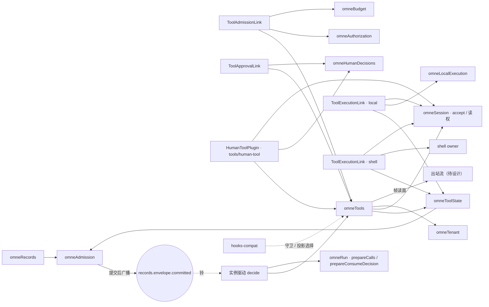
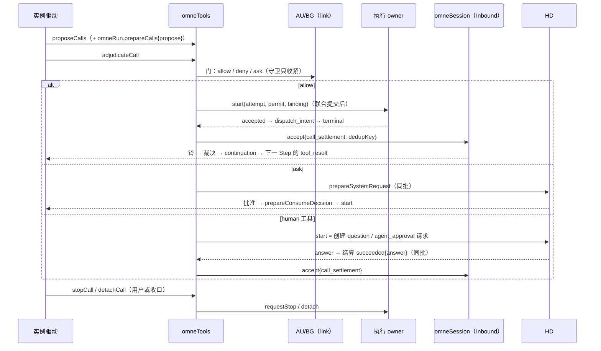

# Cordis 视角：插件、执行 owner、装载效应与接头

[提案索引](README.md) · [生命周期](lifecycle.md) · [Schema](schema.md) · [帧](frames.md)

方法沿[总体范式](../../architecture-guide/foundations/paradigm.md#从目的到可演化的实现)、
[生命周期指南](../../architecture-guide/runtime/lifecycle.md#装载效应与撤除责任)与
[Cordis 映射参考](../../architecture-guide/reference/cordis-mapping.md#核对本项目的具体提供者)；
Cordis 事实按 `c291e796` 修订的官方文档核对，项目采用官方包 4.0.2。
[tools 提供者设计](../../../packages/tools/tools/design.md#cordis-映射与撤除责任)与
[local-execution 设计](../../../packages/tools/local-execution/design.md#cordis-映射与撤除责任)
已有 `0a6e91e` 基线的插件划分与 T-R1 最后门检查；本文件不复述它们，只写 D-014 之后
要改的、要新增的和与 Run/Session/HD 的接头。

## 消费方式

| 对象 | 系统机制与服务 | Agent 工具 / 技能 | 应用装配 |
|---|---|---|---|
| 调用运行时 | `ToolStatePlugin` 提供 `omneToolState`（tools 流 owner、call/attempt/关系/控制的 prepare/check）；`ToolsPlugin` 提供 `omneTools`（discover/load/manifest/propose/adjudicate/stop/detach/帧读面、前台上限计时） | 所有工具经它提议与准入 | 选择执行 owner 集合、前台上限系统值、帧记录策略 |
| 执行 owner | `LocalExecutionPlugin`（`omneLocalExecution`）、同进程 shell owner（决定 a，新增包候选 `tools/shell-execution`）、HD 作为 `human` 工具的 owner | 文件、shell、人类请求 | 装配哪些 owner 可用 |
| 内建人类请求工具 | `HumanToolPlugin`（新成员 `packages/tools/human-tool`，同时消费 tools 与 HD 的公开入口）注册 `human` 定义、实现其 ExecutionProvider，并向 HD 登记"请求结算接收器"：HD.answer 的提交经该接收器同批写 `tools.call.settled` 与结算 arrival | `human ask_user / request_approval` | 随 tools 与 HD 装载；HD 不 import TL |
| link 插件 | `ToolAdmissionLinkPlugin`（AU/BG）、`ToolApprovalLinkPlugin`（HD system_approval）、`ToolExecutionLinkPlugin`（每个执行 owner 一份；inject owner、`omneToolState` 与 `omneSession`，组合 terminal + 结算 + accept 的同批提交） | 无 | 双端管理能力经受信 options |
| hooks 兼容层 | `hooks-compat` 插件在 S5 登记 TL-13 守卫、在 S7 登记投影选择器（另开提案） | 无 | 按 PF-025 装配 |

## 插件与服务依赖

硬规则：`omneTools` 不 inject `omneRun`。凡同时改调用与 Run 的提交由驱动器组合两者的
prepare/check 端口（[RD-03](../../../spec/capabilities/run-driver/v2/contract.md) 的 commitKind）；
结算不直接写 Run，而是经 `omneSession.accept{call_settlement}` 进 Inbound（[SE-12](../../../spec/capabilities/session/v1/contract.md)）。
执行 owner 不 inject `omneTools`：它们只实现 TL 定义的 ExecutionProvider / PermitFacts，
由各自的 link 插件登记（tools 设计"TL 不 import local-execution"保持）。结算同批的组合者是
link 插件：owner 报 terminal 后由 `ToolExecutionLink` 组合 owner 账本、`omneToolState.
prepareTerminal/checkTerminal` 与 `omneSession.accept` 成一个提交（[T-2](invariants.md#调用)）。
`human` 调用的结算同理由 `HumanToolPlugin` 组合，但触发者是 HD.answer：HD v1 下一版增加
"请求结算接收器"端口（HD 定义、human-tool 实现，与 SystemApprovalSource 同一模式），
HD.answer 在自己的提交里调用接收器的 prepare/check，仍然是 HD 不 import TL。

## 装载效应与撤除责任

| 效应 | 建立条件与所有者 | 撤除动作与完成判据 | 保留 |
|---|---|---|---|
| tools 流 owner 与调用状态面 | ToolStatePlugin 装载，恢复账本后 provide | 关新提议 → 等在途提交 completion → 撤服务；不删事实 | tools 流全部事实 |
| 定义/声明/handler/skill 的发布单位 | ToolsPlugin 的具名 publication | 同门先关新准入，撤工具与声明索引；已准入调用保留实现闭包排空后 released | 历史 manifest、已准入调用 |
| 前台上限计时器 | `omneTools` 为每个 foreground 且声明了上限的 attempt 建立（决定 n） | attempt 终态、detach 确认或 stop 时撤；插件卸载时撤全部计时，不发出未到点的 detach | 已耐久的关系事实 |
| 执行 owner 的 attempt 账本、墓碑、真实 I/O | 各 owner host | 关新 start → 等在途 launch 收口 → 保存墓碑/移交 → 关闭；清理失败保留 retained | 账本、墓碑、终态、待交付后果 |
| `human` 工具定义、ExecutionProvider 与 HD 的结算接收器登记 | HumanToolPlugin 装载 | 关新提议、撤接收器登记；未答请求保留在 HD，不因插件卸载关闭，答复到达而接收器缺席时 HD 记录决定并把结算标 pending，接收器重新登记后补结算 | HD 请求与决定 |
| 帧生产通道与订阅 | owner / tools 读面 | 撤生产资格并记关闭边界；撤订阅不停止工作 | 已确认的 replayable 帧 |
| AU/BG/HD/执行 link | 各 link 插件 | 撤本代句柄先关正向使用；不清理已转移给原调用的 pin | 无 |
| hooks 守卫与投影选择器 | hooks-compat 插件 | 撤登记；进行中的 hook 进程 abort 并 drain | `hooks.run.*` 观察记录 |

复合退出顺序：先撤 hooks 与前台计时，再撤 link（HD → AU/BG → 执行），再撤 `omneTools`，
再撤各执行 owner（等真实收口），最后撤 `omneToolState` 与协调者。

## 四类提供者接口的对接

[D-007](../../decisions/D-007-runtime-composition.md) 的四类接口在工具侧的落点：

| 接口 | 提供者 | 本提案的变化 |
|---|---|---|
| 验证当前权限 | AU 经 ToolAdmissionLink；TL-13 守卫（含 hooks S5）只能收紧 | 守卫登记 API 的返回值封闭为 `{tighten: deny \| ask, reason} \| pass`；`updatedInput` 类字段不存在 |
| 附着已有 Session | 无直接附着；结算经 `omneSession.accept`，读面按 SR 正文读权 | 结算 arrival 的 dedupKey `(call, attempt)`；archived Session 也受理内部来源（SE-14 D2） |
| 准备和驱动 | 驱动器消费 `omneTools.proposeCalls / adjudicateCall / detachCall / stopCall` 与 owner 的 `start / inspect / requestStop / detach / subscribe` | 视图新值 `waiting_human`；`human` 调用由 HD 当 owner |
| 记录使用并释放资源 | AR pinWork 的 requiredUses、LE FileUse、BG reservation | 不变；前台计时不占资源 |

## 依赖变化政策

| 依赖 | 必需性 | 变化/失效时的处置 | 依据 |
|---|---|---|---|
| records writer / 协调者 | 全部必需 | 新提议与准入封闭；执行 owner 持独立资源的调用可跑到 terminal，结算等写入权恢复 | DR-03、CC-01/03 |
| 执行 owner 丢失（进程内 worker 死亡） | 对其在途调用必需 | 未 accepted → 同 attemptId 重发 start；dispatch_intent 而终态不明 → unknown，不重发；新调用 unavailable | TL-06/08、RD-16 |
| HD link 失联 | ask 路径与 `human` 工具必需 | ask 返回 unavailable（不降级为 allow）；`human` 命令 unavailable；已创建的请求保留在 HD，答复后照常结算 | HD-04、tools 设计 |
| AU / BG link 失联 | 新准入必需 | 新准入 unavailable；已准入调用继续；不补默认 allow 或预算 | TL-04、BG-03 |
| TG 停用工具定义 / 撤权 | 新绑定必需 | 未准入 → stale_binding；已准入保留闭包排空；紧急停用另发 stop | TL-06、PF-014.C5 |
| 模型切换（MC-08/11） | 无关 | 旧后台调用保持原绑定与归属，不因切模型终止或重调用 | MC-11 |
| Session 归档 | 无关（政策 b） | 后台调用继续；结算按 D2 列关闭 | SE-14 |
| 前台上限系统值变化 | 无关 | 只影响之后准入的 attempt；已计时的沿准入时记录的三值 | TL-10 |
| hooks 配置变化 | 无关 | 下一次站点触发生效；进行中的 hook 进程不中断 | PF-025 |

## hooks 兼容层在工具站点的落点

| 上游事件 | 登记点 | 兑现 | 不兑现 |
|---|---|---|---|
| `PreToolUse` | `omneTools.registerGuard({site: pre_execute, matcher})`，在门外 prepare 阶段、TL-07 门的 AU 求值之后同步求值，结果作为准入 check 的输入（CC-02：门内不跑任意回调）；返回值封闭为 `{tighten: deny \| ask, reason, context?} \| pass` | `permissionDecision: deny \| ask`、退出码 2 → 收紧，ask 的 reason 写入 HD 请求内容；`additionalContext` → 下一 Step 的 `system_reminder{hook_context}`；多 hook 取最严格 | `allow` 越过 AU；`updatedInput`；`defer` |
| `PostToolUse` / `PostToolUseFailure` | `omneTools.registerProjectionSelector({site: post_execute})`，在结算 arrival 被裁决后、该结果进入任一 Step 投影前求值一次（continuation、context 或 queue 列都适用，closed 不触发）；返回值封闭为 `{exclude: reason} \| {context?}` | `additionalContext` → `system_reminder{hook_context}`；`decision: block` → 该结果不进模型投影，以 `blocked_by_hook{reason}` 占位 | `updatedToolOutput`；改耐久结果；`PostToolBatch`（首版不支持） |

async hook 只能观察与注入上下文；每次运行写 `hooks.run.completed{status, entries}`。

## 性质、前提、证据与未完成义务

| 性质与用途 | 前提与责任 | 证据要求 | 当前结果 | 未完成义务 |
|---|---|---|---|---|
| `omneTools` 不 inject `omneRun`，级联无环 | 驱动器是唯一组合点 | 结构检查：依赖图无 Tools↔Run 边 | 本文件依赖图 | 实现阶段静态检查 |
| 结算恰一次进 Inbound（[T-2](invariants.md#调用)） | `prepareTerminal` 与 accept 同批；dedupKey | Inbound 模型 + 调用模型 | Inbound 侧已证 | 调用模型（波 3） |
| 守卫只能收紧（[TL-13](../../../spec/capabilities/tools/v1/contract.md)）且不改参数（[T-6](invariants.md#调用)） | 守卫 API 返回值封闭 | run-driver 场景 S20 + 单测 | 论证已给 | 实现阶段 |
| 撤除不删事实、不隐式取消后台工作（T-4） | 各 owner 的 effect 与退出顺序 | 装卸测试 | 论证已给 | 实现阶段 |
| `human` 工具答复恰一次结算（H-1） | HD 同批 start/answer | 调用模型 | 待模型 | 波 3 |

## 提供者设计归属与实施入口

| 内容 | 落点 | 修订 |
|---|---|---|
| 调用五维状态、转移表、事件三段式重命名、前台计时、守卫与投影选择器 API、帧读面 | [tools 设计](../../../packages/tools/tools/design.md) | 接受后原地修订 |
| attempt 账本与墓碑、帧 seq/gap、detach unsupported | [local-execution 设计](../../../packages/tools/local-execution/design.md) | 接受后对齐词汇 |
| question / agent_approval 两种 kind 的创建入口、请求结算接收器端口、程序化作答者 | [HD 设计](../../../packages/governance/human-decisions/design.md) | 接受后扩展 |
| `human` 工具定义（`ask_user` / `request_approval`，参数与回复模板以 omne-next `hitl-agent-request-tools-contract.md` 为起点）、ExecutionProvider、接收器实现 | 新成员 `packages/tools/human-tool` | 设计待开（接受后） |
| 视图值 `waiting_human`、`human` 调用的 Yield 前提 | [run-driver 设计](../../../packages/agent/run-driver/design.md) | 接受后小修 |
| 同进程 shell owner | 新包候选 `packages/tools/shell-execution` | 设计待开（决定 a 只定范围） |
| hooks 兼容层 | 新提案 `docs/proposals/hooks-compat/` 与新包候选 `packages/agent/hooks-compat` | 另开 |
