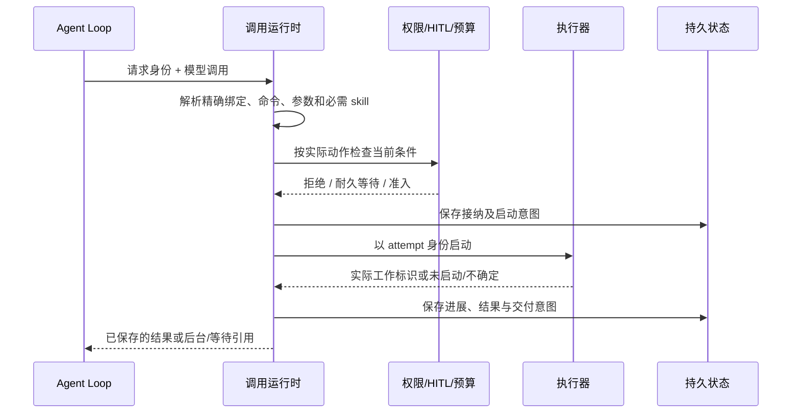

# 单次调用运行时

本页是[候选草案](README.md)的一部分。运行时负责接纳与控制的真实语义，
执行器负责实际工作；事件、会话文本和模型渲染不能单独作为执行事实权威。
入口激活的撤回与实际工作所有权沿[生命周期模型](lifecycle.md)；本页定义
已接纳工作如何控制和收束，不用调用记录代替运行资源的持有。

## 身份、状态与资源所有权

每次逻辑调用保存租户、Session、精确 Run、来源 Step、模型请求及工具调用标识、
工具/操作精确版本、实际参数、绑定与技能依赖证据。服务端从可信调用上下文
确定这些身份，模型输入不能覆盖租户、授权主体或资源所有者。

一次实际执行有独立 `attempt`，关联执行器、环境、所有权代次及外部工作标识。
重新连接同一工作不创建新 attempt；只有明确允许的重新执行才创建。后台结果
和迟到费用继续归因原调用和 Step，不改挂到结果出现时的新 Run。

采用三个互相区分的维度，避免把“后台”“停止请求已接受”“物理停止”混成
一个状态枚举：

| 维度 | 候选状态/事实 |
|---|---|
| 调用进展 | 已接纳、等待人类、执行中、结果待核实、已收束；拒绝发生在接纳前，已接纳但未启动可收束为未执行 |
| 等待关系 | 前台等待或后台关联；仍是同一次调用，不复制工作 |
| 控制与实际效果 | 已接受的中断/取消/强停意图、执行器确认、外部效果、尚未完成的清理分别记录 |

一个调用只能有一个有效逻辑收束决定。执行器报告的外部效果可能晚到，必须
保留事实及费用，不能改写已经被强停封锁的后续执行权，也不能把不确定的外部
动作写成“没有发生”。撤销效果、补偿、幂等重试和停止分别由操作契约说明。

支持后台的调用从启动时就由会话运行实例之外的执行所有者托管：它保有执行
资源、取消通道、结果出口和必要的精确依赖。Agent 实例只持等待/观察关系。
可以同机同进程实现这一所有权分离，但非协作代码的强制隔离需要进程或更强
边界。仅保存一个绑定了 Agent 对象的 Promise 不能声明可后台接续。

## 接纳、准入与启动

调用入口先建立稳定请求身份。模型来源使用可信的租户、发起 Run、已保存模型
请求及其中 tool-call 标识组合；非模型来源必须提供其获准命名空间内可恢复的
请求标识。一次新的调用意图使用新键，相同调用的传输重试沿用原键，不能仅
凭参数相同把不同意图合并。

工具状态拥有请求键到 invocation 及原始输入摘要的唯一映射。入口验证来源和
租户后，以条件写入认领该键、分配一次调用身份，再推进准备/等待/准入；这项
认领本身不表示已准入或已执行。接纳结果和对应回执归同一状态权威提交，并发
竞争者只能认回原调用，由有效执行所有者推进其状态，不各自创建 attempt。
摘要覆盖实际输入及请求所指精确操作/绑定，不用后来同名工具的当前版本重算。

同键同内容的重试，在当前访问资格下返回原调用引用及真实进展，不重新调用
实现；同键不同内容返回冲突。回执丢失或准备中重建时先查询/认回原映射，按
已保存阶段恢复，不能因工具已更新就再创建一份调用。已拒绝或已收束的请求
也不重新接纳；新的行动意图必须显式使用新请求键。下游 attempt 启动去重
是在此基础上的第二个边界，不能代替入口唯一性。

新调用在入口认领后，启动需要明确的提交次序：验证请求和 Schema，再编译可信的实际动作描述，
检查当前权限与预算，持久记录接纳/等待事实，最后允许外部执行。持久失败时
不派发新的副作用；记录成功不等于执行成功。通知只帮助消费者发现已提交事实。

授权与预算是独立权威，本运行时消费它们的公开准入接口。接口需绑定精确主体、
动作、参数摘要、目标、有效范围及 attempt，并定义撤权与准入的先后。已排队
但尚未准入的动作重新检查；准入后发生的撤权不隐式终止已开始动作。
预算预留与调用身份关联，失败释放和重复请求幂等；并发调用不得各自读取同一
余额后都放行。跨权威的预留/确认失败需要耐久对账，不能宣称一条数据库事务
已经原子提交全部外部系统。具体接口尚待组合规格落实。

系统硬拒绝不能由普通批准覆盖。可询问的动作交给人类请求能力，不能把工具
自己声明“安全”作为可信分类。执行包装器、PTC 或将来嵌套调用也不能绕过
实际动作准入；嵌套动作保留根调用与父调用关联、各自结果和费用。

执行器至少需要公开启动、查询实际工作、请求停止和读取过程/结果的语义。
启动按 attempt 身份去重，并返回稳定工作引用或明确未启动证据。若提交后未
收到确认，先查询原工作；查询不可用就进入待核实，不能无条件再次启动。
内部启动去重不证明外部 API 的 exactly-once。无法查询的外部动作只有在操作
契约和幂等证据允许时重试，否则保留不确定结果供接续处理。

调用状态的写入需要条件更新、控制请求幂等及耐久提交回执。具体存储独立选型；
没有强制采用事件溯源，也不把 DSH Session append 或 Cordis emit 当作耐久提交。

## 单次控制、转后台与 Run 组合

用户操作携带精确 invocation 与幂等请求标识；读状态、读内容、控制执行分别
授权。中断某个工具不能通过共享 Step 取消信号顺带终止同批其它工具。执行器
可组合本调用的超时和取消信号，但应保留可解释原因。

转后台只适用于该操作、实现与当前环境共同声明并验证支持的调用。转换前检查
剩余执行预算、后台资源额度、资源所有权和持久结果通道。成功耐久提交前台到
后台的关系变化，返回同一 invocation/attempt/work 标识；不重新执行前半段。

自动转后台阈值取工具声明与系统上限约束后的有效值，使用执行时间，长期人类
等待不计作持续执行。准入时应安排在 Run 执行预算耗尽前留足受控交接余量；
余量不足时提前交接或明确拒绝该执行策略，不能等 Run 销毁后才搬迁资源。
阈值、计时暂停规则及交接上限需要后续契约和测量固定。

控制、转换和收束由调用权威序列化：完成先胜出则转换返回已结束；停止意图
先被接受则不再接受转换；转换先完成也不消除普通 Run 中断对后台调用的覆盖。
手动转换失败保留可解释的前台状态；组合控制另按下表处理，不能报告假成功。

| Run 控制来源 | 本 Run 尚未收束的工具处理 |
|---|---|
| 普通 interrupt / cancel | 对自有前后台调用发出相应停止；Run 恢复不自动复活已中断调用 |
| `interrupt_then_run` | 已后台保留；前台可转则转，不能转或转换失败则停止；记录每项实际处理 |
| force_stop | 撤销旧执行者的继续执行和有效提交权，尽力物理停止；队列按 Session 规则 hold |
| 会话实例意外销毁/重建 | 不是用户中断；重连仍受托管的工作，按真实状态恢复观察或报告中断/不确定 |

Run 控制者必须先关闭该精确 Run 的新调用接纳，再枚举并控制自有调用，避免
控制期间新增工作逃逸。复合意图将目标 Run、消息与各项处理耐久关联；陈旧
目标不能误伤后来的 Run。Session 是否可开始下一 Run 由其自己的安全停止与
单活动 Run 规则决定，不能仅凭工具层返回“已发出取消”就宣告可继续。

强停的逻辑封锁使用执行所有权代次，拒绝旧执行者发起新动作或有效提交接续。
无法撤回已经发给外部世界的动作；迟到物理结果独立记录。若旧代码仍能直接
修改共享资源且没有可兑现的隔离或栅栏，不能声称已经安全停止，也不能解除
相冲突工作的等待。每种执行器需证明其控制能力和局限。

Subagent 的 delegate/spawn/handoff 关系归 PF-004；后台工具不是一个隐式子
Agent。父子传播、同级通信和普通 Run 工具控制分别走相应拥有者的接口。

## 过程帧、结果与交付

帧的定义、生产资格、记录确认、序号及终态协议由[过程帧专题](frames.md)拥有；
本节只说明其与调用状态、结果和 Session 交付的组合关系。

过程帧带 invocation、attempt、单调序号、产生时间、类型与载荷/媒体引用。
序号至少在同一 attempt 内稳定，重连使用各观察者自己的游标；一个用户读过
输出不消耗另一个用户或 Agent 的输出。重放、保留窗口、丢帧和慢消费者策略
显式区分：允许裁剪的进度应返回缺口标记，状态转移、授权依据、结果与必要
审计不能当作可随意丢弃的进度。

保留容量不足时优先限制新接纳，并记录无法完整观察的状态；不静默丢必要事实
后继续宣称完整追踪。读和推送均按当前租户及内容权限检查，授权变更作用于
后续帧披露；日志过滤不能替代访问控制。用户不订阅时不要求把全部内部过程
塞进模型上下文。

结果分为真实执行结论、规范输出数据，以及模型/UI 的呈现投影。多模态原件和
持久制品引用沿各自能力保存；临时路径不冒充已交付制品。渲染失败不把成功
执行改成执行失败，更不能据此自动重试外部动作。错误返回保留分类、阶段、
可重试依据和部分效果，不能只剩一段无法恢复关联的异常文本。

后台或长期等待时，本次模型协议可先收到带稳定调用引用的非终态回执；最终
结果以新的耐久交付事实进入 Session 输入/接续入口，不为同一个上游模型
tool-call 重复发送第二个终态响应。交付请求有稳定去重键，接收者返回耐久
受理凭据，发送方可重试而不重复触发。结果读取与接续消费分开。

结果属于旧 Run 仍可触发后续工作，但不得直接向任意当前 Run 插入控制或改写
已经结束的 Step；Session 按队列、授权和单活动 Run 规则安排。中断/取消对应
接续资格也由精确关系检查，不能因为有迟到结果就复活已取消工作。

## 长期 HITL 与恢复

等待人类的请求先耐久保存精确动作、批准范围和接续关联，再展示给用户。多个
请求可独立存在；第一份有效答复由请求权威决定，只产生一次逻辑接续，决策池
复用这些事实。请求 ID 本身不是作答凭证，模型说“用户已同意”也不是答复。

等待可释放会话和执行资源，仅保留有上限的热驻留优化；跨重建恢复依靠可保存
的接续描述，不靠 JS 调用栈。需要在工具内部暂停的实现，必须声明语义检查点
及重连/恢复方式；普通异步函数不自动得到任意位置持久暂停能力。无法兑现时
不能将该实现标记为满足相应长期 HITL 操作。

答复到达后重新检查当前主体权限、动作批准范围、预算、实现和资源；技能依赖
按是否产生新的模型决策处理。原精确实现不可取得则明确阻塞/失效，不能用同名
新版本执行曾被批准的旧动作。已发生阶段不因恢复而重复。资源预留可以释放，
但等待没有自动超时批准，也不能以保留历史请求为由永久占用执行预算。

PF-007 的暂行定夺仅用于经过资格检查、可耐久限定效果且有完整撤销语义的
动作。涉及发布、通知等外部输出不能因运行时支持“恢复”就获得暂行资格。
暂行效果、依赖和最终确认归相应领域，本层只在准入和接续处执行其契约。

恢复顺序是读取持久调用与控制事实、取得当前执行所有权、查询原工作，然后
重建观察/交付关系。存活工作继续同一 attempt；可恢复检查点按其协议接续；
能证明未启动的工作才可以按当前准入重新派发；其余保持待核实。会话实例
重建、执行器进程重启和整机丢失是不同故障范围，不承诺所有工具都可跨后两者
无损继续。执行器必须披露它实际支持哪种范围。
