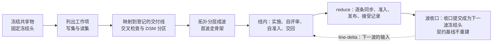
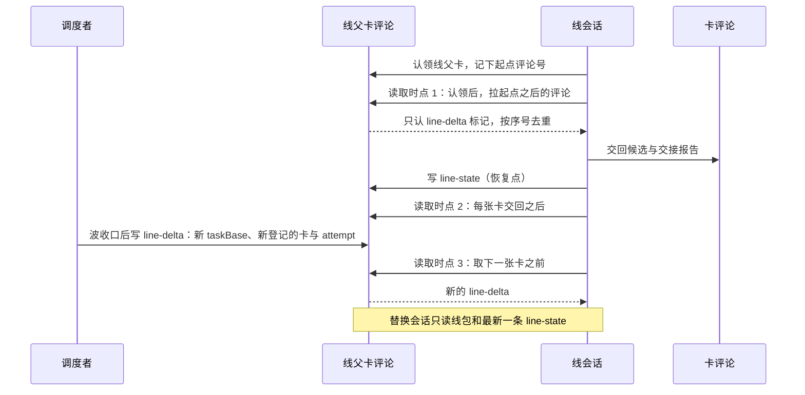

# Map-Reduce 式交付推进

**状态：流程草稿。**本页不是 skill，agent 不自动加载它。人可以按本页分解和派发，也可以把本页作为指令交给调度者 agent。

- 已验证的场景：一种宿主，由一个会话派发多个 subagent 担任交付线的执行者与集成节点。在这个场景里走通过的有：冻结共享物，写范围两两不相交的核对，自包含检查，集成节点逐条合入并逐条准入，交接报告。协调者会话为每张卡派新上下文子代理的结构，在这个场景里观察到一次。
- 没有验证的场景：其他宿主。调度者、线会话和集成节点分属多个独立会话。读集检查与 DSM 分区。按交回先后合入。队列上限与 backpressure。批量合并。失联判定。骨架常驻。冲突四分类。线内自准入。线会话跨波连贯推进多张卡。增量协议与订阅。度量账本与跨里程碑对比。
- 规则正文归各拥有者。本页只给思维模型、分解方法、协议、模板和检查清单。本页与拥有者正文冲突时，以拥有者正文为准，并修改本页。
- 宿主有权规定的事，本页只写「由宿主规定」，并给出本仓库拥有者的链接，不复述条款。本包自己主张、与宿主现行规则不同或宿主尚未规定的做法，集中在[本包建议](#本包建议宿主采用前不生效的做法)一节，宿主采用之前不生效。
- 本页的数值都是初值，按实测调整。

本页回答一个问题：一批工作要由几个会话并行推进，这些会话之间又不能通信，人也不一定在线，怎样分解、派发和集成，才能既快又可靠。

任务卡、交付线的划分、执行权、分支、准入、接受、契约基线和里程碑由宿主仓库的交付协议与工具链拥有。在本仓库，这些拥有者是[交付协议](../../../docs/engineering/delivery.md)、[通过对话操作交付卡](../../../docs/engineering/agent-delivery.md)、[多层分支集成](../../../docs/engineering/integration.md)和[共享工作约定](../../../docs/engineering/workflow.md#责任与协作交接)。

本目录还有两部分：

- 模板：[线包](templates/line-pack.md)、[线状态注](templates/line-state.md)、[line-delta](templates/line-delta.md)、[交接报告](templates/handoff-report.md)、[事前假设表](templates/hypotheses.md)、[方案版本表](templates/plan-changes.md)和[里程碑报告](templates/milestone-report.md)。模板是宿主无关的通用形状。在本仓库，每张卡的任务信息包、上下文地图与交接报告按 `claim` 技能的模板写：[任务信息包](../../agents/skills/claim/canonical/references/task-pack.md)、[上下文地图](../../agents/skills/claim/canonical/references/context-map.md)、[自包含检查](../../agents/skills/claim/canonical/references/self-contained-check.md)，交接报告是其中规定的四节。本包的线级记录（线包的线级部分、线状态注、`line-delta`）在本仓库还没有对应物。交接报告的第五节「评审闭合」是本包建议。
- [research/](research/README.md)：五篇调研和一篇综合。它们是本页的依据，不是规则。

## 术语

下列词在本页只有一个意思。宿主词汇给出通用含义和本仓库的对应位置。

| 词 | 含义 | 本仓库的对应 |
| --- | --- | --- |
| 线 | 交付线，宿主登记的写入归属单位。本页不重新划分线 | [交付线](../../../docs/engineering/integration.md#交付线) |
| 线会话 | 推进一条线的会话。map 指线会话这一侧 | 无固定对应物 |
| 线协调者 | 线会话里保存队列、裁定与状态的那一层。它自己不写代码 | 无固定对应物 |
| 工作子代理 | 线协调者为一张卡派出的新上下文子代理，负责实施或评审 | 无固定对应物 |
| 调度者 | 宿主里有权登记 attempt、发放执行权的角色 | [调度、认领与 cloud 接续](../../../docs/engineering/delivery.md#5-调度认领与cloud接续) |
| reduce | 把各线候选合入目标分支的这一段工作 | 同下 |
| 集成节点 | 做 reduce 的会话。做它的机器称「集成节点所在机器」 | [集成节点的清单](../../../docs/engineering/integration.md#集成节点的清单) |
| 波 | 从同一个冻结头开工、并行推进的一组卡 | 同上 |
| 冻结头 | 一波的共同起点提交。同一波的卡都从它开工，候选建立在它上面 | 同上 |
| taskBase | 一张卡开工时固定的基线提交。任何同步都不改变它 | [两条基线](../../../docs/engineering/integration.md#两条基线) |
| attempt | 宿主为一张卡的一次执行登记的标识。同一时刻只有一个当前 attempt。宿主也可能为集成节点检出候选另登记一个 attempt，本页说到 attempt 时写明是谁的 | [调度、认领与 cloud 接续](../../../docs/engineering/delivery.md#5-调度认领与cloud接续) |
| 准入 | 宿主的准入检查 | [现行准入](../../../docs/engineering/integration.md#现行准入) |
| gate | 宿主把候选发布进目标分支的流程 | [现行准入](../../../docs/engineering/integration.md#现行准入) |
| 线包 | 一条线的线级信息包，见[线包模板](templates/line-pack.md) | 无固定对应物 |
| 任务信息包 | 一张卡的信息包，按宿主模板写 | `claim` 的[任务信息包](../../agents/skills/claim/canonical/references/task-pack.md) |
| 线父卡 | 代表一条线的父卡。线协调者在它的评论里收发线级记录 | 无固定对应物 |
| 座位 | 一台机器上可以运行一个线会话的位置 | 无固定对应物 |

## 先判断这批工作是否适用

下面五个条件同时成立时，才适用这种做法：

1. 每个工作项的写范围都落在一条登记的交付线之内，不同线的工作项不共用未冻结的文件。
2. 各线共用的接口、规则和不变量能在开工前定下来。
3. 每一条线都能用替身独立验证自己，不必等别的线完成。
4. 有一个会话能在最后取得全部候选并做集成。
5. 人不在线时，线仍能推进。线需要的新输入以评论的形式送达，线会话自己去取，不等人转达。

下面三种情形不适用：

- 工作本身是探索性的，要边做边改共享接口。这时先做一轮串行设计，把共享的部分定下来，再回到本页的做法。
- 几个工作项都要改同一个无法预先冻结的文件。它们不能并行，交给一个会话串行推进。
- 只有一条线有工作。没有并行，就没有 map，直接推进即可。

## 思维模型

### Map-Reduce 的形状

这种做法借用 Map-Reduce 的形状。map 是几个互不通信的线会话，reduce 是集成节点做的集成工作。

会话之间不协调，所以可靠性来自两条硬规则：

- 同时运行的线，写范围不相交。
- 各线共用的东西在派发前冻结。

一张卡的同步点只有两个：派发的时刻和交回的时刻。两者之间，线会话与线会话、线会话与集成节点都不依赖对方的实时回应。

### 协调成本大多挪到 reduce

零通信没有消除协调成本。本该在过程中发生的对话，大多变成了合并冲突、准入失败和评审修复轮，在 reduce 串行处理。另一部分落在人的裁决上。

reduce 逐卡串行。一波的串行量约为 `n·S̄`，其中 `n` 是本波卡数，`S̄` 是每卡平均 reduce 服务时间。串行量随卡数线性增长，所以每波卡数有上限。依据见 [research/scheduling-theory.md](research/scheduling-theory.md) 第 1.2 节与 [research/pm-se-disciplines.md](research/pm-se-disciplines.md) 第 4 节。

### 约束是集成节点所在机器与人的注意力

agent 的产能弹性大，空闲几乎不花钱。贵的是两样东西：集成节点所在机器的时间（准入独占机器）和人的注意力（裁决与接受）。按约束理论，要追求约束的利用率，不追求线的利用率。空座位不是浪费。依据见 [research/pm-se-disciplines.md](research/pm-se-disciplines.md) 第 3、第 4 节。

### 结构层可算，语义层算不全

分解是否正确分两层：

- 结构层：写集、读集、依赖边和契约改动的类型方向。这一层能在派发前由机器判定，应当作为派发条件。
- 语义层：合并后的程序会不会出现两条线单独都没有的行为。这一层没有完备的机器判定，只能靠行为测试与人兜底。

所以文本冲突不等于分解错误。文本冲突常落在共享的登记文件上，与语义边界无关。反过来，没有文本冲突的合并也可能在构建、测试或后续场景中出错。依据见 [research/code-decomposition-theory.md](research/code-decomposition-theory.md) 的「结论先行」。

### 写集不交不等于可串行化

冻结头相当于数据库的快照。写范围不相交只排除写写冲突。A 线读了 B 线要改的东西，两边各自都能过准入，合起来却会坏。这是快照隔离下的 write skew，本页称为「读写交叉」。所以派发前除了写集，还要声明读集，并检查同一波任意两条线满足 `WS(a) ∩ RS(b) = ∅`。

过时输入是另一类错误：线包里写的事实与冻结头上的事实不一致。它靠事实出处核对来防。依据见 [research/scheduling-theory.md](research/scheduling-theory.md) 第 3.1 节。

## 十条原则

每条原则的推导与来源对照见 [research/synthesis.md](research/synthesis.md#原则与来源对照)。

| 编号 | 原则 | 为什么 |
| --- | --- | --- |
| P1 | 智能并行，写入单线程。每个写范围同一时刻只有一个写者。并行的是阅读、评审和候选 | 并行写者会各自做出相互冲突的隐含决策 |
| P2 | 零通信把大部分协调成本挪到 reduce。每波卡数由 reduce 吞吐决定，不由座位数决定 | reduce 串行量随卡数线性增长 |
| P3 | 结构层在派发前机器判定。合并后的行为靠测试与人兜底 | 语义不干扰没有完备的机器判定 |
| P4 | 写集不交不等于可串行化。派发前声明读集，检查读写交叉 | 读写交叉是 write skew，两边各自都能过准入 |
| P5 | 每个里程碑的首波就走 walking skeleton，用最薄的端到端切片在 reduce 走通一次 | 零通信并行最缺早期集成，最难的集成路径应最先暴露 |
| P6 | 契约基线在里程碑起点确定。波的收口不重建契约基线。经有权者批准的破坏性改动，按宿主规则补登记受影响成员的基线 | 可加性要累计相对起点判断。每波重建基线，几波叠加可能对起点构成破坏 |
| P7 | 追求约束的利用率，不追求线的利用率。reduce 积压时，调度者少派，空座位留着 | 非约束环节跑满不增加系统产出 |
| P8 | 验证左移到线。线交回时已评审闭合，已在冻结头上跑过准入。集成节点的准入成为复核 | reduce 是串行瓶颈，它的服务时间和准入失败率是首要杠杆 |
| P9 | 派发用的事实只从冻结头读，线包里每条事实写明出处。写范围只从任务绑定生成，不手抄 | 线包会陈旧。包内事实与冻结头不一致时，线照着错的事实做 |
| P10 | 小样本用效应量和控制图判断，不做显著性检验。判断前先登记假设 | 体感不可靠，实测与自评可能方向相反 |

P6 的规则正文归宿主。在本仓库，见[里程碑与契约基线](../../../docs/engineering/integration.md#里程碑与契约基线)。

## 三种角色与会话

| 角色 | 做什么 | 不做什么 |
| --- | --- | --- |
| 调度者 | 冻结共享物，把工作项映射到交付线并分出波，为每条线写线包，按宿主协议为卡登记当前 attempt 并派发。波收口后在线父卡发 `line-delta` | 不向在途的卡追加指令。新信息只在线会话的读取时点送达 |
| 线会话（map） | 推进一条线。按队列顺序连贯推进这条线的多张同领域卡，跨波不换会话。每张卡派工作子代理实施和评审，在冻结头上自准入，交回候选与交接报告 | 不读别的线的进度，不与别的线通信，不改写范围外的文件，不改共享物 |
| 集成节点（reduce） | 按宿主的集成清单把候选合入目标分支，运行准入，联调，确定波的收口提交 | 权限以宿主清单为准。在本仓库，它不修改候选的代码，不与线会话通信 |

执行权只来自调度者登记的当前 attempt：

- 线会话只取调度者已为其登记当前 attempt 的卡。认领线父卡与认卡评论都不授予执行权。
- 调度者可以在波开始时，为队列中已能开工的卡一次登记。
- 依赖入轨后才能开工的卡，由调度者登记，并经 `line-delta` 告知线会话。

一条线始终只由一个线会话推进。子线是一条线内部的切分：子线之间的写范围有重叠，或者后一条依赖前一条的结果，所以由同一个线会话串行推进。

一个线会话可以连贯推进多张卡，前提是这些卡属于同一领域，前后共享心智模型。队列跨了领域，就拆成两个线会话。

本地会话、云端会话或另一种 agent harness 都可以担任线会话或集成节点，前提是线包不依赖任何一种 agent harness 的私有机制。

### 线会话内部：连贯归协调层，新鲜归工作层

线协调者保存队列、裁定、当前 taskBase 与「已定、未定」状态，自己不写代码。上下文会随时间腐化，线协调者用下面三条规则挡住它：

1. 每张卡派一个新上下文的工作子代理实施，输入是线包加本卡的任务信息包。评审也派新上下文的工作子代理。
2. 修复轮第 1 轮续用同一个工作子代理。第 2 轮一律换新的工作子代理，输入是两个包、评审报告和第 1 轮的交回记录。第 1 轮修不净，多半是工作子代理的上下文已经偏了。
3. 每张卡交回后写一条[线状态注](templates/line-state.md)。任何一次压缩上下文之前，先写状态注，宿主自动压缩时也一样。波结束是其中一个压缩时点。压缩后从状态注重建，不从记忆重建。

状态注也是恢复点。线会话失联后，替换会话只读线包和最新一条状态注就能接上。替换会话同样只取调度者已登记当前 attempt 的卡。

## 流程

### 派发前

调度者按下列顺序完成，每步有可核对的产出。

1. 列出本批所有线都依赖的共享物：接口形状、不变量、依赖方向规则、公共值类型、锁文件和集成入口。
2. 完成共享物，合入基线分支，取得冻结头提交号。
3. 为契约成员上本波要新增的符号分配归属：每个契约成员本波只由一条线新增符号。
4. 从宿主的任务绑定生成每个工作项的写范围，不手抄计划表。写不清写范围的工作项先拆分，拆到写得清为止。
5. 从冻结头的依赖图取得每条线的读集：写范围内成员依赖的包的传递闭包，加上任务信息包引用的正文页。
6. 按宿主的线到目录登记，把每个工作项映射到拥有其写范围的那条交付线。
7. 核对任意两条线的写集交集为空。求交时排除宿主声明的共享路径。共享路径上由本卡其他改动生成或登记的变化，按宿主规定可以写。在本仓库，共享路径是[线归属表](../../../docs/engineering/integration.md#线与归属)的 `shared`。
8. 核对同一波任意两条线满足 `WS(a) ∩ RS(b) = ∅`。只允许读冻结的契约。
9. 在冻结头的依赖图上做 DSM 分区：把强连通分量收缩成块，再拓扑排序。同一块不拆给两条线。跨线的依赖边只能指向冻结的契约成员。
10. 一个工作项跨了两条线，或者两条线要改同一个非共享文件，说明有一个共享物没有冻结。回到第 1 步，冻结那个文件，或者把它留给集成节点。登记本身需要改时，在报告中写明，由登记的拥有者决定。
11. 以线为节点，一条线需要另一条线的交付结果才能开工就连边，然后做拓扑分层。同一层组成一波。
12. 按上一波实测值算每波卡数上限 `n ≤ ρ·L_max/S̄`。`ρ` 是 reduce 目标利用率，`L_max` 是最长线时长。
13. 标出关键路径。缩短它有两种办法：
    - 把共享物做得更完整，使长线不返工。
    - 把长线切成子线，由同一个线会话串行推进。
14. 在里程碑的首波安排最薄的端到端切片，让最难的集成路径在首波 reduce 走通一次。
15. 只从冻结头读派发用的事实，不从落后的检出或旧草稿读。线包里每条已知事实写明冻结头上的出处。没有核过的标「未核」，由线自己核。
16. 在里程碑开工前冻结[事前假设表](templates/hypotheses.md)与[方案版本表](templates/plan-changes.md)的当前版本。
17. 按[线包模板](templates/line-pack.md)写线包。每条线写出承重假设，每条配一个可观察的信号。
18. 按宿主模板写每张卡的任务信息包。
19. 做自包含检查：找一个没有任何上下文的会话，只给它线包和任务信息包，问四个问题。从哪个提交开工？能改哪些文件？做到什么程度算完成？包里的每条事实出处在哪里？四个问题都答得出，包才合格。本仓库的检查项见[自包含检查](../../agents/skills/claim/canonical/references/self-contained-check.md)。
20. 按宿主协议为能开工的卡登记当前 attempt，然后派发。

### 线内

线会话认领线父卡后，按[增量协议](#增量协议)开始读取 `line-delta`，然后按队列逐卡推进：

1. 取下一张已有当前 attempt、没有被阻塞的卡。队列头被阻塞时，先做没被阻塞的卡。都被阻塞就定时轮询。
2. 本卡的 taskBase 与上一张卡不同时，先重生成派生物。派生物指由源文件生成的投影、快照和登记文件。
3. 派新上下文的工作子代理实施。在写范围之内，实现与设计选择由线自己决定，不请示。
4. 开 PR 后，派新上下文的工作子代理评审。评审只报影响正确性和需求的缺口。
5. 修复轮至多 2 轮。超过就停下报告。
6. 在冻结头上运行准入，交回时附准入通过的日志。同机的线会话共用宿主的测试名额，准入与测试都经名额排队。
7. 按宿主的交接格式交回候选和交接报告，并照宿主协议写交回记录。
8. 写线状态注，再读一次 `line-delta`。

同机运行两个线会话时，两条线配「一重一轻」：一条代码重、跑成员测试，另一条以契约或正文为主。每台机器至多一条重测试线。两条线写范围不相交。派发前核对宿主的测试名额机制在每台机器可用。

线在下列情形暂停受影响的部分，继续写范围内不受影响的工作，并在交接报告中写明：

- 需要修改共享物。
- 需要修改写范围外的文件。
- 发现设计与不变量冲突。
- 验收标准互相矛盾，或者与拥有者正文矛盾。
- 需要相邻线的实现细节才能继续。
- 缺少产品规则、采用依据或必要权限。
- 必须做破坏性的契约改动。线写报告，请求有权者拍板。拍板后的执行方式由宿主的[里程碑内的规则](../../../docs/engineering/integration.md#里程碑内的规则)规定。

停下不是失败。报告把问题交给调度者，由调度者决定修改共享物、修正映射还是修改线包。线不替调度者做这个决定。

### reduce

集成节点按宿主的集成清单工作。在本仓库，见[集成节点的清单](../../../docs/engineering/integration.md#集成节点的清单)。合并顺序、冲突处置、是否批量合并、准入不过后怎样处理，都由宿主规定。本包对这几件事的主张在[本包建议](#本包建议宿主采用前不生效的做法)一节。

下列做法不与本仓库现行规则冲突。宿主没有相反规定时，它们适用：

1. 集成节点只读候选、交接报告和调度者给的包，不读各线的工作过程。
2. 每张卡的 reduce 分四段打点：同步、准入、gate、接受记录。接受记录由有资格的负责人或其授权者写。每段记起止时刻。目标每卡不超过 20 分钟。
3. 每次同步之后、准入之前，一律重生成派生物。同步会带进别人对派生物源文件的改动，即使候选自己没改源文件，派生物也可能过期。
4. 集成节点能修改哪些文件、怎样处理冲突，以宿主清单为准。
5. 每波 reduce 末尾跑一次薄的端到端场景。一跳是完整路径上跨过两条线交付物边界的一次调用。已交付真实实现的跳用真实实现，其余用各线共用的替身。集成报告写明哪些跳用了替身。替身跳数应逐波减少。

### 波收口

1. 同一波的卡都从冻结头开工，候选建立在它上面。合入期间目标分支的头会前进，本波各卡的 taskBase 不变。
2. 联调通过后，集成节点确定本波的收口提交。它成为下一波的冻结头。在本仓库，见[波的收口提交](../../../docs/engineering/integration.md#波的收口提交)。
3. 波的收口不重建契约基线。基线的登记与补登记由宿主规定，见 P6。
4. 集成节点写集成报告：合入顺序、每一步的结果、退回的线和分解错误清单。
5. 调度者给每条线的线父卡发一条 `line-delta`，送出下一波的输入。

## 增量协议

线会话与调度者、集成节点之间不发直接消息，只经卡评论交换记录。GitHub 的 Issue 评论就是邮箱。线级记录带固定标记，读取方只认标记。

| 方向 | 落点 | 标记 | 内容 |
| --- | --- | --- | --- |
| 线会话到卡 | 卡评论 | 宿主要求的认卡记录 | 认卡声明，照宿主协议写。它不授予执行权 |
| 调度者或集成节点到卡 | 卡评论 | 宿主现有的派发、接受与退回记录 | attempt 登记、接受、退回 |
| 调度者到线 | 线父卡评论 | `<!-- line-delta -->` 加单调递增序号 | 新的 taskBase；新登记的卡与 attempt；已入轨的依赖卡及其产物位置；共享冻结物的变化；影响本线的裁定；队列调整。格式见 [line-delta 模板](templates/line-delta.md) |
| 线会话到卡 | 卡评论 | 宿主现有的交回记录 | 候选、交接报告、评审闭合、自准入日志 |
| 线协调者到线父卡 | 线父卡评论 | `<!-- line-state -->` | 线状态注，格式见[线状态注模板](templates/line-state.md) |

`line-delta` 的写者是调度者。同一个会话兼任集成节点时，写 `line-delta` 仍是调度者动作。宿主禁止集成节点与线通信时，这个会话以调度者身份写。`line-delta` 的内容是下一波的线包增量，不是对在途卡的指令。

线会话认领线父卡后：

1. 记下起点，即线父卡当前最新的评论号。
2. 之后只拉起点之后的新评论，只认 `<!-- line-delta -->` 标记，按序号去重。
3. 在三个时点读取：认领后，每张卡交回之后，取下一张卡之前。
4. 队列全部被阻塞时定时轮询。周期取每卡 reduce 服务时间的两倍。

`line-state` 由线协调者自己写，只在恢复时读最新一条。读取方靠标记区分两类记录，不靠作者。线会话与调度者可能以同一身份发评论。

Issue 订阅推不到命令行会话，所以订阅的落地是轮询。宿主宜提供一个拉取并过滤 `line-delta` 的命令。宿主没有提供时，各宿主的技能用等价的查询。

## 按情形处理失败

| 情形 | 处理 |
| --- | --- |
| 越界：线改了写范围外的文件 | 按宿主规定处理候选。在本仓库，整个候选不合入，退回该线，见[每一步的命令](../../../docs/engineering/integration.md#每一步的命令)。记一条分解错误，原因类为越界 |
| 读写交叉：A 线读了 B 线要改的东西 | 合入顺序要与「读自」关系一致，或者 A 在 B 合入后的头上重跑准入。顺序由宿主规定。记一条分解错误。下一波派发前补读集检查 |
| 过时输入：包内事实不是冻结头上的事实 | 线按冻结头上的事实做，在交接报告中写明差异。记一条分解错误。调度者补出处核对 |
| 漏冻结：线需要修改一个共享物 | 当前波继续。共享物的修改排进下一波的冻结步骤。依赖这项修改的线等到下一波。记一条分解错误 |
| 准入不通过 | 由宿主规定。在本仓库，见[失败处理](../../../docs/engineering/integration.md#失败处理) |
| 合并冲突 | 由宿主规定。在本仓库，见[冲突即退回分解](../../../docs/engineering/integration.md#冲突即退回分解) |
| 失联：线会话不再推进 | 失联判定需要宿主提供可靠信号与原子认领。宿主不提供时，调度者停止向该线新派发，按宿主协议判断与交接。重派进哪一波由宿主规定。在本仓库，见[调度、认领与 cloud 接续](../../../docs/engineering/delivery.md#5-调度认领与cloud接续)与[失败处理](../../../docs/engineering/integration.md#失败处理) |
| 必须做破坏性的契约改动 | 线停下，写报告，请求有权者拍板。拍板后的执行方式由宿主的[里程碑内的规则](../../../docs/engineering/integration.md#里程碑内的规则)规定 |
| 联调失败 | 由宿主规定。在本仓库，见[失败处理](../../../docs/engineering/integration.md#失败处理) |

## 度量与对比

度量回答一个问题：这次的方案调整让哪些指标改善了，哪些回归了。每个字段先分清它是「门」还是「观察」。门是二值判定，不过就不合入。观察只进报告，不设目标。观察指标设成目标，就会被博弈。

账本是三张派生表：卡级、波级、里程碑级。一个版本化的脚本从原始事件派生它们。指标定义改了，就对历史重算。全部字段、来源与计算见 [research/synthesis.md](research/synthesis.md#度量账本)。

| 粒度 | 主要字段 | 门 | 观察 |
| --- | --- | --- | --- |
| 卡 | 派发、交回、进入集成、接受四个时刻；线内时长；reduce 排队与四段服务时长；准入次数与失败次数；线内与 reduce 侧修复轮数；每轮修复的返工原因；评审发现密度；分解错误（现象类、原因类、发现时点）；人裁决的请求与决定时刻；按角色的 token 与成本；线会话被替换的次数 | 宿主现有的检查；交回附准入日志；契约变化的申报值不低于实测值 | 其余全部字段 |
| 波 | 卡数、座位数；冻结时长与波时长；线时长的最大、中位、最小值；reduce 占比；到达率、排队时长、队列长度；队列超限次数；空座位时间；骨架真实跳数比；派发前拦下与交回后发现的分解错误之比；重派次数；承重假设信号的触发次数 | 无 | 全部 |
| 里程碑 | 方案版本与共干预；周期、线内时长、reduce 时长的中位数与 P85；reduce 侧准入失败率；首次通过率；修复轮分布与返工原因占比；人裁决等待；每张接受卡的成本；首次端到端通过的时刻比例；最后一波才发现的集成缺陷比例；工期预测的命中百分位 | 无 | 全部 |

观察指标成对来读：吞吐对返工率，周期对评审发现密度，成本对首次通过率。

调度者用队列控制派发节奏：「已交回、未接受」的卡数 `Q ≤ 4`，reduce 利用率 `ρ = λ·S̄ ≤ 0.75`，其中 `λ` 是交回到达率。`Q` 超限时调度者不补空座位，直到队列回落。这就是 backpressure。零通信下集成节点不能叫线放慢，只能由调度者少派。

### 跨里程碑对比协议

1. 第一张卡派发前，冻结[事前假设表](templates/hypotheses.md)。每条假设写明对应的方案调整、指标与方向、预期幅度、对照和反向信号。
2. 每项方案调整在[方案版本表](templates/plan-changes.md)登记一行。每张卡挂派发时的方案版本。里程碑中途改方案就升小版本，记为共干预。作用范围之外的卡自动成为该调整的对照组。
3. 把卡级连续指标按接受时刻排成一条跨里程碑的序列，画 XmR 图，在方案版本切换处分段。限值常数取 2.66 与 3.268，这两个常数与信号规则都待核，采用前对照 Wheeler 原书。
4. 在两个里程碑之间报中位数差、P85 和 Vargha-Delaney Â12，附 bootstrap 95% 区间，不报 p 值。波级每个里程碑只有几个点，只描述，不画控制图。
5. 三条同时满足才判「改善」或「回归」：XmR 出现信号；Â12 区间不含 0.5；方向与事前假设一致。只满足一两条记为「迹象」，下个里程碑继续看。
6. 按[里程碑报告模板](templates/milestone-report.md)写报告。

说明边界：

- 每个里程碑只有十几张卡，Â12 区间会很宽。预期多数结论落在「迹象」。
- 同一指标上有多项调整时，结论只能归到这组调整整体。
- 两个里程碑的工作类型不同（例如一个允许破坏性改动，另一个只许可加改动），属于构念效度的威胁，报告必须写明。
- 回填不出的字段标缺失，不估填。

## 本包建议、宿主采用前不生效的做法

下列做法是本包的主张。每条写明做法、理由与依据、本仓库的现行规则。宿主要采用，先经宿主拥有者修订规则。修订之前，本仓库按现行规则执行。

| 编号 | 做法 | 理由与依据 | 本仓库的现行规则 |
| --- | --- | --- | --- |
| B1 | 按交回先后流水合入，不等全波交齐。顺序只受「被引用的先合」约束。几张卡同时就绪时，失败概率高或影响面大的先合 | 按到达先后服务能让 reduce 与 map 重叠。高风险的先合，返工能与其余卡的 reduce 重叠。见 [scheduling-theory](research/scheduling-theory.md) 第 1.3、第 3.2 节 | 已采用，见[合并顺序](../../../docs/engineering/integration.md#合并顺序) |
| B2 | 冲突按四类记账：基础设施冲突（文本冲突落在共享登记文件上）、build 冲突、test 冲突、语义潜伏。后三类算分解错误，基础设施冲突计入共享名单的缺漏，改用生成器产出。这只是记账视图，不改变处理动作 | 文本冲突对分解错误既不充分也不必要。见 [code-decomposition-theory](research/code-decomposition-theory.md) 第 6 节第 3.1 条 | 记账视图未采用。处理动作见[冲突即退回分解](../../../docs/engineering/integration.md#冲突即退回分解)：只落在共享路径上的冲突，由集成节点重新生成或保留两边新增后跑准入；其余冲突退回 |
| B3 | 批量合并默认关闭。线内准入之后 reduce 侧的准入失败率 `p ≤ 0.05` 时才开启，批大小 2 到 3，整批失败就二分剔除。开启后不再每合入一条准入一次 | 批量只在 `b·p` 远小于 1 时划算。见 [scheduling-theory](research/scheduling-theory.md) 第 5.2 节 | 逐条准入，见[每一步的命令](../../../docs/engineering/integration.md#每一步的命令) |
| B4 | 准入不通过时，调度者为该卡登记同一修订的新 attempt，把评审报告写进派发记录作输入，派到任一座位，在同一波内处理 | 派发可以至少一次，接受对修订幂等。见 [scheduling-theory](research/scheduling-theory.md) 第 4 节 | [失败处理](../../../docs/engineering/integration.md#失败处理) |
| B5 | 宿主若要提供失联判定，可参考租约（到期未续即失效）与 fencing token（每次授权带单调递增编号，下游拒绝旧编号）。这两项是研究结论，不是本包的规则 | 见 [scheduling-theory](research/scheduling-theory.md) 第 4 节 | [调度、认领与 cloud 接续](../../../docs/engineering/delivery.md#5-调度认领与cloud接续) |
| B6 | 破坏性改动分两阶段：线内只做兼容开发，新旧形状并存。破坏性改动在 reduce 由一张卡一次完成，并补登记受影响成员的基线 | 契约的增量改动单调，线之间不需要协调。破坏性改动非单调，必须有协调点。见 [scheduling-theory](research/scheduling-theory.md) 第 3.3 节 | [里程碑内的规则](../../../docs/engineering/integration.md#里程碑内的规则)。本仓库正文尚未写入「线内先做兼容开发」这一步 |
| B7 | 交接报告加第五节「评审闭合」：评审报告与每轮修复记录随交回发出，每轮修复记一条返工原因 | 返工原因是区分规格缺陷、分解错误和过时输入的唯一来源。见 [measurement-and-comparison](research/measurement-and-comparison.md) 第 6.3 节 | `claim` 的[任务信息包](../../agents/skills/claim/canonical/references/task-pack.md)规定四节 |
| B8 | 线级记录：线包的线级部分、线状态注、`line-delta` 与认领线父卡后的读取 | 人不在线时，线会话要能自己取到下一波的输入，并在失联后由替换会话接上。见 [agent-practice-2026](research/agent-practice-2026.md) 第 2 节 | 本仓库还没有对应物 |

B2 与失败表的对应：基础设施冲突落在「合并冲突」一行。build 冲突与 test 冲突落在「准入不通过」一行。语义潜伏落在「联调失败」一行，或者在后续卡才暴露。一个现象只落在一行。

## 行为边界

- 线不跨写范围，不与别的线通信，不改共享物。
- 线会话只取调度者已登记当前 attempt 的卡。
- 集成节点的权限以宿主清单为准。
- 评审在线内完成。集成节点的复核不代替接受，线的自查「达到」也不是接受。接受归有资格的负责人。
- 技能和本页都不能给自己授予宿主规则的例外。需要例外时，按宿主规则由有权者具名决定。
- 本页的数值都是初值。改数值前先有实测，改动登记进方案版本表。
- 本页不定义任务卡、交付线、执行权、准入、接受、契约基线或里程碑。

## 宿主仓库要提供的机制

这种做法要求宿主提供下列机制。前四样是开工的前提，缺哪一样就先补哪一样。其余几样缺失时，对应的步骤只能人工做，或者不做，并在报告中写明。

- 任务绑定能记录基线、分支和写范围。
- 准入能核对候选是否越出写范围。
- 线到目录的登记，含共享路径，供派发前读取写范围。
- 一个联调入口，供每波 reduce 末尾走完整路径。
- 依赖图导出，供读集检查与 DSM 分区。
- 带固定标记的评论，以及按起点拉取新评论的方法，供增量协议使用。
- 机器级的测试名额，使同机多个会话的准入与测试排队运行。
- 能取得分钟级事件时刻的记录：派发、交回、准入日志、gate 运行和接受，供度量账本使用。
- 失联判定所需的可靠信号与原子认领。没有它时，失联只能由调度者按宿主协议判断。

## 派发前检查清单

- [ ] 共享物已冻结，有冻结头提交号。契约成员上的新增符号已分配到线。
- [ ] 写范围从任务绑定生成，每一项精确到文件。
- [ ] 每条线的读集已声明。
- [ ] 任意两条线的写集交集为空（排除共享路径），任意两条线满足 `WS(a) ∩ RS(b) = ∅`，DSM 跨线边只指向冻结的契约，均已用脚本核对。
- [ ] 已画出波次表，已标出关键路径。每波卡数按上一波实测值算过。
- [ ] 首波安排了骨架切片。
- [ ] 线包里每条已知事实都写明了冻结头上的出处，或者标为「未核」。
- [ ] 事前假设表与方案版本表已冻结。每条线写出了承重假设和信号。
- [ ] 线包与每张卡的任务信息包都通过了自包含检查。
- [ ] 能开工的卡都已由调度者登记当前 attempt。
- [ ] 每台机器的测试名额机制可用，每台机器至多一条重测试线。
- [ ] 宿主的前四样机制都已具备。其余缺失的已写明人工替代。
