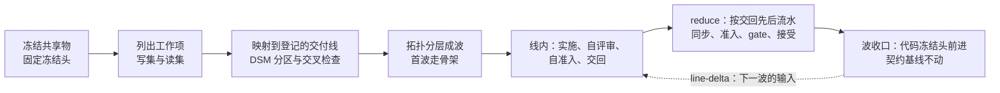

# Map-Reduce 式交付推进

**状态：流程草稿。**本页不是 skill，agent 不自动加载它。人可以按本页分解和派发，也可以把本页作为指令交给派发者 agent。

- 已验证的场景：一种宿主，由一个会话派发多个 subagent 担任交付线与集成节点。线会话内部的「协调层加新上下文工作层」结构在这个场景里观察到一次。
- 没有验证的场景：其他宿主。派发者、线会话和集成节点分属多个独立会话的调度方式。线会话跨波连贯推进多张卡。增量协议与认领后订阅。度量账本与跨里程碑对比协议。
- 规则正文归各拥有者。本页只给思维模型、分解方法、协议、模板和检查清单。本页与拥有者正文冲突时，以拥有者正文为准，并修改本页。
- 本页的数值都是初值，按实测调整。

本页回答一个问题：一批工作要由几个会话并行推进，这些会话之间又不能通信，人也不一定在线，怎样分解、派发和集成，才能既快又可靠。

任务卡、交付线的划分、分支、准入、接受、契约基线和里程碑由宿主仓库的交付协议与工具链拥有。在本仓库，这些拥有者是[交付协议](../../../docs/engineering/delivery.md)、[通过对话操作交付卡](../../../docs/engineering/agent-delivery.md)、[多层分支集成](../../../docs/engineering/integration.md)和[共享工作约定](../../../docs/engineering/workflow.md#责任与协作交接)。下文的「准入」都指宿主的准入检查。

本目录还有两部分：

- 模板：[线包](templates/line-pack.md)、[线状态注](templates/line-state.md)、[line-delta](templates/line-delta.md)、[交回报告](templates/handoff-report.md)、[事前假设表](templates/hypotheses.md)、[方案版本表](templates/plan-changes.md)和[里程碑报告](templates/milestone-report.md)。
- [research/](research/README.md)：五篇调研和一篇综合。它们是本页的依据，不是规则。

## 先判断这批工作是否适用

下面五个条件同时成立时，才适用这种做法：

1. 每个工作项的写范围都落在一条登记的交付线之内，不同线的工作项不共用未冻结的文件。
2. 各线共用的接口、规则和不变量能在开工前定下来。
3. 每一条线都能用替身独立验证自己，不必等别的线完成。
4. 有一个会话能在最后取得全部候选并做集成。
5. 人不在线时，线仍能推进。线需要的新输入以评论的形式送达，线会话自己去取，不等人调度。

下面三种情形不适用：

- 工作本身是探索性的，要边做边改共享接口。这时先做一轮串行设计，把共享的部分定下来，再回到本页的做法。
- 几个工作项都要改同一个无法预先冻结的文件。它们不能并行，交给一个会话串行推进。
- 只有一条线有工作。没有并行，就没有 map，直接推进即可。

## 思维模型

### Map-Reduce 的形状

这种做法借用 Map-Reduce 的形状。map 是几条互不通信的交付线，下文简称「线」。线就是宿主登记的交付线，即写入归属的单位。本页不重新划分线。reduce 是一个专门做集成的会话，即集成节点。

会话之间不协调，所以可靠性来自两条硬规则：

- 同时运行的线，写范围不相交。
- 各线共用的东西在派发前冻结。

一波的同步点只有两个：派发的时刻和交回的时刻。两者之间，线与线、线与集成节点都不依赖对方的实时回应。

### 协调成本集中到 reduce

零通信没有消除协调成本，只是把它挪到了 reduce。本该在过程中发生的对话，变成了合并冲突、准入失败和评审修复轮，全部在集成节点串行处理。

reduce 逐卡串行，一波的串行量是 `n·S̄`（`n` 是本波卡数，`S̄` 是每卡平均 reduce 服务时间），随线数线性增长。所以加线有上限。线越多，reduce 越可能成为一波时长的决定因素。依据见 [research/scheduling-theory.md](research/scheduling-theory.md) 第 1.2 节与 [research/pm-se-disciplines.md](research/pm-se-disciplines.md) 第 4 节。

### 约束是 reduce 机器与人的注意力

agent 的产能弹性大，空闲几乎不花钱。贵的是两样东西：reduce 机器的时间（准入独占机器）和人的注意力（裁决与接受）。按约束理论，要追求约束的利用率，不追求线的利用率。空槽不是浪费。依据见 [research/pm-se-disciplines.md](research/pm-se-disciplines.md) 第 3、第 4 节。

### 结构层可算，语义层算不全

分解是否正确分两层：

- 结构层：写集、读集、依赖边和契约改动的类型方向。这一层能在派发前由机器判定，应当作为派发条件。
- 语义层：合并后的程序会不会出现两条线单独都没有的行为。这一层没有完备的机器判定，只能靠行为测试与人兜底。

所以文本冲突不等于分解错误。文本冲突常落在共享的登记文件上，与语义边界无关。反过来，没有文本冲突的合并也可能在构建、测试或后续场景中出错。依据见 [research/code-decomposition-theory.md](research/code-decomposition-theory.md) 的「结论先行」。

### 写集不交不等于可串行化

冻结头相当于数据库的快照。写范围不相交只排除写写冲突。A 线读了 B 线要改的东西，两边各自都能过准入，合起来却会坏，这就是快照隔离下的 write skew。所以派发前除了写集，还要声明读集，并检查同一波任意两条线满足 `WS(a) ∩ RS(b) = ∅`。依据见 [research/scheduling-theory.md](research/scheduling-theory.md) 第 3.1 节。

## 十条原则

每条原则的推导与来源对照见 [research/synthesis.md](research/synthesis.md#原则与来源对照)。

| 编号 | 原则 | 为什么 |
| --- | --- | --- |
| P1 | 智能并行，写入单线程。每个写范围同一时刻只有一个写者。并行的是阅读、评审和候选 | 并行写者会各自做出相互冲突的隐含决策 |
| P2 | 协调成本只会集中到 reduce。每波卡数由 reduce 吞吐决定，不由槽数决定 | reduce 串行量随线数线性增长 |
| P3 | 结构层在派发前机器判定。合并后的行为靠测试与人兜底 | 语义不干扰没有完备的机器判定 |
| P4 | 写集不交不等于可串行化。派发前声明读集，检查读写交叉 | 「输入过时」类错误就是 write skew |
| P5 | 每个里程碑的首波就走 walking skeleton，用最薄的端到端切片在 reduce 走通一次 | 零通信并行最缺早期集成，最难的集成路径应最先暴露 |
| P6 | 契约基线在里程碑起点确定，里程碑内单调扩展。代码冻结头每波前进，契约基线不动 | 可加性要累计相对起点判断。每波重建基线，几波叠加可能对起点构成破坏 |
| P7 | 追求约束的利用率，不追求线的利用率。reduce 队列超限时，空槽留着不补 | 非约束环节跑满不增加系统产出 |
| P8 | 验证左移到线。线交回时已评审闭合，已在冻结头上跑过准入。reduce 只做确认 | reduce 是串行瓶颈，它的服务时间和准入失败率是首要杠杆 |
| P9 | 派发用的事实只从冻结头读，包里每条事实写明出处。写范围只从任务绑定生成，不手抄 | 交接包会陈旧。包内事实与冻结头不一致时，线照着错的事实做 |
| P10 | 小样本用效应量和控制图判断，不做显著性检验。判断前先登记假设 | 体感不可靠，实测与自评可能方向相反 |

P6 的规则正文归宿主。在本仓库，见[里程碑内的规则](../../../docs/engineering/integration.md#里程碑内的规则)与[可加改动](../../../docs/engineering/integration.md#可加改动)。本页只解释它为什么对并行重要。

## 三种角色与会话

| 角色 | 做什么 | 不做什么 |
| --- | --- | --- |
| 派发者 | 冻结共享物，把工作项映射到交付线并分出波，为每条线写线包，然后派发。波收口后经 `line-delta` 送出下一波的输入 | 不向在途的卡追加指令。新信息只在线会话的读取时点送达 |
| 线会话（map） | 一个独立会话，负责一条线。按队列顺序连贯推进这条线的多张同领域卡，跨波不换会话。每张卡派新上下文的工作子代理实施、派新上下文的评审子代理评审，自己做准入，交回候选与五节报告 | 不读别的线的进度，不与别的线通信，不改写范围外的文件，不改共享物 |
| 集成节点（reduce） | 一个独立会话。按交回先后把候选合入目标分支，每合入一条运行一次准入，联调，确定波的收口提交 | 不修改候选的代码，不替线补做未完成的工作，不与线通信 |

一条线始终只由一个线会话推进。子线是一条线内部的切分：子线之间的写范围有重叠，或者后一条依赖前一条的结果，所以由同一个线会话串行推进。

一个线会话可以连贯推进多张卡，前提是这些卡属于同一领域，前后共享心智模型。队列跨了领域，就拆成两条线。

本地会话、云端会话或另一种 agent harness 都可以担任线会话或集成节点，前提是线包不依赖任何一种 agent harness 的私有机制。派发者还须具备宿主交付协议要求的调度资格。

### 线会话内部：连贯归协调层，新鲜归工作层

线会话自己不写代码。它是这条线的小调度者，保存队列、裁定、当前 taskBase 与「已定、未定」状态。上下文会随时间腐化，线会话用下面三条规则挡住它：

1. 每张卡派一个新上下文的工作子代理，输入是线包加本卡的任务信息包。评审子代理同样用新上下文。
2. 修复轮第 1 轮续用同一个工作子代理。第 2 轮一律换新的工作子代理，输入是包、评审报告和第 1 轮的交回记录。第 1 轮修不净，多半是工作子代理的上下文已经偏了。
3. 每张卡交回后，线会话写一条[线状态注](templates/line-state.md)。每波结束、写完状态注后，线会话压缩一次自己的上下文，之后从状态注重建，不从记忆重建。

状态注也是恢复点。线会话失联后，替换会话只读线包和最新一条状态注就能接上，不需要人调度。

## 流程

### 派发前

派发者按下列顺序完成。每步都有可核对的产出。

1. **冻结共享物。**列出本批所有线都依赖的共享物：接口形状、不变量、依赖方向规则、公共值类型、锁文件和集成入口。逐项完成，合入基线分支，取得冻结头提交号。契约成员上本波要新增的符号也要分配：每个契约成员本波只由一条线新增符号。
2. **列出工作项与写范围。**写范围从宿主的任务绑定生成，不手抄计划表。写不清写范围的工作项先拆分，拆到写得清为止。
3. **声明读集。**读集是写范围内成员依赖的包的传递闭包，加上任务信息包引用的正文页。读集从冻结头的依赖图机械取得，不靠人记。
4. **映射到登记的交付线，并做三项核对。**按宿主的线到目录登记，把每个工作项映射到拥有其写范围的那条交付线。然后核对：
   - 任意两条线的写集交集为空。以工作项为节点、写集有交集就连边，每个连通分量必须属于同一条线。
   - 同一波任意两条线满足 `WS(a) ∩ RS(b) = ∅`。只允许读冻结的契约。
   - 在冻结头的依赖图上做 DSM 分区：把强连通分量收缩成块，再拓扑排序。同一块不拆给两条线。跨线的依赖边只能指向冻结的契约成员。

   一个工作项跨了两条线，或者两条线要改同一个文件，说明有一个共享物没有冻结。回到第 1 步：冻结那个文件，或者把它留给集成节点修改。登记本身需要改时，在报告中写明，由登记的拥有者决定。
5. **拓扑分层求波。**以线为节点，一条线需要另一条线的交付结果才能开工就连边，然后做拓扑分层。同一层组成一波。每波卡数取 `n ≤ ρ·L_max/S̄`（`ρ` 是 reduce 目标利用率，`L_max` 是最长线时长），按上一波实测值算。缩短关键路径有两种办法：
   - 把共享物做得更完整，使长线不返工。
   - 把长线切成子线，由同一个会话串行推进。
6. **首波走骨架。**里程碑的首波安排最薄的端到端切片，让最难的集成路径在首波 reduce 走通一次。
7. **核对事实出处。**事实只从冻结头读，不从落后的检出或旧草稿读。线包里每条「已知事实」写明它在冻结头上的出处。没有核过的标「未核」，由线自己核。
8. **登记事前假设。**里程碑开工前冻结[事前假设表](templates/hypotheses.md)与[方案版本表](templates/plan-changes.md)的当前版本。每条线在线包里写出承重假设，每条配一个可观察的信号。
9. **写线包并做自包含检查。**按[线包模板](templates/line-pack.md)写。派发者找一个没有任何上下文的会话，只给它线包，然后问四个问题：从哪个提交开工？能改哪些文件？做到什么程度算完成？包里的每条事实出处在哪里？四个问题都答得出，线包才合格。

### 线内

线会话认领线父卡后，按[增量协议](#增量协议)订阅它，然后按队列逐卡推进：

1. 取下一张没有被阻塞的卡。队列头被依赖卡阻塞时，先做没被阻塞的卡。都被阻塞就定时轮询。
2. 派新上下文的工作子代理实施。在写范围之内，实现与设计选择由线自己决定，不请示。
3. 开 PR 后，派新上下文的评审子代理评审。评审只报影响正确性和需求的缺口。修复轮上限 2 轮，超过就停下报告。
4. 在冻结头上运行准入。准入与测试都经机器上的测试名额排队。交回时附准入通过的日志。
5. 按[交回报告模板](templates/handoff-report.md)交回候选和五节报告。
6. 写线状态注，再读一次增量。

同机运行两个线会话时，两条线配「一重一轻」：一条代码重、跑成员测试，另一条以契约或正文为主。每台机器至多一条重测试线。两条线写范围不相交，最好属于不同交付线。两个会话用同一个系统用户，共用同一把名额锁。派发前在每台机器核一次用户与锁目录。

线在下列情形暂停受影响的部分，继续写范围内不受影响的工作，并在交回报告中写明：

- 需要修改共享物。
- 需要修改写范围外的文件。
- 发现设计与不变量冲突。
- 验收标准互相矛盾，或者与拥有者正文矛盾。
- 需要相邻线的实现细节才能继续。
- 缺少产品规则、采用依据或必要权限。
- 必须做破坏性的契约改动，见[失败处理](#按情形处理失败)。

停下不是失败。报告把问题交给派发者，由派发者决定修改共享物、修正映射还是修改线包。线不替派发者做这个决定。

### reduce

集成节点整波常驻，按下列规则处理候选。宿主对集成节点有清单时，以宿主清单为准。在本仓库，见[集成节点的清单](../../../docs/engineering/integration.md#集成节点的清单)。

1. **只读交回物。**集成节点读候选、交回报告和派发者给的线包，不读各线的工作过程。
2. **按交回先后流水处理，不等全波交齐。**顺序只受「被引用的先合」约束。几张卡同时就绪时，失败概率高或影响面大的先合，这样返工能与其余卡的 reduce 重叠。本仓库现行的合并顺序是「被引用的先合，其余按影响面从小到大」，且在开始合并前定下，见[合并顺序](../../../docs/engineering/integration.md#合并顺序)。两者不一致时，以宿主规则为准。
3. **每卡分四段并打点。**四段是同步、准入、gate 和接受，每段记起止时刻。目标每卡不超过 20 分钟。准入占大头，所以主要杠杆是缩短准入时长、减少准入次数，流水线化的收益有上限。
4. **同步后、准入前，一律重生成派生物。**派生物指由源文件生成的投影、快照和登记文件。同步会带进别的改动，即使候选自己没改源文件，派生物也可能过期。
5. **每合入一条，运行一次准入。**某条候选准入不通过时，集成节点不合入它，也不修改它的代码来补救。依赖它的候选同样不合入。不依赖它的候选继续处理。
6. **控制队列。**「已交回、未接受」的卡数 `Q ≤ 4`，reduce 利用率 `ρ = λ·S̄ ≤ 0.75`（`λ` 是交回到达率）。`Q` 超限时派发者不补空槽，直到队列回落。这就是 backpressure。零通信下集成节点不能叫线放慢，只能由派发者少派。
7. **批量合并默认关闭。**线内准入之后 reduce 侧的准入失败率 `p ≤ 0.05` 时才开启。批大小 2 到 3，整批失败就二分剔除。
8. **冲突分类计数。**冲突分四类：基础设施冲突（文本冲突落在共享登记文件上）、build 冲突、test 冲突、语义潜伏。后三类算分解错误。基础设施冲突计入共享名单的缺漏，改用生成器产出。集成节点不在集成侧手工解决任何冲突。本仓库现行规则把合并冲突一律退回分解，见[冲突即退回分解](../../../docs/engineering/integration.md#冲突即退回分解)。分类只影响记账与下一波的处置，不改变「不手工解决、退回」这一动作。
9. **修改留给集成节点的文件。**全部候选合入之后、联调之前，集成节点修改留给它的文件，并对这次修改运行一次准入。
10. **骨架常驻。**每波 reduce 末尾跑一次薄的端到端场景。一跳是完整路径上跨过两条线交付物边界的一次调用。已交付真实实现的跳用真实实现，其余用各线共用的替身。集成报告写明哪些跳用了替身。替身跳数应逐波减少。

### 波收口

- 联调通过后，集成节点确定波的收口提交。它是下一波的冻结头，即新的 taskBase。
- 契约基线不随波重建。契约基线在里程碑起点确定，破坏性改动只经宿主规定的入口补登记。在本仓库，见[里程碑内的规则](../../../docs/engineering/integration.md#里程碑内的规则)与[波的收口提交](../../../docs/engineering/integration.md#波的收口提交)。
- 集成节点写集成报告：合入顺序、每一步的结果、退回的线、冲突分类和分解错误清单。
- 派发者给每条线的线父卡发一条 `line-delta`，送出下一波的输入。

## 增量协议

线会话与 reduce 一侧之间不发直接消息，只经卡评论交换文件式的记录。GitHub 的 Issue 评论就是邮箱。每条记录带一个固定标记，读取方只认标记。

| 方向 | 落点 | 标记 | 内容 |
| --- | --- | --- | --- |
| reduce 一侧到卡 | 卡评论 | 宿主现有的接受与派发记录 | 接受、退回、新 attempt 的输入 |
| reduce 一侧到线 | 线父卡评论 | `<!-- line-delta -->` 加单调递增序号 | 新的 taskBase；已入轨的依赖卡及其产物位置；共享冻结物的变化；影响本线的裁定；队列调整。格式见 [line-delta 模板](templates/line-delta.md) |
| 线到 reduce 一侧 | 卡评论 | 宿主现有的交回记录 | 候选、五节报告、评审闭合、自准入日志 |
| 线到线父卡 | 线父卡评论 | `<!-- line-state -->` | 线状态注，格式见[线状态注模板](templates/line-state.md) |

「reduce 一侧」指派发者，或兼任派发者的集成节点会话。宿主规则禁止集成节点与线通信时，由派发者写 `line-delta`。`line-delta` 的内容就是下一波的线包增量，不是对在途卡的指令。

线会话认领线父卡后立即订阅：

- 认领时记下起点，即线父卡当前最新的评论号。
- 之后只拉起点之后的新评论，只认 `<!-- line-delta -->` 标记，按序号去重。自己写的 `<!-- line-state -->` 不读。
- 读取时点有三个：认领后，每张卡交回之后，取下一张卡之前。
- 队列全部被阻塞时定时轮询。周期取 reduce 每卡服务时间的两倍。
- 不按作者过滤。线与 reduce 一侧可能以同一身份发评论，所以靠标记区分，不靠作者。

Issue 订阅推不到命令行会话，所以订阅的落地是轮询。拉取与过滤最好由宿主工具提供一个命令，不让各宿主的技能手写查询。

## 按情形处理失败

| 情形 | 处理 |
| --- | --- |
| 越界：线改了写范围外的文件 | 准入拒绝这条线的整个候选。线在自己的写范围内重做。越界的改动丢弃，确有需要时作为冲突报告交给派发者。记一条分解错误，原因类为越界 |
| 读写交叉：A 线读了 B 线要改的东西 | 按「读自」关系排序：A 先合入，或者 A 在 B 合入后的头上重跑准入。记一条分解错误。下一波派发前补读集检查 |
| 过时输入：包内事实不是冻结头上的事实 | 线按冻结头上的事实做，在交回报告中写明差异。记一条分解错误。派发者补出处核对 |
| 漏冻结：一个共享物没有进冻结集 | 当前波继续。共享物的修改排进下一波的冻结步骤。依赖这项修改的线等到下一波。记一条分解错误 |
| 准入不通过 | 该候选不合入。登记同一修订的新 attempt，把评审报告写进派发记录作输入，再派出去。新 attempt 不必回到原机器 |
| 失联：线分支长时间没有推送 | 租约取 2 倍中位线时长，以线分支的最后推送时间被动观测。租约过期，旧 attempt 作废，派新 attempt。attempt 号就是 fencing token：集成节点只接当前 attempt 的候选，旧会话之后交回的候选只作参考。每波投机重派至多 1 次。重派进当前波还是下一波，按宿主规则。在本仓库，见[失败处理](../../../docs/engineering/integration.md#失败处理) |
| 必须做破坏性的契约改动 | 线停下，写报告，请求人裁决并记下请求时刻。人拍板后按宿主规则执行：先做兼容开发，破坏性改动只在宿主规定的入口一次完成。在本仓库，见[里程碑内的规则](../../../docs/engineering/integration.md#里程碑内的规则)。本页不定义这项流程 |
| 合并冲突 | 按 [reduce](#reduce) 第 8 步分类，按宿主规则退回 |
| 联调失败 | 按失败的那一跳找到负责它的线，问题写进下一波的线包。集成节点不修复 |

## 度量与对比

度量回答一个问题：这次的方案调整让哪些指标改善了，哪些回归了。每个字段先分清它是「门」还是「观察」。门是二值判定，不过就不合入。观察只进报告，不设目标。观察指标设成目标，就会被博弈。

账本是三张派生表：卡级、波级、里程碑级。一个版本化的脚本从原始事件派生它们。指标定义改了，就对历史重算。全部字段、来源与计算见 [research/synthesis.md](research/synthesis.md#度量账本)。

| 粒度 | 主要字段 | 门 | 观察 |
| --- | --- | --- | --- |
| 卡 | 派发、交回、进入集成、接受四个时刻；线内时长；reduce 排队与四段服务时长；准入次数与失败次数；线内与 reduce 侧修复轮数；每轮修复的返工原因；评审发现密度；分解错误（现象类、原因类、发现时点）；人裁决的请求与决定时刻；按角色的 token 与成本；线会话被替换的次数 | 宿主现有的检查；交回附准入日志；契约变化的申报值不低于实测值 | 其余全部字段 |
| 波 | 卡数、槽数；冻结时长与波时长；线时长的最大、中位、最小值；reduce 占比；到达率、排队时长、队列长度；队列超限次数；空槽时间；骨架真实跳数比；派发前拦下与交回后发现的分解错误之比；重派次数；承重假设信号的触发次数 | 无 | 全部 |
| 里程碑 | 方案版本与共干预；周期、线内时长、reduce 时长的中位数与 P85；reduce 侧准入失败率；首次通过率；修复轮分布与返工原因占比；人裁决等待；每张接受卡的成本；首次端到端通过的时刻比例；最后一波才发现的集成缺陷比例；工期预测的命中百分位 | 无 | 全部 |

观察指标成对来读：吞吐对返工率，周期对评审发现密度，成本对首次通过率。

### 跨里程碑对比协议

1. **事前假设。**第一张卡派发前冻结[事前假设表](templates/hypotheses.md)。每条假设写明对应的方案调整、指标与方向、预期幅度、对照和反向信号。
2. **方案版本。**每项方案调整在[方案版本表](templates/plan-changes.md)登记一行。每张卡挂派发时的方案版本。里程碑中途改方案就升小版本，记为共干预。作用范围之外的卡自动成为该调整的对照组。
3. **分析。**卡级连续指标按接受时刻排成一条跨里程碑的序列，画 XmR 图，在方案版本切换处分段。限值常数取 2.66 与 3.268，信号规则同样待核，采用前对照 Wheeler 原书。两个里程碑之间报中位数差、P85 和 Vargha-Delaney Â12，附 bootstrap 95% 区间，不报 p 值。波级每个里程碑只有几个点，只描述，不画控制图。
4. **判定。**三条同时满足才判「改善」或「回归」：XmR 出现信号；Â12 区间不含 0.5；方向与事前假设一致。只满足一两条记为「迹象」，下个里程碑继续看。
5. **报告。**按[里程碑报告模板](templates/milestone-report.md)写。

说明边界：

- 每个里程碑只有十几张卡，Â12 区间会很宽。预期多数结论落在「迹象」。
- 同一指标上有多项调整时，结论只能归到这组调整整体。
- 两个里程碑的工作类型不同（例如一个允许破坏性改动，另一个只许可加改动），属于构念效度的威胁，报告必须写明。
- 回填不出的字段标缺失，不估填。

## 行为边界

- 线不跨写范围，不与别的线通信，不改共享物。
- 集成节点不修改候选的代码，不替线补做工作，不在集成侧手工解决冲突。宿主的具体清单为准。
- 评审在线内完成。集成节点的复核不代替接受，线的自查「达到」也不是接受。接受归有资格的负责人。
- 技能和本页都不能给自己授予宿主规则的例外。需要例外时，按宿主规则由有权者具名决定。
- 本页的数值都是初值。改数值前先有实测，改动登记进方案版本表。
- 本页不定义任务卡、交付线、准入、接受、契约基线或里程碑。

## 宿主仓库要提供的机制

这种做法要求宿主提供下列机制。前四样是开工的前提，缺哪一样就先补哪一样。后四样缺失时，对应的步骤只能人工做，并在报告中写明。

- 任务绑定能记录基线、分支和写范围。
- 准入能核对候选是否越出写范围。
- 线到目录的登记，供派发前读取写范围。
- 一个联调入口，供每波 reduce 末尾走完整路径。
- 依赖图导出，供读集检查与 DSM 分区。
- 带固定标记的评论，以及按起点拉取新评论的方法，供增量协议使用。
- 机器级的测试名额，使同机多个会话的准入与测试排队运行。
- 能取得分钟级事件时刻的记录：派发、交回、准入日志、gate 运行和接受，供度量账本使用。

## 派发前检查清单

- [ ] 共享物已冻结，有冻结头提交号。契约成员上的新增符号已分配到线。
- [ ] 写范围从任务绑定生成，每一项精确到文件。
- [ ] 每条线的读集已声明。
- [ ] 任意两条线的写集交集为空，任意两条线满足 `WS(a) ∩ RS(b) = ∅`，DSM 跨线边只指向冻结的契约，均已用脚本核对。
- [ ] 已画出波次表，已标出关键路径。每波卡数按上一波实测值算过。
- [ ] 首波安排了骨架切片。
- [ ] 线包里每条已知事实都写明了冻结头上的出处，或者标为「未核」。
- [ ] 事前假设表与方案版本表已冻结。每条线写出了承重假设和信号。
- [ ] 每个线包都通过了自包含检查。
- [ ] 已写好集成节点的合入规则、留给它的文件和联调命令。
- [ ] 每台机器已核对测试名额的用户与锁目录，每台机器至多一条重测试线。
- [ ] 宿主的前四样机制都已具备。后四样缺失的已写明人工替代。
