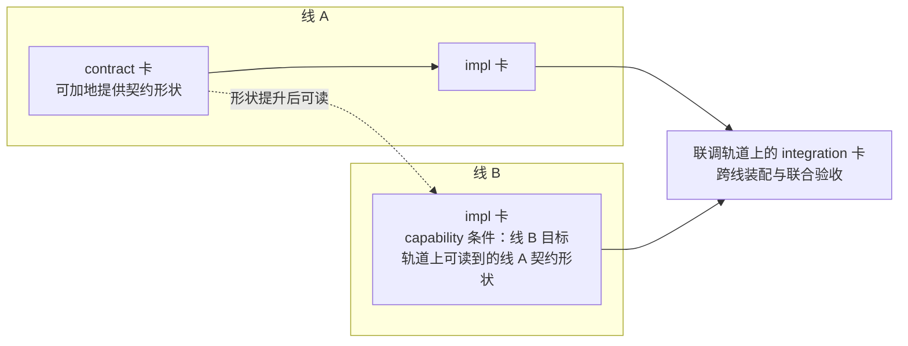

# 以里程碑为终点倒排交付

本页的读者是规划一个里程碑、并与 agent 一起推进它的人类协作者。
它讲怎样从里程碑的结束标志往回排：先定检查点，再切卡、排依赖、前置风险，最后定节奏。目标是在一个里程碑里交付得快，风险点少，质量有保证。

本页是学习材料，不是项目规则，也不是工具链的一部分。它借用敏捷开发与精益开发的成熟做法，解释它们在本项目里可以怎样落地。文中的「建议」都是方法建议，不是门槛。
里程碑、交付线、契约基线与轨道的规则由[多层分支集成](../../docs/engineering/integration.md#交付线)拥有。卡、阶段、属性与条件由[交付协议](../../docs/engineering/delivery.md#2-卡片与阶段)拥有。建卡和派发的操作由[通过对话操作交付卡](../../docs/engineering/agent-delivery.md)拥有。本页与拥有者正文不一致时，以拥有者正文为准。
契约怎样设计才能在里程碑内保持稳定，见[设计在里程碑内保持稳定的契约](stable-contracts.md)。本页不重复那部分方法。

## 先认清瓶颈：稀缺的是人的时间

与 agent 协作时，写代码和写文档的产能很高，并且可以并行。真正限制交付速度的通常是下面几样：

- **人的决定。**具名决定、取舍和产品规则只能由负责人给出。一个决定没有给出，依赖它的那部分工作就停下，见[停止与继续](../../docs/engineering/workflow.md#停止与继续)。
- **人的评审与接受。**agent 的评审给出发现，接受归具名接受者。评审队列变长时，已完成的卡在队列里等待，交付并没有更快。
- **共享的写对象。**锁文件、根 `package.json`、registry、契约成员这类对象由单一负责人维护，改动它们的耦合工作按依赖串行，见[责任与协作交接](../../docs/engineering/workflow.md#责任与协作交接)。
- **集成与确认。**进入轨道的每个 PR 都要 admin 在 gate 中确认并填写说明，改动工具链的还要多一道审批，见[现行准入](../../docs/engineering/integration.md#现行准入)。轨道前进后，有活动卡的下层轨道要同步。
- **共享资源。**同一台机器上的全量检查一次只跑一份，CI 与付费模型预算也有限。

所以排期的单位不是「agent 要做多少小时」，而是「人要在什么时候做哪些决定和评审」，以及「哪些卡可以并行而不改同一个共享写对象」。
这是约束理论（Goldratt）的基本观点：整体产出由瓶颈决定，提高非瓶颈环节的产能不会让交付变快，只会让等待变长。

Little 定律给出一个直接的推论：在一个稳定的系统里，平均停留时长等于在制品数量除以单位时间的完成数量。
如果负责人一天能接受五张卡，而开工中的卡一直保持在二十张，那么一张卡从开工到接受平均要四天。限制在制品数量，比增加 agent 更能缩短交付时长。

## 一个里程碑的骨架

先定检查点，再填工作。检查点从结束标志开始往回排。下图按时间先后从左到右画，倒排时从最右边往左读。

| 检查点 | 建议达到的事实 | 依据或判断人 | agent 做什么 |
| --- | --- | --- | --- |
| 契约设计与评审 | 本里程碑要用到的各接缝契约已经设计并评审，联合回顾的冲突已裁定 | 负责人；方法见 [stable-contracts.md](stable-contracts.md#一个里程碑里的节奏) | 按接缝设计契约，跑联合回顾，整理决定批 |
| 里程碑开始 | Milestone 已建，描述写明范围与结束标志 | 负责人；规则见[里程碑与契约基线](../../docs/engineering/integration.md#里程碑与契约基线) | 起草验收场景、范围外清单与风险清单 |
| 契约基线登记 | 联调轨道上性质为 `baseline` 的卡登记了基线提交与契约成员；在这之后才派发本里程碑的其他卡 | 规则见[里程碑内的规则](../../docs/engineering/integration.md#里程碑内的规则)第 1 条 | 核对线归属表与基线提交，起草登记 |
| 行走骨架跑通 | 最薄的真实装配在联调轨道上端到端跑通，每个跨线契约至少被真实调用一次 | 方法建议；由负责人指定判断人 | 实现骨架所需的最小路径，暴露缺失的语义 |
| 范围截止 | 计划内的线内的卡已提升到联调轨道，或者已被移出本里程碑 | 方法建议；各线 owner 与负责人 | 完成卡、提交候选、补证据 |
| 稳定窗口 | 只合入缺陷修复与验收所需的改动 | 方法建议；负责人 | 修缺陷，跑联合验收，汇总证据 |
| 结束标志成立 | Milestone 描述里写的结束标志成立，负责人关闭 Milestone | 规则见[里程碑与契约基线](../../docs/engineering/integration.md#里程碑与契约基线) | 整理验收证据与回看材料 |

表中只有里程碑开始、契约基线登记与结束标志有拥有者规则，其余检查点是本页的方法建议。

契约设计放在 Milestone 建立之前，是因为基线登记之前不能派发本里程碑的其他卡。基线登记之后，契约成员的改动按里程碑内的规则处理：线内的卡只做可加改动；破坏性改动由联调轨道上的 `integration` 卡完成，完成后补登记新基线。

## 第一步：把目标写成可验收的结束标志

结束标志是写在 Milestone 描述里的一个条件，不是一个日期。另外定一个结束日期，作为倒排的终点。
结束标志要能在联调轨道上被观察到。只写「完成 Session 设计」这类说法，到里程碑末尾无法判断是否成立。

1. 写一句结束标志，说明在哪条轨道上、用什么证据判断成立。
2. 为结束标志写几个验收场景，句式为「给定……当……则……」。每个场景说明一个可观察的系统行为。
3. 写范围外清单：本里程碑明确不做的事。范围外清单和范围一样重要，它防止 agent 顺手扩大范围。
4. 把验收场景交给后面的步骤使用：它们决定行走骨架走哪条路径，也是联合验收的用例。

可以让 agent 从产品正文和需求起草场景，再由你确认。范围外清单由负责人定，不交给 agent 决定。

## 第二步：按接缝与交付线切卡

### 切卡的原则

- **一张卡是一个可以独立接受的结果。**卡的结果要能被具名接受者判断「接受」或「不接受」。
- **按结果纵向切，不按技术层横向切。**「实现存储层」「实现接口层」这类卡完成后仍不能演示任何行为。建议优先切成「某个场景在某条线上可以运行」。
- **契约与实现分开成卡。**契约面由所属线性质为 `contract` 的卡以可加方式改动；跨线的真实装配、集成点、联合验收与破坏性契约改动由联调轨道上性质为 `integration` 的卡承担。性质与合法组合见[卡属性与合法组合](../../docs/engineering/delivery.md#卡属性与合法组合)。
- **卡的数量宁少勿多。**线会话每波的派发单位是线父卡上的一个 attempt；怎样拆闭包由线负责人在线内决定，不为闭包建卡。只有能独立接受、确有独立跟踪价值的结果才另立卡。规则见[线父分支](../../docs/engineering/integration.md#线父分支)。

### 让卡在开工前就绪

agent 不能安全地补全缺失的输入。缺了输入，它会猜，猜的结果看起来很确定。所以拥有者正文规定，必须的输入未齐不能记 Ready，见[整理需求并定位已有卡](../../docs/engineering/agent-delivery.md#1-整理需求并定位已有卡)。从排期的角度，建议在排进日程之前就核对下面几项：

- 结果、边界与主接受者。
- 现行依据：哪一份正文、哪个提交。
- 验收判据与需要的证据。
- 交付条件：按阶段（开工、集成或接受）阻塞的前置事实。

写范围在派发时给出，见[取任务和派发](../../docs/engineering/agent-delivery.md#3-取任务和派发)。Ready 的含义见[卡片与阶段](../../docs/engineering/delivery.md#2-卡片与阶段)，它不是永久许可，开工前要再读回一次。

### 用条件表达依赖

依赖写进卡的交付条件，不写在 Priority 或口头约定里。规则见[条件、关系与解锁](../../docs/engineering/delivery.md#3-条件关系与解锁)。

- 线内的卡只引用本线的卡，以及交付线为 `integration` 的卡。
- 线内的卡依赖其他线的契约时，不引用其他线的卡，而写一条 `capability` 条件，目标是本线的目标轨道上可读到的那个契约形状。见[跨线依赖](../../docs/engineering/integration.md#跨线依赖)。
- 跨线的真实装配与联合验收放在联调轨道上的 `integration` 卡里，由它承接跨线条件。

这样做以后，跨线的阻塞点只出现在联调轨道上。排期时对跨线风险，重点看联调轨道上的少数几张 `integration` 卡；线内的进度由各线 owner 盯住。

## 第三步：找出关键路径，再倒排

### 画依赖图

把全部卡和它们的交付条件画成一张图。图上从「里程碑开始」到「结束标志成立」最长的一条链就是关键路径。
在本项目里，可以预计关键路径会经过契约基线、承接跨线装配的 `integration` 卡、行走骨架与联合验收。第一个里程碑结束后，用回看的数据核对这一点。

可以让 agent 从卡的条件表生成这张图，并标出每条链的长度。图上要同时标出人的步骤：每一次具名决定、每一次接受、每一次 gate 确认。人的步骤落在最长的链上时，它们本身就是关键路径的一部分。

### 往回排

从结束日期往回排每个检查点：

1. 先放稳定窗口。它是整个里程碑的缓冲，不是可以挪用的空闲时间。
2. 再放范围截止、行走骨架与契约基线。
3. 最后把各条线的卡排进检查点之间的空档，关键路径上的卡先排。

缓冲集中放，不分散到每张卡上。这是关键链方法（Goldratt）的做法；关键链指同时考虑了依赖与人员等资源争用之后的最长链，本页其余部分只用「关键路径」一词。具体做法是：每张卡按不加余量的估计排，把省下来的余量合成一个放在末尾的项目缓冲；非关键的链汇入关键路径的地方，再放一个汇入缓冲。
分散的余量会被各张卡悄悄用掉。集中的缓冲可以被看见，也可以被管理。

### 排人的时间

建议把人的步骤当作资源排进日程：

- **决定批。**把需要负责人拍板的事攒成一批，固定时间集中交给负责人，例如每天一次。每一项都带上选项与推荐，负责人可以只回「按建议」。
- **评审窗口。**估算负责人每天能接受的卡数，按它限制同时开工的卡数。
- **确认窗口。**gate 的确认也排进日程，不让已经备好候选的 PR 长时间等待。

### 限制在制品

- 调度者控制每条线同时进行的写者数量，建议不多于该线 owner 能及时评审的数量。
- 几张卡要改同一个共享写对象时，调度者让它们按依赖串行，而不是并行之后再在合并时解决冲突。线归属表 `shared` 列出的共享路径另有规则：任何卡都可以写入由本卡其他改动生成或登记的变化，见[卡属性与合法组合](../../docs/engineering/delivery.md#卡属性与合法组合)。
- 只读的调查与评审可以大量并行，它们不争写对象。但它们的发现最终也要人来看，评审时间仍然是瓶颈。

## 第四步：把风险前置

### 开始时列出风险

在里程碑开始时列一张风险清单，每项写明：风险是什么，最早在什么时候能暴露，谁处理。常见的几类如下：

| 风险 | 典型表现 | 前置的做法 |
| --- | --- | --- |
| 契约语义缺口 | 联调时才发现失败、顺序或所有权没有定义 | Milestone 建立之前做一次跨域的联合回顾；早跑行走骨架 |
| 技术未知 | 不确定一个库或上游机制能否满足要求 | 开一张限时的调查卡，先回答问题再排实现 |
| 外部依赖 | 等上游版本、等其他线的契约 | 用 `capability` 条件表达，提前约定形状，按替身开发 |
| 环境缺口 | 云端镜像没有某种数据库或形式工具 | 开工前确认验证环境；缺失时把「未执行」写进证据 |
| 人的时间 | 负责人这几天没有空做决定 | 提前排决定批，把决定往前移 |

### 先做风险最高的部分

- 行走骨架尽量早。它用最薄的真实实现把系统连起来，缺失的语义会在早期暴露，而不是在里程碑末尾集中出现。
- 调查卡排在依赖它的实现卡之前，并且有时间上限。时间到了还没有答案时，把问题交负责人决定，而不是继续调查。
- 不可逆的决定早做，可逆的决定在最后负责时刻做。契约基线上的形状是本里程碑内最难撤回的决定，要在 Milestone 建立之前想清楚。实现细节可以晚定。

### 范围与时间冲突时砍范围

结束日期与质量门槛默认不动，范围可以动。时间不够时按下面的顺序处理：

1. 负责人决定把未开工、不在关键路径上的卡移出本里程碑，调度者改这些卡的 milestone 字段。改里程碑不升交付修订，见[卡属性与合法组合](../../docs/engineering/delivery.md#卡属性与合法组合)。
2. 负责人决定把一张卡缩小成可以独立接受的一部分，剩下的另建卡。
3. 上面两项都不够时，由负责人决定是否推迟结束日期。

不要用降低验证或跳过评审来换时间。被跳过的检查发现的问题仍然存在，只是推迟到了更难处理的时候。

## 第五步：定节奏

### 同步与提升

同步与提升以事件触发为主，见[同步与提升的节奏](../../docs/engineering/integration.md#同步与提升的节奏)与[线轨道的同步与提升](../../docs/engineering/integration.md#线轨道的同步与提升)。从排期的角度看，要点有两个：

- **小批量、勤提升。**一条线攒了很多卡再提升，联调轨道上的问题会集中出现，也更难判断是哪张卡引入的。
- **破坏性改动集中安排。**里程碑内，线内的卡对契约成员只做可加改动。破坏性改动由联调轨道上的 `integration` 卡在一次交付里完成，完成后在基线卡上补登记新基线。消费者分布在多条并行的线、无法一次同步时，负责人可以在承接卡上明确要求分步迁移；旧形状要在里程碑结束前删除，没有删除时承接卡不接受，负责人也不关闭 Milestone。见[里程碑内的规则](../../docs/engineering/integration.md#里程碑内的规则)。排期时把这类卡当作关键路径上的事件处理；破坏性公共变更由集成 owner 协调相关 owner，见[同步与提升的节奏](../../docs/engineering/integration.md#同步与提升的节奏)。

### 检查点会议

建议在每个检查点，以及检查点之间按固定间隔，对照倒排的日程看一次实际进度：

1. 关键路径上的卡比计划快还是慢。
2. 缓冲用掉了多少。缓冲用掉的比例明显超过关键路径完成的比例时，要采取行动：砍范围、增加并行，或者提前交负责人决定。
3. 决定批、评审队列和 gate 确认有没有积压。
4. 联调轨道上能演示什么。演示能直接看到组合后的行为，报告只能转述。

可以让 agent 准备这份对照：从卡的 Stage、条件和合入记录生成进度表，标出偏离和积压。判断和取舍仍由人做。云端会话读不到 Project 的字段，Stage 要经 `delivery-stage` 流程设置并读回，见[推进和更新状态](../../docs/engineering/agent-delivery.md#4-推进和更新状态)。

调度者可以把 Milestone 镜像到 Project 的 Iteration，镜像不改变 Milestone 的权威。用「当前迭代」安排节奏，要先有负责人采用的节奏与真实的 Iteration 实例，见[建卡或修订卡](../../docs/engineering/agent-delivery.md#2-建卡或修订卡)。

## 质量怎样保证

质量在每张卡里形成，不在里程碑末尾集中检验。

- **每张卡带着证据交付。**验收判据要求的证据随候选一起交回。验证的轻重按成果与风险选择，见[按成果和风险验证](../../docs/engineering/quality.md#按成果和风险验证)。
- **评审按对象分工。**代码、文档与交付边界由 `review-code`、`review-docs`、`review-delivery` 三个 skill 评审，见 [agents 的 skills](../agents/README.md#skills)；设计评审按[评审分工](../agents/roles/README.md#按判断对象选择-reviewer)派发。评审给出发现，接受归具名接受者。
- **进轨道的 PR 说清两件事。**它包含哪些卡，以及契约有没有变化。见[进轨道 PR 的说明](../../docs/engineering/integration.md#进轨道-pr-的说明)。
- **让联调轨道保持可用。**gate 流程不运行测试。建议每次提升之后，由集成 owner 在联调轨道上跑一次检查与行走骨架。联调轨道长时间是红的，就没有地方判断各条线的结果能不能组合。
- **联合验收用第一步写的场景。**场景在里程碑开始时就写好，结束时不再临时决定「怎样算完成」。

## 人与 agent 怎样分工

| 工作 | 人做什么 | agent 做什么 |
| --- | --- | --- |
| 目标与结束标志 | 定目标、结束标志、结束日期与范围外清单 | 从产品正文起草验收场景 |
| 契约设计 | 确认消费者场景，拍板取舍，在 Milestone 建立后登记基线 | 按接缝设计契约，跑联合回顾，整理决定批 |
| 切卡 | 确认范围、属性与接受者 | 起草卡正文与条件表 |
| 排期 | 定优先级与取舍，接受倒排的日程 | 从条件表算依赖图和关键路径，标出人的步骤 |
| 实施 | 回答决定批，处理阻塞 | 在隔离的工作树里实现，形成候选和证据 |
| 评审与接受 | 看评审发现，作出接受决定 | 按评审分工给出发现 |
| 跟踪 | 判断偏离，决定砍范围或调整 | 生成进度对照，标出积压与风险变化 |
| 回看 | 决定下一个里程碑要改的做法 | 汇总偏离的原因与数据 |

## 怎样指导 agent 做倒排

### 给 agent 的输入

- Milestone 的描述：范围、结束标志、结束日期与范围外清单。
- 现有的卡，以及它们的属性和条件表。
- 每条线的 owner，以及负责人每天能用于决定和评审的大致时间。
- 已知的共享写对象和在途的卡。

### 要求 agent 产出的内容

1. 检查点日程：每个检查点的日期，以及它建议达到的事实。
2. 依赖图与关键路径，人的步骤单独标出。
3. 每条线按检查点倒排的卡顺序。
4. 在制品上限：每条线同时进行的写者数量，以及理由。
5. 风险清单：每项的最早暴露时间与处理方法。
6. 需要负责人决定的事项清单，每项带选项与推荐。

### 评审 agent 产出时问的问题

1. 结束标志能在联调轨道上被观察到吗？
2. 关键路径上有没有人的步骤？它们排进日程了吗？
3. 有没有两张并行的卡改同一个共享写对象？
4. 缓冲是集中放的，还是摊在每张卡上？
5. 行走骨架排在什么时候？它之前要完成的卡是不是最少？
6. 风险最高的卡排在前面了吗？调查卡有时间上限吗？
7. 契约设计是否在 Milestone 建立之前完成？
8. 时间不够时，先砍哪些卡？

### agent 常见的偏差

- 按 agent 的工作时长排期，忽略决定、评审与确认的等待。
- 让所有线同时开工，在制品远超评审能力。
- 按技术层切卡，到里程碑末尾才能演示行为。
- 给每张卡加余量，没有集中的缓冲。
- 漏掉经共享文件形成的隐性依赖，例如锁文件与根脚本。
- 把行走骨架排到所有实现完成之后。
- 把 Priority 当作依赖，或者用口头约定代替交付条件。

看到这些偏差时，要求 agent 回到依赖图与人的时间重新说明，不要只改日期。

### 可以直接使用的指令模板

> 为里程碑〈名称〉做倒排计划。
> 结束标志：〈写明〉。结束日期：〈日期〉。范围：〈列出〉。范围外：〈列出〉。
> 负责人每天大约有〈小时数〉用于决定与评审。各线 owner：〈列出〉。在途的卡与共享写对象：〈列出〉。
> 先列出检查点与每个检查点建议达到的事实，交我确认。
> 确认后，从现有卡的条件表画依赖图，标出关键路径和其中的人的步骤，按检查点倒排各线的卡，给出每条线的在制品上限、集中的缓冲、风险清单，以及要我决定的事项与推荐。
> 不要按 agent 工时估算整体日期。估不准的地方列为假设，不要猜。

## 结束之后：回看

里程碑结束后做一次回看，只回答下面几个问题：

1. 每个检查点实际在哪一天达到，和计划差多少。
2. 延误主要来自哪一类：等决定、等评审、等确认、契约变化、环境缺口，还是估算偏差。
3. 缓冲用在了哪里。
4. 契约改动的原因按[六类原因](stable-contracts.md#契约为什么会在中途改变)归类。

下一个里程碑先处理最常出现的那一类延误。可以让 agent 从卡的时间线和合入记录汇总数据，结论由人来下。

## 参考

- Eliyahu M. Goldratt，《Critical Chain》，1997。关键链与集中缓冲。
- Eliyahu M. Goldratt，《The Goal》，1984。约束理论。
- John D. C. Little，[A Proof for the Queuing Formula: L = λW](https://doi.org/10.1287/opre.9.3.383)，Operations Research，1961。
- Donald G. Reinertsen，《The Principles of Product Development Flow》，2009。在制品、批量大小与延迟成本。
- Mike Cohn，《Agile Estimating and Planning》，2005。按价值与风险排序、发布计划。
- Mary Poppendieck、Tom Poppendieck，《Lean Software Development: An Agile Toolkit》，2003。最后负责时刻。
- Alistair Cockburn，《Crystal Clear》，2004。行走骨架。
- Jez Humble、David Farley，《Continuous Delivery》，2010。小批量与持续集成。
- Nicole Forsgren、Jez Humble、Gene Kim，《Accelerate》，2018。交付时长与批量大小的度量。
