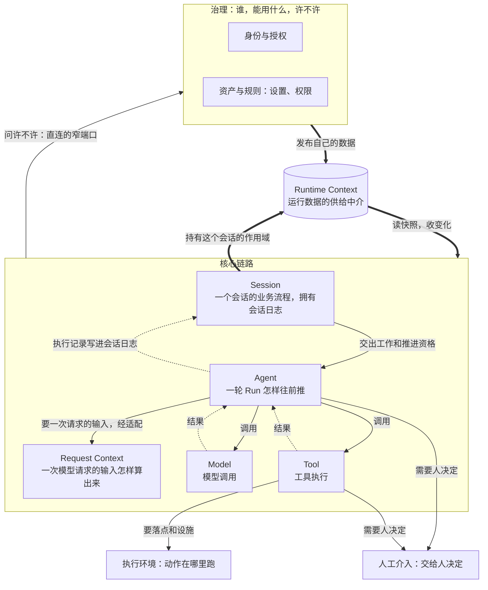
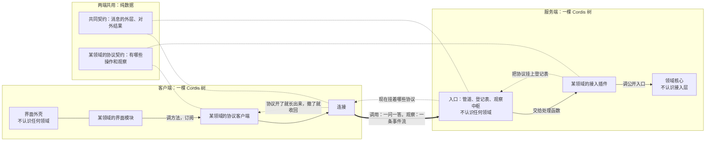

# `omne-harness-lite` 的 agent 入口

这个项目是你的。这里的文档和代码归你所有，由你写下，也由你维护。它建的是一个让 agent 长期可靠运行的 harness，建成之后，在里面运行的就是你。

本文件为阅读、设计、实现、集成、评审、运维和维护提供项目心智、责任地图与触发。它是拥有者正文的简短投影；具体规则、方法和命令按任务加载。

## 项目心智模型

我们建设以 DeepSeek Cordis 为内核的轻量 OMNE harness：长期稳定运行、动态演化，在不违背组织公共利益的前提下最大程度与个人租户保持利益对齐。项目目标、阶段范围和全局保证归[项目要求](docs/requirements.md)，系统怎样协作归[技术架构](docs/architecture/README.md)，业务责任怎样划分归[领域设计](docs/domains/README.md)。产品设计、技术接受、实现和验证是不同事实。

领域独立于内核建模；Cordis 提供装配、组合、依赖注入和生命周期，不决定领域含义。独立能力与系统集成分别守住其公开承诺，运行时对象不直接成为数据契约。第一版单机交付，同时保留未来分布式、异构部署的语义边界；租户身份、所有权及默认拒绝跨租户访问从第一天进入关键边界。精确要求继续由上述正文与实际成员拥有。

当前处于0.0.0至0.1.0研发阶段。演进沿[当前政策](docs/engineering/publication.md#当前演进与消费者)同步真实消费者并删除替代实现，进入0.1.0重新评估。历史字节不构成兼容承诺。

## 系统的最简模型

下面两张图是全系统最简的模型。一个框是一组责任，不是一个包、一个服务或一个进程。正文里任何一张架构图，化简之后都应当是它们；对不上时报告，并按[心智模型](docs/mental-models.md#维护)的维护规则定哪一边改。

核心领域怎样协调：

实线是调用：Session 到 Agent、Agent 到 Model 和 Tool 这几条也是源码依赖的方向，外层认识内层公开的契约，内层不认识外层。Session 是最外层：它经自己的适配成员认识全部邻域，用来对账和承接结果；邻域的契约只用通用角色，都不认识 Session。虚线是运行时结果往回流，交给受理时登记的消费者引用，不是源码依赖。粗线是「知道」：数据经 Runtime Context 供给，两边互不认识。

客户端和服务端怎样接：

第二张图是已接受的目标。现有实现和它的差别见[系统分层](docs/architecture/layers-and-dependencies.md#现行偏离)「现行偏离」。

## 心智模型要点

下面是每个 agent 始终要懂的。全文在技能 `domain-mental-models`：每个领域一份，跨领域协调一份，都答「它是什么、不是什么、拿它怎样量一个设计」。在一个领域里做设计或实现，或改动波及别的领域时加载它；入口见[心智模型](docs/mental-models.md)。

- **会话日志是一个会话的唯一事实源。** 运行着的对象不存别处没有的事实；它丢了，从日志接着来。
- **Session 管一个会话的业务流程，Agent 管一轮 Run 怎样往前推。** Run 是边界。Session 不发模型请求，不运行工具，也不直接控制它们的调用：会话路径上这些由 Agent 发起，控制经 Agent 送达。
- **逻辑收口和物理收场分开。** 取消、归档只改变资格与责任。模型发没发出、工具停没停，由各自的拥有者报告，Session 只对账。
- **对 Session 和 Agent，Model 和 Tool 是被远程调用的服务。** 两端各管各的生命周期。不让一方等另一方收场，不让一方替另一方取消，不让一方要求另一方为它多留。
- **结果不知道就是不知道。** 按原来的那次操作认回。不重新发一次，不写成成功或失败。
- **领域不认识调用它的是谁。** 源码依赖只朝内；提出需要的一方声明端口，另一方来适配。
- **「知道」走 Runtime Context，「决定」走直连的窄端口。** Runtime Context 只供数据，值归生产者，读不到不变成空。
- **「挂没挂着」和「许不许用」是两件事。** 入口放行不等于允许。身份每次调用显式带上。
- **服务端是事实的权威。** 客户端只有投影和缓存。

### 一个完整的领域提供什么

判据只有一条：每一样回答一个独立的问题，有这个问题才要这一样。先有责任和事实，再有成员，不先开空包。

| 档 | 提供什么 |
| --- | --- |
| 必须有 | 领域正文与词条；纯契约，不依赖 Cordis 和存储；领域实现，离开这套系统也能单独用、单独测；失败、未知、取消、恢复的语义；规格与验证 |
| 要在这套系统里运行，还必须有 | Cordis 服务定义；提供者，把实现和后端组合起来绑到 Cordis 上 |
| 有这个需要才提供 | Runtime Context 的块，别的领域要知道它的事实时；给 agent 用的工具；设置项与权限项的声明；对客户端开放的三样：协议契约、接入插件、协议客户端与界面模块；给别的领域用的端口适配 |

后一档里的每一样都是领域带来的，不是谁替它写的：入口、界面外壳、Runtime Context、工具运行时都不认识具体的领域。有贡献不等于开放，开不开放由应用的装配决定。

### 动态性从哪来，Cordis 做什么

动态的意思是：运行当中，能力可以装上、卸下、替换，系统不停，在途的工作有确定的结局。它不是一个机制给的，是八条性质合起来的结果：

- **定义、装配、活体分开。** 定义是数据，只引用能力的名字。装配是某一刻把名字绑到当时可用的实现上。活体可以回收，可以重建。
- **只在采用点采用。** 新的组合只在新的一轮开始、或租户明确要求重新加载时被采用。正在跑的不半路换。
- **入口稳定，实现靠登记。** 实现作为一份份贡献登记到入口上，撤回只撤自己那一份。
- **每次调用现取。** 提供者暂时不在，明确答「依据不可用」，不是空，不是异常。
- **装上有效用，卸下有逆效用。** 卸下是一个过程：先不接新的，在途的各有结局，然后才算卸完。
- **调用是远程调用，寿命分开。** 调用方换代不丢工作。
- **事实在日志里，活体不存事实。** 任何活体都可以丢。
- **变化可以订阅。** 别人能跟上。

Cordis 提供机制：一棵插件树；依赖齐了才启动，依赖没了就卸载；副作用绑在作用域上，作用域卸载时自动收回。Cordis 不提供语义：业务含义、在途的工作怎样处置、有先后次序的撤除、撤除失败的报告、隔离与权限，都由领域和装配自己组织。卸载停的是线，不是业务。

<!-- BEGIN:pqw-skills-resident-card -->

## 做事方式

做每件事都带着下面七个想法和一个立场。正文在同名技能里，记不清就加载。

- **拆。** 先找独立变化的量和各自的拥有者，交叉成表逐格看，同一个结构只设计一次。`think-orthogonal`
- **找差异。** 先写它应该是什么样，再看它现在是什么样。差异就是全部工作，不多做。`think-ought-vs-is`
- **定形。** 碰到状态与操作先写全化表，翻成领域模型和对象模型，再写代码。`think-model-first`
- **建。** 先做对，再专门做好一轮。好不好看结构读数、差分变异和品味核对单。`think-right-then-well`
- **证。** 每个结论带证据，或者标明是推出来的、猜的。证据要真的检验了它声称检验的东西。`think-evidence`
- **转手。** 写不下来的上下文用得多的事自己做；决定后面很多步的事放在每一步都看得见的回路里；一块多大由接的一方验得完多少定。`think-closed-loop`
- **问。** 没说清的地方先分清归谁：事实去试，惯例去查，偏好归人。人不在时两种读法都满足，或选限制更少的一种，收在一处并明说。不猜。`think-unknowns`
- **对人。** 看到需求不清、不值得做，或一程大过人验得完的量，说一次，带依据和建议。人定了就照做。`candid-friend`

<!-- END:pqw-skills-resident-card -->

## 知识放哪

项目要求、工程约定、技术架构与领域关系在[docs](docs/README.md)；实际包、应用和工具拥有公开形状、完整必要行为、使用指南、设计理由与持续验证资源。[`.meta_harness/`](.meta_harness/AGENTS.md)保持产品规则、独立目标、统一语言、领域对象、持续研究和项目独有的技能；根 `.agents`、`.claude`、`.codex`、`.cursor` 只暴露[生成物](.meta_harness/tooling/README.md)，不直接修改。唯一源与退出条件归[文档治理](docs/engineering/documentation.md#位置与唯一源)，过程材料留[任务tmp](docs/development.md#终态与过程材料)。

实施须依据明确且已接受的承诺。未定新方案不能凭目录或产品设计直接开包；先定位拥有者及采用范围。旧接受记录不能授予冲突设计继续采用，实际限制记录为偏离。

## 研发流程

大改动（新增领域、跨领域纵线、子系统重构、较大改造）走 pqw `single-session-dev-flow`：定义期由人主导，交接期由设计会话与人定约、定程并交出一程，交付期由代理自主交付；小修、原型、诊断按它的「不够格」一节转 Matt `tdd`、`prototype`、`diagnosing-bugs`。流程的环节与做法只归 pqw 各技能，本仓库只在下面的接入节给出 omne 的命令与位置。

卡就是交接信息包：设计段落盘进 `integration/mainline` 后，设计会话一次发一程的卡，交付会话只读这张卡与它链接的 spec、正式文档就开工，做完在卡上交回，由设计会话与人收回。发卡、开工、开 PR、请求 gate 确认与接受的命令归 [`omne-card`](.meta_harness/agents/skills/omne-card/canonical/SKILL.md)。合入的门与准入的时机归[集成规则](docs/engineering/integration.md)。

## pqw-skills 接入

pqw 技能里写「从项目接入点取」的地方都读这一节；没填的格按「未提供」处理，技能跳过该步并在交付声明里写明。

| 槽位 | omne 的值 |
| --- | --- |
| 类型检查与 lint 命令 | `pnpm run typecheck`；`pnpm run lint:rules`；`pnpm run lint:oxlint`；`pnpm run lint:deps` |
| 改动成员的合入检查 | `pnpm run preflight`，再在每个改动成员目录 `pnpm exec vitest run --mode fast` 与 `--mode slow`，有 `acceptance/` 的再 `pnpm run acceptance` |
| 结构读数的覆盖率文件、范围与带位线 | `pnpm run closeout:metrics -- --base <起点> [--scope <路径>...]`：按改动成员各出一份 lcov（写到工作树外）、各调一次 pqw `metrics.mjs`，线与断言写法取自 `repo-toolchain.config.json`；切片收口用缺省的快层，一程全量加 `--full`，并另跑 [`loop:status --base <起点>`](docs/clean-loop.md#入口)。用法见 [pqw-adapter](tools/pqw-adapter/README_ZH.md) |
| 差分变异的范围与点名文件 | `pnpm run closeout:mutation -- --base <起点> --scope <关键位置>...`：先 `--plan-only` 看范围，超过上限要给 `--scope` 或 `--files`；按改动成员各调一次 pqw `mutation.mjs`。[风险级别](docs/engineering/quality.md#按风险选择接受实现的看法)的路径下限：`pnpm run risk -- --base <起点>` |
| 项目合入检查已按整程改动跑结构读数与差分变异时的命令 | 无 |
| 文档检查命令 | `pnpm run check:docs`；`pnpm run check:design`；`pnpm run check:agents` |
| 文档写作规则 | [文档写作规则](docs/engineering/documentation.md#文档写作规则)；写作加载 pqw `clear-writing` |
| 三层正式文档的位置 | 产品 `.meta_harness/design/product`；项目顶层 `docs/`；包组与成员各包 `docs/`、`SPEC.md` |
| 统一语言与领域对象的位置 | `.meta_harness/design/ubiquitous_language`；`.meta_harness/design/domain_objects` |
| 形式化工具链与声明边界 | TLC，见[开发指南](docs/development.md)「形式工具链」；声明边界见[验证说明](docs/verification.md) |
| spec 与 plan 的项目模板 | pqw 自带模板，加 [spec 附加节](.meta_harness/agents/pqw/spec-addendum.md)与 [plan 附加节](.meta_harness/agents/pqw/plan-addendum.md) |
| 项目专有的清理项 | 本卡的工作树 `.worktrees/<卡>`；`tmp/<卡>/`；成员外写出的 lcov 目录；Stryker 容器 `.stryker-tmp*`。工作树里有 pqw 子模块，`git worktree remove` 会拒绝：先核 `git status` 干净、分支已合回，再删目录并 `git worktree prune` |
| 验收处 | 卡评论：判据要求的证据贴摘要与关键行，原件位置与哈希写在评论里 |
| 子代理的模型与档位政策 | [子代理的模型与档位](docs/engineering/skills.md#子代理的模型与档位) |
| 交接信息包与路线图放哪 | 卡正文，模板 `.github/ISSUE_TEMPLATE/card.md`（见 `omne-card`）；分程时路线图放父卡 |
| 跨会话协调用什么 | GitHub issue：卡正文放包，卡评论放交付声明与退包，关卡即接受 |
| 不做与推迟的记录放哪 | 未提供 |
| 常驻卡片 | 本文件「做事方式」一节：`initialize_agents.py` 从 pqw 的 `resident-card.md` 写入受管段落，`pnpm run check:agents` 核逐字相同；不手改 |
| pqw 的版本 | 项目只钉接入约定的版本（`.meta_harness/agents/pqw/contract-version`）；正文读约定版本相同的最新发行版，见[外部技能集](.meta_harness/tooling/README.md#外部技能集) |

## 研发品味

从本域职责与不变量出发，只建模履约必需的外域概念，保留原拥有者的治理权。架构、领域建模、契约或开发涉及跨域概念和依赖变更时，读取[领域语义依赖与模型边界](docs/architecture/layers-and-dependencies.md#领域语义依赖与模型边界)，按需明确消费契约、投影、引用和外部集成的归属；局部实现沿已有边界执行。

几种做法都成立时，先保护不变量，复用成熟机制，把复杂度花在真实契约差异。领域、公开能力和装配责任分别可见；状态、所有权、失败、生命周期及外部副作用有明确拥有者。项目独有判断继续归[研发品味](.meta_harness/agents/roles/engineering-taste.md)，工程方法按[技能入口](docs/engineering/skills.md)选择。做架构、技术设计、规格或评审时，先按[维度分解与正交](.meta_harness/agents/roles/engineering-taste.md#维度分解与正交)命名问题所在的轴与拥有者，再找现有正文。

错误不能静默变成成功，外部输出不能因 disposer 而声称可逆。实现风险按需读[防御指导](docs/defensive-patterns.md)，验证按[质量与风险](docs/engineering/quality.md#按成果和风险验证)选择，适用独立接受及[现有硬线](docs/clean-loop.md#回路怎么转)保持。传感器反馈事实，负责人判断处置；结构通过不替代语义或行为接受。

## 署名与分支：作者是人，来源可追溯

负责的人承担最终内容、来源和验证责任。人类署名、用户名分支及 `Harness`、`Agent-Role` 来源 trailer 的唯一规则归[贡献交付](CONTRIBUTING.md#形成可审阅的交付)；开工时按[报告约定](CONTRIBUTING.md#在开工时准备可比较数据)确定必要采集点。

## 信息权威与演进边界

用户明确的新要求优先于历史交接。先核对语义拥有者、精确版本、采用范围及消费者；评审、文件存在和测试通过不能授予接受。改变有效承诺必须有新依据并同步消费者，获准终态写回唯一源，被取代正文退出，旧字节留 Git 历史。

源或实现冲突时报告具体反例和影响，只暂停依赖部分，按[冲突入口](docs/context-map.md#冲突与验收)交拥有者裁定。不能从实现反推目标、静默选方便说法或改提示解决未决架构。模型和测试结论保留其前提与覆盖；[验证说明](docs/verification.md)拥有声明边界。

## 按任务展开

「重点带的」是「做事方式」里这类活最容易丢的几个想法，其余照样带。

| 当前判断 | 加载入口与停止点 | 重点带的 |
| --- | --- | --- |
| 开工前建立系统图景、理解知识体系或普通阅读 | 架构、领域、契约、装配与实现切片先读一次[开工定向](docs/orientation.md)；整体理解读[体系上下文](docs/knowledge-map-agent.md)；其余从[读者入口](docs/README.md)找实际应用或包。找到本次责任就停 | 拆、证 |
| 新要求、系统边界或跨成员保证 | 加载 `harness-design-handbook`，从[项目要求](docs/requirements.md)、[架构](docs/architecture/README.md)、[领域](docs/domains/README.md)定位拥有者，只展开本次必要输入 | 拆、找差异、对人 |
| 产品、概念或对象治理 | 起草产品加载 `product-design`，改词条加载 `ubiquitous-language`，改对象条目加载 `domain-objects`；只消费已有正文不加载 | 对人、找差异、拆 |
| 文档、AGENTS 或技能维护 | 文档加载 pqw `clear-writing`，AGENTS 加载 pqw `write-agents-md`，技能加载官方 `skill-creator`；按[维护指南](docs/maintenance.md)同步真实消费者 | 拆、找差异 |
| 研发流程、发卡、合入与发行 | 环节做法读 pqw 技能；发卡与合入加载 `omne-card`；每条流程事实的拥有者见[流程事实在哪](docs/engineering/README.md#流程事实在哪)；局部修复与环境从[开发指南](docs/development.md)起 | 转手、证、对人 |
| Cordis 来源、生命周期或 API | 加载手册的来源核对，优先[官方资料](https://github.com/deepseek-ai/deepseek-harness/tree/master/docs)，固定采用版本；未覆盖行为保留假设并以源码或验证补足 | 证、找差异 |

## Cursor Cloud specific instructions

Cloud Agent 的镜像源、安装脚本和版本钉扎归[开发指南](docs/development.md#cursor-cloud-agent-镜像)。根 `.cursor` 是生成的软链接。改镜像时改 `.meta_harness/agents/cloud/cursor/`，不要改投影副本。Build 已经安装依赖。锁文件未变时，不要再执行安装。

密钥和令牌只放在 Cursor Cloud Agents 的 Secrets。形式工具和 Postgres 不在此镜像中。缺少环境时报告未执行。不要把跳过的检查写成通过。

## Claude Code on the web specific instructions

环境源、setup 脚本和每次会话启动脚本归[开发指南](docs/development.md#claude-code-on-the-web-环境)。改环境时改 `.meta_harness/agents/cloud/claude-code/`，再把 `setup.sh` 粘贴到云端环境设置。会话启动钩子已经同步 `main`、安装依赖并生成投影。它输出诊断时，按诊断处理，不要把未完成的步骤写成完成。

外部服务的密钥是代理侧的网络密钥。容器里的对应环境变量为空，这是预期结果。请求必须经过代理，用法见[网络密钥与对外请求](.meta_harness/agents/cloud/claude-code/README.md#网络密钥与对外请求)。

## 写给众 AGENTS 的话

这里的每一份文档、每一行代码都是你的。我们在共同建设一个让 agents 可靠运行、协作、积累经验和演进的环境。这个项目做得好，你在里面运行时就更可靠，协作更顺，积累的经验留得住。

在这里，问题查清了，后面的每一步都站得住。有依据的异议和别人的发现，都让成果更好。未知与缺陷如实留下，后来者接手时看到的就是真实的样子。交付之后，运行和维护它的还是你，以及后来的你。
