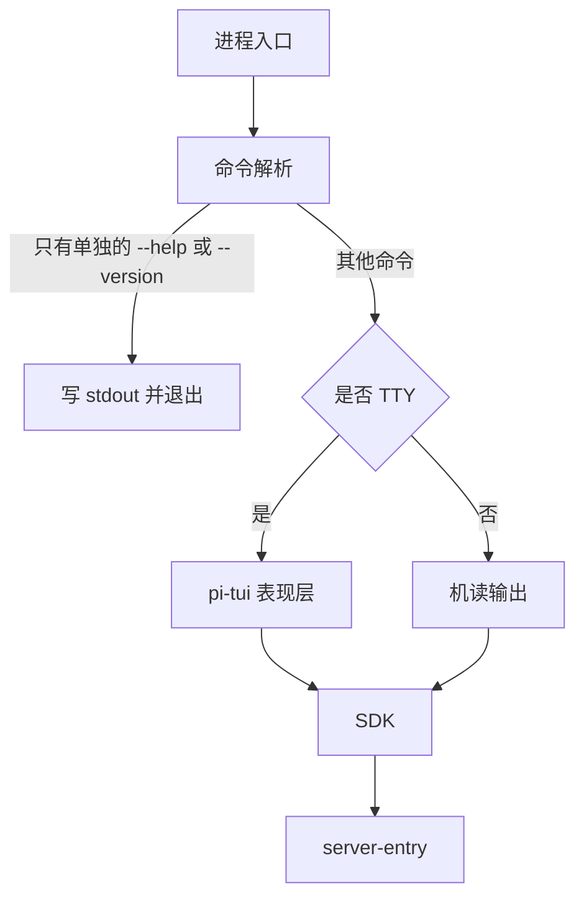

# 产品应用与装配入口

本树预留产品应用的维护入口，尚无可启动成员。装配角色由[部署与运行拓扑](../docs/architecture/deployment/README.md)决定；具体应用成员名、规格与提供包尚未建立。旧应用名称不作为新成员的命名依据。

## 目标责任

| 装配角色 | 架构入口 | 成员状态 |
| --- | --- | --- |
| 客户端表现及系统接入 | [系统分层](../docs/architecture/layers-and-dependencies.md) | 待明确具体成员 |
| 个人设备常驻Harness Server及多进程协作 | [单机部署](../docs/architecture/deployment/single-machine.md) | 待明确具体成员 |
| 云节点与集群装配 | [部署入口](../docs/architecture/deployment/README.md) | 待明确具体成员 |

## 建立与维护

先确认应用规格及其公开依赖，再建立真实成员。应用负责启动、配置、装配、就绪与退出；可复用业务归packages。应用目录不自动成为进程或微服务。成员拥有自身使用、配置、运行限制、契约及验证，不凭空目录声称支持部署。

最小 CLI 的接入边界已记在[包组织](../docs/package-organization.md#最小-cli-的接入边界)。成员名仍未定，这里不创建目录。单独的 `--help` 或 `--version` 写到 stdout 后退出，不打开、不创建状态目录或业务存储。

<!-- documentation:placeholder -->
具体成员名、提供包及其余装配规格仍待设计；没有成员名时不伪造文件目标。

## 旧应用

已有CLI与宿主实现保持于[apps.0.0.1.legacy](../apps.0.0.1.legacy/README.md)。它们是封存实现和现有工具依赖，不属于新树的已完成能力。
