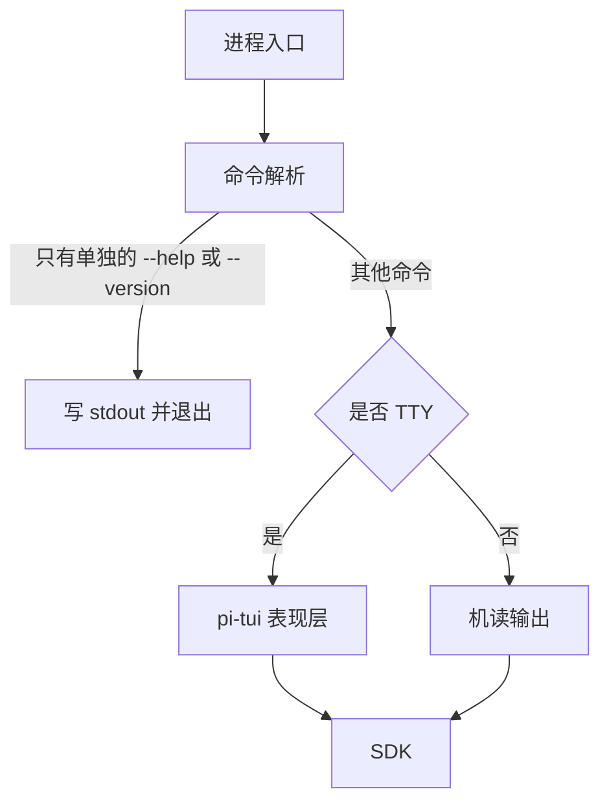

# 产品应用与装配入口

本树是产品应用的维护入口。现有一个可启动成员：最小 CLI [`apps/cli`](cli/README.md)，包名 `@omne-harness/cli`，二进制名 `omne`。它只提供 `--help` 和 `--version`。装配角色由[部署与运行拓扑](../docs/architecture/deployment/README.md)决定；其余应用成员名、规格与提供包尚未建立。旧应用名称不作为新成员的命名依据。

## 目标责任

| 装配角色 | 架构入口 | 成员状态 |
| --- | --- | --- |
| 客户端表现及系统接入 | [系统分层](../docs/architecture/layers-and-dependencies.md) | 最小 CLI 已建为 [`apps/cli`](cli/README.md)，只有 help 与 version；SDK 调用和 TTY 呈现尚未实现 |
| 个人设备常驻Harness Server及多进程协作 | [单机部署](../docs/architecture/deployment/single-machine.md) | 待明确具体成员 |
| 云节点与集群装配 | [部署入口](../docs/architecture/deployment/README.md) | 待明确具体成员 |

## 建立与维护

先确认应用规格及其公开依赖，再建立真实成员。应用负责启动、配置、装配、就绪与退出；可复用业务归packages。应用目录不自动成为进程或微服务。成员拥有自身使用、配置、运行限制、契约及验证，不凭空目录声称支持部署。

最小 CLI 的依赖方向在[包组织](../docs/package-organization.md#最小-cli-的接入边界)。它的成员是 `apps/cli`，规格是 [SPEC.md](cli/SPEC.md)。它现在没有运行时依赖。规格中的成员名、退出码和消息是 #246 的提议，仍待负责人接受。

单独的 `--help`，或单独的 `--version`，把结果写到 stdout，然后进程退出 0。这两条路径不打开、也不创建状态目录或业务存储。

<!-- documentation:placeholder -->
最小 CLI 的成员已经存在。个人设备常驻 Harness Server、云节点与集群两个装配角色的成员名、提供包及装配规格仍待设计；没有成员名时不伪造文件目标。

## 旧应用

已有CLI与宿主实现保持于[apps.0.0.1.legacy](../apps.0.0.1.legacy/README.md)。它们是封存实现和现有工具依赖，不属于新树的已完成能力。
