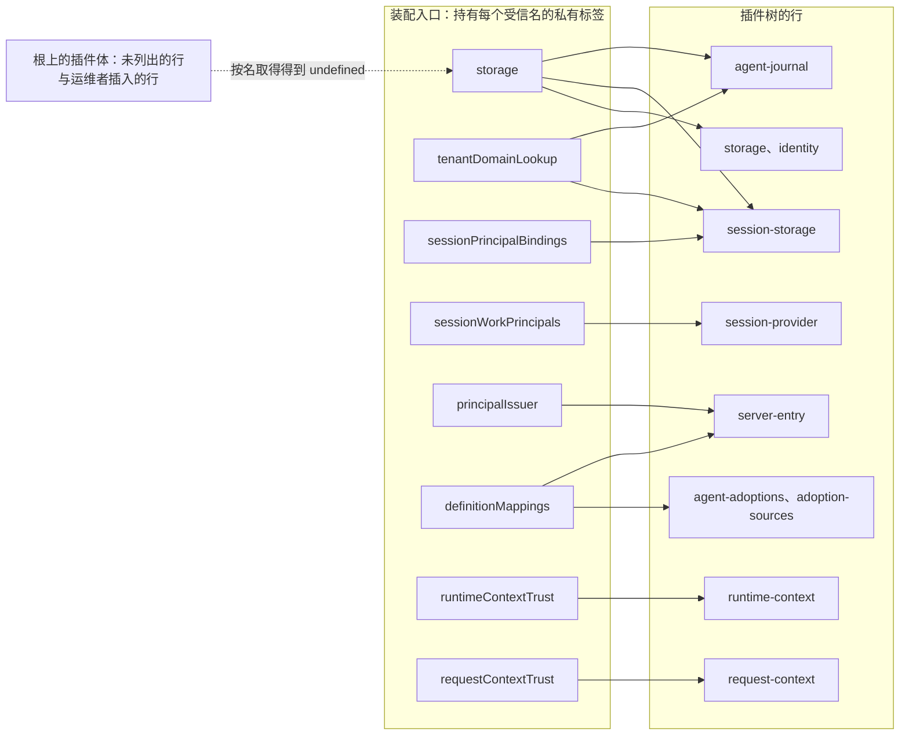
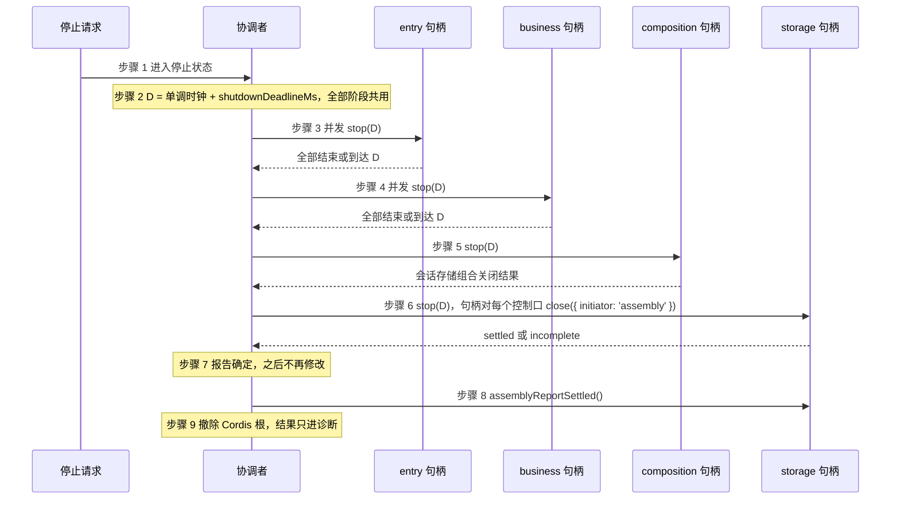

# @omne-harness/harness-server 行为规格

本页是 `apps/harness-server` 的长期行为规格。它写类型表达不了的行为：装载、可见性、就绪、进程输出、退出码和有序关闭。公开类型以 `src/types.ts` 为准，本页不重复类型定义。

## 采用状态

本页依据 S0 私有应用实施规格 r2（#1001 的输入，见 #991 的采用记录）与 L-APP 波 1 的 DP-1 决定（#978 评论 6561644061，候选 DP1-C1～C19）。S0 模式的规格状态是候选实施输入，不是已接受的产品承诺。S0 只用私有服务键 `s0.<名>`。真实模式用正式服务键。

装载器、就绪、行快照差分、关闭协调器和进程入口 `dist/bin.js` 已经实现。启动次序、停止状态后不再调用 `start`、启动期 `start` 抛出的处置三项也已实现，见「有序关闭」节的「启动与停止状态」。真实模式的子命令 `serve`、行声明 `defineRow`、入口对象注册表与三条新的装载前检查已经实现，`./cordis` 现在只导出 S0 替身插件，真实行的导出由各行闭包加入。真实模式的正文在 [docs/real-mode.md](docs/real-mode.md)，本页只写两种模式共同的行为与它们的差别。

## 范围

S0 模式经真实 Cordis 4.0.4 装载标记替身，验证五件事：

1. 两层插件树的层叠、运维操作与来源打印。
2. 受信子树的可见性：子树行能 inject 受信名，根上不能按名取得，根上同名提供者不替换子树实现。
3. 就绪诊断：PENDING 与 FAILED 分开，直接缺项与阻塞链分开，启动门控在启动时可见。
4. 行清单与应用装配页的机读差分。
5. 有序关闭的阶段次序、截止时间与报告闩锁。

S0 不接 HTTP，不创建租户，不打开业务状态根，不读真实秘密，不实现任何业务方法，不提供默认 allow。S0 成功不表示首条路径可运行。

真实模式（子命令 `serve`）以正式服务键装载同一张行表。每行是三种实现之一：`real`、`contract-double`、`s0-double`。真实行与契约替身行经 `defineRow` 自带清单。S0 替身行继续用 `src/s0/stubs.ts` 的表，名字去掉前缀。一个进程只有一种模式。`serve` 启动后等停止请求，S0 启动后自动停止。真实模式的行声明、入口对象、占位规则、IC 映射与各行拿到什么，归 [docs/real-mode.md](docs/real-mode.md)。

## 入口与输入

入口命令：

```text
node apps/harness-server/dist/bin.js s0 --distribution <绝对 JSON 路径> [--operator <绝对 JSON 路径>] --readiness-timeout-ms <正整数> --shutdown-deadline-ms <正整数>
node apps/harness-server/dist/bin.js serve --distribution <绝对 JSON 路径> [--operator <绝对 JSON 路径>] --readiness-timeout-ms <正整数> --shutdown-deadline-ms <正整数> --state-root <绝对目录> [--stop-on-stdin-close]
```

子命令是第一个参数。`bin.ts` 只解析参数、调用 `runS0` 或 `runServe` 并设置退出码。它不是 `omne` 命令的一部分，也不注册全局二进制。`s0` 的选项表、诊断文字与用法行保持原样。

`serve` 另有两个参数：

- `--state-root <绝对目录>`：必填。入口对象需要的状态文件（例如游标签名密钥）放在这个目录下。入口只校验它是已存在的绝对目录。目录在运维者的用户目录下、靠目录继承的访问控制保护，是前提，不做程序校验（DP1-C19）。
- `--stop-on-stdin-close`：可选。标准输入关闭时发起计划停止。SIGINT 与 SIGTERM（能投递的平台上）也发起计划停止。Windows 上别的进程不能向 Node 进程投递可处理的 SIGTERM，所以关闭标准输入是那里唯一的跨进程停止方式。

配置是 UTF-8 JSON，解析为 `unknown`，在边界经同步 zod schema 严格校验。校验拒绝未知键、非法值、重复行 id、未知插件导出、未知运维目标和异步 schema。插件清单是显式 allowlist，不按输入字符串动态 import。

## 插件树与运维层

树只有两层：发行层和运维层。租户与组织不是第三层。运维操作有三种：`replace` 替换一行的配置，`disable` 停用一行，`insert` 在已有锚点行之后插入一个 allowlist 内的行。

- 每行只装一个插件。
- 整行替换配置不改变该行的作用域。最终树打印的 `visibleSource` 仍是 `release-code`，`configSource` 标 `operator`。
- 运维操作的目标 id 不存在，或产生重复 id，装载前失败，退出 2，诊断写明目标与操作，零个插件体运行。
- 运维者插入的行可见集合为空。

## 装载与可见性

装配入口创建根 `Context`，为每个作用域创建一个不导出的 `Symbol` 标签。装载第一行前，入口提供根运行时对象。S0 模式提供的是替身：被某行 inject、而没有任何行提供的每个名字（例如 `s0.principalIssuer`、`s0.sessionWorkPrincipals`、`s0.runtimeContextTrust`、`s0.requestContextTrust`），以及 `s0.assemblyLifecycle`。`s0.toolStartFence` 与 `s0.toolStartAuthority` 由 `tool-records` 行提供，不是入口对象。测试参数 `omitEntryObjects` 可省去其中任意一项，CLI 不暴露它。`serve` 模式按入口对象注册表安装真实入口对象，并按占位规则给 S0 替身行提供占位对象，见 [docs/real-mode.md](docs/real-mode.md)「入口对象注册表」。

装载前检查，失败均退出 2，零个插件体运行，入口对象不安装：

- 行 inject 的受信名不在该行可见集合中。
- `sameProviderGroup` 相同的名不是由同一行提供。
- 只在 `serve` 模式：真实导出装在它声明之外的行 id 上（`row-binding`，DP1-C9）。
- 只在 `serve` 模式：`real` 或 `contract-double` 行 inject 的名字由 `s0-double` 的提供者（行或占位对象）提供（`double-dependency`，DP1-C10）。诊断写明行、名字与提供者。
- 只在 `serve` 模式：入口对象承载的行写了 `via`，而注册表里没有一个同名模块把该行列进 `registersFor`（`via-unregistered`，DP1-C15）。
- 只在 `serve` 模式：注册表里同一个名字有两个模块（`duplicate-entry-object`，DP1-C11）。
- 只在 `serve` 模式：发行层引用一个没有行声明的导出，按 `unknown-plugin` 拒绝（DP1-C8）。

之后按最终树顺序，对每行从根依次 `isolate(名, 标签)` 得到该行上下文，再 `plugin(...)`。`await ctx.plugin(...)` 完成不等于 ACTIVE：入口读取每行实际 `fiber.state`，并对 Cordis 4.0.4 的 `FiberState` 枚举做穷尽映射。

可见性规则：

- 子树行能 inject 受信名，得到入口创建的那个实例。
- 根上的插件体按受信名取值得到 `undefined`。
- 根上同名提供者与子树提供者并存，两者都 ACTIVE，子树消费者得到子树实现。
- 同一作用域内第二个同名提供者 FAILED，错误含 `has been registered`，不静默覆盖。

行 id 与受信成员的唯一源是应用装配页。S0 的行快照 `src/s0/aa-rows.json` 由 `scripts/aa-rows.mjs write` 从该页抽取，只能由脚本再生。`scripts/aa-rows.mjs check` 对快照与该页逐字节比较，`tests/aa-rows.spec.ts` 对正式页运行同一检查。

子 fiber 消费的受信名也列入该行的可见集合。这是启动门控的具名例外（N-4）。

下图是插件树与受信子树的可见性。实线表示该行可见这个受信名。根上的行和未列出的行可见集合为空。



图只示意可见性。精确的行与名对应以应用装配页的受信子树表为准。

## 就绪与诊断

- 直接缺项（`missing`）与阻塞链（`blockedBy`）分开报告。
- PENDING 与 FAILED 同时出现时都输出，整体为失败。
- 超时不把 PENDING 改为 FAILED。LOADING 超时单列 `readiness-timeout`。
- 私有 barrier 回调只在全部启用行 ACTIVE 时调用一次。随后入口按登记次序调用全部 `start`。
- 构造时的检查在启动时以 FAILED 可见，不推迟到首次使用。

S0 的 `accepting` 恒为 false。S0 用私有 barrier 的调用次数证明启动门控，不靠常量。`serve` 的 `accepting` 在全部启用行 ACTIVE 且全部 `start` 成功后为 true，否则为 false。

## 进程输出与退出码

stdout 每行一条 JSON 记录：

| 记录              | 字段                                                                                                                                                                                                           |
| ----------------- | -------------------------------------------------------------------------------------------------------------------------------------------------------------------------------------------------------------- |
| `tree`            | 启用行：`id`、`plugin`、`source`、`configSource`、`visible`（受信名）、`visibleSource: 'release-code'`、`implementation: 's0-double'`。运维者停用的行：`id`、`disabled: true`、`source`。装载前完整输出        |
| `row-state`       | `RowState` 的全部字段。先于 `startup-result` 输出                                                                                                                                                              |
| `startup-result`  | `profile: 's0'`、`scope: 'loader-only'`、`accepting: false`、`enabledRows`（启用行数）、`outcome`、`barrierCalls`（barrier 调用次数）、`startedRows`（已调用 `start` 的行）、`appliedRows`（插件体已运行的行） |
| `shutdown-step`   | 序号、阶段、行 id、动作                                                                                                                                                                                        |
| `shutdown-result` | `ShutdownReport`                                                                                                                                                                                               |

S0 进程在输出 `startup-result` 之后自动发起计划停止。装载前拒绝的诊断写 stderr，stdout 只有 `tree` 记录。

`serve` 沿用这五种记录，差别如下（DP1-C3）：

| 记录             | 与 S0 的差别                                                                                                                                                                                                                                                |
| ---------------- | ----------------------------------------------------------------------------------------------------------------------------------------------------------------------------------------------------------------------------------------------------------- |
| `tree`           | `implementation` 按行取 `real`、`contract-double` 或 `s0-double`                                                                                                                                                                                            |
| `entry-object`   | 新增，只在 `serve`。每个入口对象一条：`name`、`implementation`、`trusted`。不含对象的值。`s0.assemblyLifecycle` 记 `real`，占位对象记 `s0-double`。与 `tree` 一样在装载前完整输出                                                                           |
| `startup-result` | `profile: 'real'`、`scope: 'serving'`。`accepting` 见「就绪与诊断」。新增 `implementations`：三种实现各自的行数                                                                                                                                             |
| 之后             | `accepting` 为 true 时进程等停止请求：`--stop-on-stdin-close`、SIGINT、SIGTERM 或运行期换代。收到后 stderr 写 `serve: stop requested: <原因>`，再走有序关闭。启动码非零时与 S0 一样立即发起计划停止。装载前拒绝时 stdout 只有 `tree` 与 `entry-object` 记录 |

| 退出码 | 含义                                                                                                      |
| ------ | --------------------------------------------------------------------------------------------------------- |
| 0      | 启动全部 ACTIVE 且关闭 settled。`serve` 还要求停止来自请求                                                |
| 1      | 未预期的内部错误，stderr 写 `<子命令>: internal error: ...`                                               |
| 2      | 配置、解析或装载前检查失败，也含用法错误：参数缺失、路径不是绝对路径、JSON 读不出、状态根不是已存在的目录 |
| 3      | 至少一行 FAILED，或启动期 `start` 抛出，或（`serve`）一个入口对象的 `install` 抛出                        |
| 4      | 仍有 PENDING 或未完成 LOADING                                                                             |
| 5      | 启动码为 0 但关闭 incomplete                                                                              |

启动码非零时取启动码。启动期 `start` 抛出时，`outcome` 为 `start-failed`，退出码为 3，见「有序关闭」节「启动与停止状态」第 3 条。`serve` 里一个入口对象的 `install` 抛出时，入口不装载任何行，stderr 写 `serve: entry-object <名>: install failed`，错误消息不写进 stdout，然后发起计划停止，退出 3。这时没有行登记过句柄，关闭报告把预期登记者记为 `not-registered`。

用法错误时，stderr 写 `<子命令>: <原因>`，再写该子命令的用法行。`s0` 的用法行不变：`usage: s0 --distribution <abs json> [--operator <abs json>] --readiness-timeout-ms <n> --shutdown-deadline-ms <n>`。`serve` 的用法行是：`usage: serve --distribution <abs json> [--operator <abs json>] --readiness-timeout-ms <n> --shutdown-deadline-ms <n> --state-root <abs dir> [--stop-on-stdin-close]`。子命令不是 `s0` 或 `serve` 时，stderr 写 `harness-server: expected subcommand s0 or serve`，再写两行用法。

## 有序关闭

本节规定计划停止时的协议。意外退出与非计划卸载不适用本节；那时各行的 disposer 只发起停止，其结果只进诊断，不能当作有序关闭成功。

**登记。**装配入口在装载第一行前，在根上下文提供 `assemblyLifecycle` 服务。需要参加关闭的行在插件体内调用 `register(handle)`，句柄声明阶段 `entry`、`business`、`composition` 或 `storage`。登记落在调用方 fiber；该 fiber 撤除时自动退登记。插件体重跑后，协调者只持有新句柄。句柄不进插件树，不发布为其他服务。真实模式里带阶段的行只经 `defineRow` 进入，登记有两种承载：行体承载由包装插件在行体返回后登记，入口对象承载由入口对象在被该行调用的方法里经调用方的 `this.ctx` 登记。两种都落在行 fiber 上。见 [docs/real-mode.md](docs/real-mode.md)「关闭承载」。

**预期登记者。**预期登记者是启用行里清单带阶段的行：S0 替身行按 `stubs.ts` 的表，真实行按自己的声明。关闭时某个预期登记者没有句柄，记为 `not-registered`。预期登记者的句柄已随行撤除，记为 `disposed-before-stop`，并附 disposer 发起的关闭结果作诊断。

**步骤。**

1. 收到计划停止请求后进入停止状态。再次请求返回同一个结果，不再次调用任何句柄。此后不调用新的 `start`，规则见下面的「启动与停止状态」。
2. 计算截止时间 D：当前单调时钟加配置的 `shutdownDeadlineMs`。全部阶段共用 D。
3. `entry` 阶段：并发调用全部 `entry` 句柄的 `stop(D)`，等全部结束。接入停止接收新请求，结算在途请求与观察流。
4. `business` 阶段：并发调用全部 `business` 句柄的 `stop(D)`，等全部结束。各业务的停止准入、交接与等待真实结果的语义归各自拥有者。业务交接未决时，句柄返回 `incomplete`，原责任与可查询状态保留在耐久事实中。
5. `composition` 阶段：调用会话存储组合的句柄，得到「会话存储组合关闭结果」。该结果分别保留目录 `close()` 与 Session SQL 实例 `close()` 的结果。
6. `storage` 阶段：调用 `storage` 句柄的 `stop(D)`。句柄由 `storageHost` 入口对象持有。它对每一个保存的控制口调用 `close({ initiator: 'assembly' })`，等全部结果或到达 D。全部为 `closed` 时答 `settled`，否则答 `incomplete`，`detail` 不写 SQL 或业务正文。提供者自己的关闭期限来自 `storage` 行配置 `closeDeadlineMs`，不来自 D，所以发行层里 `closeDeadlineMs` 的初值不大于入口的 `--shutdown-deadline-ms`（DP1-C15）。
7. 形成最终装配关闭报告：逐句柄结果，加 `not-registered` 与 `disposed-before-stop` 各项。只有全部结果为 `settled` 时，整体为 `settled`；否则为 `incomplete`。报告写出后即确定，之后不再修改。
8. 报告确定之后，调用 `storage` 句柄的 `assemblyReportSettled()`。不得早于第 7 步。
9. 撤除 Cordis 根。disposer 的结果只进诊断。

**阶段规则。**一个阶段的全部句柄结束或到达 D 之后，才开始下一阶段。到达 D 时未结束的句柄记为 `incomplete`，协调者继续下一阶段，不等它。句柄抛出时记为 `failed`，继续下一阶段。报告确定后才结束的句柄只写诊断，不改变报告。协调者不关闭任何业务连接，不回滚提交；SQL 连接与 Worker 只由 SQL 提供者在第 6 步关闭。

**启动与停止状态。**

1. 启动次序：阶段之间按关闭次序的逆序，即 `storage`、`composition`、`business`、`entry`。同一阶段内按登记次序。上文「登记」一节与规格 §5.2 所说的「登记次序」按这句理解。
2. 进入停止状态后，不再调用任何新的 `start`，包括启动尚未走完的时候。每个阶段开始前、每个句柄的 `start` 调用前，都检查停止状态。
3. 启动期某个 `start` 抛出时，进入停止状态，走整套有序关闭，共用截止时间 D。已启动的句柄按关闭次序停止。最终报告把该句柄记为 `failed`，最后撤除根。`startup-result` 的 `outcome` 为 `start-failed`，并多一个 `startFailure` 字段，写明行与原因。退出码为 3，沿用 FAILED 的映射。替身配置新增测试输入 `startBehavior: 'fail'`，与 `stopBehavior` 同类，只用于测试，CLI 不暴露。这些字面来自卡树 head `df527a879` 的代码写者交回，合回时对照代码核对本页。

**结果。**整体 `incomplete` 时，进程不能报告平滑退出成功。下次启动时，未决工作由原拥有者按原身份查询与认回。

**已知限制。**单实例部署。跨进程 writer 排除不由本协议提供。

实现要点：S0 用私有服务键 `s0.assemblyLifecycle`，见「偏离登记」。关闭协调器的时钟可注入。每次句柄调用与报告确定各写一条带单调序号的 `shutdown-step` 记录。

下图是关闭的四个阶段，对应上面的步骤 2 至 9。



## 已知限制

- 正式服务定义（`definitionMappings`、`tenantDomainLookup`、`sessionWorkPrincipals`、`sessionPrincipalBindings`、`assemblyLifecycle`）未接受。S0 只用私有键。
- `PrincipalIssuerService` 由 #992 交付（N-5）。#992 合回之前，只在测试里使用测试自己的定义。
- 签发者的寿命与根进程相同，没有「绑定 identity 行」的条件分支（N-6）。
- 暂停项（inbox、owner 解析器）不在 S0 中出现为服务。解析器交出接收方；推送资格由接收组件核验。（N-9）
- 生产插件 ABI、身份与授权、存储、真实回复和真实业务交接，都不由 S0 证明。
- 同进程反射遍历 `ctx.reflect.store` 可取得受信实例。这是 kernel-basis 已记录的非保证。S0 不测试它，也不宣称阻止它。隔离不是权限。
- 生产 Node 版本由后继任务固定。
- `serve` 的停止触发只有 `--stop-on-stdin-close`、SIGINT 与 SIGTERM。Windows 上只有关闭标准输入能跨进程触发。
- `--state-root` 的保护只是文档化的前提（DP1-C19）。
- `serve` 下运维者只能插入 `stubPlugin`：真实导出绑定在它声明的行 id 上，运维者 `insert` 的行 id 必须是新 id（DP1-C9）。
- 成员插件在插件体内自登记的行要等正式 `assemblyLifecycle` 被接受后再定承载（N-r2-3）。现在带阶段的行只经 `defineRow` 的两种承载进入。
- `storage` 句柄的结果受提供者自己的 `closeDeadlineMs` 约束。它大于 D 时，句柄在 D 答 `incomplete`，提供者仍在关闭。
- 行清单的四跳同步靠人工：装配页到 `aa-rows.json` 由脚本再生，装配页到 `stubs.ts` 由线负责人手工同步，`stubs.ts` 到真实行声明由 `real-manifests-sync` 检查，等待装配页补丁的差额写在该测试的具名清单里。
- `defineRow` 声明的清单与插件实际取用的服务可能不一致。装载器只核声明，真实行的成员测试负责核对。

## 偏离登记

- IC-3：私有服务键 `s0.assemblyLifecycle` 与服务类 `S0AssemblyLifecycleService`，`@owner apps/harness-server`。待 kernel-basis 的正式定义被接受后迁移，并删除这个私有定义（规格 §9 末段）。
- `StubService` 使用动态服务键，只在 S0 替身内部使用，不对外导出。
- IC-2：`s0-double` 占位对象以 `provide` 普通值提供，没有服务定义。只给 S0 替身行，真实消费者不得到占位（DP1-C11）。
- IC-8：S0 的 `rowPlugin`（`src/run.ts` 的 `stubRowPlugin`）与 `serve` 的包装插件（`src/row.ts` 的 `defineRow`）的 `inject` 由清单计算，不是字面数组。补偿：`defineRow` 要求声明的 `injects` 包含被包装插件的字面 `inject`，不符即抛出。声明再由 `real-manifests-sync` 与 `stubs.ts` 比较。
