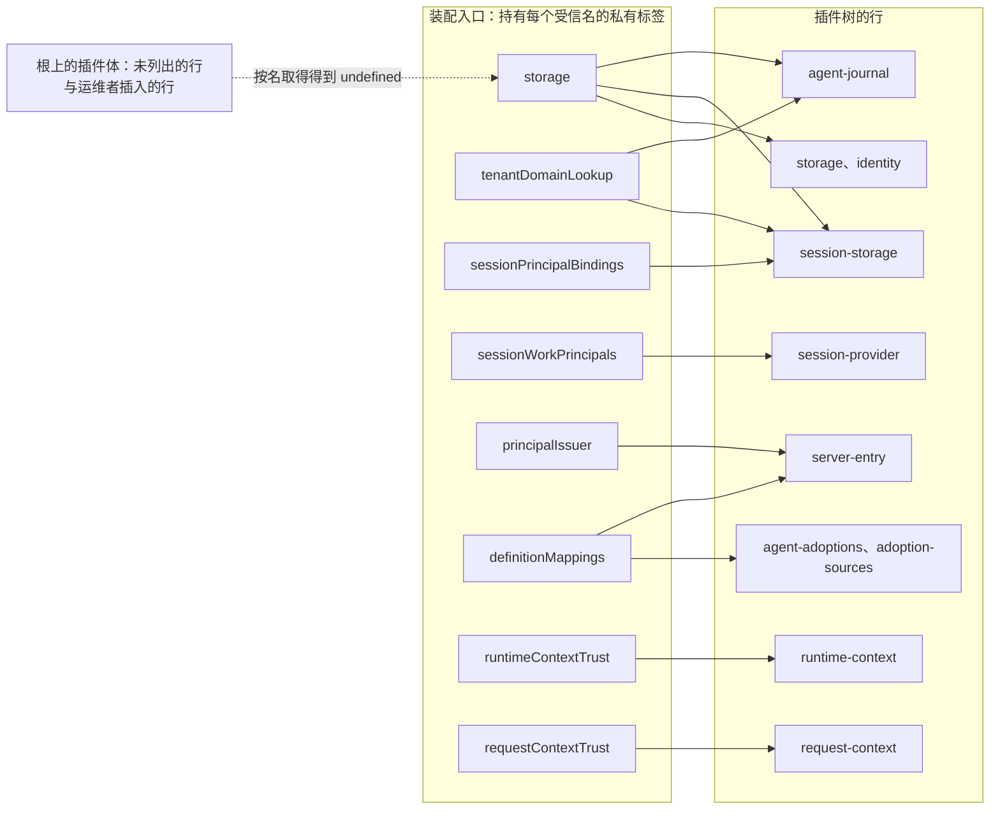
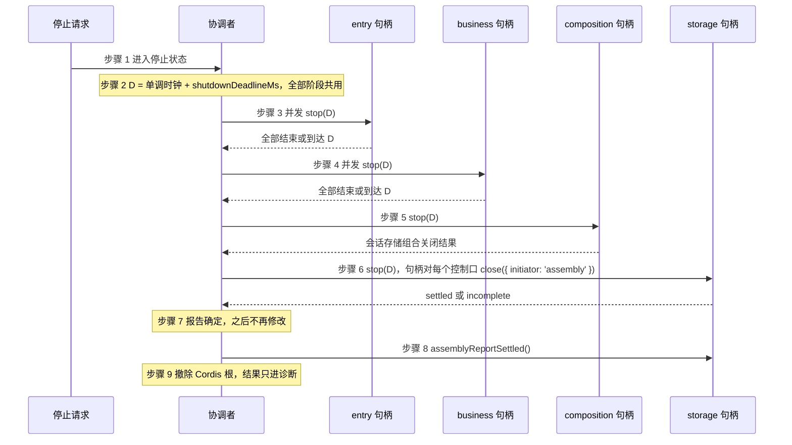

# @omne-harness/harness-server 行为规格

本页是 `apps/harness-server` 的长期行为规格。它写类型表达不了的行为：装载、可见性、就绪、进程输出、退出码和有序关闭。公开类型以 `src/types.ts` 为准，本页不重复类型定义。

## 采用状态

本页依据 S0 私有应用实施规格 r2（#1001 的输入，见 #991 的采用记录）与 L-APP 波 1 的 DP-1 决定（#978 评论 6561644061，候选 DP1-C1～C19）。S0 模式的规格状态是候选实施输入，不是已接受的产品承诺。S0 只用私有服务键 `s0.<名>`。真实模式用正式服务键。

装载器、就绪、行快照差分、关闭协调器和进程入口 `dist/bin.js` 已经实现。启动次序、停止状态后不再调用 `start`、启动期 `start` 抛出的处置三项也已实现，见「有序关闭」节的「启动与停止状态」。真实模式的子命令 `serve`、行声明 `defineRow`、入口对象注册表与装载前检查已经实现。`./cordis` 已导出 S0 替身插件和多条真实行；`executionHost` 由每次运行的入口闭包另行绑定。真实模式的正文在 [docs/real-mode.md](docs/real-mode.md)，本页只写两种模式共同的行为与它们的差别。

驻留桥、宿主文件工厂、租户目录、动作规则、Runtime/Execution 信任入口及采用规划器已有实现。精确行为与生产接线差额见真实模式的行说明。

本机单用户档（子命令 `setup` 与 `serve` 的默认值）依据 R2-D345：用户用一条命令配置一次，宿主之后一直复用，Windows 与 Linux 用同一套流程。它已经实现，见[本机单用户档](#本机单用户档)。

## 范围

S0 模式经真实 Cordis 4.0.4 装载标记替身，验证五件事：

1. 两层插件树的层叠、运维操作与来源打印。
2. 受信子树的可见性：子树行能 inject 受信名，根上不能按名取得，根上同名提供者不替换子树实现。
3. 就绪诊断：PENDING 与 FAILED 分开，直接缺项与阻塞链分开，启动门控在启动时可见。
4. 行清单与应用装配页的机读差分。
5. 有序关闭的阶段次序、截止时间与报告闩锁。

S0 不接 HTTP，不创建租户，不打开业务状态根，不读真实秘密，不实现任何业务方法，不提供默认 allow。S0 成功不表示首条路径可运行。

真实模式（子命令 `serve`）以正式服务键装载同一张行表。每行是三种实现之一：`real`、`contract-double`、`s0-double`。真实行与契约替身行经 `defineRow` 自带清单。S0 替身行继续用 `src/s0/stubs.ts` 的表，名字去掉前缀。一个进程只有一种模式。`serve` 启动后等停止请求，S0 启动后自动停止。真实模式的行声明、入口对象、占位规则、IC 映射与各行拿到什么，归 [docs/real-mode.md](docs/real-mode.md)。

## 入口与输入

入口命令是 `harness-server`，即 `node apps/harness-server/dist/bin.js`。`package.json` 的 `bin` 登记这个名字。它不是 `omne` 命令的一部分。

```text
harness-server s0 --distribution <绝对 JSON 路径> [--operator <绝对 JSON 路径>] --readiness-timeout-ms <正整数> --shutdown-deadline-ms <正整数>
harness-server serve [--distribution <绝对 JSON 路径>] [--operator <绝对 JSON 路径>] [--readiness-timeout-ms <正整数>] [--shutdown-deadline-ms <正整数>] [--state-root <绝对目录>] [--stop-on-stdin-close]
harness-server setup [--port <n>] [--workspace <目录>] [--shell <可执行文件>] [--reconfigure] [--reset] [--replace-credential]
```

位置参数里有 `serve` 时，进程走真实模式。没有 `serve` 而有 `setup` 时，进程走本机首次配置，见[本机单用户档](#本机单用户档)。其他任何调用走 S0 的原解析路径：`parseArgs` 允许位置参数，子命令 `s0` 可在任意位置。这条路径的参数、输出、退出码与 stderr 文字与加入 `serve` 之前逐字节相同。`bin.ts` 只解析参数、调用 `runS0`、`runServe` 或 `runSetup` 并设置退出码。

`serve` 的参数都可以省略。省略的参数取下面的值：

| 参数                     | 省略时                                                                                  |
| ------------------------ | --------------------------------------------------------------------------------------- |
| `--distribution`         | 随应用发行的 `config/serve.distribution.json`                                           |
| `--operator`             | 本机单用户档的运维者层，由配置文件与发行层在启动时生成，见[本机单用户档](#本机单用户档) |
| `--readiness-timeout-ms` | 30000                                                                                   |
| `--shutdown-deadline-ms` | 10000                                                                                   |
| `--state-root`           | 本机单用户档的状态目录                                                                  |

只有省略 `--operator` 或 `--state-root` 时，入口才读本机的配置与状态目录。两个都给出时，行为与加入默认值之前相同。

`serve` 另有两个参数：

- `--state-root <绝对目录>`：入口对象需要的状态文件（例如游标签名密钥）放在这个目录下。给出时，入口只校验它是已存在的绝对目录。目录在运维者的用户目录下、靠目录继承的访问控制保护，是前提，不做程序校验（DP1-C19）。
- `--stop-on-stdin-close`：可选。标准输入关闭时发起计划停止。SIGINT 与 SIGTERM（能投递的平台上）也发起计划停止。Windows 上别的进程不能向 Node 进程投递可处理的 SIGTERM，所以关闭标准输入是那里唯一的跨进程停止方式。

配置是 UTF-8 JSON，解析为 `unknown`，在边界经同步 zod schema 严格校验。校验拒绝未知键、非法值、重复行 id、未知插件导出、未知运维目标和异步 schema。插件清单是显式 allowlist，不按输入字符串动态 import。

## 本机单用户档

本机单用户档是一个人在自己的宿主上运行服务的方式：自己的模型凭据、一个工作区、宿主上的 Shell。用户运行一次 `harness-server setup`，之后 `harness-server serve` 不带参数就能启动。Windows 与 Linux 用同一套命令。实现在 `src/local/`。

### 位置

配置目录与状态目录按下表取值。规则只依赖平台、环境变量和用户目录。

| 条件                           | 配置目录                                       | 状态目录                                           |
| ------------------------------ | ---------------------------------------------- | -------------------------------------------------- |
| 设了 `OMNE_SERVER_HOME=<目录>` | `<目录>/config`                                | `<目录>/state`                                     |
| Windows                        | `%LOCALAPPDATA%\omne\config`                   | `%LOCALAPPDATA%\omne\state`                        |
| 其他平台（XDG）                | `$XDG_CONFIG_HOME/omne`，默认 `~/.config/omne` | `$XDG_STATE_HOME/omne`，默认 `~/.local/state/omne` |

- `OMNE_SERVER_HOME` 必须是绝对路径。空值或相对路径时，`setup` 与 `serve` 都以退出码 2 拒绝。测试用它把整套位置放进临时目录。
- `LOCALAPPDATA` 缺失或不是绝对路径时，取 `<用户目录>\AppData\Local`。XDG 变量是相对路径时被忽略，与 XDG 规则一致。

配置目录里只有 `server.json`。状态目录里有下面这些：

| 路径               | 内容                                            | 谁创建                       |
| ------------------ | ----------------------------------------------- | ---------------------------- |
| `model-vault.json` | 模型凭据保管库。宿主上唯一含秘密的文件          | `setup`                      |
| `workspace/`       | 默认工作区                                      | `setup`                      |
| `host-files/`      | 执行宿主的状态目录，也是 Shell 的临时目录       | `setup`，缺失时 `serve` 重建 |
| `storage/`         | `storage` 行的存储根                            | `serve`                      |
| 游标签名密钥       | 入口对象的状态文件（`--state-root` 即状态目录） | `serve`                      |

### 配置文件

`server.json` 是一个 JSON 对象，键不多也不少：`version`（值为 `1`）、`port`（1 至 65535 的整数）、`workspace`（绝对目录）、`shell`（Shell 可执行文件的绝对路径）、`shellEnvironment`（Shell 的环境变量，名字到值，见[Shell 的环境](#shell-的环境)）。文件里没有秘密，也没有运维者层的数值。数值留在代码里，所以新的发行版带来新的数值时，用户不需要再运行 `setup`。

`omne` CLI 只读这个文件的 `port`，把 `http://127.0.0.1:<port>` 当作默认服务地址，见 CLI 的[服务地址](../cli/SPEC.md#服务地址)。文件的位置与形状归本页。

### setup

`setup` 按下面的次序执行。任一步失败即停止。

1. 解析参数。参数不对时退出 2，标准错误写 `setup: <原因>` 和用法行。未知参数只报 `setup: unrecognized arguments`，不回显参数，因为参数可能就是密钥。`--help` 打印说明，退出 0，不读写宿主。
2. 按[位置](#位置)取目录。
3. 读已有的 `server.json`。文件不合格时退出 2，标准错误写明哪一项不合格，文件不变。`--reconfigure` 也不替换不合格的文件。只有 `--reset` 丢弃已有的文件（合格与否都一样），从默认值重新开始，总结里这一行标 `reset`。
4. 算出要用的设置：已有设置（没有或有 `--reset` 时取默认值），再叠加 `--port`、`--workspace`、`--shell`。`shellEnvironment` 在新建设置与 `--reconfigure` 时从 `setup` 自己的环境按白名单取，其余时候保持文件里的值。相对路径按当前目录解析。默认端口是 8787，与 CLI 的默认地址相同。默认工作区是 `<状态目录>/workspace`。默认 Shell 在 Windows 上是 `%SystemRoot%\System32\WindowsPowerShell\v1.0\powershell.exe`，其他平台是 `/bin/bash`。
5. 已有的 `port`、`workspace`、`shell` 与要用的不同而没有 `--reconfigure` 时，退出 2，标准错误逐项列出旧值与新值，文件不变。已有设置不被静默覆盖。
6. Shell 不是已存在的文件时，退出 2。
7. 建配置目录、状态目录、`host-files/`，以及不存在的工作区。
8. 存模型凭据。保管库路径上的情形如下：
   - 什么都没有：读凭据，经 model-host-local 的 `initVault` 新建保管库，凭据成为工厂秘密。
   - 是目录或链接：退出 1，标准错误写明路径上不是保管库文件，要人先删除它。`setup` 从不删除目录或链接。
   - 是文件：经 `inspectLocalCustodian` 在文件锁下打开它（顺带清理这份保管库的残留临时文件），不只看文件在不在。
     - 没有 `--replace-credential`、文件可读：不读标准输入，保管库不变，总结标 `kept`。
     - 没有 `--replace-credential`、文件读不出：退出 1，标准错误写 `setup: the model credential vault <路径> cannot be read (<原因>)` 与修正办法（加 `--replace-credential` 重跑）。原因是 `corrupt` 或 `io`。保管库不变。
     - 有 `--replace-credential`、文件可读：读凭据，经 `replaceVaultSecret` 替换工厂秘密，总结标 `replaced`。
     - 有 `--replace-credential`、文件读不出：重建。先读凭据并校验，再删除这个文件，再按新建的规则建保管库，总结标 `rebuilt: the old vault could not be read`。旧文件的内容不读。凭据不合格时旧文件留在原处。重建后，旧保管库里各租户自己的模型凭据都不再存在，这些租户改用部署默认凭据，直到各自重新执行 `omne credential set`。总结里必须多写一行 `warning` 说明这一点（R2-D366）。这是运维者显式执行的例外；运行时遇到「绑定存在但读不出」时，调用仍以 credential 失败结束，不回落到默认。
   - 文件锁等不到：退出 1。
9. 设置是新的或变了时，写 `server.json`：先写临时文件，再改名。

第 8 步在第 9 步之前，所以 `server.json` 存在表示写它时保管库已经存在。

凭据只从标准输入读。标准输入是终端时，标准错误写提示，关闭回显读一行。不是终端时，读到第一个换行或输入结束，去掉行尾。凭据去首尾空白后为空、含控制字符或读取失败时，退出 1，不写 `server.json`。凭据不经命令行参数或环境变量传入。凭据、它的哈希或前缀不出现在任何输出、配置文件或错误文字里。

权限：

- POSIX：配置目录、状态目录、`host-files/` 与新建的工作区设为 `0700`，`server.json` 设为 `0600`。已存在的工作区不改模式。保管库按 model-host-local 的权限护栏建立与替换：创建掩码 `077`，文件 `0600` 并读回。
- Windows：不改访问控制列表。保护来自用户目录下继承的访问控制，前提与 model-host-local 的[保管库初始化命令](../../packages/model/model-host-local/SPEC.md#权限)相同。保管库必须位于用户目录之下。`OMNE_SERVER_HOME` 指向用户目录之外时，第 8 步失败，原因是 `path-outside-home`。

成功时标准输出写一份给人看的总结，退出 0：

```text
harness-server setup: done.
  settings     <配置目录>/server.json (created | updated | kept | reset)
  state        <状态目录>
  credential   <状态目录>/model-vault.json (created | replaced | rebuilt: the old vault could not be read | kept (run setup --replace-credential to change it))
  workspace    <工作区>
  shell        <Shell>
  address      http://127.0.0.1:<port>
Next:
  harness-server serve
  then, in another terminal: omne register --login-identifier <name>
```

| 退出码 | 含义                                                                                                   |
| ------ | ------------------------------------------------------------------------------------------------------ |
| 0      | 完成，或 `--help`                                                                                      |
| 1      | 一步失败：凭据读不到或不合格、保管库读不出或写不成、保管库路径上是目录或链接、目录或配置文件写不成     |
| 2      | 参数不对、位置变量不合格、已有设置不合格而没有 `--reset`、设置不同而没有 `--reconfigure`、Shell 不存在 |

凭据步骤失败时，标准错误写 `setup: model credential not stored: <原因>`。原因来自保管库操作的原因代码，不含凭据。例外是替换后收窄权限失败（`written-not-private`）：这时新凭据已经写进文件，旧凭据已不在，所以标准错误写 `setup: the new model credential was written to <路径>, but the file could not be made private to this user (mode 0600)`，再写一行 `Set the mode yourself (chmod 600 <路径>), then run setup again to check it.`，退出 1。

### serve 怎样用这份配置

省略 `--state-root` 时，状态目录必须存在。省略 `--operator` 时，入口读 `server.json`，用 `openLocalCustodian` 实际打开保管库（不只看文件在不在），确认工作区是目录，必要时重建 `host-files/`，再生成运维者层。运维者层里的文件根与 Shell、Files 的 `cwd` 取工作区的真实路径（R2-D376）：工作区经链接或 8.3 短名给出时，用它指的那个目录。真实路径只在内存里用，`server.json` 不变。

- 状态目录、`server.json` 或保管库缺失时，标准错误写 `serve: not set up: <缺什么>` 和一行 ``Run `harness-server setup` first.``，退出 2。stdout 没有记录，不装载任何行。
- 保管库读不出（原因 `corrupt` 或 `io`）时，标准错误写 `serve: the model credential vault <路径> cannot be read (<原因>)` 与修正办法，退出 2，不装载任何行。路径上是文件时，办法是 `harness-server setup --replace-credential`；不是文件时，办法是删除它后运行 `harness-server setup`。
- `server.json` 不合格时，标准错误写哪一项不合格，并建议先改文件，`harness-server setup --reset` 用默认值替换它。工作区不是目录时，写原因与修正的命令。两种情形都再写 `serve` 的用法行，退出 2。
- 运维者层由配置生成，而且服务开始接收请求时，标准错误在 `startup-result` 之后多写一行 `serve: accepting on http://127.0.0.1:<port>`。

### 运维者层的默认值

`src/local/operator-defaults.ts` 的 `localOperatorLayer` 生成本档的运维者层。发行层不写数值默认值（R2-D6），所以本档的数值在这里。每一行都是 `replace`。配置从发行层该行的配置开始，再叠加本档的键。因此本档不重抄发行层拥有的值：`storage` 的 `maxJsonDepth`、`agent-host` 的 `jointCommits` 与 `coordination`。`session-storage`、`model-records`、`tool-records` 的 `combinationVersion` 取发行层 `session-handoff` 行的值。发行层没有这个值时，入口以退出码 2 拒绝。本档的键与发行层同一行的键不重叠。

| 行                                                                               | 本档给出                                                                                                                                    |
| -------------------------------------------------------------------------------- | ------------------------------------------------------------------------------------------------------------------------------------------- |
| `storage`                                                                        | 存储根 `<状态目录>/storage` 与提供者数值。`closeDeadlineMs` 是 D 减 1000，但不少于 D 的一半                                                 |
| `session-storage`                                                                | 目录文件 `<存储根>/tenant-domains.json`，规则 `organization-account/1`                                                                      |
| `model-credential`                                                               | 只有保管库路径 `<状态目录>/model-vault.json`，没有秘密                                                                                      |
| `model-profiles`、`model-request-preparation`、`model-host`、`model-records`     | 档案、准备、宿主与记录仓的数值。路由是 OpenRouter                                                                                           |
| `tool-host`                                                                      | Shell：可执行文件取配置，参数见下，`cwd` 是工作区，结果上限 32768 字节。Files：`cwd` 是工作区，结果上限 32768 字节                          |
| `tool-records`、`execution-host`                                                 | 文件根是工作区，宿主状态目录是 `host-files/`                                                                                                |
| `request-context`、`agent-context`、`agent-host`、`session-ad03`、`session-ad04` | 各自的上限与工厂数值                                                                                                                        |
| `server-entry`                                                                   | 端口取配置。`historyKinds` 是 `message.user`、`message.assistant`、`message.tool`、`message.system_reminder`、`run.started`、`run.terminal` |

Shell 的参数按可执行文件名定：`powershell` 或 `pwsh` 在 Windows 上取 `-NoLogo -NoProfile -NonInteractive -ExecutionPolicy Bypass -Command` 再加一段 UTF-8 前导（见下），在其他平台取 `-NoLogo -NoProfile -NonInteractive -Command`。其他可执行文件取 `-c`。Windows PowerShell 的默认执行策略不让运行本地脚本。`-ExecutionPolicy Bypass` 只作用于这一个 Shell 进程，不改宿主的策略。

Windows 上输出到管道的 PowerShell 按控制台的 OEM 代码页写出（中文系统是 936），原生程序的输出也按这一页解码，而执行宿主按 UTF-8 解码，所以中文成了乱码。前导 `WINDOWS_POWERSHELL_PRELUDE` 是 `-Command` 后面的最后一个参数，PowerShell 把它与调用的脚本用空格接成一个命令。它只对这一个 Shell 进程做几件事：把 `[Console]::InputEncoding`、`[Console]::OutputEncoding` 与 `$OutputEncoding` 设为不带 BOM 的 UTF-8（`[Console]::In` 因此按 UTF-8 读工具的 `stdin`；前者同时设控制台输出页，原生程序继承它，所以 `cmd /c echo` 与 `git log` 的输出以 UTF-8 到达宿主，管道送给原生程序的字符串也以 UTF-8 送出）；把 `Get-Content` 与 `Select-String` 的 `-Encoding` 默认值设为 `UTF8`，读不带 BOM 的 UTF-8 文件不再按 ANSI 页读（调用自己写 `-Encoding` 时以调用为准）。不改机器或用户的任何设置，Linux 的参数不变。

#### Shell 的环境

Shell 进程不继承服务进程的环境。它的环境是 `server.json` 的 `shellEnvironment`，再加上临时目录：Windows 上 `TEMP` 与 `TMP`，其他平台 `TMPDIR`，都指向 `host-files/`。`shellEnvironment` 缺 `SystemRoot` 时（Windows）补 `C:\Windows`，缺 `PATH` 时（其他平台）补 `/usr/bin:/bin`。Windows 上 `WINDIR` 默认等于 `SystemRoot`。

`setup` 按下面的白名单从自己的环境取 `shellEnvironment`。Windows 上按名字比较时不分大小写，例如 `Path` 记为 `PATH`。值为空的变量不取。

| 平台     | 白名单                                                                                                                                                            |
| -------- | ----------------------------------------------------------------------------------------------------------------------------------------------------------------- |
| Windows  | `PATH`、`PATHEXT`、`SystemRoot`、`SystemDrive`、`WINDIR`、`ComSpec`、`USERPROFILE`、`APPDATA`、`LOCALAPPDATA`、`ProgramData`、`ProgramFiles`、`ProgramFiles(x86)` |
| 其他平台 | `PATH`、`HOME`、`USER`、`LANG`、`LC_ALL`                                                                                                                          |

所以 Shell 里的 `PATH` 是运行 `setup` 时的 `PATH`，agent 能找到 `git`、`node`、`python` 这些工具。宿主上装了新工具、`PATH` 变了时，运行 `setup --reconfigure` 重新取。

名字像秘密的变量不进 Shell 的环境：名字以 `TOKEN`、`KEY`、`SECRET`、`PASSWORD`、`PASSWD`、`CREDENTIAL`（可带复数 `S`）结尾，或以 `OPENROUTER_` 开头，不分大小写。白名单里没有这样的名字。有人手工把这样的名字写进 `shellEnvironment` 时，`serve` 认为配置不合格，以退出码 2 拒绝。生成运维者层时也再滤一次。

用户可以改 `shellEnvironment` 来增减变量，也可以用 `--operator` 给出整份运维者层，在 `tool-host` 行写自己的 `construction.Shell.env`。经 `--operator` 配置的文件根必须是真实路径。Windows 上联接或符号链接作根不受支持：路径守卫放行时文件后端仍拒绝，以拒绝为准。

数值来自联调 B 的运维者层与 coding agent 教程的运维者层。两者不同时取教程的值，因为教程在 WIRE 头 `1a34bcba6` 上用真实模型跑通了 15 次工具调用。`tools/joint-b/operator.mjs` 经构建产物消费同一份默认值，只换路径与测试工厂秘密。

本地档的 SQL 单参加者响应上限为 256 KiB。四个驻留工具的 coding 定义创建 Session 时已超过原 64 KiB。Tools 读取约 50 KiB 结果时，消息准入回执同时保留原意图、结果请求与准入消息，超过中间的 128 KiB 配置并触发 `response_limit` 回滚。当前预算为既有 64 KiB 结果页及其回执封套留出空间；真实 SQLite 回归验证完整保存、原身份和同键认回。总操作响应仍为 1 MiB，全局及组预留不变。该预算服务当前发行档，不承诺任意大小的定义或消息均可接纳；超限仍明确失败并回滚，不扩大消息恢复权限。

### Tools 与会话待办的发行采用

当前正式发行采用 Shell、Files、Tools 和 TodoItems，coding 定义将四项声明为常驻候选。实际常驻集合由 Session 的 WorkSnapshot.residents 提供。Tools 的当前目录由受信会话工作身份、活动 Session、其 adopted AgentDefinition 引用与正式发行资产求交，并保留已经实际持有的常驻项。references.resident 不替代实际持有事实。当前适配只支持官方发行，不声称组织、租户、工作区资产解析或自动继承已经实现。

search 只返回合法非常驻，四项均已实际常驻时成功返回空页；inspect 可查看两类工具。Tools.execute 经原 Tool runtime 启动非常驻目标，准备与实际启动分别核当前纳入、常驻状态及目标授权规则。目标继承父调用的租户、主体和资源上限，不采用父 Tools 获准作为目标授权。已受理调用的结果保管与当前新启动资格分别处理。发现和执行不把目标加入模型直接 tool call 列表。Agent 的直接调用在运行时准入与首次启动处要求目标属于当前实际常驻集合，即使模型直接返回合法但非常驻的工具名也拒绝。该检查依据当前 Session 事实，不声称绑定原模型请求发送时的声明快照。

发行提供者按当前 generation 保留成功校验的普通 ToolDefinition 副本，最多保留该清单的定义数量，不保留 executor、作者对象或运行句柄。live contribution 卸载不删除这份定义；当前会话合法 view 可据此返回 known-unavailable。当前资格仍逐次核验，元数据不是执行授权。提供者不保存跨旧发行的耐久历史。重新启动只重新取得当前发行可合法装载的定义，旧发行历史能力记忆须由采用拥有者另行承接。

TodoItems 作者只得到本次执行绑定的清单能力。应用从可信 Session 工作主体和原 ToolCallId 取得 Session 范围及稳定操作身份，并固定命令与参数；模型不提供 Session、租户或主体标识。每次访问经 Session 当前授权，状态、原操作回执与访问证据同事务提交。add/remove/mark_complete 逐项生效，list 保留完成项并隐藏已移除项，跨 Run 沿同一 Session 延续。提交未知须认回原操作，不能用新模型调用代替。执行作用域关闭后撤销绑定能力。

清单结果通过既有 Tool→Agent 结果链进入历史，同 Session 接续按使用指导主动 list。本次发行未采用自动 Runtime Context 待办投影，不承诺自动注入或每次模型请求必见最新待办；这些保证不能从逐项持久清单推导。

## 插件树与运维层

树只有两层：发行层和运维层。租户与组织不是第三层。运维操作有三种：`replace` 替换一行的配置，`disable` 停用一行，`insert` 在已有锚点行之后插入一个 allowlist 内的行。

- 每行只装一个插件。
- 整行替换配置不改变该行的作用域。最终树打印的 `visibleSource` 仍是 `release-code`，`configSource` 标 `operator`。
- 运维操作的目标 id 不存在，或产生重复 id，装载前失败，退出 2，诊断写明目标与操作，零个插件体运行。
- 运维者插入的行可见集合为空。

## 装载与可见性

装配入口创建根 `Context`，为每个作用域创建一个不导出的 `Symbol` 标签。装载第一行前，入口提供根运行时对象。S0 模式提供的是替身：被某行 inject、而没有任何行提供的每个名字（例如 `s0.principalIssuer`、`s0.sessionWorkPrincipals`、`s0.runtimeContextTrust`、`s0.requestContextTrust`），以及 `s0.assemblyLifecycle`。`s0.toolStartFence` 与 `s0.toolStartAuthority` 由 `tool-records` 行提供，不是入口对象。测试参数 `omitEntryObjects` 可省去其中任意一项，CLI 不暴露它。`serve` 模式按入口对象注册表安装真实入口对象，并按占位规则给 S0 替身行提供占位对象，见 [docs/real-mode.md](docs/real-mode.md)「入口对象注册表」。

装载前检查，失败均退出 2，零个插件体运行，入口对象不安装：

- 行 inject 的受信名不在该行可见集合中。
- `sameProviderGroup` 相同的名不是由同一行提供。
- 只在 `serve` 模式：真实导出装在它声明之外的行 id 上（`row-binding`，DP1-C9）。
- 只在 `serve` 模式：`real` 或 `contract-double` 行 inject 的名字由 `s0-double` 的提供者（行或占位对象）提供（`double-dependency`，DP1-C10）。诊断写明行、名字与提供者。
- 只在 `serve` 模式：入口对象承载的行写了 `via`，而注册表里没有一个同名模块把该行列进 `registersFor`（`via-unregistered`，DP1-C15）。
- 只在 `serve` 模式：注册表里同一个名字有两个模块（`duplicate-entry-object`，DP1-C11）。
- 只在 `serve` 模式：发行层引用一个没有行声明的导出，按 `unknown-plugin` 拒绝（DP1-C8）。

真实模式在最终层叠配置与受信预检成功后、入口对象安装和任何业务行装载前，自动准备启用的真实 `session-storage` 租户目录。准备使用最终 `storage` 与 `session-storage` 行配置，调用 `prepareTenantDirectory`，不增加人工首启步骤。全新存储根独占创建并写合法空表；已有根必须有合法登记表，缺表、损坏或半初始化均失败，不补空表。失败结果是独立的 `preparation-failed`，退出 3，stderr 仅写 `serve: tenant directory preparation failed`，不安装入口对象、不运行行体，也不写 `startup-result`。禁用或替身行不触发准备。目录规则归 [session-storage 行说明](docs/rows/session-storage.md)。

之后按最终树顺序，对每行从根依次 `isolate(名, 标签)` 得到该行上下文，再 `plugin(...)`。`await ctx.plugin(...)` 完成不等于 ACTIVE：入口读取每行实际 `fiber.state`，并对 Cordis 4.0.4 的 `FiberState` 枚举做穷尽映射。

可见性规则：

- 子树行能 inject 受信名，得到入口创建的那个实例。
- 根上的插件体按受信名取值得到 `undefined`。
- 根上同名提供者与子树提供者并存，两者都 ACTIVE，子树消费者得到子树实现。
- 同一作用域内第二个同名提供者 FAILED，错误含 `has been registered`，不静默覆盖。

行 id 与受信成员的唯一源是应用装配页。S0 的行快照 `src/s0/aa-rows.json` 由 `scripts/aa-rows.mjs write` 从该页抽取，只能由脚本再生。`scripts/aa-rows.mjs check` 对快照与该页逐字节比较，`tests/aa-rows.spec.ts` 对正式页运行同一检查。同一个检查还对源码做两项机读拦截（身份治理 E1、E2，R2-D208）：受信表里的名字只经入口对象的 `env.readTrusted` 读取，或由受信表列为可见的行在自己的行上下文里读取；`issueActingForTenant(` 与 `issueSystem(` 只出现在 `scripts/aa-trust-config.json` 列出的文件里。该文件的 `pending` 名单只报告、不失败，现在为空。规则与局限见 [README](README.md#verification)。

子 fiber 消费的受信名也列入该行的可见集合。这是启动门控的具名例外（N-4）。

下图是插件树与受信子树的可见性。实线表示该行可见这个受信名。根上的行和未列出的行可见集合为空。



图只示意可见性。精确的行与名对应以应用装配页的受信子树表为准。

## 就绪与诊断

- 直接缺项（`missing`）与阻塞链（`blockedBy`）分开报告。
- PENDING 与 FAILED 同时出现时都输出，整体为失败。
- 超时不把 PENDING 改为 FAILED。LOADING 超时单列 `readiness-timeout`。
- 私有 barrier 回调只在全部启用行 ACTIVE 时调用一次。随后入口按登记次序调用全部 `start`。
- 构造时的检查在启动时以 FAILED 可见，不推迟到首次使用。

S0 的 `accepting` 恒为 false。S0 用私有 barrier 的调用次数证明启动门控，不靠常量。`serve` 的 `accepting` 在全部启用行 ACTIVE 且全部 `start` 成功后为 true，否则为 false。

## 进程输出与退出码

stdout 每行一条 JSON 记录：

| 记录              | 字段                                                                                                                                                                                                           |
| ----------------- | -------------------------------------------------------------------------------------------------------------------------------------------------------------------------------------------------------------- |
| `tree`            | 启用行：`id`、`plugin`、`source`、`configSource`、`visible`（受信名）、`visibleSource: 'release-code'`、`implementation: 's0-double'`。运维者停用的行：`id`、`disabled: true`、`source`。装载前完整输出        |
| `row-state`       | `RowState` 的全部字段。先于 `startup-result` 输出                                                                                                                                                              |
| `startup-result`  | `profile: 's0'`、`scope: 'loader-only'`、`accepting: false`、`enabledRows`（启用行数）、`outcome`、`barrierCalls`（barrier 调用次数）、`startedRows`（已调用 `start` 的行）、`appliedRows`（插件体已运行的行） |
| `shutdown-step`   | 序号、阶段、行 id、动作                                                                                                                                                                                        |
| `shutdown-result` | `ShutdownReport`                                                                                                                                                                                               |

S0 进程在输出 `startup-result` 之后自动发起计划停止。装载前拒绝的诊断写 stderr，stdout 只有 `tree` 记录。

`serve` 沿用这五种记录，差别如下（DP1-C3）：

| 记录             | 与 S0 的差别                                                                                                                                                                                                                                                                                                  |
| ---------------- | ------------------------------------------------------------------------------------------------------------------------------------------------------------------------------------------------------------------------------------------------------------------------------------------------------------- |
| `tree`           | `implementation` 按行取 `real`、`contract-double` 或 `s0-double`                                                                                                                                                                                                                                              |
| `entry-object`   | 新增，只在 `serve`。每个入口对象一条：`name`、`implementation`、`trusted`。不含对象的值。`s0.assemblyLifecycle` 记 `real`，占位对象记 `s0-double`。与 `tree` 一样在装载前完整输出                                                                                                                             |
| `log`            | 新增，只在 `serve`。`level`（`error`、`info` 或 `warn`）、`name`（记录器名）、`text`（格式化后的消息）。根上登记的导出器把级别不高于 WARN 的 Cordis 日志各写成一条，DEBUG 不输出（R2-D253）。消息带什么由各行负责，导出器不另裁剪。格式化失败时 `text` 是固定文字，写出失败时这条丢弃，都不抛给记日志的调用方 |
| `startup-result` | `profile: 'real'`、`scope: 'serving'`。`accepting` 见「就绪与诊断」。新增 `implementations`：三种实现各自的行数                                                                                                                                                                                               |
| 之后             | `accepting` 为 true 时进程等停止请求：`--stop-on-stdin-close`、SIGINT、SIGTERM 或运行期换代。收到后 stderr 写 `serve: stop requested: <原因>`，再走有序关闭。启动码非零时与 S0 一样立即发起计划停止。装载前拒绝时 stdout 只有 `tree` 与 `entry-object` 记录                                                   |

| 退出码 | 含义                                                                                                                                                   |
| ------ | ------------------------------------------------------------------------------------------------------------------------------------------------------ |
| 0      | 启动全部 ACTIVE 且关闭 settled。`serve` 还要求停止来自请求                                                                                             |
| 1      | 未预期的内部错误，stderr 写 `<子命令>: internal error: ...`                                                                                            |
| 2      | 配置、解析或装载前检查失败，也含用法错误：参数缺失、路径不是绝对路径、JSON 读不出、状态根不是已存在的目录。也含 `serve` 省略参数而本机没有完成 `setup` |
| 3      | 至少一行 FAILED，或启动期 `start` 抛出，或（`serve`）目录准备失败、一个入口对象的 `install` 抛出                                                       |
| 4      | 仍有 PENDING 或未完成 LOADING                                                                                                                          |
| 5      | 启动码为 0 但关闭 incomplete                                                                                                                           |

启动码非零时取启动码。启动期 `start` 抛出时，`outcome` 为 `start-failed`，退出码为 3，见「有序关闭」节「启动与停止状态」第 3 条。`serve` 里一个入口对象的 `install` 抛出时，入口不装载任何行，stderr 写 `serve: entry-object <名>: install failed`，错误消息不写进 stdout，然后发起计划停止，退出 3。这时没有行登记过句柄，关闭报告把预期登记者记为 `not-registered`。

用法错误时，stderr 写 `<子命令>: <原因>`，再写该子命令的用法行。`s0` 的用法行不变：`usage: s0 --distribution <abs json> [--operator <abs json>] --readiness-timeout-ms <n> --shutdown-deadline-ms <n>`。`serve` 的用法行是：`usage: serve [--distribution <abs json>] [--operator <abs json>] [--readiness-timeout-ms <n>] [--shutdown-deadline-ms <n>] [--state-root <abs dir>] [--stop-on-stdin-close]`。`setup` 的用法与输出见[本机单用户档](#setup)。位置参数里没有 `serve`，也不是恰好一个 `s0` 时（包括无参数），按 S0 路径处理，stderr 写 `s0: expected subcommand s0`，再写 `s0` 的用法行。位置参数里有 `serve` 但不是恰好一个 `serve` 时，stderr 写 `serve: expected subcommand serve`，再写 `serve` 的用法行。

## 有序关闭

本节规定计划停止时的协议。意外退出与非计划卸载不适用本节；那时各行的 disposer 只发起停止，其结果只进诊断，不能当作有序关闭成功。

**登记。**装配入口在装载第一行前，在根上下文提供 `assemblyLifecycle` 服务。需要参加关闭的行在插件体内调用 `register(handle)`，句柄声明阶段 `entry`、`business`、`composition` 或 `storage`。登记落在调用方 fiber；该 fiber 撤除时自动退登记。插件体重跑后，协调者只持有新句柄。句柄不进插件树，不发布为其他服务。真实模式里带阶段的行只经 `defineRow` 进入，登记有两种承载：行体承载由包装插件在行体返回后登记，入口对象承载由入口对象在被该行调用的方法里经调用方的 `this.ctx` 登记。两种都落在行 fiber 上。见 [docs/real-mode.md](docs/real-mode.md)「关闭承载」。

**预期登记者。**预期登记者是启用行里清单带阶段的行：S0 替身行按 `stubs.ts` 的表，真实行按自己的声明。关闭时某个预期登记者没有句柄，记为 `not-registered`。预期登记者的句柄已随行撤除，记为 `disposed-before-stop`，并附 disposer 发起的关闭结果作诊断。

**步骤。**

1. 收到计划停止请求后进入停止状态。再次请求返回同一个结果，不再次调用任何句柄。此后不调用新的 `start`，规则见下面的「启动与停止状态」。
2. 计算截止时间 D：当前单调时钟加配置的 `shutdownDeadlineMs`。全部阶段共用 D。
3. `entry` 阶段：并发调用全部 `entry` 句柄的 `stop(D)`，等全部结束。接入停止接收新请求，结算在途请求与观察流。
4. `business` 阶段：并发调用全部 `business` 句柄的 `stop(D)`，等全部结束。各业务的停止准入、交接与等待真实结果的语义归各自拥有者。业务交接未决时，句柄返回 `incomplete`，原责任与可查询状态保留在耐久事实中。
5. `composition` 阶段：调用会话存储组合的句柄，得到「会话存储组合关闭结果」。该结果分别保留目录 `close()` 与 Session SQL 实例 `close()` 的结果。
6. `storage` 阶段：调用 `storage` 句柄的 `stop(D)`。句柄由 `storageHost` 入口对象持有。它对每一个保存的控制口调用 `close({ initiator: 'assembly' })`，等全部结果或到达 D。全部为 `closed` 时答 `settled`，否则答 `incomplete`，`detail` 不写 SQL 或业务正文。提供者自己的关闭期限来自 `storage` 行配置 `closeDeadlineMs`，不来自 D，所以发行层里 `closeDeadlineMs` 的初值不大于入口的 `--shutdown-deadline-ms`（DP1-C15）。
7. 形成最终装配关闭报告：逐句柄结果，加 `not-registered` 与 `disposed-before-stop` 各项。只有全部结果为 `settled` 时，整体为 `settled`；否则为 `incomplete`。报告写出后即确定，之后不再修改。
8. 报告确定之后，调用 `storage` 句柄的 `assemblyReportSettled()`。不得早于第 7 步。
9. 撤除 Cordis 根。disposer 的结果只进诊断。

**阶段规则。**一个阶段的全部句柄结束或到达 D 之后，才开始下一阶段。到达 D 时未结束的句柄记为 `incomplete`，协调者继续下一阶段，不等它。句柄抛出时记为 `failed`，继续下一阶段。报告确定后才结束的句柄只写诊断，不改变报告。协调者不关闭任何业务连接，不回滚提交；SQL 连接与 Worker 只由 SQL 提供者在第 6 步关闭。

**宿主文件结算。**启用 `executionHost` 时，入口在停止开始后取消周期。在 `business` 阶段之后、`composition` 阶段之前，入口等待已排队维护。随后经 loader 的 `disposeRow` 显式卸载宿主行，等待卸载完成后补维护，再做最终维护。关闭报告附 `hostFiles`：无残留为 `settled`，有残留为 `host-files-unsettled` 并附计数；维护或退役失败为 `unavailable`，不填未知计数。附录不参与原 `overall` 或退出码计算。超过 D 时附录固定为 `unavailable` 与 `deadline`，迟到结果只进诊断。storage 仍在报告确定后收到确认，根撤除继续等待同一个结算任务。R2-D32 只承诺显式 loader 卸载后的补维护，自动依赖卸载后的特定补维护留波 3。D 约束 stop 与报告窗口，不保证整个进程在 D 内退出。责任域和维护周期归 [execution-host 行说明](docs/rows/execution-host.md)。

**启动与停止状态。**

1. 启动次序：阶段之间按关闭次序的逆序，即 `storage`、`composition`、`business`、`entry`。同一阶段内按登记次序。上文「登记」一节与规格 §5.2 所说的「登记次序」按这句理解。
2. 进入停止状态后，不再调用任何新的 `start`，包括启动尚未走完的时候。每个阶段开始前、每个句柄的 `start` 调用前，都检查停止状态。
3. 启动期某个 `start` 抛出时，进入停止状态，走整套有序关闭，共用截止时间 D。已启动的句柄按关闭次序停止。最终报告把该句柄记为 `failed`，最后撤除根。`startup-result` 的 `outcome` 为 `start-failed`，并多一个 `startFailure` 字段，写明行与原因。退出码为 3，沿用 FAILED 的映射。替身配置新增测试输入 `startBehavior: 'fail'`，与 `stopBehavior` 同类，只用于测试，CLI 不暴露。这些字面来自卡树 head `df527a879` 的代码写者交回，合回时对照代码核对本页。

**结果。**整体 `incomplete` 时，进程不能报告平滑退出成功。下次启动时，未决工作由原拥有者按原身份查询与认回。

**已知限制。**单实例部署。跨进程 writer 排除不由本协议提供。

实现要点：S0 用私有服务键 `s0.assemblyLifecycle`，见「偏离登记」。关闭协调器的时钟可注入。每次句柄调用与报告确定各写一条带单调序号的 `shutdown-step` 记录。

下图是关闭的四个阶段，对应上面的步骤 2 至 9。



## 已知限制

- 正式服务定义（`definitionMappings`、`tenantDomainLookup`、`sessionWorkPrincipals`、`sessionPrincipalBindings`、`assemblyLifecycle`）未接受。S0 只用私有键。
- `PrincipalIssuerService` 由 #992 交付（N-5）。#992 合回之前，只在测试里使用测试自己的定义。
- 签发者的寿命与根进程相同，没有「绑定 identity 行」的条件分支（N-6）。
- 暂停项（inbox、owner 解析器）不在 S0 中出现为服务。解析器交出接收方；推送资格由接收组件核验。（N-9）
- 生产插件 ABI、身份与授权、存储、真实回复和真实业务交接，都不由 S0 证明。
- 同进程反射遍历 `ctx.reflect.store` 可取得受信实例。这是 kernel-basis 已记录的非保证。S0 不测试它，也不宣称阻止它。隔离不是权限。
- 生产 Node 版本由后继任务固定。
- `serve` 的停止触发只有 `--stop-on-stdin-close`、SIGINT 与 SIGTERM。Windows 上只有关闭标准输入能跨进程触发。
- `--state-root` 的保护只是文档化的前提（DP1-C19）。
- `serve` 下运维者只能插入 `stubPlugin`：真实导出绑定在它声明的行 id 上，运维者 `insert` 的行 id 必须是新 id（DP1-C9）。
- 发行层单独不能装载 `serve`。发行文件没有 `execution-host` 与 `agent-host` 的工厂数值，也没有 `agent-host` 的 `loopGuardPolicy`，进程以 `invalid-config` 退出（R2-D229）。运维者层必须用 `replace` 给出这些值，并重抄发行层的 `jointCommits` 与 `coordination`。省略 `--operator` 时，[本机单用户档](#运维者层的默认值)生成这一层。`loopGuardPolicy` 还没有生产采用来源，本档用的是占位采用，这个缺口归 L-RUN 波 3。
- 本机单用户档的数值没有测量依据，采用引用是摘要全零的占位。它们来自联调与教程的运维者层，那里是测试值。
- 本机单用户档的 Shell 环境是 `setup` 当时的白名单值。`PATH` 之后变了，要运行 `setup --reconfigure` 才跟上。白名单以外的变量（例如代理设置）不进 Shell，需要时手工写进 `shellEnvironment`。
- Windows 上 Shell 的 UTF-8 前导只管输出和读文件。`Set-Content`、`Out-File` 与 `>` 仍按 PowerShell 的默认编码写（Windows PowerShell 5.1 是 ANSI 页），前导不强制 BOM，因为 BOM 会破坏 `package.json` 之类的文件；要写 UTF-8 文件，脚本自己用 `[IO.File]::WriteAllText` 或 `-Encoding utf8`（5.1 带 BOM）。工具的 `stdin` 经 `$input` 读取时仍按控制台页解码，前导够不到它；脚本用 `[Console]::In.ReadToEnd()` 读才是 UTF-8。参数里的中文文本不受影响（命令行是 UTF-16）。验证见 `tests/local/shell-encoding.spec.ts`，它在 Windows 上用真实 `powershell.exe`，其他平台跳过；经执行宿主的 Windows 命令桥做过一次手工核对，没有固化成用例。
- Windows 上 `setup` 不改也不读回访问控制列表，保护只靠用户目录的继承，前提见[权限](#setup)。
- `omne` CLI 为读默认地址重复了[位置](#位置)的规则，因为应用之间不互相导入。改位置规则时两处要同时改，CLI 的 `tests/local-server.spec.ts` 与本应用的 `tests/local/locations.spec.ts` 各自固定一份。
- 成员插件在插件体内自登记的行要等正式 `assemblyLifecycle` 被接受后再定承载（N-r2-3）。现在带阶段的行只经 `defineRow` 的两种承载进入。
- `storage` 句柄的结果受提供者自己的 `closeDeadlineMs` 约束。它大于 D 时，句柄在 D 答 `incomplete`，提供者仍在关闭。
- 行清单的四跳同步靠人工：装配页到 `aa-rows.json` 由脚本再生，装配页到 `stubs.ts` 由线负责人手工同步，`stubs.ts` 到真实行声明由 `real-manifests-sync` 检查，等待装配页补丁的差额写在该测试的具名清单里。
- `defineRow` 声明的清单与插件实际取用的服务可能不一致。装载器只核声明，真实行的成员测试负责核对。
- R2-D25 的 Runtime/Execution `current()` 只桥接读取方 fiber 的进程代次。撤权、工作失效和 Request Context 换代尚未同步，不闭合 #677。R2-D29 的 reader 只接受 scope 所属 Session 的工作主体，producer 拒绝；缺 AD-03 归属或 AD-15 恢复授权生产来源时默认 `unavailable`。
- Model 三行真件的已知限制（撤权只随宿主 fiber 退役、直接命令口的 W 没有受理点、工厂围栏永不拒绝而由保管库 `resolveFor` 防护、ActorRef 是租户级记录、四种证据恒 `unavailable`、数值无测量依据）归 [Model 生产接线](docs/rows/model-release.md#已知限制)。
- R2-D26 的采用规划器已有纯模块实现，但生产 `SessionAdoptionSource` 尚未接入 `plan`，真实 authority、首次 version 与 admitted 的定义投影仍缺。登记事实缺失时整份 `unavailable`，不能把局部规划测试写成 AS-06 完整生产就绪。

## 偏离登记

- IC-3：私有服务键 `s0.assemblyLifecycle` 与服务类 `S0AssemblyLifecycleService`，`@owner apps/harness-server`。待 kernel-basis 的正式定义被接受后迁移，并删除这个私有定义（规格 §9 末段）。
- `StubService` 使用动态服务键，只在 S0 替身内部使用，不对外导出。
- IC-2：`s0-double` 占位对象以 `provide` 普通值提供，没有服务定义。只给 S0 替身行，真实消费者不得到占位（DP1-C11）。
- IC-8：S0 的 `rowPlugin`（`src/run.ts` 的 `stubRowPlugin`）与 `serve` 的包装插件（`src/row.ts` 的 `defineRow`）的 `inject` 由清单计算，不是字面数组。补偿：`defineRow` 要求声明的 `injects` 包含被包装插件的字面 `inject`，不符即抛出。声明再由 `real-manifests-sync` 与 `stubs.ts` 比较。
