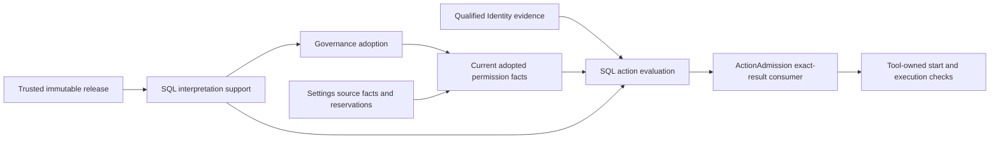
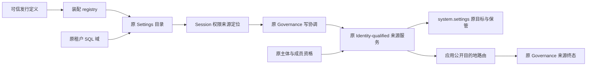

# Transactional permission interpretation

Status: C3b implementation contract adopted by the delivery owner. Agent and Tool admission adapters now require a current permission check after a static allow. The production row supplies this dependency through the current Governance service. A static allow only permits this further check; it does not authorize execution. Assembly tests and independent delivery acceptance are separate evidence.

## Current consumer

[createCurrentToolPermission](../../src/rows/authorization/current-tool-permission.ts) reads the exact adopted Tool release and the original action's current PermissionBasisSource. The trusted request mapper locates the target; the source still qualifies the actual principal and original action. A mapped request must match the tenant, organization, Session work identity, operation, arguments digest and released implementation. The returned current request must match the mapped request exactly.

The consumer uses the same interpretPermission function as the SQL interpreter below. Known prohibitions remain denials when another source is unavailable. Missing sources, substituted declarations and stale operation bindings are unavailable. Need-decision remains unavailable at these adapters until the HITL consumer is installed; it never becomes implicit allow. Each call reacquires dependencies and reads current facts. A successful read is not a reusable execution permit.

The current source receives a service context containing the original issued principal and an owner locator. Agent locators carry execution, passage, action and advance. Tool locators carry call and the fixed request. The consumer snapshots these locator values before awaiting dependencies and preserves the original principal object. The Governance implementation obtains the principal through its configured principalOf function, verifies it independently and passes the context to the owner resolver. The locator is input to owner qualification, not proof of qualification; the production owner projections remain required.

The ordinary admission factories accept a readPermission dependency. The production authorization row connects Governance, Session assignments and the original AgentDefinition constraints. Consumer tests with named source fixtures verify their own boundary; native SQL and default-release tests verify the actual composition. Neither fixture tests nor source presence alone establish delivery acceptance.

### Admission invariant

For one fixed action `a`, let `I(a)` be successful current identity qualification, `S(a)` be a matching static allow with no matching static deny, and `C(a)` be an exact current reading interpreted as allow. These adapters return allow only when `I(a) ∧ S(a) ∧ C(a)` holds. An absent dependency makes its conjunct false for admission; it does not manufacture an empty constraint set. Static deny is terminal before the permission dependency.

The implementation preserves this invariant by ordered branches. Identity failure exits before permission consumption. Static deny exits before readPermission. The only remaining allow branch consumes a current permission allow. CurrentToolPermission first matches the original operation and returned request, then delegates to interpretPermission. That interpreter preserves known prohibitions and requires all applicable sources before an effective allow. Agent evidence combines the identity/static-rule evidence with the current permission evidence.

This is a source-level argument, not a machine proof of the providers or distributed linearizability. It assumes the current source authenticates its principal, qualifies the original action and reports owner facts faithfully. Production owner projections and source assembly must establish those assumptions. Rechecking at Tool start does not undo an effect already started.

## Original Tool source in a permission capture

[qualifyToolPermission](../../src/rows/governance/tool-permission-qualification.ts) binds the original Tool call, admission, fixed request, effective arguments, Session work principal and exact released interpretation to the permission request. It invokes the Tool owner's qualification port. A caller-supplied call identifier, definition or digest does not establish this qualification. The resulting observation retains the original invocation and the owner-read record addresses and digests. The resolver must supply the actual action context and the trusted release; it must not accept a caller-authored observation as proof.

[toolPermissionCurrentCommands](../../src/rows/governance/tool-permission-current.ts) places the Tool record guard and Session permission guard in the same SQL operation as the target snapshot and permission terminal writer. The named combination includes the Tool table owner and the read-only record participant. The application participant requires the original Tool records, Session permission observation and target snapshot. It compares the complete owner observations, principal, permission request and declaration. It then uses the common permission evaluation. Governance stores the observation and checks that the terminal fact still matches the original command. Neither Governance nor this application participant reads Tool's private tables.

Let `Q(a,p,w)` mean that the original Tool source qualifies action `a` for permission request `p`, and `Current(w)` mean that the Tool participant finds the exact observed records in the capture transaction. Under trusted assembly, successful qualification establishes `Q`; the capture requires `Current(w)` and equality of the complete observation. A removed or changed record causes transaction rollback. Substituting a different valid record fact fails the application equality check. A prior successful SQL receipt only recalls that earlier capture; it does not establish a new `Current(w)`.

This is a conditional implementation argument. It assumes the owner's source authority, immutable release and SQL transaction semantics. It does not prove cross-process linearizability or protect an external effect after admission. The [real capture test](../../tests/rows/governance/tool-permission-capture.spec.ts) uses Identity, Tool issuance, qualification, SQLite and native Governance/Settings. Its Session identity is issued, and its Session permission observation uses the real SQL reader and guard. Session initialization and write qualification remain named fixtures. The Agent-origin variant also uses the actual Journal and Agent adoption service. It checks the empty author bound, missing association source, execution changes after qualification and recapture. Inquiry publication remains outside this test. Production row installation and independent acceptance are still required.

### Agent-origin Tool capture

The Tool owner returns the verified original invocation. For forwarded calls, this is the parent invocation. The application uses its consumer only to require Agent proof and route the query. An Agent consumer without AgentToolQualification is unavailable; it cannot become a non-Agent source. The Agent query matches the original saved intent or persistent binding and returns its exact Agent adoption. The application resolves that adoption and retains its permission bound.

Protocol `tool-permission-observation/5` distinguishes no Agent origin from a verified Agent origin. The latter stores the original Tool origin, Agent observation, execution revision and bound. Two participant identities share one implementation. Their immutable configuration and protocol digest select different static fact dependencies. The Agent variant requires the Session execution-current fact in addition to the Tool record, Session permission and target facts. A mismatched observation variant is rejected. The bound is mandatory even when the assembly's extra constraint list is empty.

Under the original-owner and SQL assumptions above, an Agent Tool capture requires `ToolCurrent(w) ∧ AgentAssociated(origin,A,r) ∧ ExecutionCurrent(r) ∧ SessionCurrent(s)`. Its permission evaluation includes the bound of `A`. A known empty bound therefore remains a denial when another source is unavailable. If the execution moves after qualification, the old revision fails inside the capture transaction. A later capture requalifies and uses the new revision; the old receipt is not a current permit. This remains a conditional argument, not proof of cross-process linearizability.

## Original Agent source in a permission capture

[qualifyAgentPermission](../../src/rows/governance/agent-permission-qualification.ts) consumes AgentActionQualification. It checks the full original request and the operation derived from execution, passage and action. The original Agent adoption comes from the same Journal load as the action revision. It differs from the Tool adoption named by the action. The adapter resolves the exact Agent adoption through AgentAdoptions and projects its permission bound. A missing definition remains an unavailable constraint; it is not an absent restriction.

[agentPermissionCurrentCommands](../../src/rows/governance/agent-permission-current.ts) selects a separate named combination. Session owns the execution revision and permission guards. The application compares their complete facts with the saved observations before producing current permission material. The Agent definition constraint is always required by this participant, even if assembly omits it from the additional constraint list. Governance stores the envelope without interpreting Agent state. No new table is needed.

Let `A` be the original Agent adoption, `r` its qualified execution revision, `s` the Session permission observation, and `b(A,p)` the bound for permission request `p`. Under trusted source resolution, immutable exact adoptions and the owner's revision contract, a successful capture requires `Qualified(a,p,A,r) ∧ ExecutionCurrent(r) ∧ SessionCurrent(s)`. The resulting evaluation includes `b(A,p)` and the Session assignment from `s`. If the original action changes before capture, its revision differs and the transaction rejects the old observation. A missing bound source cannot produce allow. A known empty bound remains prohibitive even if another source is unavailable.

This is a conditional implementation argument. The [Agent capture scenario](../../tests/rows/governance/agent-permission-capture.spec.ts) uses the real Session Journal, original action material, Agent adoption service, SQLite and Governance. Session admission, initial handoff and Tool description are named fixtures. Tool-to-Agent association now feeds the Tool capture described above. The default production row and inquiry publication consumption are installed. This scenario alone does not establish independent acceptance.

## Session assignment projection during capture

[sessionPermissionSource](../../src/rows/governance/permission-session-current.ts) consumes the public Session current observation. An absent assignment stays absent with its revision. An assignment for the exact permission definition retains its rule. An assignment for an old definition makes this source unavailable, while prohibitions from other sources remain effective. A wrong tenant, Session or enforcement binding rejects the capture. The mode is guarded as original Session state; this path does not translate it into a permission override. Inquiry translation belongs to the published Session mode view.

## Ownership and binding

The application action permission owner supplies the SQL interpreter. Permissions retains its pure definition validation and rule evaluation. Governance retains contribution leases, adoption and epochs. Settings retains editable values. The release owner supplies immutable definitions and the exact implementation/action/interpretation mapping. Tool retains implementation adoption, availability and execution.

implementationRef identifies the controlled implementation in the trusted release. It does not identify the generic Permissions evaluator or prove an online Tool instance. interpretationRef identifies the implemented rule interpretation. Neither a Tool name nor a caller-provided route proves these facts. This follows [Permissions current reads](../../../../packages/assets/permissions/docs/public-api.md#当前来源消费口) and the [separate assembly states](../../../../packages/assets/docs/governance-contributions.md).

A released interpretation contains the complete EnforcementBinding, exact PermissionDefinitionRef and a finite mapping from every declared value to allow, deny or need-decision. The actual interpreter supports named interpretation versions. An unsupported version is unavailable. Values with permitsOperation=false cannot map to allow or need-decision. A permitted value is not automatically allow. Need-decision identifies a requirement for human authorization, not an issued grant or an already accepted answer.

The trusted release owns the mapping. It is not an editable Settings value or an arbitrary map supplied by the Agent. The consumer supplies the actual controlled implementation and action from its trusted description; the interpreter compares them with the released route. Same-name replacement cannot reuse an old route.

## Two facts with different dependencies

Support resolution checks the exact released route and the installed interpreter's supported version and complete value interpretation. It can run during Governance adoption without requiring the adoption it is helping establish. It produces only supported bindings for that SQL operation. It does not evaluate a user's permission or issue a permit.

Action evaluation additionally consumes current adopted declarations, complete layered Settings values, applicable constraints and qualified identity evidence. The actual participant calls the pure Permissions evaluator and then interprets its selected value. ActionAdmission consumes that actual result; static ActionRules cannot provide fallback allow. A source's unavailable state never becomes absent. The source adapters, not request fields, determine the required constraint set.

Both facts are produced by actual ParticipantModule.execute calls. Module registration and stored manifests do not produce current facts. The SQL combination requires each producer explicitly. The interpreter owns no business tables and reads no foreign private tables; it consumes owner-produced facts through SqlStorage. There is no auxiliary active table or main-thread deployment mirror.

## Total result and ordering

ResolveSupport(release, binding) returns supported or unavailable. Unknown interpretation, mismatched exact implementation/action/definition, malformed or incomplete mapping and unavailable release return unavailable.

Interpret(current, support, original) returns allow, deny, need-decision or unavailable. Invalid material or binding and missing sources return unavailable. Known active prohibition and empty bounds remain deny under the Permissions evaluator's established order. A selected value that prohibits the operation returns deny. A supported human-required value returns need-decision. All results retain exact original action and evidence bindings.

The actual SQL transaction is the ordering point for current contribution/adoption, target facts, values and applicable local constraints. Cross-domain Identity and organization sources use their existing qualified reservations and destination resolution. This protocol does not replace those protocols with an earlier read.

Withdrawal before a new decision prevents consumption of the withdrawn basis. A decision committed first retains its original result. A retry can recover that original result, but cannot turn it into a current fact for a new operation, attempt or action. PermissionBasisSource.readCurrent remains an observation, never a future execution permit. The actual Tool start must consume its precise authorized action boundary or recheck at its owned start boundary; a detached response is not sufficient.

## Lifecycle and assembly

The tenant factory registers separate capture combinations for an Agent action, a Tool call, and a Tool call with an Agent origin. Each combination includes only its required owner guards. A Tool call without an Agent origin does not produce a substitute Agent fact.

For a permission with a Settings mapping, the application resolves a unique target from the actual Settings directory and compares the complete definition. For a permission with settings:null, it uses the shared Tool holding address and captures the actual Assets publication and selected Governance definition. Both paths bind the original Session work principal, operation, arguments and released interpretation. Missing required targets or original qualification ports return unavailable. A target address alone does not authorize the action.

Base session/agent identity checks and systemActionAuthorization start without tenantDomains. Dynamic action assembly separately consumes the tenant domain and permission dependencies. Otherwise authorization requiring tenantDomainLookup and session-storage requiring sessionAccessCheck would form a startup cycle.

Governance publishes the trusted application service `currentToolPermission`. Its request mapping and current reading first verify the original Session work principal and current tenant standing. Only then can the service open that tenant's runtime. It copies action data before asynchronous work and retains the issued principal identity. A retired service cannot return a successful reading through an old reference.

Authorization uses the same current check for Agent action admission and Tool target admission. It reads this service on each call, without a static dependency on Governance or either runtime. It also reads the Session mode recovery port and the RuntimeContext inquiry publication on each call. Missing dependencies return unavailable for the affected decision; they do not prevent base identity admission from starting. The inquiry policy cannot override a structural prohibition.

Two tenants execute in separate transaction domains. Closing tenant A's contribution does not remove tenant B's sources or interpreter support. Interpreter execution has no mutable cross-call state. Missing code, missing material, a missing required participant or dependency loss fails the operation closed. Contribution fencing, late SQL acceptance, bounded close and original-operation recovery continue to follow Governance and SqlStorage.

The support fact does not promise Tool liveness, action success, rollback of external effects or distributed failure detection. There is no separately unloadable main-thread interpreter whose lifetime must be copied into SQL. If such a resource is introduced later, its owner must define custody and release before claiming the same currentness.

## Built-in Tool release source

The application release owner publishes one invocation permission for each built-in Tool, Shell and Files. It covers all commands of that Tool, matching the existing action-rule granularity. The initial declared values are deny, ask and auto. The default is ask; an absent assignment does not silently reproduce the old static allow. Identity, holding and execution conditions remain independent. Supported authorization scopes describe one original call, one logical session and the tenant. No grant is issued by declaring these scopes.

The source is part of format 2 of [tool-release.json](../../config/tool-release.json). The same [composition function](../../src/entry/tool-release-manifest.ts) generates the file and recomputes it at startup. Permissions, their Settings projections and interpretation mappings are compared with that recomputation. An added or changed sidecar is not accepted as release authority.

[tool-permission-release.ts](../../src/entry/tool-permission-release.ts) owns the declaration and its digest algorithm. It builds the complete declaration and interpretation with a fixed version placeholder, hashes that canonical draft, then builds the final material with the resulting version. The draft includes the exact Tool adoption, full module location and executor identity, artifact digest, definition digest, permission semantics and Settings presentation. A source change therefore changes the version, assuming SHA-256 collision resistance. The final declaration has a separate full-body digest. Mutable tenant assignments are never inputs to either digest.

The immutable origin is an asset release. The asset identifier is stable for the built-in Tool; the release reference includes the content-derived version. Same-name implementation replacement therefore does not inherit the prior concrete origin's assignments or grants. Stable capability and enforcement identities remain available for the independently owned capability constraints.

[tool-definition-source.ts](../../src/rows/governance/tool-definition-source.ts) resolves only the complete owner/definition/version tuple from the trusted release snapshot. It has no tenant argument and never reads a tenant-editable copy as authority. Each result is an isolated copy. A missing source, unknown tuple or source failure returns unavailable.

The SQL [release participant](../../src/rows/governance/tool-release-participant.ts) independently loads and verifies the actual release during module initialization. Its material URL and participant protocol bind the expected generation. The protocol enters the SQL manifest; changing generation changes that manifest. The module produces the immutable release fact during execute only when its verified generation matches. Command facts cannot replace the release body. A failed load or generation mismatch fails closed.

This snapshot is an immutable publication, not a current adoption or online Tool assertion. Reload requires new material adoption; file edits do not mutate an already loaded release or refresh an existing SQL combination. The support and decision participants consume this publication, while current target/adoption/value producers retain their own transaction and lifecycle responsibilities.

Current source verification covers the actual release producer, tuple resolution, tamper refusal and real Worker consumption. The default production assembly connects the current-target adapter to ActionAdmission. The release-producer SQL scenario uses a named current-permission fixture; it does not prove the complete production chain.

## Tool asset publication

[tool-assets.ts](../../src/rows/governance/tool-assets.ts) adapts the trusted Tool release to the public Assets category contract. The fixed body contains the Tool adoption, module, definition digest and complete governance declaration reference (owner, definition, version and digest). The declaration body remains in the verified release; the asset does not duplicate that body. It excludes the containing manifest generation and holding evidence: changes to an unrelated Tool must not change this asset body under the same version.

A change to the asset body format requires a new Tool publication version. The category accepts only a body that matches the trusted release at the exact Tool name and content-derived version. It projects the Settings definition from that same release. Assets retains publication, holdings, enablement and version selection. The adapter does not read Assets tables or create a second registry of holding state.

The expected publication reference includes the asset identifier, category, name, version, source and SHA-256 digest of the Assets JSON tree. Consumers must compare the complete reference with the native Assets publication fact. A matching Settings definition alone does not prove the original publication. Publishing a body does not establish a holding, configuration rights or execution permission.

The Assets owner can supply its publication and Settings projection in one transaction. The Governance current adapter must bind these facts to the same request, target, owner revision and complete definition. The application current-target participant implements this join. The default Tool adoption assembly and ActionAdmission consumer are connected. Independent feature issuance still requires a real issuer before that path can be accepted.

## Current-target composition

[adoption-current.ts](../../src/rows/governance/adoption-current.ts) constructs the capture commands from the admitted Governance operation binding. The capture keeps the exact tenant reference, principal, deployment and transaction domain. Its identifier derives from the complete operation binding. It uses runtime mode and does not require an adoption result that it is helping establish.

The [participant](../../src/rows/governance/adoption-current-participant.ts) requires the native Assets and standalone Settings publication and definition facts, immutable publication mappings, and actual interpreter support. [current-targets.ts](../../src/rows/governance/current-targets.ts) joins the native facts on the complete target. It requires one view from each corresponding owner, equal request bindings and owner revisions, and the exact publication mapping. The complete Settings definition and its digest must match the immutable declaration. Missing, ambiguous, disabled or unsupported targets fail the operation.

The participant emits the existing Governance adoption-current fact. It reads no tables and stores no state. Governance still checks the active contribution set, selection, epoch and required enforcement bindings in its own adoption transaction. The current fact is not an adoption result, a caller authorization or an execution permit.

The immutable Tool issuer supplies asset publication mappings today. The same join has an independent publication variant, but a real independent feature issuer remains required before that path can be accepted. A schema variant or synthetic test is not that issuer.

## Current catalog composition

[catalog-current.ts](../../src/rows/governance/catalog-current.ts) constructs native captures for a Governance catalog request. Management captures retain disabled targets. The current adapter reports unresolved publications through unavailable owners instead of claiming a complete empty source. Governance owns the runtime filtering and checks every selected target, including targets outside a requested display filter.

The adapter returns no assignment values and reads no private owner tables. Its result is a transaction fact, not a cached session authorization. The public catalog snapshot supplies the declaration and adoption revisions used by the next adoption command. Consumers must obtain those revisions rather than assume an initial revision.

The real-service combination test covers Identity reservations, Tool publication, Assets holding, contribution, catalog, adoption, disabled-target filtering, original-operation lookup and withdrawal. A rejected current-source transaction is sealed by the coordinator. Its command then reports a basis conflict, and operation lookup provides the not-committed seal. This does not replace production row assembly or ActionAdmission acceptance.

## Verification obligations

[GovernanceEnforcementExecution](../../../../packages/human-intervention/human-intervention/verification/models/GovernanceEnforcementExecution.tla) models exact implementation selection, actual execution, withdrawal ordering, historical receipt reuse and two-tenant isolation. Its finite state and atomic transaction assumptions do not prove the actual providers.

Production acceptance must use actual SqlStorage, Identity, Settings/Assets source facts and the release producer. It must swap same-name implementations, omit the interpreter, omit each required source, reorder withdrawal and decision, replay an old receipt for a new action, and close one of two tenants. It must show allow, deny, unavailable and need-decision through the real ActionAdmission. The existing Governance-local suite is not this acceptance evidence.

## Freshness at call boundaries

The delivery owner accepted this application guarantee on 2026-11-07. It remains an implementation obligation, not a claim that the current production composition already meets it.

For next-read settings and current permission rules, a new call that begins its adoption boundary after a successful update must use that update or a later effective state of the same source. Concurrent updates and calls follow the source transaction or reservation order. Revisions from different sources or lifecycle generations are not compared as numbers. Replacement requires current qualification again. If current material cannot be established, the dependent operation is unavailable; it cannot reuse an earlier allow result.

Runtime Context supplies qualified material and change observations. Settings retains assignment authority; Permissions and Authorization retain interpretation and admission. The consumer fixes the material used for each request or call. An existing session is not a permanent configuration snapshot. Calls that require admission again after waiting must perform that admission again.

Notifications may be delayed, lost, duplicated or reordered. They are wakeups, not proof of freshness. The next read must consult or validate the authoritative source. Updating all live session caches is not a prerequisite for completing the source write. Context does not replace the permission checks at actual admission or protected commit.

The declared adoption modes remain distinct. Next-boundary values apply at the owner's specified boundary; reload and creation values apply at their declared lifecycle points. Saving a value does not prove that a reload-only consumer has adopted it. A policy change does not answer an existing human-intervention card or undo an external effect.

## Atomic target inputs

[target-snapshot.ts](../../src/rows/governance/target-snapshot.ts) composes the actual Governance target observation, native Assets/standalone publication facts, Settings-owned assignment projection, immutable issuer and SQL interpretation support in one logical transaction. The application owns the relation join and no tables.

The join requires the exact capture binding for all inputs. The assignment view must match the complete native target projection, including owner revision, definition, source layout and grants. The immutable publication mapped from the native owner must contain the same complete Governance declaration as the current contribution. Required enforcement bindings must be present in actual interpreter support.

Management mode can observe a contributed declaration before adoption and can retain disabled target values. Runtime mode requires current adoption and native enablement. Missing sources, another capture, changed publication, withdrawal or an unsupported interpreter cannot produce a snapshot. No earlier snapshot is reused for a new operation.

This snapshot supplies current target inputs. It does not yet assemble organization/session permission assignments, Agent constraints or Identity reservations for the consuming action. It emits no allow decision or execution permit. ActionAdmission and protected Settings commands remain responsible for their complete qualified consumption.

The [protected Settings current composition](settings-preparation.md) consumes this snapshot for initial capture and fresh ready/commit facts. Its native source grants authorize Settings mutations only. They do not constitute permission to execute the corresponding Tool action.

## Agent 定义上界投影

`readAgentPermissionConstraint` 调用 AgentAdoptions.resolve 读取原动作的精确 Adoption。已有定义的空允许集合投影成禁止；未声明该关口时投影为当前权限定义的完整值集合，仍受其他约束限制。解析失败或声明值不受支持时返回 unavailable，不能默认空约束。来源和修订包含精确采用依据，不使用定义名查找最新发布。

该适配器只做读取与投影。调用方仍须经 Agent 或 Tool 拥有者认回原动作、采用和 Session 关系，并保护可变事实的当前性。当前公开采用服务组合测试证明声明保真及求值，不证明生产 row 已装配，也不证明真实动作资格闭环。

## Session 配值的原事务回执

`sessionPermissionWriteResult` 消费真实 Session commit-result，核对原操作、完整 Session facts 摘要、协调引用和实际回执摘要，再向 Governance 提供同提交结果。它不决定编辑资格，也不读取 Session 私有表。

`sessionPermissionReply` 消费同次 externalWrites.execute 的 terminal、按 terminal.sqlIdentity 查询的原 SQL 回执，以及该次提交的原 Session 命令。它核对租户、操作、完整事务身份和终态一致。成功仍须匹配 Session 命令摘要；回滚只将实际停止者为 Session 的回执交给 Session 的公开解码器。其他参加者失败、错绑、无法解码或缺回执均保持失败，不把治理 sealed 猜成业务拒绝。

这两个转换是应用装配适配器。原失败解释不重新执行领域判断，也不提交第二笔写入。它们不提供独立身份认证或任意回执查询权。生产行通过原资格与当前来源完成提交协调；转换本身不证明这条组合路径正确，仍须核验实际组合。

该回执解释器只用于本 Session 组合。本组合的成功结果适配器固定发布 committed，其余失败由原操作封口。其他外域可以有自己的业务 aborted 语义，不能把这里的治理终态与 SQL 结果对应关系直接套用到其他组合。

## Session 配值的原资格与当前写入依据

`sessionPermissionQualification` 把已核验的 `SessionCheckedAccess` 转换为可持久的应用记录。它核对原请求和实际命令的租户、会话、完整摘要，以及原写资格的操作、权限修订、主体引用和自主管理政策。转换结果不包含运行时 principal 对象。该函数不认证主体，解析记录也不授予权限；只有受信委派提交路径可以生成此记录。

`sessionPermissionWriteBasis` 消费 Governance 原操作 basis。它核对原资格记录、执行者、原操作绑定和完整 Session facts，再产生 Session commit-basis。设值需要同事务的 `governance.definition-projection`。清除使用独立的 `clear` 参加者，依赖原资格而不依赖当前声明；Session 自己认回已存项与修订，所以声明卸载不会阻止清除已存项。原修订过期时，Session 停止该事务。

`sessionPermissionMaterial` 采用本地应用政策 `settings-projection-only/1`。该政策以声明的 Settings 投影作为组织与租户原配值的唯一后端。只有当前声明已认回且映射为空时，适配器才生成缺席事实。缺席修订绑定政策、scope、epoch、精确定义和声明修订。增加其他原配值后端时必须修改此政策；不能继续沿用其唯一后端前提。

映射存在时，租户原值来自同 capture 的 management TargetSnapshot，组织原值来自 Governance 已保管的 Settings 快照。缺来源、错绑定或错布局保持 unavailable。读取使用原配值，不使用 Settings 合并后的有效值。组织与租户配值缺席不会删除能力级的独立约束。当前 SQL 适配对已配置但尚未接入拥有者事实的必需约束发布 unavailable，不从空来源推导许可。

写入依据成立的前提是原资格由受信转换产生，治理 basis 认回原持久操作，声明和租户原值在同事务读取，组织原值受来源保管保护。转换器要求 `Q ∧ C ∧ D ∧ J`：原资格绑定 Q、原完整命令绑定 C、当前精确定义 D、Permissions 配值判断 J。清除以 Session 的原项核验替代 D 和配值放宽判断。任一所需前提不成立，不发布 Session 写入依据。这个组合论证不证明应用 row 已正确注入，也不替代来源竞争及重启验证。

[真实写入组合测试](../../tests/rows/governance/session-permission-write-native.spec.ts)使用实际 Identity 登录、Governance 注册、Session 写者与 SQLite，覆盖无映射设值、撤下拒绝、必需约束缺失、过期修订、卸载后清除和原操作重传。声明发布源与组合选择由测试装配提供，普通 Session 创建使用具名夹具。生产委派出口与动态来源解析由默认行接入，完整装配另由发行树测试验证。[来源测试](../../tests/rows/governance/session-permission-material.spec.ts)使用具名快照，覆盖配值缺席、不可用、禁止和错 capture；它不是实际来源竞争验证。

### 原命令重传与首次执行材料

Session 认回已提交操作时，可以省略本次 guards。治理的业务意图只绑定编码后的原命令；第一次提交的完整 Session facts 则保存在原资格的 commandFacts 中。后者包含 guards、预算和准入 evidence。plan 只采用已保存材料，basis 同时核对业务命令与完整 facts。相同命令的重传不会替换首次证据；同操作的不同命令仍冲突。

应用 withSessionPermissionCommit 在首次 await 前固定这些材料。它仅拦截权限配值提交，通过注入的治理后端执行，再查询 terminal.sqlIdentity 指定的原回执。缺后端返回 unavailable，Session 的 changed 等公开失败保持原义。顺序认回原提交时标记 recovered，不能据此宣称并发通知恰好一次。实际 session-storage 委派行已消费此适配器，并按调用现取受信后端。默认 governance 行提供租户后端、Settings 目录与组织来源服务；实际业务贡献与完整恢复仍须验证。

### 动态声明发现与原来源选择

应用 createSessionPermissionWriteResolver 通过装配注入的受信目录读能力发现精确声明。目录管理资格属于该读能力的持有者，不附加到会话编辑用户。原写入始终保留用户原主体与原登录资格。目录读者不能据查询结果授予编辑权。

发现按完整权限引用、capabilityId 和 enforcementKey 查找唯一声明。management 目录必须完整、属于原 scope，并在同一依据下结束分页。冲突游标、部分结果、重复匹配、不可用声明和查询异常均返回 unavailable。当前读取上界为 128 页及 128 个目录项，对应 Governance 的 active contribution 上界；它不缓存声明以绕过后续查询。

原操作保管两种互斥资格记录。clear 只保存原资格，不查当前目录；set 同时保存原资格和发现的精确 GovernanceDefinitionRef。提交计划只能消费已保管选择。basis 还必须核对本次声明投影的 definition 与原选择相等，所以发现后撤下、计划替换声明和重传重新选源都不能绕过提交内检查。

令 R=Set(Q,D) 为已保管记录，F 为原 Session facts，P 为本次同事务声明投影。接受写入需要原记录身份成立、执行 facts=Q.commandFacts、业务命令与 Q 绑定成立，以及 P.definition=D 且 P.observation 可用。因此，同一操作重传不能改变 D 或 F；发现后的声明撤下使最后一个条件不成立。此论证依赖 Governance 的原记录保管、执行封套和同事务投影保证，不把目录读本身当成原子授权。

Settings 映射的 set 还保存原目标和组织 source 引用 M。受信 Settings management 视图必须完整，声明正文与摘要一致，原租户内只能有一个目标。组织路由由装配按组织身份提供。目标或来源缺失、歧义和查询异常返回 unavailable。读取只定位来源，不把最终有效值冒充各层原值。

令 R=Set(Q,D,M)。计划从 M 生成同 capture 的 management targetSnapshot；组织值来自 Governance held source。basis 要求投影目标=M.target，原 command.source 与 held source 地址均等于 M.source，再用真实层值判断写入。组织及租户的确定禁止不能被 Session 的 auto 覆盖。清除仍不依赖当前声明或来源。

目录捕获与 prepared 修改的终态由 Settings 自己分开保管。应用使用公开 `createSettingsCatalogDestination` 接入身份结算，不解释 Settings 私有终态或读取其表。组合验证覆盖真实 Settings 与 Session 写者。生产委派行、默认租户实例表及可选 Cordis 发布适配已经接通；组织来源与目录路由已进入默认行；跨进程在途恢复仍须验证。

### 租户实例的准备、开启与恢复

[tenant-runtime.ts](../../src/rows/governance/tenant-runtime.ts) 用拥有者的公开端口组合一个租户治理实例。调用方提供完整 scope、已登记的原租户事务域、目录读者、Identity 端口、定义来源、grants 和所需 Settings 来源。工厂核对 scope、域和读者的租户相同，并用原 verifier 核验读者。错误绑定在登记组合前失败。目录读者与原编辑用户分别保留，工厂不增补目录授予或业务许可。

prepareTenantGovernance 先固定数据配置和组合引用，返回 Identity 与 Settings 来源的结算目的地。装配应先发布这些路由，再调用 open；否则历史恢复可能找不到原目的地。SQL 登记描述包含参加者列表，提交引用只包含组合版本和摘要，应用在这里显式转换。业务服务不消费登记描述的附加字段。

同一个 prepared 对象只拥有一次开启尝试。open 先保存 Promise，再通过微任务进入核验和登记，因此普通并发与核验器同步重入都取得同一个尝试。成功或失败结果均保留。重试和重装配创建新的 prepared 对象，仍使用原 scope、事务域及组合身份；部分登记不声称回滚。

实例服务、写入后端及 close 来自 createGovernanceLocal。应用不重写 epoch、原操作、围栏或历史恢复状态机，也不关闭共享 SQL 与 Identity。旧实例关闭后拒绝新业务请求，新的实例可在原域恢复。结算目的地不等同于业务服务，其路由必须在原责任结算期间继续可达。

令 P 是一个 prepared 对象保存的开启 Promise。第一次 open 在调用任何外部端口前令 P 非空，后续调用只返回 P，因而同一对象最多启动一次实例开启。重装配使用新的 P，持久 scope 的隔离和历史恢复仍由 Governance 保证。同一 prepared 对象的结论不单独证明整个应用的唯一实例，后者由下面的实例表负责。

### 默认应用行与实例表

[governance 行](../../src/rows/governance/index.ts)已进入默认发行。它用原只读 tenantDomainLookup 查已登记事务域，并为每个租户配置固定的 deploymentId、logicalServiceId 与 tenant visibility。目录读者由入口的窄签发能力提供，只取得该 scope 的 catalog-management grant。Tool 定义来自原发行权威核验的快照；该权威沿用原根服务及实现身份核验，不改变其他 Tool 消费者的可见范围。

[TenantGovernanceHost](../../src/rows/governance/tenant-host.ts)持有本行的内存实例表。每个租户先保存 preparation Promise，再查询目录和调用工厂；成功 prepared 项在当前装配内不替换。因此相同租户只开启一次，其他租户不排在它后面。未知租户不触发登记或准备。这个表不替代租户目录，也不是第二份持久业务状态。

行发布 sessionPermissionBackend 与 Identity standingDestinationResolver。Session 每次调用现取后端，原主体与资格继续交给 Governance 核验。Identity 结算按公开 scopeRef 找回 prepared 目的地，不等待业务 open 完成。目的地由原提供者核对封套和终态，应用不解析私有记录。Settings 来源服务通过 host.sourceDestination 找回原 Governance 目的地。

关闭先停止返回新后端，再等待已开始的开启并调用原 close。关闭期间迟到的 created 结果不交给业务调用者。截止时间只限制报告等待，返回 incomplete 不代表原责任消失；后续 close 继续等待或重试原关闭。业务停止后保留目的地，直到行撤除，存储仍按全应用关闭阶段最后处理。

真实 Identity、SQLite 与租户目录测试覆盖工厂及实例表的开启、空目录读、并发合并、跨租户独立推进、错误绑定、关闭期间迟到实例回收和同域重开。实际行测试覆盖受信发布、已登记域选择、错误主体拒绝与 composition 关闭；该测试的普通 Session 创建准入是具名夹具。完整组织来源、资产持有与声明采用、实际合法权限写入及跨进程在途恢复不由这些测试证明。

### Settings 目录与组织来源装配

[tenant-settings.ts](../../src/rows/governance/tenant-settings.ts)把原 Settings 目录读者与租户 Governance 组合起来。目录使用原租户事务域、窄目录主体及原 Identity 保留端口。定义可用性来自当前可信 Tool 发行的 registry，实际目标与持有仍由原 SQL 投影证明。注册定义不会自动产生目标或许可。目录游标时间使用入口已有的系统时钟读数。

Settings 目录终态有独立目的地。应用按公开 owner 与 destination 分派，原 Settings 目的地解释自己的封套。Governance 关闭完成后才关闭该目录读者；结算目的地继续独立可达。

[organization-settings.ts](../../src/rows/governance/organization-settings.ts)在 system.settings 登记原来源捕获、保管及必要表拥有者。应用使用 createIdentityQualifiedSettingsSources 核验原主体、成员状态、组织、目的地租户与主体绑定。来源服务只披露约束材料，不授予组织配值修改权。业务调用者拿不到独立目标 provision 能力。

组织来源地址由组织标识和 Settings 的 providerId、definitionId 确定。版本采用由原目标显式修订，地址稳定不表示定义相容。缺目标、已退役或原定义无法认回时保持不可用，不能制造空来源。只有真实存在的目标才可能捕获到 absence。

默认行已连接目录 resolver 与来源 reservations。业务停止后先排空租户治理，再关闭组织来源服务；SQL 仍由存储行关闭。真实提供者测试覆盖同存储重装配后的原保管认回、缺源与错组织拒绝。整树冷启动期间的历史组合登记、在途恢复，以及实际贡献初始化和合法 Session 写入仍需独立场景验证。

应用恢复场景还覆盖原 Governance externalWrites 产生的持久来源请求。来源回复丢失且旧实例关闭为 pending 后，真实 SQL Worker 重启仍保留来源约束。原来源 control.recover 可以在业务未开启时结算；默认首次租户开启也能由 Governance 历史恢复自行完成结算，来源回调不等待自身 open。错误 attempt 不能结算原责任。该场景的业务准入和业务拒绝计划是具名夹具，不能证明合法 Session 权限写入已经成功，也不代替完整服务进程重启验收。

## Built-in installation owner operations

The application installation functions consume the trusted Tool release and original owner capabilities. `installToolAsset` publishes its fixed body and establishes a stable tenant holding. Repeated installation preserves the holding identity and existing Settings source grants. Disabled or removed holdings stay inactive. Publication revision comes from `AssetsLocal.readAsset`; it is not the holding revision or the domain owner sequence.

`installToolOrganizationSource` uses the stable organization source address and the original Settings owner's `readTarget` result. It provisions an absent target and recognizes only the same complete definition and source identity. A different existing definition is unavailable; installation does not infer upgrade or rollback order from opaque versions. An explicit original-owner conditional mutation owns definition adoption. Existing grants remain unchanged, and retirement is not reversed. The installer never writes assignment values. Original Settings evaluation retains responsibility for compatibility after a definition change.

Original owner receipts and revisions govern retry. A publication or initial holding with a lost reply can be recognized through the original public query. An incomplete step does not claim cross-domain rollback or installed execution permission. Default-row installation identity, Governance contribution/adoption and legitimate Session editing still require their composition acceptance.

## Published inquiry at permission capture

The application consumes `SessionInquiryView` from the trusted coordinator context. It does not translate Session modes during permission checks. [current-tool-permission.ts](../../src/rows/authorization/current-tool-permission.ts) copies the published view before reading permission facts. The same view enters the Agent or Tool qualification envelope and the final inquiry decision. A missing publication is represented by null and cannot authorize skipping an inquiry.

[permission-inquiry.ts](../../src/rows/governance/permission-inquiry.ts) compares the view's tenant, Session, permission revision and permission source with the captured Session observation. The SQL participant also checks that comparison against the Session owner's current fact in the same transaction. It does not compare the work snapshot revision: ordinary work can advance without changing permission policy. An old publication cannot acquire a new basis from a later read. Agent observation protocol 3 and Tool observation protocol 5 carry the view; their SQL participant protocols change with it.

Structural interpretation precedes inquiry handling. A known prohibition stays denied, including when the inquiry publication is missing or says `skip-ask`. Unavailable structural evidence stays unavailable. An already allowed action needs no inquiry. Only a structurally permitted `need-decision` uses Authorization's `decideInquiry`: `deny` rejects; `skip-ask` continues through the remaining admission checks; `ask-human` remains unavailable until the durable waiting handoff is installed. This continuation is not an independent execution permit.

### Capture proof boundary

Let Q be the copied published view and C the Session permission-current observation. For a non-null Q, a successful capture requires `(Q.tenant, Q.session, Q.permissionRevision, Q.permissionSource) = (C.tenant, C.session, C.revision, C.source)`. The original Session guard re-reads C in the capture transaction, and the application participant requires that exact fact. Therefore a permission change before capture cannot mix an old inquiry policy with new assignment facts. The request envelope preserves Q across the asynchronous capture; the final decision uses that same copied value. The proof assumes a trusted publication reader and application resolver. A caller-supplied object alone does not satisfy these assumptions.

The denial property follows independently: structural `deny` is returned before policy handling, and structural `unavailable` cannot reach the skip branch. Tests at the application check boundary cover the policy cases and mutation between capture and interpretation. Actual Governance/Session SQL tests cover mismatched published sources and revisions, change during capture, and recapture after a new publication. Their initialization and publication wiring are explicit fixtures. These tests do not establish default-row RuntimeContext assembly, durable human response delivery, or whole-process recovery.

### RuntimeContext publication reader

[published-inquiry.ts](../../src/rows/authorization/published-inquiry.ts) reads the current scope from `Session.work.readWork` with the original access context. It requires the last scope to be open, uses the existing `recoverSession` entry, requests coordinator eligibility, and binds a reader. It selects only `sessionInquiryBinding`, verifies the returned Session and tenant, and ends the reader in a finally block. It keeps no reader, eligibility or policy cache. Missing, refused, unknown, malformed or failed reads return null; the permission capture and inquiry rules above decide what that absence means.

The default Authorization row reads this publication through `CurrentPermissionService` on each admission. Actual release-tree tests cover Agent and Tool capture, a Tool result returned to the model, and new captures after cold restart of the same Session. A public Session permission change also updates the publication before the tested next invocation, which returns structural denial without invoking the Tool. These tests use a local model gateway and skip human inquiry; they do not prove durable human response delivery.

### Forwarded invocation verification

The SQL capture scenarios include a Tools parent whose original intent is saved in the Agent Journal. The original invocation source and start coordinator establish the forwarding relation. Losing the committed child-binding reply and rebuilding the source preserves the call and admission identities across concurrent retries. Governance then captures the child binding, parent call and parent source together with the original Agent bound. Deleting the parent between qualification and capture refuses the capture.

The parent completion and start-permit decision in this scenario are explicit setup fixtures. It verifies the real source, SQL and Governance composition, not execution of Tools through the whole release tree. Notifications remain best effort. If a publication is stale, revision checks refuse it; these checks do not promise reliable delivery of every notification.

## Permissions without a Settings mapping

The trusted release declaration determines whether a permission has a Settings mapping. The application records this distinction in the original Agent or Tool observation. A mapped permission continues to require its exact Settings target and organization source. A permission with settings:null does not ask those providers for an invented configuration.

Both paths use the actual installed asset holding. For an unmapped permission, the capture consumes the Governance selected-definition fact, the Assets current-publication fact, the trusted publication mapping and loaded enforcement support in one transaction. A missing, disabled or removed holding, a different selected publication, an unadopted declaration, or a changed original action prevents a current result. The application uses each owner's public facts and does not read their private tables.

The two configuration cases use separate SQL combinations for Agent, Tool and Agent-origin Tool requests. Only the selected combination supplies the target fact. Original action, Session permission and Agent execution guards are unchanged. A verified unmapped declaration makes the organization and tenant configuration sources absent at the captured revision; Session assignments and Agent bounds still apply. A failed mapped Settings read never takes this branch.
