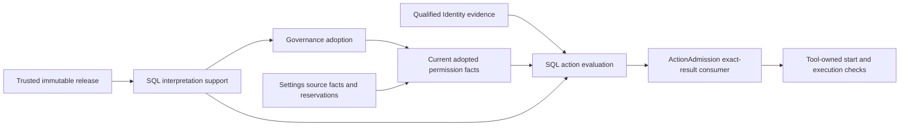

# Transactional permission interpretation

Status: C3b implementation contract adopted by the delivery owner. This extends the dynamic action responsibility of [authorization](authorization-policy.md); the existing static ActionRules path has not yet been replaced. This page does not claim production assembly or acceptance.

## Ownership and binding

The application action permission owner supplies the SQL interpreter. Permissions retains its pure definition validation and rule evaluation. Governance retains contribution leases, adoption and epochs. Settings retains editable values. The release owner supplies immutable definitions and the exact implementation/action/interpretation mapping. Tool retains implementation adoption, availability and execution.

implementationRef identifies the controlled implementation in the trusted release. It does not identify the generic Permissions evaluator or prove an online Tool instance. interpretationRef identifies the implemented rule interpretation. Neither a Tool name nor a caller-provided route proves these facts. This follows [Permissions current reads](../../../../packages/assets/permissions/docs/public-api.md#当前来源消费口) and the [separate assembly states](../../../../packages/assets/docs/governance-contributions.md).

A released interpretation contains the complete EnforcementBinding, exact PermissionDefinitionRef and a finite mapping from every declared value to allow, deny or need-decision. The actual interpreter supports named interpretation versions. An unsupported version is unavailable. Values with permitsOperation=false cannot map to allow or need-decision. A permitted value is not automatically allow. Need-decision identifies a requirement for human authorization, not an issued grant or an already accepted answer.

The trusted release owns the mapping. It is not an editable Settings value or an arbitrary map supplied by the Agent. The consumer supplies the actual controlled implementation and action from its trusted description; the interpreter compares them with the released route. Same-name replacement cannot reuse an old route.

## Two facts with different dependencies

Support resolution checks the exact released route and the installed interpreter's supported version and complete value interpretation. It can run during Governance adoption without requiring the adoption it is helping establish. It produces only supported bindings for that SQL operation. It does not evaluate a user's permission or issue a permit.

Action evaluation additionally consumes current adopted declarations, complete layered Settings values, applicable constraints and qualified identity evidence. The actual participant calls the pure Permissions evaluator and then interprets its selected value. ActionAdmission consumes that actual result; static ActionRules cannot provide fallback allow. A source's unavailable state never becomes absent. The source adapters, not request fields, determine the required constraint set.

Both facts are produced by actual ParticipantModule.execute calls. Module registration and stored manifests do not produce current facts. The SQL combination requires each producer explicitly. The interpreter owns no business tables and reads no foreign private tables; it consumes owner-produced facts through SqlStorage. There is no auxiliary active table or main-thread deployment mirror.

## Total result and ordering

ResolveSupport(release, binding) returns supported or unavailable. Unknown interpretation, mismatched exact implementation/action/definition, malformed or incomplete mapping and unavailable release return unavailable.

Interpret(current, support, original) returns allow, deny, need-decision or unavailable. Invalid material or binding and missing sources return unavailable. Known active prohibition and empty bounds remain deny under the Permissions evaluator's established order. A selected value that prohibits the operation returns deny. A supported human-required value returns need-decision. All results retain exact original action and evidence bindings.

The actual SQL transaction is the ordering point for current contribution/adoption, target facts, values and applicable local constraints. Cross-domain Identity and organization sources use their existing qualified reservations and destination resolution. This protocol does not replace those protocols with an earlier read.

Withdrawal before a new decision prevents consumption of the withdrawn basis. A decision committed first retains its original result. A retry can recover that original result, but cannot turn it into a current fact for a new operation, attempt or action. PermissionBasisSource.readCurrent remains an observation, never a future execution permit. The actual Tool start must consume its precise authorized action boundary or recheck at its owned start boundary; a detached response is not sufficient.

## Lifecycle and assembly

Base session/agent identity checks and systemActionAuthorization start without tenantDomains. Dynamic action assembly separately consumes the tenant domain and permission dependencies. Otherwise authorization requiring tenantDomainLookup and session-storage requiring sessionAccessCheck would form a startup cycle.

Two tenants execute in separate transaction domains. Closing tenant A's contribution does not remove tenant B's sources or interpreter support. Interpreter execution has no mutable cross-call state. Missing code, missing material, a missing required participant or dependency loss fails the operation closed. Contribution fencing, late SQL acceptance, bounded close and original-operation recovery continue to follow Governance and SqlStorage.

The support fact does not promise Tool liveness, action success, rollback of external effects or distributed failure detection. There is no separately unloadable main-thread interpreter whose lifetime must be copied into SQL. If such a resource is introduced later, its owner must define custody and release before claiming the same currentness.

## Built-in Tool release source

The application release owner publishes one invocation permission for each built-in Tool, Shell and Files. It covers all commands of that Tool, matching the existing action-rule granularity. The initial declared values are deny, ask and auto. The default is ask; an absent assignment does not silently reproduce the old static allow. Identity, holding and execution conditions remain independent. Supported authorization scopes describe one original call, one logical session and the tenant. No grant is issued by declaring these scopes.

The source is part of format 2 of [tool-release.json](../../config/tool-release.json). The same [composition function](../../src/entry/tool-release-manifest.ts) generates the file and recomputes it at startup. Permissions, their Settings projections and interpretation mappings are compared with that recomputation. An added or changed sidecar is not accepted as release authority.

[tool-permission-release.ts](../../src/entry/tool-permission-release.ts) owns the declaration and its digest algorithm. It builds the complete declaration and interpretation with a fixed version placeholder, hashes that canonical draft, then builds the final material with the resulting version. The draft includes the exact Tool adoption, full module location and executor identity, artifact digest, definition digest, permission semantics and Settings presentation. A source change therefore changes the version, assuming SHA-256 collision resistance. The final declaration has a separate full-body digest. Mutable tenant assignments are never inputs to either digest.

The immutable origin is an asset release. The asset identifier is stable for the built-in Tool; the release reference includes the content-derived version. Same-name implementation replacement therefore does not inherit the prior concrete origin's assignments or grants. Stable capability and enforcement identities remain available for the independently owned capability constraints.

[tool-definition-source.ts](../../src/rows/governance/tool-definition-source.ts) resolves only the complete owner/definition/version tuple from the trusted release snapshot. It has no tenant argument and never reads a tenant-editable copy as authority. Each result is an isolated copy. A missing source, unknown tuple or source failure returns unavailable.

The SQL [release participant](../../src/rows/governance/tool-release-participant.ts) independently loads and verifies the actual release during module initialization. Its material URL and participant protocol bind the expected generation. The protocol enters the SQL manifest; changing generation changes that manifest. The module produces the immutable release fact during execute only when its verified generation matches. Command facts cannot replace the release body. A failed load or generation mismatch fails closed.

This snapshot is an immutable publication, not a current adoption or online Tool assertion. Reload requires new material adoption; file edits do not mutate an already loaded release or refresh an existing SQL combination. The support and decision participants consume this publication, while current target/adoption/value producers retain their own transaction and lifecycle responsibilities.

Current source verification covers the actual release producer, tuple resolution, tamper refusal and real Worker consumption. The current-target adapter is implemented; its production assembly and ActionAdmission wiring are still incomplete. The current SQL scenario uses a named current-permission fixture and does not establish complete C3b acceptance.

## Tool asset publication

[tool-assets.ts](../../src/rows/governance/tool-assets.ts) adapts the trusted Tool release to the public Assets category contract. The fixed body contains the Tool adoption, module, definition digest and complete governance declaration reference (owner, definition, version and digest). The declaration body remains in the verified release; the asset does not duplicate that body. It excludes the containing manifest generation and holding evidence: changes to an unrelated Tool must not change this asset body under the same version.

A change to the asset body format requires a new Tool publication version. The category accepts only a body that matches the trusted release at the exact Tool name and content-derived version. It projects the Settings definition from that same release. Assets retains publication, holdings, enablement and version selection. The adapter does not read Assets tables or create a second registry of holding state.

The expected publication reference includes the asset identifier, category, name, version, source and SHA-256 digest of the Assets JSON tree. Consumers must compare the complete reference with the native Assets publication fact. A matching Settings definition alone does not prove the original publication. Publishing a body does not establish a holding, configuration rights or execution permission.

The Assets owner can supply its publication and Settings projection in one transaction. The Governance current adapter must bind these facts to the same request, target, owner revision and complete definition. The application current-target participant implements this join. Production adoption assembly, independent feature issuance and the ActionAdmission consumer remain incomplete.

## Current-target composition

[adoption-current.ts](../../src/rows/governance/adoption-current.ts) constructs the capture commands from the admitted Governance operation binding. The capture keeps the exact tenant reference, principal, deployment and transaction domain. Its identifier derives from the complete operation binding. It uses runtime mode and does not require an adoption result that it is helping establish.

The [participant](../../src/rows/governance/adoption-current-participant.ts) requires the native Assets and standalone Settings publication and definition facts, immutable publication mappings, and actual interpreter support. [current-targets.ts](../../src/rows/governance/current-targets.ts) joins the native facts on the complete target. It requires one view from each corresponding owner, equal request bindings and owner revisions, and the exact publication mapping. The complete Settings definition and its digest must match the immutable declaration. Missing, ambiguous, disabled or unsupported targets fail the operation.

The participant emits the existing Governance adoption-current fact. It reads no tables and stores no state. Governance still checks the active contribution set, selection, epoch and required enforcement bindings in its own adoption transaction. The current fact is not an adoption result, a caller authorization or an execution permit.

The immutable Tool issuer supplies asset publication mappings today. The same join has an independent publication variant, but a real independent feature issuer remains required before that path can be accepted. A schema variant or synthetic test is not that issuer.

## Current catalog composition

[catalog-current.ts](../../src/rows/governance/catalog-current.ts) constructs native captures for a Governance catalog request. Management captures retain disabled targets. The current adapter reports unresolved publications through unavailable owners instead of claiming a complete empty source. Governance owns the runtime filtering and checks every selected target, including targets outside a requested display filter.

The adapter returns no assignment values and reads no private owner tables. Its result is a transaction fact, not a cached session authorization. The public catalog snapshot supplies the declaration and adoption revisions used by the next adoption command. Consumers must obtain those revisions rather than assume an initial revision.

The real-service combination test covers Identity reservations, Tool publication, Assets holding, contribution, catalog, adoption, disabled-target filtering, original-operation lookup and withdrawal. A rejected current-source transaction is sealed by the coordinator. Its command then reports a basis conflict, and operation lookup provides the not-committed seal. This does not replace production row assembly or ActionAdmission acceptance.

## Verification obligations

[GovernanceEnforcementExecution](../../../../packages/human-intervention/human-intervention/verification/models/GovernanceEnforcementExecution.tla) models exact implementation selection, actual execution, withdrawal ordering, historical receipt reuse and two-tenant isolation. Its finite state and atomic transaction assumptions do not prove the actual providers.

Production acceptance must use actual SqlStorage, Identity, Settings/Assets source facts and the release producer. It must swap same-name implementations, omit the interpreter, omit each required source, reorder withdrawal and decision, replay an old receipt for a new action, and close one of two tenants. It must show allow, deny, unavailable and need-decision through the real ActionAdmission. The existing Governance-local suite is not this acceptance evidence.

## Freshness at call boundaries

The delivery owner accepted this application guarantee on 2026-11-07. It remains an implementation obligation, not a claim that the current production composition already meets it.

For next-read settings and current permission rules, a new call that begins its adoption boundary after a successful update must use that update or a later effective state of the same source. Concurrent updates and calls follow the source transaction or reservation order. Revisions from different sources or lifecycle generations are not compared as numbers. Replacement requires current qualification again. If current material cannot be established, the dependent operation is unavailable; it cannot reuse an earlier allow result.

Runtime Context supplies qualified material and change observations. Settings retains assignment authority; Permissions and Authorization retain interpretation and admission. The consumer fixes the material used for each request or call. An existing session is not a permanent configuration snapshot. Calls that require admission again after waiting must perform that admission again.

Notifications may be delayed, lost, duplicated or reordered. They are wakeups, not proof of freshness. The next read must consult or validate the authoritative source. Updating all live session caches is not a prerequisite for completing the source write. Context does not replace the permission checks at actual admission or protected commit.

The declared adoption modes remain distinct. Next-boundary values apply at the owner's specified boundary; reload and creation values apply at their declared lifecycle points. Saving a value does not prove that a reload-only consumer has adopted it. A policy change does not answer an existing human-intervention card or undo an external effect.

## Atomic target inputs

[target-snapshot.ts](../../src/rows/governance/target-snapshot.ts) composes the actual Governance target observation, native Assets/standalone publication facts, Settings-owned assignment projection, immutable issuer and SQL interpretation support in one logical transaction. The application owns the relation join and no tables.

The join requires the exact capture binding for all inputs. The assignment view must match the complete native target projection, including owner revision, definition, source layout and grants. The immutable publication mapped from the native owner must contain the same complete Governance declaration as the current contribution. Required enforcement bindings must be present in actual interpreter support.

Management mode can observe a contributed declaration before adoption and can retain disabled target values. Runtime mode requires current adoption and native enablement. Missing sources, another capture, changed publication, withdrawal or an unsupported interpreter cannot produce a snapshot. No earlier snapshot is reused for a new operation.

This snapshot supplies current target inputs. It does not yet assemble organization/session permission assignments, Agent constraints or Identity reservations for the consuming action. It emits no allow decision or execution permit. ActionAdmission and protected Settings commands remain responsible for their complete qualified consumption.

The [protected Settings current composition](settings-preparation.md) consumes this snapshot for initial capture and fresh ready/commit facts. Its native source grants authorize Settings mutations only. They do not constitute permission to execute the corresponding Tool action.
