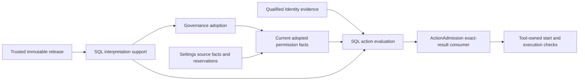
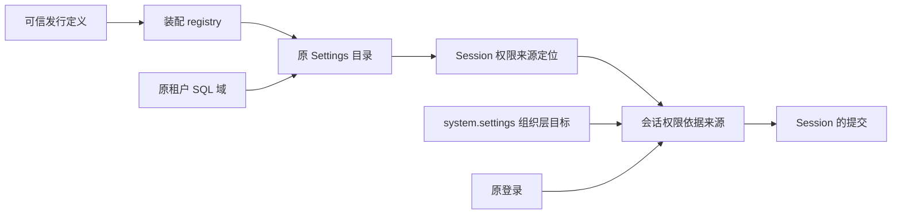

# Transactional permission interpretation

Status: C3b implementation contract adopted by the delivery owner. Agent and Tool admission adapters now require a current permission check after a static allow. The production row supplies this dependency through the current Governance service. A static allow only permits this further check; it does not authorize execution. Assembly tests and independent delivery acceptance are separate evidence.

## Current consumer

[createCurrentToolPermission](../../src/rows/authorization/current-tool-permission.ts) reads the exact adopted Tool release and the original action's current PermissionBasisSource. The trusted request mapper locates the target; the source still qualifies the actual principal and original action. A mapped request must match the tenant, organization, Session work identity, operation, arguments digest and released implementation. The returned current request must match the mapped request exactly.

The consumer uses the same interpretPermission function as the SQL interpreter below. Known prohibitions remain denials when another source is unavailable. Missing sources, substituted declarations and stale operation bindings are unavailable. Need-decision remains unavailable at these adapters until the HITL consumer is installed; it never becomes implicit allow. Each call reacquires dependencies and reads current facts. A successful read is not a reusable execution permit.

The current source receives a service context containing the original issued principal and an owner locator. Agent locators carry execution, passage, action and advance. Tool locators carry call and the fixed request. The consumer snapshots these locator values before awaiting dependencies and preserves the original principal object. The permission basis read verifies the principal with the Identity verifier and passes the context to the qualification port of the original owner. The locator is input to owner qualification, not proof of qualification; the production owner projections remain required.

The ordinary admission factories require a readPermission dependency. The production authorization row connects Governance, Session assignments and the original AgentDefinition constraints. Consumer tests with named source fixtures verify their own boundary; native SQL and default-release tests verify the actual composition. Neither fixture tests nor source presence alone establish delivery acceptance.

### Admission invariant

For one fixed action `a`, let `I(a)` be successful current identity qualification, `S(a)` be a matching static allow with no matching static deny, and `C(a)` be an exact current reading interpreted as allow. These adapters return allow only when `I(a) ∧ S(a) ∧ C(a)` holds. An absent dependency makes its conjunct false for admission; it does not manufacture an empty constraint set. Static deny is terminal before the permission dependency.

The implementation preserves this invariant by ordered branches. Identity failure exits before permission consumption. Static deny exits before readPermission. The only remaining allow branch consumes a current permission allow. CurrentToolPermission first matches the original operation and returned request, then delegates to interpretPermission. That interpreter preserves known prohibitions and requires all applicable sources before an effective allow. Agent evidence combines the identity/static-rule evidence with the current permission evidence.

This is a source-level argument, not a machine proof of the providers or distributed linearizability. It assumes the current source authenticates its principal, qualifies the original action and reports owner facts faithfully. Production owner projections and source assembly must establish those assumptions. Rechecking at Tool start does not undo an effect already started.

## Current permission basis: one read and one commit condition

[createPermissionBasisRead](../../src/rows/governance/permission-basis-read.ts) computes the current permission of one action. A check is a read. It sends no commit, starts no Governance operation, and holds no Identity or Settings reservation.

One check does these steps in order:

1. It verifies the principal and reads the current tenant standing from Identity. A principal that is not a member is denied. An unreadable standing is unavailable.
2. It maps the action to its permission request and target with the trusted [request mapper](../../src/rows/governance/permission-read-mapping.ts). The mapper reads nothing. The target is the address at which the installation holds the Tool, and the organization source has a fixed address. An address is not evidence that the target exists: steps 4 and 5 read the facts at these addresses, and the commit condition checks them again. The mapper runs one time for each check, and the reading carries the mapped request. The authorization row accepts the reading only when that request belongs to the action and to the release.
3. It asks the original owner to qualify the action. [qualifyAgentPermission](../../src/rows/governance/agent-permission-qualification.ts) consumes AgentActionQualification. [qualifyToolPermission](../../src/rows/governance/tool-permission-qualification.ts) consumes the qualification port of the Tool owner and, for a call with an Agent origin, AgentToolQualification. The [qualification result](../../src/rows/governance/permission-qualification.ts) carries the Session permission observation, the configuration case and the bound of the original Agent definition. It is a value of one check and is not stored.
4. It runs one [projection read](../../src/rows/governance/projection-read.ts). The read executes a list of read-only participant commands in one snapshot of the tenant domain: the target snapshot commands, the Session permission guard and the [basis participant](../../src/rows/governance/permission-basis-participant.ts). The basis participant joins the target snapshot with the Session permission fact and the constraints of the origin, and gives the tenant-domain basis.
5. It reads the organization source from `system.settings` with the Settings source observation read and adds the organization layer to the evaluation.
6. It answers the reading. With a current reading it also answers the commit condition: the reference of the registered combination, the same command list, and a [guard command](../../src/rows/governance/permission-basis-guard-participant.ts) that carries the digest of the basis.

Each owner reads its own tables in its own participant module. The projection read handler does not know a table or a domain rule. It executes the commands on the read connection and passes facts between them. Its read tables are the union of the tables that the member participants declare.

### Commit point

The acceptance of a Tool call is the only commit that uses the basis. [tool-target-policy.ts](../../src/rows/authorization/tool-target-policy.ts) returns the allow verdict with the condition. The Tool start coordinator commits its ledger command together with the condition commands in one transaction, under the `toolStart` or `toolStartUnmapped` combination. The commands run again in that transaction. The guard compares the digest of the new basis with the digest that the check saw.

If a tenant-domain fact changed after the check, the Session permission guard or the basis guard stops the transaction. The whole commit rolls back. The Tool storage adapter answers `condition-failed`, and the coordinator reads again and decides again with a new check. Agent action admission and Tool preparation use the reading only; they send no commit and carry no condition.

Let `B(t)` be the tenant-domain basis at time `t`, `c` the time of the check and `k` the time of the acceptance commit. The acceptance commits only when `digest(B(k)) = digest(B(c))`. `B` contains the Governance target and adoption facts, the Settings projection and tenant value, the Assets publication, the immutable release and interpreter support, and the Session permission fact. A change of one of these facts between `c` and `k` therefore cannot commit an acceptance that the old basis allowed.

### Facts outside the condition

Identity standing and the organization source are in other transaction domains. They are read new for each check and are never cached. The condition does not read them again. A change of these facts after the check applies to the next check.

The execution revision of the Agent and the Tool records are not part of the basis. An Agent that commits its own progress during a check does not invalidate the check. The original owner proves the action in step 3, at the time of each check.

A reading is an observation. It is not a reusable execution permit: each check reacquires its dependencies and reads current facts.

### Evidence and its limits

This is a conditional implementation argument. It assumes the source authority of each owner, the immutable release and the snapshot and transaction semantics of SqlStorage. It does not prove cross-process linearizability and does not protect an external effect after acceptance.

- [permission-basis.spec.ts](../../tests/rows/governance/permission-basis.spec.ts) runs the basis participant and the guard with explicit facts.
- [permission-basis-read.spec.ts](../../tests/rows/governance/permission-basis-read.spec.ts) reads the basis of a real Agent action with the real provider, Session storage, Agent journal and adopted Governance. It checks that a check sends no commit, that Agent progress during a check does not stop it, and that the condition stops a commit after the adoption is withdrawn. Its world is the mapped configuration.
- [projection-read.spec.ts](../../tests/rows/governance/projection-read.spec.ts) covers the generic read handler.
- [release-depth.spec.ts](../../tests/rows/storage/release-depth.spec.ts) and [release-tool-delivery.spec.ts](../../tests/rows/tool-runtime/release-tool-delivery.spec.ts) run the default release tree. The second file runs a batch of several Tool calls to completion.

### Forwarded Tool calls

For a forwarded call, the Tool owner returns the verified original invocation, which is the parent invocation. The application uses its consumer only to require Agent proof and route the query. An Agent consumer without AgentToolQualification is unavailable; it cannot become a non-Agent source. The Agent query matches the original saved intent or persistent binding and returns its exact Agent adoption. The application resolves that adoption and keeps its permission bound. The bound is mandatory. A known empty bound stays a denial when another source is unavailable.

[tool-agent-qualification-sql.spec.ts](../../tests/rows/governance/tool-agent-qualification-sql.spec.ts) covers the recognition of the original Agent from a saved Tool intent and from its binding after a new Journal instance.

## Session assignment projection

[sessionPermissionSource](../../src/rows/governance/permission-session-current.ts) consumes the public Session current observation. An absent assignment stays absent with its revision. An assignment for the exact permission definition retains its rule. An assignment for an old definition makes this source unavailable, while prohibitions from other sources remain effective. A wrong tenant, Session or enforcement binding gives no reading. The mode is guarded as original Session state; this path does not translate it into a permission override. Inquiry translation belongs to the published Session mode view.

## Ownership and binding

The application action permission owner supplies the SQL interpreter. Permissions retains its pure definition validation and rule evaluation. Governance retains contribution leases, adoption and epochs. Settings retains editable values. The release owner supplies immutable definitions and the exact implementation/action/interpretation mapping. Tool retains implementation adoption, availability and execution.

implementationRef identifies the controlled implementation in the trusted release. It does not identify the generic Permissions evaluator or prove an online Tool instance. interpretationRef identifies the implemented rule interpretation. Neither a Tool name nor a caller-provided route proves these facts. This follows [Permissions current reads](../../../../packages/assets/permissions/docs/public-api.md#当前来源消费口) and the [separate assembly states](../../../../packages/assets/docs/governance-contributions.md).

A released interpretation contains the complete EnforcementBinding, exact PermissionDefinitionRef and a finite mapping from every declared value to allow, deny or need-decision. The actual interpreter supports named interpretation versions. An unsupported version is unavailable. Values with permitsOperation=false cannot map to allow or need-decision. A permitted value is not automatically allow. Need-decision identifies a requirement for human authorization, not an issued grant or an already accepted answer.

The trusted release owns the mapping. It is not an editable Settings value or an arbitrary map supplied by the Agent. The consumer supplies the actual controlled implementation and action from its trusted description; the interpreter compares them with the released route. Same-name replacement cannot reuse an old route.

## Two facts with different dependencies

Support resolution checks the exact released route and the installed interpreter's supported version and complete value interpretation. It can run during Governance adoption without requiring the adoption it is helping establish. It produces only supported bindings for that SQL operation. It does not evaluate a user's permission or issue a permit.

Action evaluation additionally consumes current adopted declarations, complete layered Settings values, applicable constraints and qualified identity evidence. The actual participant calls the pure Permissions evaluator and then interprets its selected value. ActionAdmission consumes that actual result; static ActionRules cannot provide fallback allow. A source's unavailable state never becomes absent. The source adapters, not request fields, determine the required constraint set.

Both facts are produced by actual ParticipantModule.execute calls. Module registration and stored manifests do not produce current facts. The SQL combination requires each producer explicitly. The interpreter owns no business tables and reads no foreign private tables; it consumes owner-produced facts through SqlStorage. There is no auxiliary active table or main-thread deployment mirror.

## Total result and ordering

ResolveSupport(release, binding) returns supported or unavailable. Unknown interpretation, mismatched exact implementation/action/definition, malformed or incomplete mapping and unavailable release return unavailable.

Interpret(current, support, original) returns allow, deny, need-decision or unavailable. Invalid material or binding and missing sources return unavailable. Known active prohibition and empty bounds remain deny under the Permissions evaluator's established order. A selected value that prohibits the operation returns deny. A supported human-required value returns need-decision. All results retain exact original action and evidence bindings.

The acceptance transaction is the ordering point for current contribution/adoption, target facts, tenant values and the Session permission fact. Identity standing and the organization source are in other domains. They are read for each check and are not part of that transaction.

Withdrawal before the acceptance commit prevents consumption of the withdrawn basis: the condition stops the commit. An acceptance committed first retains its original result. PermissionBasisSource.readCurrent remains an observation, never a future execution permit. The Tool start consumes the reading together with its condition at its owned acceptance boundary; a detached response is not sufficient.

## Lifecycle and assembly

The tenant factory registers one projection read handler and two start combinations, one for each configuration case. The three origins (an Agent action, a Tool call, and a Tool call with an Agent origin) use the same basis participant. They differ only in the constraints that the original owner supplies. A Tool call without an Agent origin does not produce a substitute Agent fact.

For a permission with a Settings mapping, the application resolves a unique target from the actual Settings directory and compares the complete definition. For a permission with settings:null, it uses the shared Tool holding address and reads the actual Assets publication and selected Governance definition. Both paths bind the original Session work principal, operation, arguments and released interpretation. Missing required targets or original qualification ports return unavailable. A target address alone does not authorize the action.

Base session/agent identity checks and systemActionAuthorization start without tenantDomains. Dynamic action assembly separately consumes the tenant domain and permission dependencies. Otherwise authorization requiring tenantDomainLookup and session-storage requiring sessionAccessCheck would form a startup cycle.

Governance publishes the trusted application service `currentToolPermission`. Its request mapping and current reading first verify the original Session work principal and current tenant standing. Only then can the service open that tenant's runtime. It copies action data before asynchronous work and retains the issued principal identity. A retired service cannot return a successful reading through an old reference.

Authorization uses the same current check for Agent action admission and Tool target admission. It reads this service on each call, without a static dependency on Governance or either runtime. It also reads the Session mode recovery port and the RuntimeContext inquiry publication on each call. Missing dependencies return unavailable for the affected decision; they do not prevent base identity admission from starting. The inquiry policy cannot override a structural prohibition.

Two tenants execute in separate transaction domains. Closing tenant A's contribution does not remove tenant B's sources or interpreter support. Interpreter execution has no mutable cross-call state. Missing code, missing material, a missing required participant or dependency loss fails the operation closed. Contribution fencing, late SQL acceptance, bounded close and original-operation recovery continue to follow Governance and SqlStorage.

The support fact does not promise Tool liveness, action success, rollback of external effects or distributed failure detection. There is no separately unloadable main-thread interpreter whose lifetime must be copied into SQL. If such a resource is introduced later, its owner must define custody and release before claiming the same currentness.

## Built-in Tool release source

The application release owner publishes one invocation permission for each built-in Tool, Shell and Files. It covers all commands of that Tool, matching the existing action-rule granularity. The initial declared values are deny, ask and auto. The default is ask; an absent assignment does not silently reproduce the old static allow. Identity, holding and execution conditions remain independent. Supported authorization scopes describe one original call, one logical session and the tenant. No grant is issued by declaring these scopes.

The source is part of format 2 of [tool-release.json](../../config/tool-release.json). The same [composition function](../../src/entry/tool-release-manifest.ts) generates the file and recomputes it at startup. Permissions, their Settings projections and interpretation mappings are compared with that recomputation. An added or changed sidecar is not accepted as release authority.

[tool-permission-release.ts](../../src/entry/tool-permission-release.ts) owns the declaration and its digest algorithm. It builds the complete declaration and interpretation with a fixed version placeholder, hashes that canonical draft, then builds the final material with the resulting version. The draft includes the exact Tool adoption, full module location and executor identity, artifact digest, definition digest, permission semantics and Settings presentation. A source change therefore changes the version, assuming SHA-256 collision resistance. The final declaration has a separate full-body digest. Mutable tenant assignments are never inputs to either digest.

The immutable origin is an asset release. The asset identifier is stable for the built-in Tool; the release reference includes the content-derived version. Same-name implementation replacement therefore does not inherit the prior concrete origin's assignments or grants. Stable capability and enforcement identities remain available for the independently owned capability constraints.

[tool-definition-source.ts](../../src/rows/governance/tool-definition-source.ts) resolves only the complete owner/definition/version tuple from the trusted release snapshot. It has no tenant argument and never reads a tenant-editable copy as authority. Each result is an isolated copy. A missing source, unknown tuple or source failure returns unavailable.

The SQL [release participant](../../src/rows/governance/tool-release-participant.ts) independently loads and verifies the actual release during module initialization. Its material URL and participant protocol bind the expected generation. The protocol enters the SQL manifest; changing generation changes that manifest. The module produces the immutable release fact during execute only when its verified generation matches. Command facts cannot replace the release body. A failed load or generation mismatch fails closed.

This snapshot is an immutable publication, not a current adoption or online Tool assertion. Reload requires new material adoption; file edits do not mutate an already loaded release or refresh an existing SQL combination. The support and decision participants consume this publication, while current target/adoption/value producers retain their own transaction and lifecycle responsibilities.

Current source verification covers the actual release producer, tuple resolution, tamper refusal and real Worker consumption. The default production assembly connects the current-target adapter to ActionAdmission. The release-producer SQL scenario uses a named current-permission fixture; it does not prove the complete production chain.

## Tool asset publication

[tool-assets.ts](../../src/rows/governance/tool-assets.ts) adapts the trusted Tool release to the public Assets category contract. The fixed body contains the Tool adoption, module, definition digest and complete governance declaration reference (owner, definition, version and digest). The declaration body remains in the verified release; the asset does not duplicate that body. It excludes the containing manifest generation and holding evidence: changes to an unrelated Tool must not change this asset body under the same version.

A change to the asset body format requires a new Tool publication version. The category accepts only a body that matches the trusted release at the exact Tool name and content-derived version. It projects the Settings definition from that same release. Assets retains publication, holdings, enablement and version selection. The adapter does not read Assets tables or create a second registry of holding state.

The expected publication reference includes the asset identifier, category, name, version, source and SHA-256 digest of the Assets JSON tree. Consumers must compare the complete reference with the native Assets publication fact. A matching Settings definition alone does not prove the original publication. Publishing a body does not establish a holding, configuration rights or execution permission.

The Assets owner can supply its publication and Settings projection in one transaction. The Governance current adapter must bind these facts to the same request, target, owner revision and complete definition. The application current-target participant implements this join. The default Tool adoption assembly and ActionAdmission consumer are connected. Independent feature issuance still requires a real issuer before that path can be accepted.

## Current-target composition

[adoption-current.ts](../../src/rows/governance/adoption-current.ts) constructs the capture commands from the admitted Governance operation binding. The capture keeps the exact tenant reference, principal, deployment and transaction domain. Its identifier derives from the complete operation binding. It uses runtime mode and does not require an adoption result that it is helping establish.

The [participant](../../src/rows/governance/adoption-current-participant.ts) requires the native Assets and standalone Settings publication and definition facts, immutable publication mappings, and actual interpreter support. [current-targets.ts](../../src/rows/governance/current-targets.ts) joins the native facts on the complete target. It requires one view from each corresponding owner, equal request bindings and owner revisions, and the exact publication mapping. The complete Settings definition and its digest must match the immutable declaration. Missing, ambiguous, disabled or unsupported targets fail the operation.

The participant emits the existing Governance adoption-current fact. It reads no tables and stores no state. Governance still checks the active contribution set, selection, epoch and required enforcement bindings in its own adoption transaction. The current fact is not an adoption result, a caller authorization or an execution permit.

The immutable Tool issuer supplies asset publication mappings today. The same join has an independent publication variant, but a real independent feature issuer remains required before that path can be accepted. A schema variant or synthetic test is not that issuer.

## Current catalog composition

[catalog-current.ts](../../src/rows/governance/catalog-current.ts) constructs the native read commands for a Governance catalog request. Governance runs them in the projection read that the assembly supplies; a catalog read sends no commit. Management reads retain disabled targets. The current adapter reports unresolved publications through unavailable owners instead of claiming a complete empty source. Governance owns the runtime filtering and checks every selected target, including targets outside a requested display filter.

The adapter returns no assignment values and reads no private owner tables. Its result is a fact of one read, not a cached session authorization. The public catalog snapshot supplies the declaration and adoption revisions used by the next adoption command. Consumers must obtain those revisions rather than assume an initial revision.

The real-service combination test covers Identity reservations, Tool publication, Assets holding, contribution, catalog, adoption, disabled-target filtering, original-operation lookup and withdrawal. A rejected current-source transaction is sealed by the coordinator. Its command then reports a basis conflict, and operation lookup provides the not-committed seal. This does not replace production row assembly or ActionAdmission acceptance.

## Verification obligations

[GovernanceEnforcementExecution](../../../../packages/governance/governance-local/verification/models/GovernanceEnforcementExecution.tla) models exact implementation selection, actual execution, withdrawal ordering, historical receipt reuse and two-tenant isolation. Its finite state and atomic transaction assumptions do not prove the actual providers.

Production acceptance must use actual SqlStorage, Identity, Settings/Assets source facts and the release producer. It must swap same-name implementations, omit the interpreter, omit each required source, reorder withdrawal and decision, replay an old receipt for a new action, and close one of two tenants. It must show allow, deny, unavailable and need-decision through the real ActionAdmission. The existing Governance-local suite is not this acceptance evidence.

## Freshness at call boundaries

The delivery owner accepted this application guarantee on 2026-11-07. It remains an implementation obligation, not a claim that the current production composition already meets it.

For next-read settings and current permission rules, a new call that begins its adoption boundary after a successful update must use that update or a later effective state of the same source. Concurrent updates and calls follow the source transaction or reservation order. Revisions from different sources or lifecycle generations are not compared as numbers. Replacement requires current qualification again. If current material cannot be established, the dependent operation is unavailable; it cannot reuse an earlier allow result.

Runtime Context supplies qualified material and change observations. Settings retains assignment authority; Permissions and Authorization retain interpretation and admission. The consumer fixes the material used for each request or call. An existing session is not a permanent configuration snapshot. Calls that require admission again after waiting must perform that admission again.

Notifications may be delayed, lost, duplicated or reordered. They are wakeups, not proof of freshness. The next read must consult or validate the authoritative source. Updating all live session caches is not a prerequisite for completing the source write. Context does not replace the permission checks at actual admission or protected commit.

The declared adoption modes remain distinct. Next-boundary values apply at the owner's specified boundary; reload and creation values apply at their declared lifecycle points. Saving a value does not prove that a reload-only consumer has adopted it. A policy change does not answer an existing human-intervention card or undo an external effect.

## Atomic target inputs

[target-snapshot.ts](../../src/rows/governance/target-snapshot.ts) composes the actual Governance target observation, native Assets/standalone publication facts, Settings-owned assignment projection, immutable issuer and SQL interpretation support in one logical transaction. The application owns the relation join and no tables.

The join requires the exact capture binding for all inputs. The assignment view must match the complete native target projection, including owner revision, definition, source layout and grants. The immutable publication mapped from the native owner must contain the same complete Governance declaration as the current contribution. Required enforcement bindings must be present in actual interpreter support.

Management mode can observe a contributed declaration before adoption and can retain disabled target values. Runtime mode requires current adoption and native enablement. Missing sources, another capture, changed publication, withdrawal or an unsupported interpreter cannot produce a snapshot. No earlier snapshot is reused for a new operation.

This snapshot supplies current target inputs. The permission basis participant adds the Session permission fact and the constraints of the origin; the permission basis read adds the organization layer and the Identity standing. The snapshot emits no allow decision or execution permit. ActionAdmission and protected Settings commands remain responsible for their complete qualified consumption.

No application row writes Settings values in this release, so no Settings preparation consumes this snapshot. The native source grants of a target authorize Settings mutations only. They do not constitute permission to execute the corresponding Tool action.

## Agent 定义上界投影

`readAgentPermissionConstraint` 调用 AgentAdoptions.resolve 读取原动作的精确 Adoption。已有定义的空允许集合投影成禁止；未声明该关口时投影为当前权限定义的完整值集合，仍受其他约束限制。解析失败或声明值不受支持时返回 unavailable，不能默认空约束。来源和修订包含精确采用依据，不使用定义名查找最新发布。

该适配器只做读取与投影。调用方仍须经 Agent 或 Tool 拥有者认回原动作、采用和 Session 关系，并保护可变事实的当前性。当前公开采用服务组合测试证明声明保真及求值，不证明生产 row 已装配，也不证明真实动作资格闭环。

## Session 配值写入

会话层的权限配值归 Session。写入是 Session 的一次提交，回执归 Session。Governance 不保管这次写入，只在提交里供应当前定义的只读事实。提交顺序、认回和失败语义归 Session 存储的[受保护提交](../../../../packages/session/session-storage-sql/docs/commit-basis.md#受保护提交)。应用实现它的依据来源和依据参加者。

### 依据来源

[session-permission-basis-source.ts](../../src/rows/governance/session-permission-basis-source.ts) 实现 `SessionProtectedBasisSource`。Session 的提交只在原操作没有已提交的回执时调用它。每次调用按当时的事实执行以下各步：

1. 核对写资格属于这条命令：租户、会话、操作、完整命令摘要、期望权限修订、主体引用和自主管理政策。不符时答 denied。
2. 经 Identity 核对原登录仍有效。登录已撤回时答 denied，读不到时答 unavailable。
3. 清除不查当前声明，直接给出 clear 组合的计划。声明卸载不会阻止清除已存项。
4. 设值经受信目录读能力发现精确声明。目录管理资格属于该读能力的持有者，不附加到会话编辑用户。发现按完整权限引用、capabilityId 和 enforcementKey 查找唯一声明。management 目录必须完整、属于原 scope，并在同一依据下结束分页。冲突游标、部分结果、重复匹配、不可用声明和查询异常均答 unavailable。读取上界为 128 页及 128 个目录项。
5. 声明带 Settings 映射时，来源解析原租户内唯一的目标和组织来源地址，再用 `readSettingsSource` 读组织层的当前值。这次读取不预留来源，也不保管读到的值。
6. 给出组合与命令：定义投影命令、映射存在时的目标快照命令，以及依据参加者的命令。

来源不缓存，也不跨调用保存选择。登录资格与组织层的值在另一个事务域，提交的事务读不到它们。它们的当前性止于这次读取。租户域的事实由提交里的参加者重新读取。

### 依据参加者

`harness.session-permission-basis.{clear,unmapped,mapped}` 在提交的事务里产生 Session commit-basis。它的输入是自己的命令 facts：Session 命令、写资格的四项、声明内容、选中的定义绑定、权限求值范围和组织层的值。它还消费同事务的 `governance.definition-projection`。映射存在时，它另外消费 management TargetSnapshot。

参加者要求投影的绑定等于来源选中的绑定。然后它用投影的声明、同事务的租户原值和命令里的组织层的值做 Permissions 的配值判断。判断使用各层原配值，不使用 Settings 合并后的有效值。组织与租户的确定禁止不能被 Session 的配值覆盖。组织层读不到时，它按 unavailable 进入判断；已知的租户禁止仍然成立。当前 SQL 适配对已配置但尚未接入拥有者事实的必需约束发布 unavailable，不从空来源推导许可。

`sessionPermissionMaterial` 采用本地应用政策 `settings-projection-only/1`。该政策以声明的 Settings 投影作为组织与租户原配值的唯一后端。只有当前声明已认回且映射为空时，适配器才生成缺席事实。增加其他原配值后端时必须修改此政策。

依据不成立时，参加者报告失败，事务回滚，Session 的提交按暂时失败答 unavailable。因此下列情况都不能产生写入：发现之后声明被撤下；目标或租户层的值变化后不再允许；来源给出的定义与提交里的投影不一致。Session 自己核对期望修订，修订过期时答 changed。

### 重传与失败

同一原操作的重传由 Session 的提交认回，并标记 recovered。认回不调用来源。原操作提交之后，声明撤下或组织层改值都不改变重传的答复。同一操作换了内容时答 conflict。

失败的投递不留按原操作的持久裁定。条件恢复后，同一原操作重来时按当时的事实重新裁定。这与 Session 的其他命令一致。

有限模型 [SessionPermissionWrite](../../../../packages/session/session-storage-sql/verification/protected-basis/README.md) 检查上述顺序，模型与实现的对应见该说明。

### 证据

[真实写入组合用例](../../tests/rows/governance/session-permission-write-native.spec.ts)使用实际 Identity 登录、Governance 注册、依据来源、依据参加者、Session 写者与 SQLite。它覆盖无映射设值、发现后撤下、必需约束缺失、过期修订、卸载后清除、定义不一致和缺来源。它还断言三件事：整笔写入只有一次存储提交，并且 Governance 不收命令；声明撤下后重传仍认回；失败后重新登记声明，同一原操作成功。

[映射写入用例](../../tests/rows/governance/session-permission-write-mapped.spec.ts)使用真实 Settings 目录、租户层的值和组织来源。它覆盖组织禁止、租户禁止和来源不存在，并断言组织层改值后的下一次写入按新值裁定。

声明发布源与组合登记由测试装配提供，普通 Session 创建使用具名夹具。默认行的接线由[全行用例](../../tests/rows/storage/session-permission-live.spec.ts)和发行树的 deny-update 场景验证。[来源用例](../../tests/rows/governance/session-permission-material.spec.ts)使用具名快照，不是实际来源竞争验证。

## 租户实例的准备、开启与恢复

[tenant-runtime.ts](../../src/rows/governance/tenant-runtime.ts) 用拥有者的公开端口组合一个租户治理实例。调用方提供完整 scope、已登记的原租户事务域、目录读者、Identity 端口、定义来源、grants 和所需 Settings 来源。工厂核对 scope、域和读者的租户相同，并用原 verifier 核验读者。错误绑定在登记组合前失败。目录读者与原编辑用户分别保留，工厂不增补目录授予或业务许可。

prepareTenantGovernance 先固定数据配置和组合引用，返回 Identity 的结算目的地。装配应先发布这条路由，再调用 open；否则历史恢复可能找不到原目的地。SQL 登记描述包含参加者列表，提交引用只包含组合版本和摘要，应用在这里显式转换。业务服务不消费登记描述的附加字段。

同一个 prepared 对象只拥有一次开启尝试。open 先保存 Promise，再通过微任务进入核验和登记，因此普通并发与核验器同步重入都取得同一个尝试。成功或失败结果均保留。重试和重装配创建新的 prepared 对象，仍使用原 scope、事务域及组合身份；部分登记不声称回滚。

实例服务及 close 来自 createGovernanceLocal。会话权限的依据来源由本工厂用同一实例的目录读能力构造。应用不重写 epoch、原操作、围栏或历史恢复状态机，也不关闭共享 SQL 与 Identity。旧实例关闭后拒绝新业务请求，新的实例可在原域恢复。结算目的地不等同于业务服务，其路由必须在原责任结算期间继续可达。

令 P 是一个 prepared 对象保存的开启 Promise。第一次 open 在调用任何外部端口前令 P 非空，后续调用只返回 P，因而同一对象最多启动一次实例开启。重装配使用新的 P，持久 scope 的隔离和历史恢复仍由 Governance 保证。同一 prepared 对象的结论不单独证明整个应用的唯一实例，后者由下面的实例表负责。

## 默认应用行与实例表

[governance 行](../../src/rows/governance/index.ts)已进入默认发行。它用原只读 tenantDomainLookup 查已登记事务域，并为每个租户配置固定的 deploymentId、logicalServiceId 与 tenant visibility。目录读者由入口的窄签发能力提供，只取得该 scope 的 catalog-management grant。Tool 定义来自原发行权威核验的快照；该权威沿用原根服务及实现身份核验，不改变其他 Tool 消费者的可见范围。

[TenantGovernanceHost](../../src/rows/governance/tenant-host.ts)持有本行的内存实例表。每个租户先保存 preparation Promise，再查询目录和调用工厂；成功 prepared 项在当前装配内不替换。因此相同租户只开启一次，其他租户不排在它后面。未知租户不触发登记或准备。这个表不替代租户目录，也不是第二份持久业务状态。

行发布 sessionPermissionBackend 与 Identity standingDestinationResolver。Session 存储每次提交权限配值时现取后端。后端按命令的租户找到实例，交回依据来源的计划。主体不是登录主体时答 denied，实例不可用时答 unavailable。Identity 结算按公开 scopeRef 找回 prepared 目的地，不等待业务 open 完成。目的地由原提供者核对封套和终态，应用不解析私有记录。

关闭先停止返回新后端，再等待已开始的开启并调用原 close。关闭期间迟到的 created 结果不交给业务调用者。截止时间只限制报告等待，返回 incomplete 不代表原责任消失；后续 close 继续等待或重试原关闭。业务停止后保留目的地，直到行撤除，存储仍按全应用关闭阶段最后处理。

真实 Identity、SQLite 与租户目录测试覆盖工厂及实例表的开启、空目录读、并发合并、跨租户独立推进、错误绑定、关闭期间迟到实例回收和同域重开。实际行测试覆盖受信发布、已登记域选择、错误主体拒绝与 composition 关闭；该测试的普通 Session 创建准入是具名夹具。完整组织来源、资产持有与声明采用、实际合法权限写入及跨进程在途恢复不由这些测试证明。

## Settings 目录与组织层目标装配

[tenant-settings.ts](../../src/rows/governance/tenant-settings.ts)把原 Settings 目录读者与租户 Governance 组合起来。目录使用原租户事务域、窄目录主体及原 Identity 保留端口。定义可用性来自当前可信 Tool 发行的 registry，实际目标与持有仍由原 SQL 投影证明。注册定义不会自动产生目标或许可。目录游标时间使用入口已有的系统时钟读数。

Settings 目录终态有独立目的地。应用按公开 owner 与 destination 分派，原 Settings 目的地解释自己的封套。Governance 关闭完成后才关闭该目录读者；结算目的地继续独立可达。

[organization-settings.ts](../../src/rows/governance/organization-settings.ts)在 system.settings 登记组织层目标的组合，并打开组织层目标的拥有者。应用不预留组织来源：权限检查和会话权限写入都用 `readSettingsSource` 现读组织层的值。业务调用者拿不到独立目标 provision 能力。

组织来源地址由组织标识和 Settings 的 providerId、definitionId 确定。版本采用由原目标显式修订，地址稳定不表示定义相容。缺目标、已退役或原定义无法认回时保持不可用，不能制造空来源。只有真实存在的目标才可能捕获到 absence。

默认行已连接目录 resolver。业务停止后先排空租户治理，再关闭组织层目标的拥有者；SQL 仍由存储行关闭。整树冷启动期间的历史组合登记，以及实际贡献初始化，仍需独立场景验证。

## Built-in installation owner operations

The application installation functions consume the trusted Tool release and original owner capabilities. `installToolAsset` publishes its fixed body and establishes a stable tenant holding. Repeated installation preserves the holding identity and existing Settings source grants. Disabled or removed holdings stay inactive. Publication revision comes from `AssetsLocal.readAsset`; it is not the holding revision or the domain owner sequence.

`installToolOrganizationSource` uses the stable organization source address and the original Settings owner's `readTarget` result. It provisions an absent target and recognizes only the same complete definition and source identity. A different existing definition is unavailable; installation does not infer upgrade or rollback order from opaque versions. An explicit original-owner conditional mutation owns definition adoption. Existing grants remain unchanged, and retirement is not reversed. The installer never writes assignment values. Original Settings evaluation retains responsibility for compatibility after a definition change.

Original owner receipts and revisions govern retry. A publication or initial holding with a lost reply can be recognized through the original public query. An incomplete step does not claim cross-domain rollback or installed execution permission. Default-row installation identity, Governance contribution/adoption and legitimate Session editing still require their composition acceptance.

## Published inquiry at a permission check

The application consumes `SessionInquiryView` from the trusted coordinator context. It does not translate Session modes during permission checks. [current-tool-permission.ts](../../src/rows/authorization/current-tool-permission.ts) copies the published view before reading permission facts. The same view enters the Agent or Tool qualification and the final inquiry decision. A missing publication is represented by null and cannot authorize skipping an inquiry.

[permission-inquiry.ts](../../src/rows/governance/permission-inquiry.ts) compares the view's tenant, Session, permission revision and permission source with the Session permission observation of the check. The Session permission guard reads the current fact of the Session owner in the projection read, and again in the acceptance transaction. It does not compare the work snapshot revision: ordinary work can advance without changing permission policy. An old publication cannot acquire a new basis from a later read.

Structural interpretation precedes inquiry handling. A known prohibition stays denied, including when the inquiry publication is missing or says `skip-ask`. Unavailable structural evidence stays unavailable. An already allowed action needs no inquiry. Only a structurally permitted `need-decision` uses Authorization's `decideInquiry`: `deny` rejects; `skip-ask` continues through the remaining admission checks; `ask-human` remains unavailable until the durable waiting handoff is installed. This continuation is not an independent execution permit.

### Proof boundary of the check

Let Q be the copied published view and C the Session permission-current observation. For a non-null Q, a current reading requires `(Q.tenant, Q.session, Q.permissionRevision, Q.permissionSource) = (C.tenant, C.session, C.revision, C.source)`. The Session guard reads C again in the projection read, and the basis participant requires that exact fact. Therefore a permission change before the read cannot mix an old inquiry policy with new assignment facts. The check keeps its copy of Q across the asynchronous reads; the final decision uses that same copied value. The proof assumes a trusted publication reader and application resolver. A caller-supplied object alone does not satisfy these assumptions.

The denial property follows independently: structural `deny` is returned before policy handling, and structural `unavailable` cannot reach the skip branch. Tests at the application check boundary cover the policy cases. [permission-basis-read.spec.ts](../../tests/rows/governance/permission-basis-read.spec.ts) covers an inquiry of another Session permission revision with the real Session storage. Its initialization and publication wiring are explicit fixtures. These tests do not establish durable human response delivery or whole-process recovery.

### RuntimeContext publication reader

[published-view.ts](../../src/rows/session-ad03/published-view.ts) reads the current scope from `Session.work.readWork` with the original access context. It requires the last scope to be open, uses the existing `recoverSession` entry, requests coordinator eligibility, and binds a reader. The inquiry read selects only `sessionInquiryBinding`, verifies the returned Session and tenant, and ends the reader in a finally block. It keeps no reader, eligibility or policy cache. Missing, refused, unknown, malformed or failed reads return null; the permission check and inquiry rules above decide what that absence means.

The default Authorization row reads this publication through `CurrentPermissionService` on each admission. Actual release-tree tests cover Agent and Tool checks, a Tool result returned to the model, and new checks after cold restart of the same Session. A public Session permission change also updates the publication before the tested next invocation, which returns structural denial without invoking the Tool. These tests use a local model gateway and skip human inquiry; they do not prove durable human response delivery.

Notifications remain best effort. If a publication is stale, revision checks refuse it; these checks do not promise reliable delivery of every notification.

## Permissions without a Settings mapping

The trusted release declaration determines whether a permission has a Settings mapping. The application records this distinction in the original Agent or Tool observation. A mapped permission continues to require its exact Settings target and organization source. A permission with settings:null does not ask those providers for an invented configuration.

Both paths use the actual installed asset holding. For an unmapped permission, the projection read consumes the Governance selected-definition fact, the Assets current-publication fact, the trusted publication mapping and loaded enforcement support in one snapshot. A missing, disabled or removed holding, a different selected publication, an unadopted declaration, or a changed original action prevents a current result. The application uses each owner's public facts and does not read their private tables.

The two configuration cases use separate command lists and separate start combinations. Only the selected list supplies the target fact. The Session permission guard is the same in the two cases. A verified unmapped declaration makes the organization and tenant configuration sources absent at the revision of the read; Session assignments and Agent bounds still apply. A failed mapped Settings read never takes this branch.
