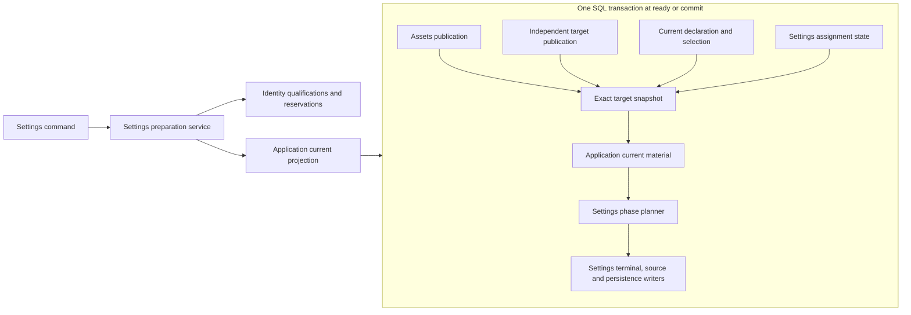

# Protected Settings current composition

The application connects the Settings preparation SPI to its current owner facts through [settings-preparation.ts](../../src/rows/governance/settings-preparation.ts). This is an application composition, not a second Settings store. It adds no tables or foreign-table reads. The public service and transaction writers remain in [settings-local](../../../../packages/assets/settings-local/README.md).

## Responsibilities

The constructor fixes the tenant domain, complete target, Governance scope, epoch and declaration reference. Identity verifies the caller and retains the required qualifications. The current projection supplies `plan` and `currentCommands` to the public preparation backend. It does not supply caller authorization.

Initial capture, ready and commit use the same native owner projections. Assets or the independent Settings owner publishes the target and declaration reference. Governance reads the current contribution and selection. Settings reads its assignment state. [The snapshot join](permission-interpretation.md#atomic-target-inputs) checks their agreement. The application then supplies the prepared provider's named current fact.

Ready and commit perform these reads in their own physical SQL transaction. They never reuse the initial snapshot. The initial plan is a comparison basis. A changed owner revision or policy basis invalidates that attempt. A fresh explicit prepare can create a successor. A confirmed SQL rollback seals the original attempt; an unknown result does not authorize replacement.

## Native write policy and witnesses

The current material identifies the native Settings mutation policy as `settings.target-grants/<policyId>`, interpreted by `settings.decide-change/1`. Its revision hashes the exact definition reference and source grants. The existing Settings decision function checks the requested action against those grants and enforces definition, revision and lock rules.

The policy input witnesses identify each local source, its value location, presence and assignment revision. Declaration witnesses bind the Governance scope, epoch, full declaration and declaration-set revision. Management mode carries an explicit `not-required` selection witness. Runtime mode carries the current adoption witness. Capture identifiers are excluded from the comparison basis.

These witnesses are not Permissions action decisions. They do not grant Tool execution, answer HITL requests or replace Identity qualification checks. Worker descriptors bind the immutable configuration and interpretation code. Requests cannot override destination, qualification requirements, grants or revision witnesses.

## Current implementation boundary

This composition supports tenant-local target sources. Organization, session, owner and foreign-tenant source descriptors produce an unavailable transaction. They are never silently removed from the required source set. The organization-source service and its reservation protocol remain required for the full assembly.

The production projection is exercised with the public prepared service, actual Identity, Governance, Assets and SQLite. The running server's old consumers have not yet switched. Cross-definition rebase needs a maintenance current projection that preserves historical assignments without presenting them as a valid runtime view. Independent feature issuance, system-domain sources and Runtime Context/ActionAdmission remain incomplete. Author tests do not establish independent C3b acceptance.

