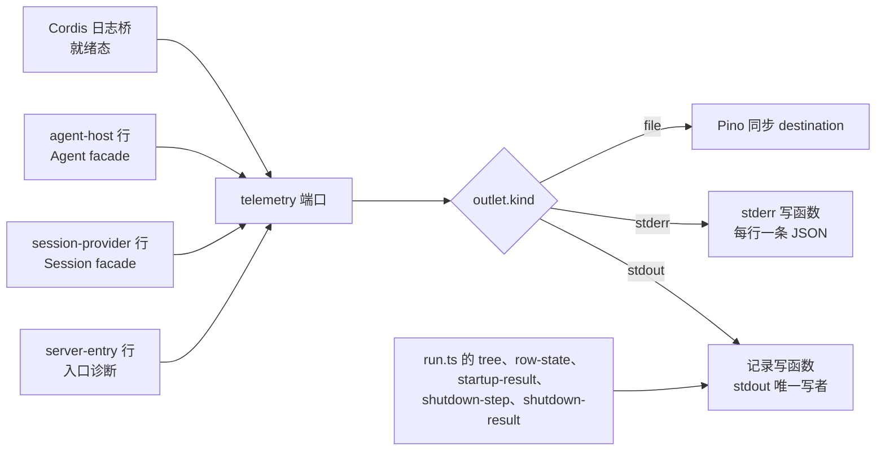

# `telemetry` 行

本页是 `telemetry` 行的行规格。行的代码在 `src/rows/telemetry/`。它是工厂行，照 `execution-host` 的先例：配置在装载前解析，运行时由装配入口在行 fiber 里创建，插件按这一次运行绑定。设计依据是 [RFC-0013](../../../../docs/rfcs/RFC-0013-engineering-telemetry.md) 的「[Cordis 承载与应用装配](../../../../docs/rfcs/RFC-0013-engineering-telemetry.md#cordis-承载与应用装配)」与「[计时记录与离线聚合](../../../../docs/rfcs/RFC-0013-engineering-telemetry.md#计时记录与离线聚合)」。本页条款属于 RFC-0013 revision 2 采用的本地输出范围。两种模式共同的规则归 [real-mode.md](../real-mode.md)。提供者自己的行为归 [telemetry-node 的 SPEC](../../../../packages/telemetry/telemetry-node/SPEC.md)（TN-1～TN-10），契约归 [telemetry-contract 的 SPEC](../../../../packages/telemetry/telemetry-contract/SPEC.md)（TC-1～TC-15）。

## 这一行做什么

行提供工程遥测的端口 `telemetry`。发射行注入它，在行体里构造成员的遥测 facade 或直接 `ctx.telemetry.bind(binding)` 取得发射器，再把成员已有的可选回调（例如 `server-entry` 的 `diagnostics`、Session 的 `measure` 与 `diagnose`、Agent 的 `measure`）接上。第一版的信号：Cordis 日志经日志桥成为 `log` 记录，`server-entry` 的入口诊断成为事件记录，`session-provider` 与 `agent-host` 的测量事件成为段记录与事件记录。

| 项               | 内容                                                                                                                                                      |
| ---------------- | --------------------------------------------------------------------------------------------------------------------------------------------------------- |
| 行 id 与实现     | `telemetry`，`real`。`implementation: 'disabled'` 仍是 `real` 行：禁用是在场的实现，不是缺席（IC-9）                                                       |
| 导出名           | `telemetry`。不在 `./cordis` 里：`run.ts` 用 `createTelemetryBinding` 按每次运行绑定，再加进 allowlist，与 `executionHost` 相同                            |
| 提供             | `telemetry`（`@omne-harness/telemetry-cordis-contract/cordis` 的 `TelemetryService`）                                                                      |
| 必需（`inject`） | 无                                                                                                                                                        |
| 阶段             | 无。关闭是四个阶段之后、报告确定之前的一个显式步骤，见[关闭步骤](#关闭步骤与报告)                                                                           |
| 工厂绑定         | `telemetryFactoryBindings`：导出 `telemetry` 只能站在行 id `telemetry` 上，运维者不能 `insert` 它。装载前检查，退出 2                                       |
| `tree` 记录      | 本行的 `tree` 记录另带 `telemetry: { implementation, outlet }`，`outlet` 是出口种类。配置没有出口时（只可能是 `disabled`）不带 `outlet`                    |

## 配置

配置用 Zod 严格解析，在装载前（`parseConfig`）。未知键、缺项和越界值以 `invalid-config` 拒绝，退出 2，不输出被拒绝的值。发行层只写 `implementation` 与 `outlet`；预算由运维者层给（R2-D229 的工厂数值规则）。省略 `--operator` 时，[本机单用户档](../../SPEC.md#运维者层的默认值)给出预算。

哪些键必填取决于实现：

- `node`：`outlet` 与 `budgets` 必填，`budgets` 的前六项必填。
- `disabled`：`outlet` 与 `budgets` 都可以省略。禁用实现不写出记录，也不持有段，所以不用它们。给了照样按下表校验，值不合格仍以 `invalid-config` 拒绝。

| 键                         | 取值                                                         | 说明                                                                   |
| -------------------------- | ------------------------------------------------------------ | ---------------------------------------------------------------------- |
| `implementation`           | `node` 或 `disabled`                                         | `node` 装 `TelemetryNodePlugin`，`disabled` 装 `DisabledTelemetryPlugin` |
| `outlet.kind`              | `stdout`、`stderr` 或 `file`                                 | `file` 另带 `path`：宿主的绝对路径                                     |
| `budgets.maxRecordBytes`   | 正整数                                                       | 一条记录序列化后的最大字节数                                           |
| `budgets.maxQueueItems`    | 正整数                                                       | 等待出口的记录数上限                                                   |
| `budgets.maxQueueBytes`    | 正整数                                                       | 等待出口的字节数上限                                                   |
| `budgets.maxOpenSegments`  | 正整数                                                       | 同时打开的段数上限。它也界定发射行 facade 的配对表，见[发射行怎样接入](#发射行怎样接入) |
| `budgets.maxLogTextLength` | 正整数                                                       | `log` 记录 `text` 的最长字符数                                         |
| `budgets.summaryIntervalMs`| 正整数                                                       | 两条自监控摘要行之间的最短间隔                                         |
| `budgets.maxSegmentLifetimeMs` | 正整数，可省略                                           | 一个段最长打开多久，毫秒。超过时段过期：让出名额，计入 `droppedBy.expired`，它的 `end` 答 `dropped(expired)`。省略时取提供者的缺省值（`DEFAULT_SEGMENT_LIFETIME_MS`，一小时）。本行原样转交提供者 |

配置里没有远端目的地字段。第一版的三种出口都只落在本机。

两个发行常量不是配置，因为它们在行配置被读取之前就要存在（`src/rows/telemetry/index.ts`）：

- `TELEMETRY_BOOTSTRAP_RECORDS = 256`：引导缓冲的容量。
- `TELEMETRY_BOOTSTRAP_TEXT_CHARS = 4096`：桥自己写出时 `text` 的最长字符数。

两个数都是未测量的初值。

## 出口与 stdout 的唯一写者

| `outlet.kind` | 谁写                                                                                                                                          |
| ------------- | --------------------------------------------------------------------------------------------------------------------------------------------- |
| `stdout`      | `bin.ts` 交给 `runServe` 的同一个记录写函数。它是唯一向 stdout 写记录的函数，`tree`、`row-state`、`startup-result`、`shutdown-step`、`shutdown-result` 与遥测记录都经它写出，每条一行完整 JSON |
| `stderr`      | 应用的 stderr 写函数。每行是一条完整 JSON 记录，不带前缀                                                                                       |
| `file`        | 提供者持有的 Pino 同步 destination。文件打不开时运行时创建失败，本行 `FAILED`，退出 3                                                          |

提供者的限频摘要行写到 stderr，带 `serve: ` 前缀。摘要不是记录，从不进 stdout。`stderr` 出口下，记录行与摘要行在 stderr 上交错；按前缀区分，带前缀的行不是 JSON。

下图是记录从发射行到出口的路径。日志桥的状态图见 telemetry-node 的[日志桥状态](../../../../packages/telemetry/telemetry-node/docs/flows.md#日志桥三态)。

`shutdown-result` 是 `run.ts` 经记录写函数写出的最后一行，在遥测关闭步骤与撤根之后。写出它之后 stdout 封口：之后到达记录写函数的记录（例如期限之后才结束的句柄的 `late-result` 诊断）改写到 stderr，每条一行完整 JSON，不带前缀。所以 stdout 的最后一行一定是 `shutdown-result`。封口在 `run.ts` 里，`bin.ts` 只把 `process.stdout` 与 `process.stderr` 交给 `recordLineWriter` 与 `lineWriter`。

## 日志桥的状态

桥在装载任何行之前登记在根 logger 上，导出级别不高于 WARN 的消息（R2-D253）。状态由本行切换：

| 状态   | 何时                                                       | 路径                                                                                                        |
| ------ | ---------------------------------------------------------- | ----------------------------------------------------------------------------------------------------------- |
| 引导   | 进程启动到本行就绪；本行 `FAILED` 或缺席时一直停在这里     | 直接经记录写函数写出，同时放进有界引导缓冲。记录不带 `generation` 与 `instance`                            |
| 就绪   | 本行以 `node` 实现就绪                                     | 交给运行时准入。出口不是 stdout 时，先把缓冲里的消息标 `bootstrap: true` 回放进运行时；出口是 stdout 时不回放 |
| 直写   | 本行以 `disabled` 实现就绪                                 | 直接经记录写函数写出，不进缓冲，不计数。切换时清空缓冲。记录不带 `generation` 与 `instance`                  |
| 关闭后 | 关闭步骤开始到撤根                                         | 直接经记录写函数写出，`afterClose` 加一                                                                     |

`disabled` 实现下桥不切到就绪：否则 Cordis 的 WARN 消息会被禁用实现吞掉，`droppedBy.disabled` 也会把日志算进去。桥切到直写（`bridge.direct()`），不停在引导态：不会有运行时来接缓冲里的消息，所以不缓冲，也不计 `bootstrapOverflow`。

## 关闭步骤与报告

`entry → business → composition → storage` 四个阶段完成之后，协调者写一条 `shutdown-step`（动作 `telemetry-close`），调用入口交来的关闭步骤：先 `bridge.detach()`，再 `runtime.close(剩余期限)`。先切桥，所以运行时关闭期间、以及期限耗尽后撤根期间的 Cordis 消息都走关闭后路径，不会在已关闭的运行时里答 `dropped(closed)`。步骤受同一个截止时间 D 约束，只为了报告：抛出记诊断 `telemetry close failed`，到达 D 记 `deadline`，迟到的完成只写诊断。之后报告确定，再撤根，`shutdown-result` 仍由 `run.ts` 经同一个写函数最后写出。

关闭报告的 `telemetry` 字段（`src/types.ts` 的 `TelemetryShutdownReport`）：

| `kind`           | 成员                                                                                                                      |
| ---------------- | ------------------------------------------------------------------------------------------------------------------------- |
| `closed`         | 提供者的 `CloseReport`（`generation`、`admission`、`admitted`、`dropped`、`droppedBy`、`pending`、`flush`、`boundary`、`transport`），加桥的四个计数 `bootstrapOverflow`、`afterClose`、`formatFailures`、`writeFailures`。`droppedBy` 的键是准入时的丢弃原因，另加 `output`：已受理、写到出口时失败的记录。`dropped` 是 `droppedBy` 各项之和，含 `output` |
| `not-registered` | 本行没有创建运行时（`FAILED` 或缺席）。只有桥的四个计数                                                                     |
| `unavailable`    | `diagnostic` 为 `close-failed` 或 `deadline`                                                                              |

计数在步骤结束时取样。报告在撤根之前确定，所以 `afterClose` 只计 detach 到报告确定之间的消息，含运行时关闭期间的消息。撤根期间 disposer 的消息直接写到 stdout，不进报告。

## 接入点清单

CLI/Server 工作重构 `apps/harness-server` 时按这张表带走。表外没有遥测接入点。

| 文件                                    | 接入点                                                                                                                                                  |
| --------------------------------------- | ------------------------------------------------------------------------------------------------------------------------------------------------------- |
| `src/rows/telemetry/config.ts`          | 行配置 schema                                                                                                                                          |
| `src/rows/telemetry/instance.ts`        | 进程实例引用 `processInstance`：一个 `serve` 进程一个随机 ref，运行时与发射行共用                                                                        |
| `src/rows/telemetry/index.ts`           | `createTelemetryBinding`、`telemetryFactoryBindings`、两个发行常量                                                                                      |
| `src/run.ts`                            | 五处：`shutdown-result` 之后封口的记录写函数（`sealedAfterShutdownResult`）；创建绑定并把这个写函数交给它；把 `telemetry.plugin` 加进 profile、`telemetryFactoryBindings` 加进装载前检查并在行映射里 `parseConfig`；`root.logger.exporter(telemetry.bridge.exporter)`；关闭选项 `afterStorage`。`treeRecords` 多一个 `describe` 参数 |
| `src/shutdown.ts`                       | 选项 `afterStorage(deadline)`，动作 `telemetry-close`，报告字段 `telemetry`                                                                             |
| `src/types.ts`                          | `TelemetryShutdownReport`，`ShutdownReport.telemetry?`                                                                                                  |
| `src/rows/server-entry/telemetry.ts`    | 事件 `omne.entry.diagnostic` 的定义与 facade `entryDiagnostics`                                                                                         |
| `src/rows/server-entry/index.ts`        | `injects` 多 `telemetryKey`；`dependencies.diagnostics: entryDiagnostics(ctx.telemetry)`                                                                |
| `src/rows/session-provider/real.ts`     | `injects` 多 `telemetryKey`；行体 `createSessionTelemetry(ctx.telemetry, …)`，`measure` 与 `diagnose` 经 `createSessionProviderPlugin` 交给插件            |
| `src/rows/agent-host/index.ts`          | `injects` 多 `telemetryKey`；`createAgentHostRow` 缺省以 `createAgentTelemetry(ctx.telemetry, …).measure` 作为运行时的 `measure`                          |
| `src/local/operator-defaults.ts`        | 本行的预算初值，七项。`maxSegmentLifetimeMs` 写明一小时，即提供者的缺省值                                                                                 |
| `config/serve.distribution.json`        | 发行层的 `telemetry` 行（第一行，`server-entry` 注入它）                                                                                                |
| `src/s0/stubs.ts`、`src/s0/aa-rows.json` | 替身清单与行快照                                                                                                                                       |

## 发射行怎样接入

成员插件不认识遥测的服务键。发射行把 `telemetryKey` 写进 `manifest.injects`，在行体里构造 facade，再交给成员工厂已有的可选参数。`telemetry` 是三行的必需注入（D04）：没有这一行，三行停在 `PENDING`；`disabled` 实现是在场的提供者，三行照常 `ACTIVE`（IC-9）。第一版有三个发射行。

`server-entry`：

- 绑定是 `{ scope: systemScope(), component: 'server-entry', instance: processInstance }`。入口的故障是进程自己的事实，记录里没有租户标识（TC-4）。
- 事件 `omne.entry.diagnostic`，owner `server-entry`，version 1，级别 `warn`，只有一个定义 `entryDiagnosticDefinition`。字段 `code` 是成员十个诊断码的枚举；`path` 与 `operation` 是可选引用（上限 256 与 128 字节，契约 TC-2 的可选字段）。诊断没有的成员不写，记录里只有诊断带的成员。
- `path` 只取请求 URL 的路径部分，不写查询串和片段，因为查询串是客户端文本，可能含凭据。URL 解析失败时不写 `path`。
- 契约会拒绝的引用（空、超长、非可打印 ASCII，例如空的请求路径）不写，记录保留 `code` 与另一个引用。

`session-provider`：

- 行体用 `@omne-harness/session` 的 `createSessionTelemetry(ctx.telemetry, { instance: processInstance })` 构造 facade，把 `measure` 与 `diagnose` 经 `createSessionProviderPlugin` 交给插件。facade 的记录定义归 Session 的 SPEC「遥测投影」。
- 每个面操作是段 `omne.session.<操作>`（owner `session`），Session 实例自己的提交写下 `run.terminal` 时是事件 `omne.session.round-complete`（由 `session-ad02` 解读 Agent 事实写下的终态不发，见 Session SPEC「测量事件」），协调器步骤停在失败上是事件 `omne.session.diagnostic`（字段 `owner`、`step`、`reason`，不带 `detail` 正文）。每条记录按它所属工作的租户作用域，`work` 是会话引用，Run 已知时 `attempt` 是 Run 引用。目录读取没有 `work`。目录读取 `pending`（含恢复扫描器的）按输入的租户作用域。`references` 与 `releasedScopes` 在契约里是系统作用域，它们的段按 `system` 作用域、`component` 为 `session`，记录里没有租户标识（TC-4）。没有租户、也不是系统作用域的事件 facade 不发记录。它经 `telemetry.discard` 交给本行的提供者按 `invalid` 计数，不落到 `system` 作用域（TC-4）。这个计数出现在摘要行的 `dropped.invalid` 与 `shutdown-result` 的 `telemetry.droppedBy.invalid`。正常运行的扫描器不产生这个计数。

`agent-host`：

- `createAgentHostRow` 缺省用 `@omne-harness/agent` 的 `createAgentTelemetry(ctx.telemetry, { instance: processInstance }).measure` 作为每个运行时的 `measure`。构造输入 `measure` 给出时替代它，这是测试用的替代观察者。
- 每个执行的 pass 是段 `omne.agent.pass.accept` 或 `omne.agent.pass.run`（owner `agent`），按执行的租户作用域，`attempt` 是执行引用。没有租户的 pass 同样经 `telemetry.discard` 计入 `invalid`。

两个 facade 都没有自己的段上限，也没有自己的丢弃计数。facade 的配对表只保存提供者受理的段，提供者只在本行 `budgets.maxOpenSegments` 之内受理段的开始，`disabled` 实现不受理任何段，所以 facade 持有的段数由运维者的那个数界定（两个成员的 SPEC「遥测投影」写明这条推理）。发行层不另写一个数：那会盖过运维者的数（R2-D229）。全部丢弃只在运行时侧计数（摘要行与关闭报告）。

## 测试

| 文件                              | 层        | 覆盖                                                                                                                                                                              |
| --------------------------------- | --------- | --------------------------------------------------------------------------------------------------------------------------------------------------------------------------------- |
| `tests/rows/telemetry/row.spec.ts`   | fast      | 桥的状态，抛错的写函数，关闭报告，禁用实现，运维者层的预算与工厂绑定，配置边界。B-5：禁用实现下桥直写，超过引导缓冲容量的消息全部到 stdout，`bootstrapOverflow` 为 0。B-6：禁用实现省略出口与预算能装载，`tree` 不带 `outlet`；`node` 缺出口或预算以 `invalid-config` 拒绝；`maxSegmentLifetimeMs` 的校验，以及它转交到提供者（段超时后 `end` 答 `dropped(expired)`，报告计 `droppedBy.expired`） |
| `tests/rows/telemetry/serve.spec.ts` | fast、slow | 真实 `server-entry` 的诊断记录、缺本行时 `server-entry` PENDING、发行层的行；慢层起 `dist/bin.js serve`，逐行解析 stdout，`shutdown-result` 最后 |
| `tests/rows/telemetry/measure.spec.ts` | slow     | 发行树在本进程跑一次 Run：Session 操作段与 Agent pass 段带租户作用域、`summarizeTelemetry` 按操作给 count 与 p50/p95；去掉 `session-ad14` 后 `omne.session.diagnostic` 记 `agent-absent` 且不带 detail；缺本行时两行 PENDING、禁用实现下 ACTIVE。真件上的三个目录读取：`pending` 的段带输入的租户作用域，`references` 与 `releasedScopes` 的段是 `system` 作用域，关闭报告没有 `invalid`；没有租户的 Session 段经本行的端口 `discard`，关闭报告计 `droppedBy.invalid` 为 1。`support.ts` 给单独装行的树一个禁用实现的本行 |
| `tests/rows/telemetry/measure.spec.ts` | slow     | G3：经应用自己的记录写函数（`recordLineWriter`）写进字节流，非引用字段里放 `Error` 对象或秘密样式文本的记录答 `dropped(invalid)`，`shutdown-result` 计 `droppedBy.invalid`，写出的字节里没有那段文本。G7：模型替身答一段文字，发行树的 Run 到达 `run.terminal`；这次运行的每个段开始都有同一 trace 与 span 的段结束，`maxSegmentLifetimeMs` 取短值并等过它之后关闭，关闭报告没有 `expired` 与 `capacity`，`pending` 为 0 |
| `tests/shutdown.spec.ts`             | fast      | B-7：期限之后才结束的 stop，stdout 最后一行是 `shutdown-result`，迟到的 `late-result` 在 stderr 上成为不带前缀的一行 JSON                                                           |
| `tests/shutdown-steps.spec.ts`       | fast      | 关闭步骤的次序、期限、抛出与迟到                                                                                                                                                    |
| `tests/local/operator-defaults.spec.ts` | fast   | 本机单用户档给出七项预算，不覆盖发行层的实现与出口                                                                                                                                  |

## 已知限制

- 第一版只有一代输出，按行配置在启动时固定。改出口或预算要重启进程。这不满足 SYS-DYNAMIC 的最终目标（D09）。
- `log` 记录的 `text` 是自由文本，可能含租户标识。D06 裁定之前它不离开本机。三种出口都在本机。
- 进程实例引用在模块装入时生成一次。同一进程里多次 `runServe`（测试）共用一个 ref。
- 运行中整行替换 `telemetry` 的插件会关闭运行时，而桥仍指向它，之后的日志答 `dropped(closed)`。第一版没有管理面，日常输出变更不走整行替换。
- 报告里的 `afterClose` 不计撤根期间的消息，见上文。
