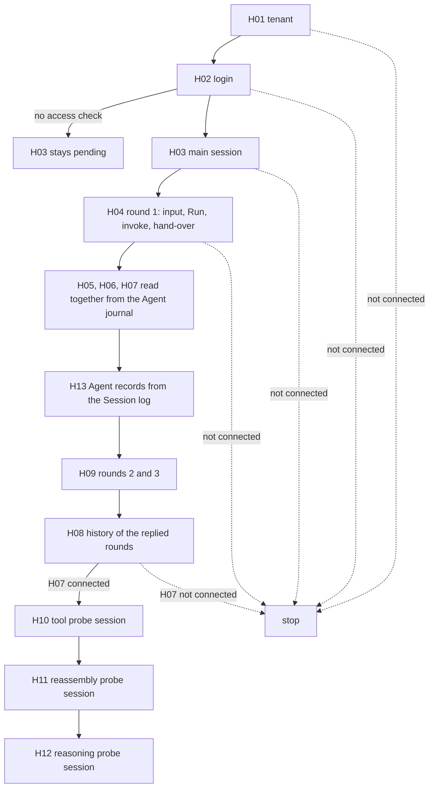

# M2 contract skeleton behavior

This private application connects the M2 tenant path. It is the CS of the M1 joint acceptance (G1) and the evidence of the M1.5 closing gate [H3](https://github.com/nemori-ai/omne-harness-lite/issues/783) (CS v2). It uses only the public exports of contract members and their `./testing` doubles. Its report belongs to this application. The report is not a shared protocol or a production API.

The adopted scope is [#790 revision 5](https://github.com/nemori-ai/omne-harness-lite/issues/790), section 「目标与范围」, items 1 to 8, on top of [#684 revision 2](https://github.com/nemori-ai/omne-harness-lite/issues/684). The [H3 ruling](https://github.com/nemori-ai/omne-harness-lite/issues/783#issuecomment-6515275392) sets the result of this revision: H01 to H08 connect. H09 to H12 record where the upstream public entries stop them. The default store does not probe H13. H13 is recorded as a named gap, and a separate test pins the upstream fact behind it (GAP-SESSION-LOG-TARGETS). These five hops move to M2 ([#784](https://github.com/nemori-ai/omne-harness-lite/issues/784)) as blocking residual gaps. They stay blocking. Their acceptance continues on the first tenant path of M2.

The assembly model is the 「替身与真件」 section of the [application assembly page](../../docs/architecture/runtime/application-assembly.md#替身与真件). This application is the CS that the page names. It is not the application assembly of the first tenant path.

## Path

`runFirstTenantPath(dependencies)` in [path.ts](src/path.ts) has thirteen hops:

1. H01: create the organization and tenant.
2. H02: log in and recognize the tenant.
3. H03: create the session through the session codec, with the injected Session access check.
4. H04: accept the first request through the session codec, start the Run, and hand the request to Agent.
5. H05: Agent assembles the request through Request Context and sends the Model call.
6. H06: the Model pushes the result to the host receiver, which writes the received entry. The loop continues from that entry.
7. H07: the Agent reply enters the Session journal.
8. H08: a history read through the session codec returns the replies of the main session.
9. H09: the later rounds of the main session, one Run and one reply for each input.
10. H10: the Model requests a tool. Tool runs it in the execution environment, and the result returns to the Model.
11. H11: the Agent instance is withdrawn during a Model call and assembled again.
12. H12: a reply with reasoning is consumed, and the next request replays its state.
13. H13: the Agent records of the first round are read from the Session log.

The path runs the hops in this order:

H03 to H09 and H13 use the main session. H09 drives the later rounds on that session. H08 runs after H09, so it reads the replies of every replied round. H10, H11 and H12 are the probes. Each probe opens its own session with its own Agent instance, because each probe needs its own scripted Model answer.

These rules stop the path:

- A hop of H01 to H04 that does not connect stops the path. Every later hop reports `not-reached`.
- H05, H06 and H07 are read together from the Agent journal after H04. A failure of one of them does not stop H13, H09 or H08.
- The probes run only when H07 connected.

Each hop calls the public entry of a contract member through a port that the caller passes in. The module builds no double. A hop never reports success for a call that it did not make. A probe goes until the first upstream refusal. It records the refusal as evidence, and it never builds the refused behavior in this application. Each probe also holds the next step for the time after the upstream entry is delivered. That step is the connection criterion of the hop.

The path uses one tenant and one principal from H02 onward. The tenant comes from the identity response that the governance codec read back. The principal is the account that identity recognized from the login proof.

## Report

`runContractSkeleton(inputs)` in [run.ts](src/run.ts) runs the connected path, the fixed governance protocol scenarios, and the public Model obligation suite. It returns one `PathReport`.

The path gives one observation for each hop that it reached. An observation has one of four kinds:

- `not-reached`: the path stopped before the hop. The report gives the evidence `not-reached`.
- `refused`: an upstream public entry refused a call with a named failure, such as `run-active` or `unavailable`, or the Agent journal shows the loop at a named refusal point, such as the loop position I4 or M6. The evidence names the refusal.
- `disconnected`: the calls answered, but the results do not meet the connection criterion of the hop. This kind also covers a hop that is pending: the path made no call because an input is missing, such as an injection without a value, or because the store does not supply the part that the hop reads, such as H13 on the default store.
- `connected`: the public calls succeeded in order and met the criterion.

A hop that stops takes the kind of the step that stopped it. For example, Session refusing the hand-over of H04 with `conflict` makes H04 `refused`. A probe that stops in its own session keeps the kind of that step. Its evidence names the step, not an earlier step that succeeded.

`hops` contains one entry for each hop H01 through H13. Each entry records `hopId`, `publicEntry`, `responsibility`, `ownerCards`, `reason`, `rows`, `realization`, `state`, `blockedBy` and `fragments`. A fragment has `fragmentId`, `status`, and `evidence`. Fragment status is `pass`, `fail`, or `not-applicable`. The `<hop>-connected` fragment passes only for a `connected` observation.

`rows` lists the rows of the plugin tree of the [application assembly page](../../docs/architecture/runtime/application-assembly.md#插件树) that the wiring of the hop crosses when the hop connects. A probe that stops early does not reach every row. Its evidence says where it stopped.

`realization` records the caller's declaration for each row. The caller gives the table in `inputs.realization`. The report records the declaration by row. It does not check the declaration against the wiring, hop by hop. The values are:

- `real`: the production implementation that the row names is wired.
- `double`: a `./testing` double or a stand-in of this application is wired. A production runtime over test dependencies is also `double` when the row names another member. For example, `agent-host` names the host plugin of `@omne-harness/agent-host-local`. The tests run `createAgentRuntime` of `@omne-harness/agent` over `createTestAgentDependencies`, so the row is `double`.
- `absent`: nothing stands in the row on this path.
- `undeclared`: the caller gave no declaration.

The tests declare these rows. The two Session stores differ only in `session-ad01` and `session-ad02`:

| Hop | Rows | `contract-memory` | `session-log` |
| --- | --- | --- | --- |
| H01, H02 | `server-entry`, `identity` | double | double |
| H03 | `server-entry`, `authorization`, `session-storage`, `session-provider`, `session-ad10` | double | double |
| H04 | `server-entry`, `session-provider`, `session-ad14`, `agent-adoptions`, `agent-host`, `session-handoff` | double | double |
| H05 | `agent-host`, `session-conditions`, `agent-model-selection`, `session-ad04`, `agent-context`, `request-context`, `model-host` | double | double |
| H06 | `model-host`, `agent-host`, `agent-journal` | double | double |
| H07 | `session-handoff` | double | double |
| H07 | `session-ad01` | absent | double |
| H08 | `server-entry`, `session-provider` | double | double |
| H09 | `session-provider`, `session-ad14`, `agent-host` | double | double |
| H09, H13 | `session-ad02` | absent | double |
| H10 | `agent-host`, `tool-runtime`, `execution-files` | double | double |
| H10 | `tool-executor`, `tool-environments`, `execution-environment` | absent | absent |
| H11 | `agent-host`, `model-host`, `server-entry` | double | double |
| H11 | `agent-instances` | absent | absent |
| H12 | `model-host`, `agent-host`, `session-ad04` | double | double |
| H13 | `agent-journal` | double | double |

Every hop has one fragment `<hop>-connected` from the connected path. H01 and H02 also carry the governance protocol scenarios. H06 also carries every public Model obligation from `@omne-harness/model-contract/conformance`.

The hop `state` follows these rules:

- `gap`: the path did not reach the hop, the observation is missing, or a blocking residual gap names the hop. `blockedBy` lists the blocking residual gaps of the hop. The fragments keep the evidence of what the path met there.
- `failed`: the path reached the hop, no blocking residual gap names it, and at least one fragment failed or is `not-applicable`.
- `verified`: the path reached the hop, every fragment passed, and no blocking residual gap names the hop.

`fullPath` is `complete` only when all thirteen unique hops are `verified` with a connected fragment and there is no structural error. Any other result keeps it `incomplete`. The field `gaps` lists the hops that are not verified.

`residualGaps` lists what the connected path does not include. Each residual gap has `gapId`, `hops`, `owners`, `blocking`, and `reason`. A residual gap names a part of the target system that this path replaces with a call sequence of this application or does not exercise. A blocking residual gap names a part that the hop definition below needs and that no public entry supplies. The hops that it names stay in the `gap` state. A non-blocking residual gap names a part that this application calls directly or leaves out. `owners` lists open cards only. A residual gap without an open implementation card names the M2 milestone card [#784](https://github.com/nemori-ai/omne-harness-lite/issues/784). The sections below are the only detailed inventory of residual gaps.

`checksPassed` describes the checks inside one invocation. Every required scenario must occur once, execute, and match its expectation. Every hop fragment must pass. Exceptions, timeouts, missing or repeated entries, `fail`, and `not-applicable` make this value false. External Vitest results, independent reviews, and QA do not change this value.

The aggregator inserts a `gap` entry for a missing hop. It keeps repeated observations in `duplicateObservations`, adds a duplicate diagnostic, and marks the normalized hop failed. Both structural faults make `checksPassed` false and `fullPath` incomplete.

## What the report proves

A report proves that the public entries of the members connect in this order, for one tenant, with the doubles that the tests supply. It proves the shapes of the values that cross each hop and the order of the judgments. A probe that does not connect proves where it stopped: the public entry that refused with its failure kind, or the loop position that the Agent journal shows.

The report does not prove durability. The doubles keep state in memory. It does not prove cross-process principal origin, joint commits in one transaction domain, or real vendor behavior. The scripted Model provider answers what the test scripted. The governance and session messages travel through the codecs in process, not over HTTP.

## Public dependencies

[path.ts](src/path.ts) imports only root entries: `@omne-harness/public-contract`, `@omne-harness/identity`, `@omne-harness/session-contract`, `@omne-harness/agent`, `@omne-harness/agent-contract`, `@omne-harness/request-context-contract`, `@omne-harness/message`, `@omne-harness/content-block`, `@omne-harness/json-text`, `@omne-harness/legal-identity` and `@omne-harness/model-contract`. [model.ts](src/model.ts) and [path-report.ts](src/path-report.ts) import `@omne-harness/model-contract/conformance`. No file in `src/` imports a `./testing` entry. `@omne-harness/session-adapters` and `@omne-harness/execution-environment-contract` are development dependencies, because only the tests import them.

The path does not touch the shapes that [#673](https://github.com/nemori-ai/omne-harness-lite/issues/673) changed on the Agent side: `AgentEventBody`, observation through `StreamRef`, and `retry.notBefore`. It consumes them only through the type check and the run on the adopted base.

The tests wire the doubles in [first-path-doubles.ts](tests/first-path-doubles.ts):

| Capability | Double |
| --- | --- |
| Registration, login, recognition | `inProcessIdentityOperations` with `manualIdentityClock` and `adjustableLoginTerms` |
| Session access check | `createPolicySessionAccessCheck` with an explicit policy, injected by the path |
| Session store, `contract-memory` (default) | `createMemorySessionTransactions` and `createMemorySessionEvidenceBridge`. The Agent keeps its own memory Journal. |
| Session store, `session-log` | `createMemorySessionJournal` of `@omne-harness/session-adapters/testing` ([#756](https://github.com/nemori-ai/omne-harness-lite/issues/756)): one log for the Session entries and the Agent Journal |
| Agent runtime | `createAgentRuntime` over `createTestAgentDependencies`, with the generic `agentEvaluator` |
| Model call and result push | the scripted Model provider and its public result pusher inside `createTestAgentDependencies`. The host receiver of `@omne-harness/agent` writes the received entry. |
| Tool runtime | the scripted Tool runtime of `createTestAgentDependencies`. Each invocation first reads and writes a file in `createMemoryFileSystem` and starts one command in `createScriptedCommandFacility` of `@omne-harness/execution-environment-contract/testing` ([#791](https://github.com/nemori-ai/omne-harness-lite/issues/791)). |
| Request Context assembly and Model preparation lease | `createAssemblyOperations` through `createAssemblyFixture`, with its scripted preparation resources |
| Model obligations | `createScriptedConformanceSubject` |

The application owns two bridges in [path.ts](src/path.ts). Both bridges find the round of a call by the Agent execution that the call names. They do not read a shared "current round".

- The message bridge is the Agent `MessageHandoff`. Its `prepare` fixes the admission of each hand-over (H) and keeps the outcome. For the external input of an invoke it fixes the admitted message. For a Model reply it commits `recordMessage` with a `message` participation and fixes that message. A second `prepare` of the same request answers the original outcome. A different request for the same H is a `conflict`. A submit answers `unsupported`, because the bridge has no trusted migration of the entry index. `lookup` only reads the fixed outcome back, and answers `unknown` without material for an H that it did not decide. `exclude` answers `recorded` for a fixed outcome. For any other H it answers `unsupported`, because the bridge has no trusted Journal resolver for the pending request and no durable fence. The round driver commits `receive(input-handover)` after the Agent accepted the invoke.
- The context bridge is the Agent `RequestPreparation`. On the first preparation it assembles through Request Context. On the second preparation it fixes the request from the assembled input.

## Resource lifetime and failure

A failure label holds only the step name that this application mints and the `kind` of the failure. An exception that is not a refusal of a path step becomes `first-path-threw:unknown`. Tests check this on the happy path, on the login-gate refusal, and on a supplier that throws.

The path does not call `quiesce` to end a round. On the happy path the Agent execution of each round has ended when the path returns. The H10 and H12 probes leave their Agent execution stopped where the loop refused. The runtime and the memory doubles stay reachable only from the caller, and the process releases them. The H11 probe releases the held Model call in a `finally` step, also when a withdrawal call throws. When the Model does not settle, the admitted call stays open in the scripted provider until the process exits. The Model obligation suite owns its subject disposal and its bounded waits. The default wait bound is 500 ms for each suite operation. Tests use a 15 second outer limit.

The path waits for each Agent reply for at most `replyTurns` event-loop turns. The default is 2000. Every wait of the main rounds and of the probes that ends at the bound adds a timeout label to the evidence of its hop. The label tells a wait that ended at its bound from a refusal of an upstream entry. When the Model does not settle, H06 through H08 do not connect, and the report says which call did not occur.

A failed governance scenario does not remove its hop or stop the Model checks. An exception in the connected path becomes a structural error and leaves every hop in the `gap` state. Evidence holds fixed labels, failure kinds, positions, and counts. The report holds no free text of a supplier or a port, and no credential, login proof, or message body.

Known limitations of this application, hop by hop. Each item says what the skeleton itself meets first after the upstream entry of the hop is delivered. These items are not residual gaps. M2 must remove them before the hop can connect.

- Request Context fixture. The fixture of the tests throws on an assistant history row, because it cannot name the source call of that row. The Agent loop calls the request preparation with `previous: null` at I1 of every iteration ([coordinator.ts](../../packages/agent/agent/src/loop/coordinator.ts)). The context bridge then assembles over the Session history again. After a reply, that history holds a `message.assistant` row, so the fixture throws inside the Agent preparation, and the loop records a defect. M2 must replace the throw with a Request Context refusal or with a fixture row that names its source call.
- H09: when GAP-SECOND-RUN closes, rounds 2 and 3 assemble after the reply of round 1 and meet the fixture throw above.
- H10: when GAP-TOOL-LOOP closes, the second Model call assembles after the tool-call reply and meets the fixture throw above. The message bridge also refuses a `tool-result` source with `unsupported-source:tool-result`, although the Agent contract defines that source. A bridge failure of a probe session does not enter the H10 evidence, because only the main session adds its bridge failures to its hops. The H10 criterion counts the execution-environment effects that the test wrapper of the Tool runtime produces on each invocation, for every tool name. It does not measure a Tool executor, because the rows `tool-executor` and `tool-environments` are `absent`.
- H11: when GAP-AGENT-REASSEMBLY closes on the Agent side, the probe still has no server-entry observation path. H11 stays `disconnected` until that path exists (see H11).
- H12: when GAP-REASONING-REPLAY closes, round 2 needs a second Run on the same session and meets GAP-SECOND-RUN and the fixture throw above.
- H13: the default store does not probe H13. The `session-log` store probes it, but H06 then does not connect (GAP-SESSION-LOG-TARGETS).

## H01

The governance codec encodes and reads a `register-and-activate` request. Identity runs `registerAndActivate`. The codec encodes and reads the response with the identity tenant. The hop is connected when the tenant that the response carries equals the identity tenant. The fixed `G1-register` and `G1-create` protocol scenarios are additional fragments.

## H02

The governance codec carries an `issue-login` request and its response. Identity runs `issueLogin` and then `recognizeLogin` with the login proof that the response carries. The hop is connected when identity recognizes the tenant of H01. The other fixed governance scenarios are additional fragments.

## H03

The path hands the injected `sessionAccessCheck` to the caller's Session store builder ([#680 ruling B-1](https://github.com/nemori-ai/omne-harness-lite/issues/680#issuecomment-6498559862), item 4). The dependency is required. Its type is `SessionAccessCheck | undefined`, so a caller must give a value. When the value is `undefined`, the path does not build the store, and H03 stays `session-assembly:pending:sessionAccessCheck`. This matches the `agent-journal` row, which stays `PENDING` without the check. The path never uses a default check.

The card and the `agent-journal` row require the check because the Session store judges the Session participation that it derives from the Agent Journal. This path does not exercise that judgment. The Agent configuration of the tests has no joint commits (`jointCommits` is empty), so no derived participation reaches the injected check. The check sees only the commands of the path. This application therefore has no test of a refused derived participation. The evidence of card item 8 is the pending stop above and the check on each command.

Steps:

1. The session codec of [#685](https://github.com/nemori-ai/omne-harness-lite/issues/685) encodes and reads a `create-session` request with the login proof and the acting tenant.
2. The path commits `create` for the recognized tenant, with the definition mapping entry that the caller passes.
3. The codec encodes and reads the `create-session` response with the wire session.
4. `readWork` returns the session.

Every commit carries the guard materials of the Session evidence bridge. The store asks the injected check once for each command. A `denied` answer stops the hop with `session-create:denied`.

The hop is connected when the commit succeeded, both codec messages were read back, and `readWork` returns the session.

## H04

Steps:

1. The session codec carries a `send-input` request with the message.
2. The path commits `accept` for the ordinary request that it read back. The request origin has the owner `login-entry`, as the access layer sets it after a login.
3. The path builds the Agent of the tenant and commits `startRun`. The Session evidence bridge hands over the login confirmation, a guard material with the owner `login-entry`. Without it, Session `decide` refuses `startRun` with `login-required`.
4. The path reads the admitted input back with `readInput`. It invokes the Agent runtime with the Session execution and that input. On the `session-log` store the invoke carries the receipt of the Run as the Journal grant.
5. The Agent message hand-over admits the external input.
6. The round driver commits `receive(input-handover)`.

On the `session-log` store the Agent loop can take the input before step 6 lands. The log then holds `run.batch-taken` for the Run ([AD-02](../../packages/session/session-adapters/SPEC.md#ad-02)), and Session answers the hand-over `invalid` on the field `fact.input`. Only that answer, with `run.batch-taken` for the same Run, counts as the hand-over. Any other refusal of the hand-over is a refusal.

The hop is connected when `startRun` fixed the request, the hand-over admitted the input, and the Session side holds the hand-over.

## H05

The Agent calls its request preparation. The context bridge reads the Session history and runs Request Context `assemble` over it. During the assembly Request Context acquires a Model preparation lease from its sources, plans the assembled input with the lease, and releases it. The first preparation returns the assembled input. The second preparation fixes the request with the assembled messages.

The hop is connected when all of these are true:

- Request Context assembled at least one history message.
- At least one lease was acquired and planned an input, and no lease is still open.
- The fixed request carries the assembled messages.
- The Agent journal binds the Model call of the step.
- The caller reports at least one Model admission.

The lease and admission counts are caller-reported. `src/` does not import `./testing`, so it cannot read the counters itself. The assembler that the caller passes reports the lease counts. The Agent that the caller passes reports the admissions. The evidence labels say `caller-reported`. In the tests of this application the assembler reads the counts from the scripted preparation resources of the Request Context `./testing` fixture. Those resources count every real `acquire`, plan, and `release`. A test checks that the counts come from that counter, and that H05 fails when the assembler reports no lease.

## H06

The Model settles the admitted call. The public result pusher of `@omne-harness/model-contract/testing` ([#683](https://github.com/nemori-ai/omne-harness-lite/issues/683)) pushes the frozen delivery to the host receiver of `@omne-harness/agent` ([#787](https://github.com/nemori-ai/omne-harness-lite/issues/787)). The receiver writes the `received` entry and its material in one commit. The Agent loop waits for that entry, reads the material, and hands over the reply of the original call.

The hop is connected when the journal holds the received entry, the material reads back under its original binding, and the hand-over carries the reply of the same call.

The Model takes its ACK through the pusher after `saved`. The Session-side accounting of that ACK stays open. When the journal holds a received result, the evidence records the named deviation `MODEL-ACK-ARRIVAL` (GAP-RECEIVE-SURFACE). Without a received result there is no ACK, and the evidence does not name the deviation.

## H07

The message bridge commits `recordMessage` with a `message` participation for the Agent reply. The hop is connected when the commit succeeded and the Agent journal shows the execution ended.

## H08

The session codec carries a `read-history` request with the wire session. The path reads the Session history with `history.begin` for the entry kinds that a deployment discloses by default, `message.user` and `message.assistant`. The codec encodes and reads the `read-history` response with the page. The hop is connected when the assistant messages of the page carry the Model reply texts of the replied rounds, in round order.

## H09

After the first round the path drives rounds 2 and 3 on the same session. `PATH_ROUNDS` is 3, which is the minimum of card item 1. Each round accepts its input through the session codec, starts a Run, and invokes the same Agent with a new execution. The path stops at the first round that does not reply. When Session refuses the `startRun` of that round, the path tries the other route: `input.submit` on the first execution.

The hop is connected when all three rounds replied.

## H10

In the `tool` probe session the scripted Model answers the first call with a `tool_call` block for `read_file`. It answers a later call with a text reply. The Tool runtime of the tests runs each invocation in the file and command doubles of [#791](https://github.com/nemori-ai/omne-harness-lite/issues/791): it reads a file, writes the file, and starts one command. The probe waits for the tool-call reply. When the loop did not stop at I4, the probe also waits for the reply that follows the tool result.

The hop is connected when all of these are true (card item 2):

- The Tool runtime received an invocation.
- The execution-environment effects include a file read, a file write and a command start that each answered `done`.
- The Model admitted a second call.
- A Model request after the first one carried a `tool_result` block.
- The Agent execution ended.

The Tool runtime double of the Agent test dependencies answers each invocation itself. No public double issues the invocation reference and the result pages of a Tool runtime. When the loop reaches the Tool, M2 must check that the Tool result reaches the Model through such a runtime.

Two parts of this application also stop the next step of H10 after GAP-TOOL-LOOP closes: the Request Context fixture throws when the second Model call assembles after the tool-call reply, and the message bridge refuses the `tool-result` source ([path.ts](src/path.ts), the message bridge). The known limitations under 「Resource lifetime and failure」 give the details.

The probe judges the stop at I4 from the last journal snapshot that it read. When a wait ends at its bound, the evidence says so.

## H11

In the `reassembly` probe session the scripted Model holds the call. After the Model admitted the call, the path calls `control.quiesce`, `recovery.detach` with the current attachment, and `runtime.resume` on the public faces of the Agent provider. Then it releases the Model and waits for the reply.

The hop is connected when all of these are true (card item 3):

- The withdrawal and the resume succeeded.
- The Model admitted the call exactly once, so the call was not sent again.
- The execution ended from the received entry in the Journal.
- The observation stayed continuous: after the reassembly, the frames on the same observation connection keep a continuous sequence number, and the observation runs through the observation path of the server entry. This is E4 of the [H3 ruling](https://github.com/nemori-ai/omne-harness-lite/issues/783#issuecomment-6515275392) and the observation part of card item 3. The 「观察通道」 row of the [assembly page](../../docs/architecture/runtime/application-assembly.md) gives the run continuity evidence to this hop.

The evidence records the answer of each of the three faces, the Model admission count after the Model settled, and how the execution ended. When the withdrawal failed and the execution ended, the evidence says that the original driver continued. When the withdrawal succeeded, it says that the resumed execution ended. No public entry supplies the observation path of the server entry on this track, so the probe cannot observe the continuity. The evidence says so, and H11 does not connect without it (GAP-AGENT-REASSEMBLY).

## H12

In the `reasoning` probe session the scripted Model answers with a `thinking` part followed by text. The pusher delivers the result, and the receiver writes the received entry. When the loop hands over the first reply, the probe drives round 2 on the same Agent.

The hop is connected when the first reply was handed over and the request of round 2 carries the reasoning part again (card item 4).

The probe sends a `thinking` part and not a sealed `reasoning_state` part. The scripted Model producer of `@omne-harness/model-contract/testing` refuses to settle a result with a sealed `reasoning_state` part with `invalid-script`. A test of this application pins that upstream fact. A `reasoning_state` part therefore never reaches the Agent through the public doubles, and the probe would stop at the double instead of at the loop.

## H13

When the Session store supplies the same-log Agent Journal of [#756](https://github.com/nemori-ai/omne-harness-lite/issues/756), the path loads the execution of the first round through that Journal, reads `readWork`, and reads the history.

The hop is connected when all of these are true (card item 5):

- The Journal returns the execution that the Run grant opened.
- `readWork` reports the Run of that execution: the active Run with the same execution, or a terminal of the same Run.
- The history holds the hand-over entry of the execution or the `run.batch-taken` entry of the Run.

On the default `contract-memory` store the Agent keeps its own memory Journal. That store is not the Session log, so the path does not probe H13 on it. The report records H13 as a `gap`, and its evidence says that this store does not probe H13 and names GAP-SESSION-LOG-TARGETS. The H13 of the path report therefore holds no upstream refusal. The upstream fact behind the gap comes from a separate test on the real same-log provider.

## GAP-SESSION-WIRE

Non-blocking for H03, H04 and H08. The session codecs of [#685](https://github.com/nemori-ai/omne-harness-lite/issues/685) carry `create-session`, `send-input` and `read-history` in process. The server entry is M2 work. It maps the wire session (the 64-hex digest) to the Session id, recognizes the login proof, and selects the disclosed entry kinds. This application mints the digest from the Session id. It also mints the caller operation ids of `create`, `accept` and `startRun`. Owner: [#784](https://github.com/nemori-ai/omne-harness-lite/issues/784).

## GAP-SESSION-COORDINATOR

Non-blocking for H04, H07 and H09. No Session implementation supplies the Session faces, the `AgentDrivePort` adapter, or the Session-side `MessageHandoff`. This application orders the port commits, the Agent invoke and the hand-over. Its message bridge stands in for the Session-side hand-over. The stand-in writes the Model reply message when `prepare` fixes the outcome, and not through the Ja commit of the Session-side plugin. It keeps its outcomes in memory and does not check the `read-message-handoff` or `exclude-message-handoff` access of the caller. Its execution `prepare` does not check the advance, so it never returns `stale-advance`. Its `lookup` and `exclude` do not check the tenant, and its outcomes are not keyed by tenant. A Session write that is unavailable or has an unknown result returns the failure and fixes no outcome. Only a validation refusal of the Session write fixes a rejection. The application assembly page lists these rows without an owner card. Owner: [#784](https://github.com/nemori-ai/omne-harness-lite/issues/784).

## GAP-RUN-COMPLETED

Non-blocking for H07. Session cannot form a `completed` Run terminal on this path. The only terminal is the bounded `finishRun`, which fails the Run. The Agent execution ends, but the Session Run stays active after H07. AD-02 interprets the Agent `ended` event into the Session terminal. The `session-log` store exposes that interpretation only as a testing control, and the path does not drive it. H09 needs this terminal, see GAP-SECOND-RUN. Owner: [#784](https://github.com/nemori-ai/omne-harness-lite/issues/784).

## GAP-AGENT-CONTEXT

Non-blocking for H05. No Agent-side Context adapter is available. The context bridge of this application stands in for it. The Model preparation lease of the path is the one that Request Context acquires during assembly. The bridge fixes the request itself and does not run a second Model preparation. It takes the source, state, schema, budget, and coverage of the preparation from the Agent test frame. It keeps the representation and source adoptions of the frame, because the Request Context testing policies carry adoption digests that the Model request check refuses. Owner: [#542](https://github.com/nemori-ai/omne-harness-lite/issues/542).

## GAP-RECEIVE-SURFACE

Non-blocking for H06. H06 connects through the public pusher, the host receiver and the received entry. What remains is the named deviation `MODEL-ACK-ARRIVAL`: the Model takes its ACK after `saved`, and the Session-side accounting of that ACK is not closed on this path. The [assembly page](../../docs/architecture/runtime/application-assembly.md#缺口与承接者) gives that accounting to the Agent contract and host owners, [#502](https://github.com/nemori-ai/omne-harness-lite/issues/502). [#795](https://github.com/nemori-ai/omne-harness-lite/issues/795) implements the production Model host. Owners: #502, #795.

## GAP-SECOND-RUN

Blocking for H09. A second Run needs one of two parts that no public entry supplies:

- the completed terminal of the first Run, which GAP-RUN-COMPLETED leaves open, or
- a submit to the first execution.

Observed stop: round 1 replies. Session refuses the `startRun` of round 2 with `run-active`. The Agent runtime answers `input.submit` on the first execution with `unavailable`. Its diagnostic says that [#502](https://github.com/nemori-ai/omne-harness-lite/issues/502) assigns `submit` no stage. Round 3 is not tried.

The gap closes when a later round can start its Run or submit to the execution, and all three rounds reply. Owners: [#784](https://github.com/nemori-ai/omne-harness-lite/issues/784) for the Run terminal through the same-log interpretation, and #502 for `submit`.

## GAP-TOOL-LOOP

Blocking for H10. The Agent loop of the adopted base does not run the tool calls of a Model reply. Stage 2 of [#502](https://github.com/nemori-ai/omne-harness-lite/issues/502) owns that step.

Observed stop: the loop admits the tool-call reply and hands it over to Session. Its journal stays `advancing` at [I4](../../packages/agent/agent/docs/architecture/loop-algorithm.md#节点表), the step that turns the tool-call parts into an action batch. The Tool runtime receives no invocation. The file and command doubles of #791 see no call. The Model admits no second call.

The gap closes when the H10 criteria above hold. Owners: the stage 2 cards [#520](https://github.com/nemori-ai/omne-harness-lite/issues/520), [#524](https://github.com/nemori-ai/omne-harness-lite/issues/524), [#525](https://github.com/nemori-ai/omne-harness-lite/issues/525), [#526](https://github.com/nemori-ai/omne-harness-lite/issues/526) and [#528](https://github.com/nemori-ai/omne-harness-lite/issues/528) of #502.

## GAP-AGENT-REASSEMBLY

Blocking for H11. Two parts have no public entry on this track:

- the public faces that withdraw an instance and continue an execution from the Journal under a new instance, and
- the observation path of the server entry, through which the observation must stay continuous after the reassembly.

Observed stop: `control.quiesce`, `recovery.detach` and `runtime.resume` answer `unavailable`. Each diagnostic says that the face is not implemented until #502 stage 5. The host receiver outside the instance keeps receiving. After the Model settles, the original driver continues from the received entry, with one Model admission. The probe has no observation path to check.

The gap closes when the H11 criteria above hold, including the observation continuity. Owners: [#502](https://github.com/nemori-ai/omne-harness-lite/issues/502) for the Agent faces, and [#784](https://github.com/nemori-ai/omne-harness-lite/issues/784) for the observation continuity, which the access line of M2 takes over.

## GAP-REASONING-REPLAY

Blocking for H12. The Agent loop does not consume a Model result with a `thinking` or `reasoning_state` part, so no reply is handed over and no second request replays the state.

Observed stop: the pusher delivers the result and the receiver writes the received entry. The journal stays `waiting` at M6 with the received result, and no reply is handed over. In the loop source, the result consumption answers `unsupported` for these parts. The probe does not send round 2.

The gap closes when the H12 criteria above hold. Owner: [#502](https://github.com/nemori-ai/omne-harness-lite/issues/502).

## GAP-SESSION-LOG-TARGETS

Blocking for H13. The same-log provider of `@omne-harness/session-adapters/testing` exposes the Agent Journal, entries, materials and received ports. It does not expose the `ModelReceptionTargets` that the host receiver needs. A test of this application checks this upstream fact on the real provider. That test fails when the provider exposes the targets, and the gap must then be checked again.

Without the targets no public entry builds a receiver over the Session log. On the `session-log` store the tests therefore give the Model pusher no receiver. That wiring is a result of the upstream fact, not its evidence. H13 connects on that store, but H06 does not, because the journal holds no received Model result. The default store keeps the Agent's own memory Journal, so H13 is not probed there.

The gap closes when one store connects H06 and H13 together. Owner: [#784](https://github.com/nemori-ai/omne-harness-lite/issues/784).

## Maintenance and exit

The integration delivery line keeps this application until it exits. A new connection requires real public consumption and a failure test for the hop. No upstream private import or local business substitute closes a gap. When a supplying contract changes, this application consumes the adopted change and updates the hop and gap sections. A blocking residual gap stays blocking when its owner defers the work. It closes only when the public entry exists, the hop criterion holds, and a failure test covers the hop.

The application exits under the [policy that removes replaced implementations](../../docs/engineering/publication.md#当前演进与消费者). The exit happens after the application member of the first tenant path completes the same end-to-end acceptance through the plugin tree. That acceptance includes H01 to H13 as this page defines them. The same change removes this member, its navigation entry in [apps/README.md](../README.md), and its dependency closure.
