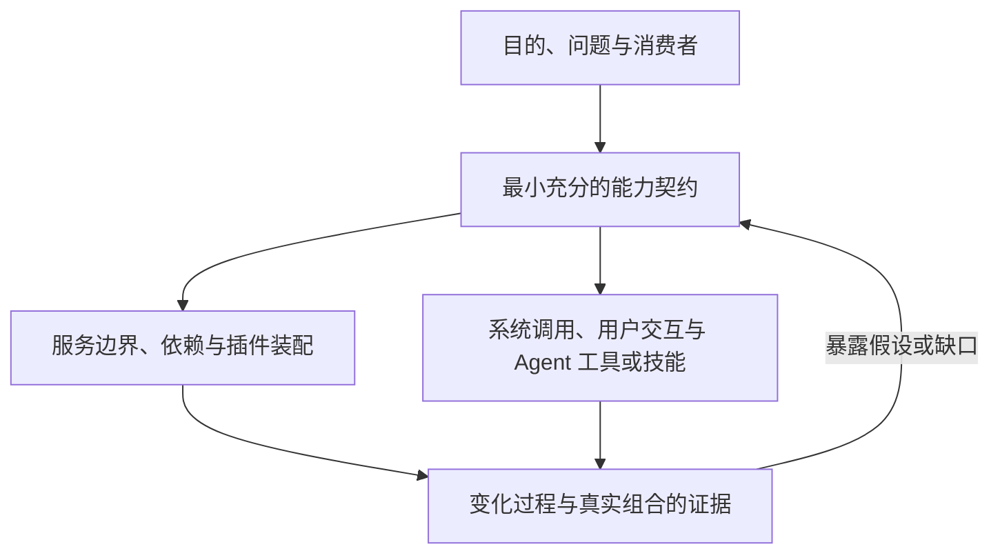

# 总体设计范式

[指南首页](../README.md) · [本组索引](README.md)

## 目录

- [系统的描述对象](#系统的描述对象)
- [以契约组织能力](#以契约组织能力)
- [从目的到可演化的实现](#从目的到可演化的实现)
- [项目边界](#项目边界)
- [最小正确模型](#最小正确模型)

## 系统的描述对象

完全动态目标及原始定义归 [SYS-DYNAMIC](../../requirements/system/fully-dynamic-system.md)，
本页解释其建模方向，原文量词未决不由本页裁决。定义、能力集合、实现和组合关系
可以在运行中变化。设计需要描述三件事：哪些结构可以存在，某个结构下允许发生什么行为，以及结构之间如何合法转换。允许变化的范围及其约束也必须明确。

系统可以理解为：一组已声明的能力，由当前活跃的实例提供，通过显式依赖和交互协议组合；这些实例读取、产生或保存状态，其行为受契约与不变量约束。[概念定义](concepts.md)给出这些词汇的统一含义。

这种表达不要求每个数据对象都有插件实例。独立创建、管理和发布的定义可以是一个服务管理的记录；真正获得运行资源和参与组合时，才需要相应的实例与生命周期。

## 以契约组织能力

能力边界隔离一个具有稳定含义的职责。消费者说明自己需要什么，提供者说明自己承诺什么；具体实现可以变化，但已经承诺的可观察含义必须保持，或通过明确的契约变更重新约定。

设计中分别说明机制、策略和证据：机制提供可实施的操作；策略选择什么时候、对谁使用；证据支持某项性质成立。例如运行时提供撤除能力，产品策略决定何时允许撤除，清理测试和行为规格说明撤除后哪些关系必须消失。

所有权树、服务依赖图、作用域关系、业务因果关系和部署拓扑有不同含义。它们可以关联，但不能仅因为图形相似就共用一个隐含关系。详见[能力边界](../modeling/capabilities.md)。

## 从目的到可演化的实现

先问这项能力为谁解决什么问题、消费者需要观察到什么结果，再定义最小充分的
契约。“最小”指没有无职责的概念，“充分”指能解释所需行为；只保证不发生错误
还不够，需要同时表达适用的状态不变量、安全约束、允许的变化和进展要求。
身份、状态权威、授权、所有权与失败语义按实际需要展开，不为凑齐模型引入实体。

图表示需要互相校准的视图，不是固定阶段。服务按对消费者的责任划分，插件按
实现的装配、配置、资源所有权和独立演化需要组织；不先列插件容器再往其中分配
服务。谁来消费能力从一开始就参与判断，Agent 使用面的具体表达见
[能力消费方式](../modeling/capabilities.md#系统机制与-agent-消费方式)。

对 Cordis 系统，同时设计某一时刻的合法组合和组合改变的过程。依赖尚未就绪、
撤除或替换后，谁关闭准入、谁持有在途工作、谁完成结算、什么状态跨实例保留，
都需有明确归属。内核机制与具体提供者的映射用于兑现这些承诺，不自动选择业务
政策。纯计算不必拥有运行实例，单机交付也不预建全部远程基础设施。

语言无关不等于省略实现设计。关键语义先明确；技术研究可与候选规格相互校准；
被消费者依赖的具体提供者映射在相应实施前闭合。设计的就绪范围与长期正文沿
[规格维护](../../maintenance/spec-maintenance.md)管理，不把施工计划作为永久的
接口或装配权威。

## 项目边界

遵循[跨系统要求](../../requirements/system/constraints.md)的已确认范围：第一版交付单机系统，关键边界在设计时应能支持未来独立扩展到分布式、异构节点或微服务部署，并保留领域语义；租户隔离从第一天成立，模型请求统一经 OpenRouter。

这些要求需要明确的身份、操作和失败契约。它们不要求第一版预先实现网络发现、集群协调或多套存储框架。依赖实际 Cordis 机制时，先用语言无关的关系描述要求，再核对内核实现能承担的部分。

## 最小正确模型

抽象应当保护不变量、隔离真实变化，或承载明确边界。满足需求的成熟库优先于自建机制；同一概念复用权威定义，跨上下文也不因目录不同而重定义。

简单性体现为读者能够解释状态、所有权、失败和变化。隐藏后台任务的短函数可能更难理解；没有独立职责的多层包装同样增加负担。尚无真实使用需求的抽象不应仅以“未来可能需要”成立。

例如，系统只有一种提示词记录，并不因此需要多级 Repository 工厂；但它需要独立发布、授权引用和动态渲染时，这些行为必须有明确契约。具体职责是否分服务，由独立演化和所有权需求判断，见[设计判断](../assurance/judgment.md)。
