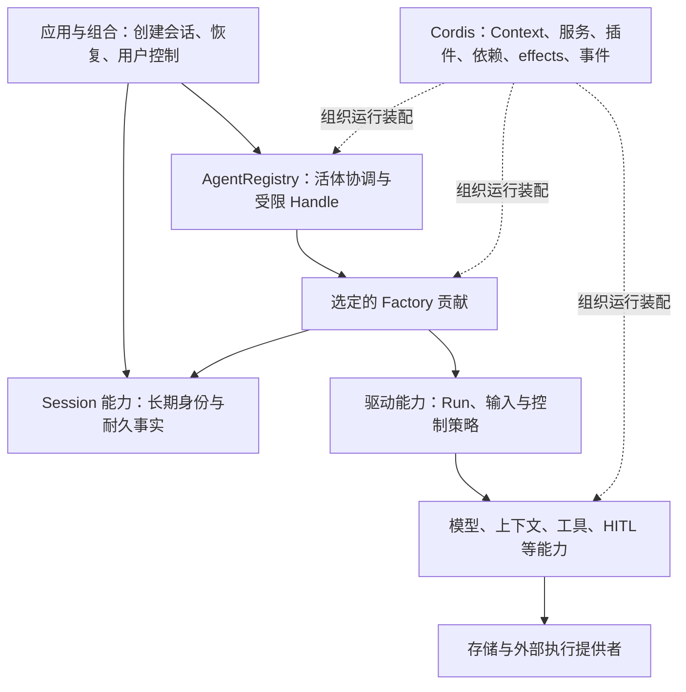
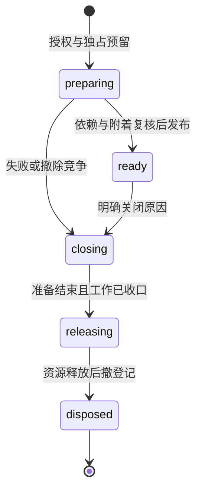

# Agent 运行时

本页是运行时设计的系统视图；选择依据见[提案](../proposals/agent-runtime/README.md)，
精确身份和行为分别归 [data.agent-runtime-identity v1](../../spec/data/agent-runtime-identity/v1/contract.md)
与 [capability.live-agent v1](../../spec/capabilities/live-agent/v1/contract.md)。
本版是内核运行时的设计基线；正式化授权与采用范围见上述提案和
[D-005](../decisions/D-005-agent-runtime.md)。目标 v1 尚未实现；[定向 fork](../../packages/core/agent/README.md)提供已固定来源的实验原语基线。

四类提供者的交接已由 [D-007](../decisions/D-007-runtime-composition.md)与
[Agent/Session 附着组合 v1](../../spec/compositions/agent-session-binding/v1/contract.md)
具体化，系统职责与依赖方向见[共同边界](runtime-composition.md)。
[D-008](../decisions/D-008-core-capabilities.md)已接受本批 Session/Run、模型与工具等
目标契约；[Agent 提供者](../../packages/core/agent/design.md)与
[Session 提供者](../../packages/session/session/design.md)维护当前映射，真实产品组合仍待验收。
图中的"驱动能力"由 [D-012](../decisions/D-012-run-driver-and-inbound.md) 具体化为
[run-driver v1](../../spec/capabilities/run-driver/v1/contract.md)：它在 Session/Run、工具、
人类决定与模型能力的已提交事实上以纯决策函数推进，异步到达经
[session-run v2](../../spec/capabilities/session-run/v2/contract.md) 的 Session Inbound 裁决后
进入；运行时退役只封闭 epoch、保留占位，由 Session 级调度重取。驱动器作为 Factory
准备并拥有的实例驱动如何对接 AR-8～16 与附着组合 CB-08～14，由
[D-013](../decisions/D-013-run-driver-cordis-boundary.md) 接受。系统视图见
[Run 驱动器与 Inbound](run-driver.md)。

## 系统位置

图中的逻辑责任不等同于包、fiber、进程或数据库表。核心产品机制可以位于能力层，
不因某能力也有 runtime 就并入内核。官方 Cordis 提供动态组合机制；本项目维护的
agent fork 兑现活体运行时契约；驱动和其它能力分别兑现自己的产品规则。

## 身份、授权与所有权

一个长期 SessionRef 可经历多个 AgentRef；单机的逻辑协调权威防止同 Session
同时存在两份未释放激活。准备与清理阶段仍占位，所以注册表不能只记录“正在运行”。
同 Session 的新实例不会继承旧句柄的效力。Agent Definition 是授权资产，Run 是
业务执行，两者均独立于活体生命期。

租户显式出现在对象身份和有关操作中，读/控制/事件/解析都在实际入口检查；
Context 的可达性和 initiator 的因果来源不能授权。Registry 查询只给受限描述，
Handle 只给授予的操作，原始登记撤销器留在拥有清理责任的内部边界。
同进程内核与提供者是受信实现；有限信任插件须先有与实际授权相符的执行边界，
不能靠 Context 或私有字段获得恶意代码隔离。

稳定的 Session 运行宿主持有实例资源；临时 master 是业务关系及因果来源。
运行时 owner、业务父系、权限委托和长期工作所有者不能共用一个隐含父指针。
后台工具和独立 child 有自己的 owner，临时实例重建不会自动终结它们。

## 生灭和动态演化

失败/未知以退出阶段上的阻塞和残留记录表达，不能把清理失败伪装成 disposed。
实际 idle/running 由驱动维护；ready 的实例可以没有活动 Run，closing 的实例
仍可能收尾，二者不是同一条状态轴。完成原退出后，才可为原 Session 激活新代际。

新工作采用实际、稳定的绑定；模型/工具等能力配置按其业务边界生效。替换驱动
或必要提供者时，只关闭受影响实例并完成释放；其他装配不必停止。
对实例可选、但正被某项工作使用的贡献，消费能力和贡献 owner 共同保护在途绑定，
按其契约结算后才释放；未确定撤除策略时拒绝繁忙撤除。源码映射和
与 DSH 行为的明确差异见[来源映射](../proposals/agent-runtime/v1/source-mapping.md)。

## 持久化与后续能力

运行时的 Map、Context、Handle、工作许可都不是持久数据格式。Session 持久事实、
独立工作及治理关系跨重建存在；恢复要由它们的权威提供合法状态，不能把重新
activate 报成已经恢复 Run。退役、用户 interrupt、cancel、interrupt_then_run
和 force_stop 仍是不同操作。

本版规定依赖端口的义务；Session attachment、访问验证和驱动的当前映射见
[应用装配设计](../../apps/local-harness/design.md)。这些提供者的真实符合性、
输入/Run、OpenRouter、工具及存储的产品闭环仍需实际验收。
当前 fork 只导入选定 agent 原语及内部 scope 辅助，没有引入其他 DSH 产品子系统；[覆盖与缺口](../proposals/agent-runtime/v1/requirements.md)
及[验证说明](../../spec/capabilities/live-agent/verification.md)限定当前结论。
