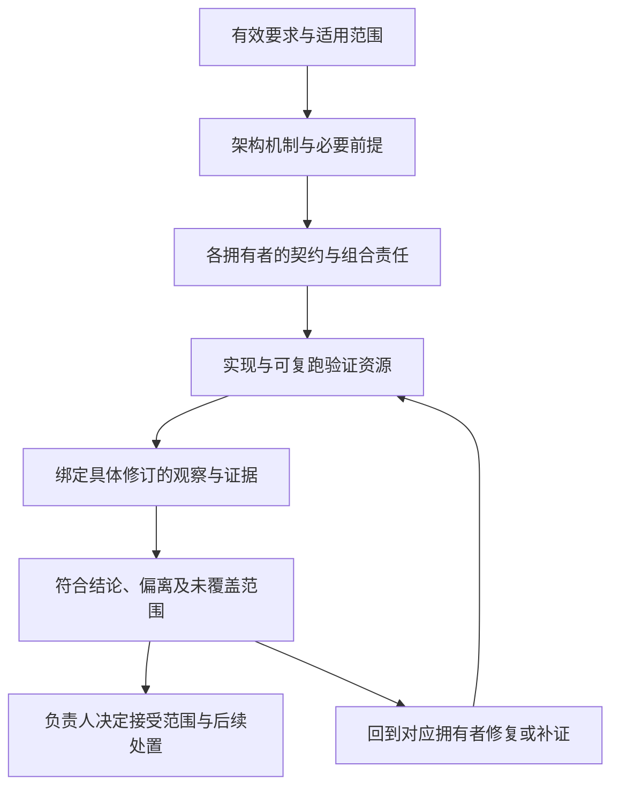

# 质量论证与符合性

本页说明架构怎样支撑系统质量要求，以及怎样判断具体交付是否符合这些要求。它连接系统承诺、实现责任与可核对的证据，供架构负责人、开发者、验证者和 agent 定位本次工作。

[项目要求](../requirements.md)拥有系统目标，[目标与约束](drivers-and-constraints.md)拥有质量优先级，各架构专题拥有相应的目标设计。工程验证方法、命令和交付规则分别由[交付质量与证据](../engineering/quality.md)、[验证说明](../verification.md)和[整洁回路](../clean-loop.md)维护。本页引用这些规则，不维护第二套技能流程、工具命令表或合并门槛。

## 质量场景与判断条件

### 从质量目标到可判断的场景

“稳定”“快速”或“可恢复”需要落到具体场景，才能判断设计和交付是否满足要求。每个场景须明确：

- **目标与范围**：依据哪项有效要求，检查什么工作和边界。
- **环境与前提**：部署装配、数据规模、并发、权限、可用依赖及故障假设。
- **刺激与交错**：正常请求、持续负载、变更、故障，或它们发生的顺序。
- **预期响应**：系统必须保持什么，允许暂停什么，谁负责接续和收场。
- **判断条件**：可观察的业务结果、禁止发生的效果，以及适用的时间或资源预算。
- **证据与责任**：由谁提供什么验证资源，结果适用于哪些版本和配置。

场景中的数值预算由目标拥有者与验证责任方共同明确。没有阈值时，可以报告实际测量和增长趋势，但不能据此宣布性能达标。已有明确的权限、不变量和结果真实性要求，不能因性能阈值尚缺而一并搁置。

### 系统级代表场景

下表是验证选题和责任地图。各专题继续拥有精确行为，表中的场景不替代成员验收，也不要求每次改动全部执行。

| 质量场景 | 必须判断的结果 | 主要架构依据 |
|---|---|---|
| 长期会话持续积累数据 | 会话创建、恢复、日志读取及上下文组装在声明规模下的成本；工作集是否受控，结果是否完整，不只检查新会话。 | [数据与状态](data-and-state.md)、[请求上下文](runtime/request-context.md)。 |
| 多租户、多 Agent 持续并行 | 正确归属、单一有效推进、吞吐、排队和尾延迟；共享瓶颈与局部过载的影响范围。 | [Session 与 Run](runtime/session-and-run.md)、[执行与通信](deployment/execution-and-communication.md)。 |
| 待机、等待模型、后台工具或 HITL | 无须推进时的计算、内存、句柄和连接占用；重新唤醒时的资格、位置及结果承接。 | [Agent runtime](runtime/agent-runtime.md)、[控制与恢复](runtime/control-and-recovery.md)。 |
| Agent 撤除而模型或工具仍在运行 | 原执行、结果与取消责任不因观察者退出而丢失；独立生命周期及迟到结果的处理符合契约。 | [流式与消费](runtime/streaming-and-consumption.md)、[Cordis 与生命周期](deployment/cordis-and-lifecycle.md)。 |
| 运行时变更与重新装配 | 新旧版本采用边界明确，候选失败有相应处理；在途责任连续，无关工作不发生系统性停机。 | [装配与变化](runtime/assembly-and-change.md)。 |
| 进程崩溃、断连或关键服务不可用 | 已确认事实、原调用与未知效果被正确辨认；恢复不重复推进副作用，兜底及其副作用符合已接受范围。 | [控制与恢复](runtime/control-and-recovery.md)、[部署故障与演进](deployment/resilience-and-evolution.md)。 |
| 文字、图片和语音的组装与流式消费 | 实际输入、显示内容、持久结果与消费位置一致；中断、慢消费者和附件不可用按契约处理。 | [请求上下文](runtime/request-context.md)、[流式与消费](runtime/streaming-and-consumption.md)。 |
| 租户切换、撤权和人工决定 | 跨租户访问被拒绝，原对象归属不变；HITL 不绕过授权，等待后的动作重新满足有效条件。 | [身份与授权](security/identity-and-authorization.md)、[跨系统约定](cross-cutting-concepts.md)。 |
| 恶意代码、不可信内容和数据外传 | 在实际执行和传输边界观察禁止效果未发生；拒绝、终止与失败恢复符合威胁模型。 | [安全验证](security/assurance.md)。 |
| 单机服务与云端集群 | 分别在声明装配中验证工作路由、数据可达、故障域和接管；单机结果不外推为跨节点保证。 | [部署拓扑](deployment/README.md)。 |
| 独立模块与 SDK 消费 | 使用公开入口能完成承诺任务，领域能力独立于 Cordis；本地和远程接入保持适用的业务语义。 | [分层与依赖](layers-and-dependencies.md)、[结构与责任](structure.md)。 |
| 诊断、遥测和审计故障 | 能依据实际记录辨认结果与缺口；观测不重新执行动作，也不泄露无权采集或外传的数据。 | [工程观测与结果真实性](../requirements.md#工程观测与结果真实性)、[跨系统约定](cross-cutting-concepts.md)。 |

代表场景在当前阶段展开成逐格的端到端情形与期望时，写成[端到端验收矩阵](../acceptance/README.md)。矩阵引用本页与各专题的承诺，不另立承诺。

性能验证沿质量优先级选择代表路径。TTFT 明确起点和首内容判据，并区分受理、排队、加载、模型请求及消费耗时。吞吐同时报告错误、拒绝和未完成工作，不能把快速拒绝当作成功处理能力。平均值不能掩盖尾延迟、积压或持续增长的资源占用。

## 保证与验证责任

### 论证一项保证需要什么

对影响交付的系统保证，设计须说明：适用条件、依靠的机制、各部分承担的性质、组合后仍须成立的性质，以及证据尚未覆盖的部分。组件分别通过，不能直接推出系统组合通过。

例如，“Agent 撤除不丢失已受理工具执行”不能只由工具单测支撑。论证还须说明谁拥有原调用、谁保留结果、观察者如何退出、结果怎样交接。验证要覆盖 Agent 撤除与工具完成交错，以及交接失败和结果迟到；只观察新 Agent 能启动，不能证明原执行已被承接。

图中的证据支持有范围的判断，不自动授予接受。若需要修改要求或架构，须回到原拥有者取得新依据；不能通过改测试预期、删场景或放宽范围来消除反例。

### 谁对什么负责

| 责任方 | 须维护的内容 |
|---|---|
| 要求与产品拥有者 | 可观察目标、适用范围、阶段边界及尚需确定的验收条件。 |
| 架构负责人 | 保证的分解、跨边界责任、关键前提及整体论证中的缺口。 |
| 公开契约与领域拥有者 | 具体行为、不变量、失败与恢复规则，以及对应验证资源。 |
| 提供者与装配维护者 | 实际依赖和环境、绑定与配置、实现及装配符合性；不能把环境限制隐去后声称满足公共契约。 |
| 跨边界协调责任方 | 端到端工作及失败交接的验证，防止两个组件各自通过却无人承接中间责任。 |
| 验证者与交付负责人 | 固定被验对象、选择相称方法、报告实际结果和局限；由有权负责人决定接受范围。 |

责任可以由同一人或团队承担，但须能定位。没有实现成员的有效要求仍由其产品或架构拥有者维护，不为填写映射而创建空包。独立评审和验收按[风险与影响](../engineering/quality.md#按成果和风险验证)选择，不要求每个小改动配置完整评审阵容。

## 文档与实现的符合性

### 三种问题分别检查

| 检查对象 | 要回答的问题 | 不能代替什么 |
|---|---|---|
| 文档体系 | 必要内容是否存在，版本、引用、拥有者和接受范围是否清楚；正文是否完整且相互一致。 | 文件可检查、链接有效，不等于语义正确或实现符合。 |
| 设计与实现 | 实际接口、依赖、装配和行为是否满足有效承诺，失败与演化时是否仍成立。 | 类型、静态关系及模型通过，不等于实际组合或物理隔离成立。 |
| 工作方法的遵循 | 本次是否取得正确上下文、使用适用方法并完成必要验证。 | 技能已安装、已读取或 hook 已执行，不等于交付结果正确。 |

### 给人和 agent 的定位路径

每项被评估的承诺须能沿以下关系定位：**要求或场景 → 架构条款 → 契约拥有者 → 实际消费者与装配 → 验证资源 → 本次证据**。映射可以分布在已有文档与工具中，用稳定标识和链接连接，不另抄一套要求或中央 SPEC。

agent 从[任务地图](../context-map.md)取得必要上下文，再沿受影响条款展开。能明确目标、拥有者、消费者及所需证据后，停止扩大阅读。发现目标与实现不符时，记录差距；目标含义冲突或缺少决定时，只暂停依赖该结论的行动。

目标关系与实际关系须分开维护。实际成员、导入、装配和覆盖关系应尽可能从源码、配置及验证资源提取，并标明被检查的修订。生成不了的语义映射由拥有者维护并复核，不能仅凭文件名或目录推断。

反向核对同样必要：检查实际入口、数据访问、跨边界调用及新依赖，是否都有有效契约和所需证据。只从已写出的条款向下查，会漏掉新增但未纳入设计的执行路径。没有找到映射时报告缺口，不把未映射路径默认视为无需检查。

## 证据与有效范围

### 方法按所需性质选择

| 方法 | 可以支撑的判断 | 主要限制 |
|---|---|---|
| 结构与静态检查 | 文档位置、引用、导入、依赖方向、公开形状及已配置规则。 | 不能单独证明权限执行、恢复、事务或运行时隔离。 |
| 设计论证与语义评审 | 责任是否完整，前提是否明确，跨边界行为是否矛盾。 | 不能替代真实实现和运行证据。 |
| 模型或形式验证 | 在明确模型、假设和检查范围内的性质。 | 须说明与实现的对应；有限探索不外推到任意规模。 |
| 公开契约与组合测试 | 所消费接口及动作链在被验场景下的实际行为。 | 替身的行为不自动证明真实提供者符合。 |
| 故障、并发和攻击验证 | 指定交错或攻击下的失败边界、禁止效果、交接与恢复。 | 只覆盖实际施加的故障和环境。 |
| 性能与持续运行测量 | 声明负载下的响应、吞吐、资源与增长趋势。 | 依赖数据、硬件、配置及测量方法；短时运行不证明无限期稳定。 |

方法互补，不排列成可互换的分数。选择能暴露目标缺陷的验证：拒绝分支检查禁止效果未发生，恢复检查原工作被正确接续，性能检查计时区域内确实完成了有效工作。适用时用受控错误、已知反例或故障注入确认检查能发现问题；不要求为每次文档修订运行变异测试。

过载、取消、崩溃、进程退出和物理断电各用自己的证据。一种方法的通过不证明另一种已经通过。没有写明负载和平台的数字不是性能承诺。缺工程日志或遥测记录，不把业务结果改成失败，也不把业务结果改成成功。业务账目、授权依据和恢复事实缺失时，按它们自己的契约判断。

| 故障 | 环境 | 成本 | 可复跑步骤 | 证据强度 |
| --- | --- | --- | --- | --- |
| 过载 | 该能力 profile 写明的平台。存储受理队列的平台基线是 Node 24.21.0 内嵌的 SQLite 3.53.4。 | 未测量。 | 在写明的负载上观察拒绝、有界等待或降级。已受理输入仍在。存储队列已满时返回 `queue_full`，并且不发送。 | 规则已写明。没有生产数字下的测量。 |
| 取消 | 运行该提供者的进程。 | 未测量。 | 取消仍在执行的提交。核对观察已经释放，并且预留不因此归还。 | 存储规格已写明这条规则。没有新的测量。 |
| 崩溃 | 进程外能观察到该进程消失的监督者。具体装配未在本页点名。 | 未测量。 | 在进程外确认崩溃。已确认事实按耐久要求仍在。未确认的外部效果保持未知。 | 项目要求。恢复秒数没有。 |
| 进程退出 | 关闭协议的验证平台是 Node v26.0.0。存储语句等待的平台基线是 Node 24.21.0 内嵌的 SQLite 3.53.4。 | 未测量。 | 关闭并读取报告。报告是 `closed`、`failed` 或 `timed-out`。进程在 `close` 完成前死亡，则没有报告。存储期限到达而 SQL 未结束时，结果是 `incomplete`，装配报告是 `timed-out`。 | 关闭协议已有 SIGKILL 试验，并且没有写出报告。该试验不是断电证据。 |
| 物理断电 | 声明的保存介质。 | 未测量。 | 在该介质上断电或做等效掉电，然后检查已确认事实是否仍在。 | 尚未执行。普通 kill、`synchronous=FULL` 和重启不能代替。 |
