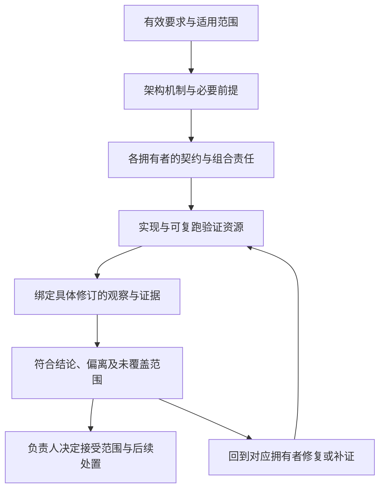

# 质量论证与符合性

本页说明架构怎样支撑系统质量要求，以及怎样判断具体交付是否符合这些要求。它连接系统承诺、实现责任与可核对的证据，供架构负责人、开发者、验证者和 agent 定位本次工作。

[项目要求](../requirements.md)拥有系统目标，[目标与约束](drivers-and-constraints.md)拥有质量优先级，各架构专题拥有相应的目标设计。本页也拥有验证的原则：按风险定验证的深浅，各类测试由谁承担，一份证据能支持什么结论，哪些设计必须给出证明。命令以工具自己的帮助为源，结构读数的带位与硬线归[整洁回路](../clean-loop.md)。本页不维护命令表或合并门槛。

## 质量场景与判断条件

### 从质量目标到可判断的场景

“稳定”“快速”或“可恢复”需要落到具体场景，才能判断设计和交付是否满足要求。每个场景须明确：

- **目标与范围**：依据哪项有效要求，检查什么工作和边界。
- **环境与前提**：部署装配、数据规模、并发、权限、可用依赖及故障假设。
- **刺激与交错**：正常请求、持续负载、变更、故障，或它们发生的顺序。
- **预期响应**：系统必须保持什么，允许暂停什么，谁负责接续和收场。
- **判断条件**：可观察的业务结果、禁止发生的效果，以及适用的时间或资源预算。
- **证据与责任**：由谁提供什么验证资源，结果适用于哪些版本和配置。

场景中的数值预算由目标拥有者与验证责任方共同明确。没有阈值时，可以报告实际测量和增长趋势，但不能据此宣布性能达标。已有明确的权限、不变量和结果真实性要求，不能因性能阈值尚缺而一并搁置。

### 系统级代表场景

下表是验证选题和责任地图。各专题继续拥有精确行为，表中的场景不替代成员验收，也不要求每次改动全部执行。

| 质量场景 | 必须判断的结果 | 主要架构依据 |
|---|---|---|
| 长期会话持续积累数据 | 会话创建、恢复、日志读取及上下文组装在声明规模下的成本；工作集是否受控，结果是否完整，不只检查新会话。 | [数据与状态](data-and-state.md)、[请求上下文](runtime/request-context.md)。 |
| 多租户、多 Agent 持续并行 | 正确归属、单一有效推进、吞吐、排队和尾延迟；共享瓶颈与局部过载的影响范围。 | [Session 与 Run](runtime/session-and-run.md)、[执行与通信](deployment/execution-and-communication.md)。 |
| 待机、等待模型、后台工具或 HITL | 无须推进时的计算、内存、句柄和连接占用；重新唤醒时的资格、位置及结果承接。 | [Agent runtime](runtime/agent-runtime.md)、[控制与恢复](runtime/control-and-recovery.md)。 |
| Agent 撤除而模型或工具仍在运行 | 原执行、结果与取消责任不因观察者退出而丢失；独立生命周期及迟到结果的处理符合契约。 | [流式与消费](runtime/streaming-and-consumption.md)、[Cordis 与生命周期](deployment/cordis-and-lifecycle.md)。 |
| 运行时变更与重新装配 | 新旧版本采用边界明确，候选失败有相应处理；在途责任连续，无关工作不发生系统性停机。 | [装配与变化](runtime/assembly-and-change.md)。 |
| 进程崩溃、断连或关键服务不可用 | 已确认事实、原调用与未知效果被正确辨认；恢复不重复推进副作用，兜底及其副作用符合已接受范围。 | [控制与恢复](runtime/control-and-recovery.md)、[部署故障与演进](deployment/resilience-and-evolution.md)。 |
| 文字、图片和语音的组装与流式消费 | 实际输入、显示内容、持久结果与消费位置一致；中断、慢消费者和附件不可用按契约处理。 | [请求上下文](runtime/request-context.md)、[流式与消费](runtime/streaming-and-consumption.md)。 |
| 租户切换、撤权和人工决定 | 跨租户访问被拒绝，原对象归属不变；HITL 不绕过授权，等待后的动作重新满足有效条件。 | [身份与授权](security/identity-and-authorization.md)、[跨系统约定](cross-cutting-concepts.md)。 |
| 恶意代码、不可信内容和数据外传 | 在实际执行和传输边界观察禁止效果未发生；拒绝、终止与失败恢复符合威胁模型。 | [安全验证](security/assurance.md)。 |
| 单机服务与云端集群 | 分别在声明装配中验证工作路由、数据可达、故障域和接管；单机结果不外推为跨节点保证。 | [部署拓扑](deployment/README.md)。 |
| 独立模块与 SDK 消费 | 使用公开入口能完成承诺任务，领域能力独立于 Cordis；本地和远程接入保持适用的业务语义。 | [分层与依赖](layers-and-dependencies.md)、[结构与责任](structure.md)。 |
| 诊断、遥测和审计故障 | 能依据实际记录辨认结果与缺口；观测不重新执行动作，也不泄露无权采集或外传的数据。 | [工程观测与结果真实性](../requirements.md#工程观测与结果真实性)、[跨系统约定](cross-cutting-concepts.md)。 |

代表场景在当前阶段展开成逐格的端到端情形与期望时，写成[端到端验收矩阵](../acceptance/README.md)。矩阵引用本页与各专题的承诺，不另立承诺。

性能验证沿质量优先级选择代表路径。TTFT 明确起点和首内容判据，并区分受理、排队、加载、模型请求及消费耗时。吞吐同时报告错误、拒绝和未完成工作，不能把快速拒绝当作成功处理能力。平均值不能掩盖尾延迟、积压或持续增长的资源占用。

## 保证与验证责任

### 论证一项保证需要什么

对影响交付的系统保证，设计须说明：适用条件、依靠的机制、各部分承担的性质、组合后仍须成立的性质，以及证据尚未覆盖的部分。组件分别通过，不能直接推出系统组合通过。

例如，“Agent 撤除不丢失已受理工具执行”不能只由工具单测支撑。论证还须说明谁拥有原调用、谁保留结果、观察者如何退出、结果怎样交接。验证要覆盖 Agent 撤除与工具完成交错，以及交接失败和结果迟到；只观察新 Agent 能启动，不能证明原执行已被承接。

图中的证据支持有范围的判断，不自动授予接受。若需要修改要求或架构，须回到原拥有者取得新依据；不能通过改测试预期、删场景或放宽范围来消除反例。

### 谁对什么负责

| 责任方 | 须维护的内容 |
|---|---|
| 要求与产品拥有者 | 可观察目标、适用范围、阶段边界及尚需确定的验收条件。 |
| 架构负责人 | 保证的分解、跨边界责任、关键前提及整体论证中的缺口。 |
| 公开契约与领域拥有者 | 具体行为、不变量、失败与恢复规则，以及对应验证资源。 |
| 提供者与装配维护者 | 实际依赖和环境、绑定与配置、实现及装配符合性；不能把环境限制隐去后声称满足公共契约。 |
| 跨边界协调责任方 | 端到端工作及失败交接的验证，防止两个组件各自通过却无人承接中间责任。 |
| 验证者与交付负责人 | 固定被验对象、选择相称方法、报告实际结果和局限；由有权负责人决定接受范围。 |

责任可以由同一人或团队承担，但须能定位。没有实现成员的有效要求仍由其产品或架构拥有者维护，不为填写映射而创建空包。独立评审和验收按[风险与影响](#按成果和风险验证)选择，不要求每个小改动配置完整评审阵容。

## 按成果和风险验证

按实际成果、风险、影响面与真实输入选择验证。

- 设计成果核对目标、责任、承诺、选择依据、条件、未决和可实施的输入。设计完成不自动批准实施。
- 软件成果核对实际的公开消费、行为、失败、资源、组合与相称的验证。接受级别按[风险分级](#按风险选择接受实现的看法)定。
- 文档与技能成果核对唯一源、触发、路径、来源与维护的消费者。链接、结构、宿主加载、实际遵循和行为结果分别验证。结构完整不代替真实的阅读或任务执行。

选择验证不改变适用的独立接受责任与现有硬线。固定被验候选的修订与字节，输入变了就复跑受影响的检查；旧修订通过不支持新候选通过。必要资源缺失时如实写无法验证，不把精简的验证写成降低了保证或消除了红项。

非性能任务只在影响性能承诺或观察到退化时才加测量。性能结论保留基线、运行条件、重复次数、噪声和代价；没有可比的基线就报告增减不可用。数值门槛由相应目标的拥有者明确，不从一次测量推成全局政策。

### 按风险选择接受实现的看法

接受一份实现类交付之前，先定它属于哪一级。级别决定的只是合入 `integration/mainline` 时要几个人看、看什么，不决定派几个 agent 评审。交接信息包的「起点与风险」写明级别，交回时按它备齐证据。

| 级 | 例 | 人在合入 `integration/mainline` 时做什么 |
|---|---|---|
| L0 | 纯文档、注释、只加不改的内部代码 | 读交付声明，点一次确认 |
| L1 | 普通局部改动 | 读交付声明与收口读数，点确认 |
| L2 | 跨成员、公开契约的可加改动、并发或生命周期 | 读意图与证据；按需派只读子代理作自动审，它的结论是证据，不是批准 |
| L3 | 安全、租户隔离、凭据、同提交状态、CI 与 gate 定义、验收目录、契约破坏性改动、工具链 | 逐行读热点，热点见 [`omne-card` 的 L3 热点清单](../../.meta_harness/agents/skills/omne-card/canonical/SKILL.md#l3-热点清单)；L3 的改动在设计段就要有形式化或故障注入的证据 |

级别取两者中高的那个：交接信息包写的级别，与改动路径推出的级别。改到 `.github/`、gate 相关文件、任何 `acceptance/` 目录、契约快照或 `github-gate` 上 `gate/toolchain-paths.txt` 列出的路径，至少 L3；改到公开契约的可加改动，至少 L2。

级别按改动触及的最高风险定，不按改动大小；拿不准就上调一级。执行仓库没有某项入口
（结构度量、形式任务）时如实写「无此入口」，不以别的证据顶替。绿灯与度量是抽查线索：
级别只规定最低限度的看法，不代替接受者的判断，也不改变接受权归谁。

检查范围归执行仓库。风险级别不把受影响的检查扩大为无条件全仓检查。
计划排除的步骤如实记未执行，不能写成通过。

交付配了可执行验收（本次真实拥有者维护的验收文件，锁定规则在 `repo-toolchain.config.json` 的 `acceptanceLock`）时，
任何级别都多核一件事：**验收自任务基线以来没有被实施提交改动**。执行仓库有验收锁入口就跑它并把输出留作证据；
没有就对着基线提交看那几个文件的差异。验收被实施者改过的交付不接受，无论改得有没有道理——有道理的改动由验收的主人来做。

### 区分四层就绪状态

| 层次 | 能支持的结论 | 不能由此推断 |
|---|---|---|
| 语义接受 | 有明确范围的要求/契约已被有权者接受 | 提供者已有全部实施输入，或必要证明已完成 |
| 提供者可实施 | 被依赖的机制选择、接口、资源/失败责任已明确 | 应用已正确装配 |
| 装配明确 | 实际提供者、配置、消费与跨能力交接可解释 | 真实组合已经运行通过 |
| 实际验证 | 特定版本/环境/范围取得了相应结果 | 未检查范围成立或模型检查等于无条件证明 |

这是报告维度，不是新增的登记状态或四轮审批。
每个缺口说明负责产物/拥有者、受影响消费者、所需决定或证据及闭合条件；
只暂停依赖它的实施，不把不影响公共契约的内部实现选择都当成缺失规格。
语义接受不能绕过具体机制所需的[证明门槛](#组合性质与证明义务)。

## 包级测试责任与边界

测试责任由包的公开承诺和实际职责决定。目录名、测试数量、是否起子进程、使用什么框架，都不决定责任。`fast` 和 `slow` 记录执行成本。单元、契约、集成、端到端记录责任和组合范围。`slow` 不等于端到端。`fast` 不能代替集成证据。

| 测试责任 | 默认承担者 | 应当证明什么 | 范围停在哪里 |
| --- | --- | --- | --- |
| 单元测试 | 原则上每个包 | 本包自身的规则、分支、状态变化、失败和适用边界 | 不为测本包逻辑启动无关系统。不反复验证下游包的内部实现 |
| 契约测试 | 原则上每个包 | 从公开入口观察输入、输出、拒绝、错误，以及本包承诺的所有权、生命周期和隔离。公开类型与运行时责任分别验证 | 以本包对消费者的承诺为边界。不依赖兄弟包的私有实现来证明契约 |
| 集成测试 | 实现具体存储或应用服务的包 | 本包与兑现承诺所必需的真实数据库、Worker、传输或其他依赖组合之后，事务、持久化、恢复、资源释放和失败传播是否成立 | 只组合该责任所需的参与者。纯定义和值包不因被服务消费而取得整套集成测试责任 |
| 端到端测试 | 明确拥有关键用户旅程的业务实现包 | 从该旅程的公开入口到可观察的业务结果，验证必要的关键协作和失败路径 | 只覆盖该拥有者负责的旅程和必要参与者。其他被调用的包不复制同一旅程 |

单元和契约是不同关注点。一次从公开入口运行的测试可以同时覆盖本包逻辑和契约。该测试必须能说明它验证了哪些承诺。

只发布类型、纯重导出，或其他确实没有某类行为的包，可以说明某项不适用。成员拥有者写明理由、替代证据和接受范围。没有运行时行为时，可以用类型消费测试验证公开类型。类型检查不能替代真实的运行时校验。空目录、空脚本、恒真断言或整套 skip 不能充当「都有测试」。也不为了填表制造没有断言对象的测试。

单元和契约测试使用包的公开入口和受控依赖。夹具由本包或明确的测试设施拥有。依赖替身保持公开契约。测试不穿透兄弟包的私有源码，不读取旧实现，也不共享旧产物。测试需要文件、数据库、端口、进程或时钟时，写明谁创建、谁释放、怎样隔离，以及失败后怎样清理。测试不依赖开发者已有的登录、真实 `OMNE_HOME`、工作目录里的偶然状态，或其他用例留下的数据。

测试结果不依赖快慢层怎样拆分，也不依赖文件并行。同一组测试分层跑、两层一起跑（`turbo run test`），或开着文件并行跑，结果必须相同。测试需要写构建产物或其他共享文件时，在自己创建的临时目录里写，并自己清理。测试不删除、不改写成员的 `dist/` 或其他测试会读的共享位置。反例：打包测试如果先删除再重建 `apps/cli/dist`，同时并行运行、经包名读取 `dist` 的测试就会随机失败。所以 `apps/cli` 的打包测试构建到临时目录，不碰 `apps/cli/dist`。这一条是上面隔离要求在运行编排上的具体要求，不是新的测试责任。

测试在系统临时目录下建目录时，一开始就取物理路径。同步写法是 `realpathSync(mkdtempSync(join(tmpdir(), …)))`，异步写法是 `await realpath(await mkdtemp(…))`。原因如下：macOS 默认的 `tmpdir()` 在 `/var` 下，`/var` 是指向 `/private/var` 的符号链接。git、vitest 和 pytest 报告解析后的 `/private/var/…` 路径。测试拿未解析的路径与这些报告比较，在 macOS 上会失败。Linux CI 上没有这种差异，所以发现不了这类问题。这一条由 `pnpm run lint:rules` 的 `test-temp-physical-path` 规则守。

必须由真实组合才能证明的性质，在该集成或旅程的拥有者处验证。模拟数据库不证明事务或持久性。模拟容器不证明 Cordis 行为。普通进程退出不证明物理断电耐久。`synchronous=FULL` 和重启测试同样不证明物理断电耐久。替身的通过范围写清楚。源码导入测试，与实际安装、exports、声明、bin 和构建产物的消费验证，分别承担责任。独立消费测试证明包能被单独消费。它不是业务端到端测试。CLI 的 help 或 version 子进程测试不是整套用户旅程。

配置中的有限正值不是一次测量自动写成的上限。该测量必须写明负载、平台和超限行为，并且只证明这次负载和这个平台。缺工程日志或遥测记录不改变已提交的业务结果。该缺口必须可见。业务账目、授权依据和恢复事实缺失时，按它们自己的契约判断。

跨包改动仍验证受影响的消费者。按影响面选择测试，表示本次运行哪些已经存在的责任。契约共用的符合性用例由契约拥有者维护。各提供者运行适用的部分。本页不改变已接受的安全、租户隔离、事务或生命周期保证，也不取消适用的故障注入和独立验证。

工具链发现并运行成员声明的测试。它不代替成员定义业务测试。

## 文档与实现的符合性

### 三种问题分别检查

| 检查对象 | 要回答的问题 | 不能代替什么 |
|---|---|---|
| 文档体系 | 必要内容是否存在，版本、引用、拥有者和接受范围是否清楚；正文是否完整且相互一致。 | 文件可检查、链接有效，不等于语义正确或实现符合。 |
| 设计与实现 | 实际接口、依赖、装配和行为是否满足有效承诺，失败与演化时是否仍成立。 | 类型、静态关系及模型通过，不等于实际组合或物理隔离成立。 |
| 工作方法的遵循 | 本次是否取得正确上下文、使用适用方法并完成必要验证。 | 技能已安装、已读取或 hook 已执行，不等于交付结果正确。 |

### 给人和 agent 的定位路径

每项被评估的承诺须能沿以下关系定位：**要求或场景 → 架构条款 → 契约拥有者 → 实际消费者与装配 → 验证资源 → 本次证据**。映射可以分布在已有文档与工具中，用稳定标识和链接连接，不另抄一套要求或中央 SPEC。

agent 先取得本次任务必要的上下文，再沿受影响条款展开。能明确目标、拥有者、消费者及所需证据后，停止扩大阅读。发现目标与实现不符时，记录差距；目标含义冲突或缺少决定时，只暂停依赖该结论的行动。

目标关系与实际关系须分开维护。实际成员、导入、装配和覆盖关系应尽可能从源码、配置及验证资源提取，并标明被检查的修订。生成不了的语义映射由拥有者维护并复核，不能仅凭文件名或目录推断。

反向核对同样必要：检查实际入口、数据访问、跨边界调用及新依赖，是否都有有效契约和所需证据。只从已写出的条款向下查，会漏掉新增但未纳入设计的执行路径。没有找到映射时报告缺口，不把未映射路径默认视为无需检查。

## 证据与有效范围

### 方法按所需性质选择

| 方法 | 可以支撑的判断 | 主要限制 |
|---|---|---|
| 结构与静态检查 | 文档位置、引用、导入、依赖方向、公开形状及已配置规则。 | 不能单独证明权限执行、恢复、事务或运行时隔离。 |
| 设计论证与语义评审 | 责任是否完整，前提是否明确，跨边界行为是否矛盾。 | 不能替代真实实现和运行证据。 |
| 模型或形式验证 | 在明确模型、假设和检查范围内的性质。 | 须说明与实现的对应；有限探索不外推到任意规模。 |
| 公开契约与组合测试 | 所消费接口及动作链在被验场景下的实际行为。 | 替身的行为不自动证明真实提供者符合。 |
| 故障、并发和攻击验证 | 指定交错或攻击下的失败边界、禁止效果、交接与恢复。 | 只覆盖实际施加的故障和环境。 |
| 性能与持续运行测量 | 声明负载下的响应、吞吐、资源与增长趋势。 | 依赖数据、硬件、配置及测量方法；短时运行不证明无限期稳定。 |

方法互补，不排列成可互换的分数。选择能暴露目标缺陷的验证：拒绝分支检查禁止效果未发生，恢复检查原工作被正确接续，性能检查计时区域内确实完成了有效工作。适用时用受控错误、已知反例或故障注入确认检查能发现问题；不要求为每次文档修订运行变异测试。

过载、取消、崩溃、进程退出和物理断电各用自己的证据。一种方法的通过不证明另一种已经通过。没有写明负载和平台的数字不是性能承诺。缺工程日志或遥测记录，不把业务结果改成失败，也不把业务结果改成成功。业务账目、授权依据和恢复事实缺失时，按它们自己的契约判断。

| 故障 | 环境 | 成本 | 可复跑步骤 | 证据强度 |
| --- | --- | --- | --- | --- |
| 过载 | 该能力 profile 写明的平台。存储受理队列的平台基线是 Node 24.21.0 内嵌的 SQLite 3.53.4。 | 未测量。 | 在写明的负载上观察拒绝、有界等待或降级。已受理输入仍在。存储队列已满时返回 `queue_full`，并且不发送。 | 规则已写明。没有生产数字下的测量。 |
| 取消 | 运行该提供者的进程。 | 未测量。 | 取消仍在执行的提交。核对观察已经释放，并且预留不因此归还。 | 存储规格已写明这条规则。没有新的测量。 |
| 崩溃 | 进程外能观察到该进程消失的监督者。具体装配未在本页点名。 | 未测量。 | 在进程外确认崩溃。已确认事实按耐久要求仍在。未确认的外部效果保持未知。 | 项目要求。恢复秒数没有。 |
| 进程退出 | 关闭协议的验证平台是 Node v26.0.0。存储语句等待的平台基线是 Node 24.21.0 内嵌的 SQLite 3.53.4。 | 未测量。 | 关闭并读取报告。报告是 `closed`、`failed` 或 `timed-out`。进程在 `close` 完成前死亡，则没有报告。存储期限到达而 SQL 未结束时，结果是 `incomplete`，装配报告是 `timed-out`。 | 关闭协议已有 SIGKILL 试验，并且没有写出报告。该试验不是断电证据。 |
| 物理断电 | 声明的保存介质。 | 未测量。 | 在该介质上断电或做等效掉电，然后检查已确认事实是否仍在。 | 尚未执行。普通 kill、`synchronous=FULL` 和重启不能代替。 |

### 证据能支持什么

选择工具根据所需性质，**不把多种证据排成可互相替代的分数等级**。

| 证据 | 能支持的结论与必要边界 |
|---|---|
| 正确性论证或人工审阅的证明 | 说明命题、定义域、前提和推导；只有完整证明才报告为证明，草图与未闭合义务分别标明 |
| 模型检查 | 说明模型、实际探索范围、配置、被检性质及结果；**有限实例未发现反例不能扩展为任意规模或真实实现正确** |
| 机器检查的演绎证明 | 固定命题、证明工件、工具及依赖，实际检查通过；列出公理、环境假设、信任边界及未消解义务 |
| 实现符合性证据 | 固定实际包/fork、源码、配置、装配和环境，观察契约要求的结果；契约测试、故障注入及实机结果分别说明范围 |

检查器未执行、占位证明、跳过目标，或把目标本身当成未验证假设，**都不能报告该目标已经证明**。
实际失败和工具不支持也分别记录。

形式模型与实现之间要能解释：哪些状态和事件对应，哪些实现步骤被抽象成一个动作，
哪些环境或提供者行为被假定。行为的权威是所采用的 TLA+ 规格；
采用其他表示时说明映射，**不建立另一套相冲突的行为**。
没有精化证明时如实说明符合性由哪些场景或轨迹核对支持，**不把模型证明自动延伸到代码**。

可复用证据至少记录：契约与模型版本、源码 commit、工具与版本、命令或配置、
输入边界/假设和结果。通过、失败、不确定和未覆盖均须如实保留。
**有限测试或模型检查不能表述为无条件证明。**

### 分别表述这六种状态

尚未形式化、模型未覆盖、已声明但未执行、执行失败、有限范围通过，
以及实现尚未存在或真实组合未验证——**它们是六件事，不能合并成一个百分比**。

某个模型通过不能扩展为整份契约已验证；结构检查、语义审阅、有限模型、
公共产物消费和真实组合属于不同证据范围。记录后两者时固定实际发行物、
所消费接口及应用装配；**上游源码测试不自动代表实际采用的包**，
单组件和替身通过不代表跨能力动作链闭合。

实现、契约、装配或假设变化后，旧证据保留原范围并标出当前失效部分，
**不让新入口把过往结果投影为当前通过**。

环境缺失、后端跳过、方法不支持和范围未知不能算通过。发现反例时给出契约条款、精确输入和可复跑的路径，不静默改承诺。

### 证明与实现证据

| 需要对应 | 留下什么 |
|---|---|
| 采用对象 | 精确契约、实现/发行物修订，以及证明或模型输入 |
| 抽象状态 | 模型变量对应哪些权威状态与可观察事实 |
| 抽象动作 | 由哪些实现步骤兑现，提交/观察点在哪里 |
| 前提责任 | 谁强制、谁以契约保证、什么仅被诊断、什么仍是假设 |
| 省略部分 | 未建模的失败、并发与资源行为由哪项证据或待办承接 |
| 实际执行 | 工具、配置、环境、结果、覆盖范围与局限 |

模型把清理视为原子成功动作时，提供者仍需兑现这个抽象；
承诺覆盖清理失败、挂起或残留时，应在相应层次建模，不能把目标性质自身无约束地当作前提。
一方假设由另一方承担时引用精确保证，循环互相假定不能闭合整体证明。

### 证据与追溯

性质从[性质核对](../../.meta_harness/agents/skills/harness-design-handbook/canonical/references/properties.md)，证据须能追到规则、模型假设、
实现边界与消费者观察。全称要求表达规范目标，不自动表示已证明。
生成代码、共享测试和相同接口有各自价值，均不单独证明行为等价。

优先观察真实边界：撤除后资源是否消失、失败后状态是什么、受保护访问是否被拒绝、外部写入是否发生。
多个提供者使用共同契约场景，并覆盖影响保证的失败与交错；只检查 mock 次数或成功文字可能漏掉实际结果。
测试预期由契约导出，fixture 不能补造缺失行为。

### 变更与验证范围

有限模型未找到反例，只支持已建模且已执行的范围；运行时检查只支持实际观察的关系；
机器检查证明需有命题、前提与真实工具结果。各类证据不能跨范围互相冒充。

表示、调用方式、观察关系或环境改变时，重新判断哪些旧证据仍适用。
出现反例时先区分实现违约、规格遗漏、模型抽象错误、环境前提变化和新要求，再修正对应拥有者；旧证据只保留其原有范围。
只改局部表达时做相称检查；相关检查通过且没有新疑点后停止，不用重复无关验证增加信心。

## 组合性质与证明义务

以下义务约束本次实际声明和消费的保证。复用已适用的证据，不为目录完整性新造模型。

### 从承诺界定性质

先说明消费者依赖什么，再选择允许的操作和状态表示。Context、服务键或 disposer
的存在本身不证明行为。Cordis 的机制与条件性结论按[采用来源](../../.meta_harness/agents/skills/harness-design-handbook/canonical/references/cordis.md)确认；
项目需要兑现的具体含义仍由能力及组合契约拥有。

| 性质 | 需要说明的含义 |
|---|---|
| 局部可逆 | 在给定有效状态及操作条件下，所附逆操作恢复约定的观察 |
| 撤除正确 | 撤除本实例贡献，保留其他合法贡献和明确保留的事实；依赖使用按契约收口 |
| 释放或交接完成 | 资源或工作到达规定终态，或由明确的新所有者承接 |
| 可交换或互不干扰 | 指定操作族在允许条件和交错下，状态、结果、后续合法操作及撤除满足声明的关系 |
| 授权撤销、工作取消、业务补偿 | 分别由所属契约定义生效点、在途政策及完成条件，不以局部逆操作代替 |

观察关系由契约允许的消费者观察确定，包括必要的返回值、失败、顺序、权限与
后续行为。可以隐藏无业务意义的内部布局，不能为了证明成立而忽略既定的观察。
受控范围按实际访问、所有权和恢复能力划定，不按“内存/磁盘”或“经 Context
取得”直接划分；外部输出与已成立的业务事实沿所属协议保留或处理。

### 证据要求何时触发

逐项按本次声明及其用途判断，可以引用已有适用的证明和模型。下表针对需要
建立的事实，不要求所有提案具有相同附件。完成时点由[就绪范围](#区分四层就绪状态)
与本次消费者需要确定。

| 设计情形 | 所需证据义务 |
|---|---|
| 复用既有受控操作，未改变语义、表示和适用前提 | 核对精确契约、已有证据范围及使用映射；验证实际使用符合契约，不重复证明上游 |
| 自定义局部效应和清理，影响范围明确 | 给出前后条件、所有权、保留范围和正确性论证；实现阶段覆盖相关部分失败、重入/并发及清理结果 |
| 新增共享操作，以其可逆、可交换或互不干扰性质支撑跨组件组合 | 必须给出覆盖所声明操作族和范围的形式化证明；复用定理时补足前提成立的论证 |
| 自定义并发装卸、共享资源交接、代际替换或恢复协议 | 需要相应行为模型及关键性质检查；复用已有完整契约和适用证据可引用。声称已建立检查边界外的结论，或机制选择依赖这种推广时，需相应证明 |
| 依赖上述性质省略或放宽顺序、隔离、排空或冲突检查等控制 | 必须证明所依赖性质及省略/放宽控制后仍保留目标保证；首次设计即省略与取消既有控制同样适用 |
| 外部输出或已经确认不可逆的效果 | 明确不可逆边界、结果不确定性及业务撤销/补偿/恢复协议；按实际协议验证，不构造虚假的逆操作 |

多项适用时分别履行相关义务，不用一项通过替代另一项。对顺序敏感的操作可
明确依赖、限制允许的交错或选用其他满足需求的机制；必须验证实际采用的政策，
串行执行本身不证明撤除能保留后续合法变化。

当需要待设计系统新建立的共享代数保证承载租户隔离、唯一写入权、安全撤除等系统
关键保证，且以其为依据省略或放宽控制约束时，所依赖的证明须经机器检查。
这包括首次设计即省略控制，以及复用原语后改变表示、操作语义或放宽证明前提。
已有证明可复用，但必须满足本次所需级别并补足适用性论证，不能通过改称“复用”
改变门槛。关键性根据所保护
的需求、不变量和失效后果说明，不由包名或角色名判断。其他必须证明的情形可
采用有明确形式命题、完整推导及独立审阅的证明；若声称机器检查通过，必须有
相应实际结果。此处不指定新证明工具或替换 TLA+ 的行为权威地位。

契约中的全称要求是规范目标，不自动是已证明结论，也不单独触发上述新增门槛。
可以接受要求或语义范围并保留未验证状态；依赖强制证明的具体机制选择另行
判断，不能借“接受语义”同时放行它。

不能通过省略性质名称逃避义务：只要方案的成立依赖该性质，就应说明并提供
证据。未触发强制证明仍需相称验证；工具未具备、时间不足或模型能力强都不
消解已触发义务。探索性候选可保留待完成项，不将它们当作可直接消费的保证。

### 命题与前提的责任

证明需要能辨认所量化的状态、参与者、操作和配置范围，操作的定义域、观察
关系、失败模型及进展所需的公平性或终止前提。先定义目标性质，不能将它本身
写成未受约束假设，再以模型检查通过宣称已经兑现。

局部逆关系可写作 `undo_e(apply_e(s)) ≈ s`，但该式只覆盖定义中的条件。允许
其他组件在建立与撤除之间活动时，还需论证其他合法贡献得到保留。交换性不能
只看最终容器相同：必要时包含前向及逆操作、返回结果、可执行条件，以及后续
操作或继续执行选择。停止请求与静止、逆序调用与异步完成顺序分别按实际契约
表达。重复清理的调用协议需明确，不一概要求数学逆操作本身幂等。

服务提供者拥有受控接口和表示方式所承诺的性质；消费者负责满足自身调用及
生命周期条件；装配负责实际依赖与作用域；无法由系统兑现的部分保留为环境
假设。一方的假设由另一方提供时，引用其精确保证和证据；循环地互相假定不能
代替证明，循环依赖的性质需要整体论证或先建立独立成立的前提。

区分前提由哪个操作强制、由协议保证、仅被检查器观察或仍未经验证。声明式
接口不能限制绕过它的任意代码；受控 API 的行为证据和宿主执行权限证据分别
取得，不把提示词、Context 可见性或测试环境隔离当作生产安全边界。

### 共享贡献的最小例子

假设一个注册能力的消费者只依赖每个实例各自的条目。A 建立 `a`，B 随后建立
`b`，撤除 A 应保留 `b`。若 A 的逆操作恢复整个旧表，B 的合法贡献会丢失。
按独立注册身份撤除自身条目，可以把关键正确性责任集中到注册能力提供者；
是否需要代际、唯一令牌等表示，由实际身份及旧引用契约决定。

这个例子适合验证“保留他方贡献”，不能自动证明所有注册接口可交换。若条目
顺序决定请求处理，或注册返回值使两个顺序可区分，就需进一步建模观察和顺序
政策。不能借例子接受产品的接口形状，也无需为纯计算组件建立空 effect。

### 把设计义务交给实现

如果模型将清理抽象为原子地移除全部所属资源，组合结论以该抽象成立为前提；
实际 disposer、后台任务和后端必须有对应证据。若所声称保证覆盖清理失败、
挂起或残留，就应在合适层次描述这些行为，不能用理想清理动作遮蔽它们。

按风险从契约导出测试：部分取得资源后失败；两个实例交错建立/撤除；旧清理
晚于新实例发布；清理异常或依赖消失；退出后的晚到结果；外部效果成功但回执
丢失。观察真实资源、权威状态或消费者行为，不能仅断言回调被调用。

共享验证设施应能识别代表性错误，例如空清理、恢复整个旧快照或误删他方贡献。
这可以用少量负例核对测量有效性，不要求所有组件运行统一突变测试。具体版本、
环境、实际结果及局限按[证明与实现证据](#证明与实现证据)记录；
改变表示、调用约束或环境时沿[证据适用范围](#证据能支持什么)重新判断证据适用性。

### 规格的分工

| 表达 | 主要用途 | 不能单独说明什么 |
|---|---|---|
| 概念与契约文档 | 统一词汇、身份、边界、操作含义，引用设计理由 | 全部并发执行都满足性质 |
| JSON Schema | 约束交换/保存的数据形状并引用共享定义 | 跨请求权限、生命周期与最终进展 |
| Alloy | 表达结构关系，在给定范围查找反例 | 任意规模成立或真实运行必然终止 |
| TLA+ | 行为权威规格：状态变化、并发与时序性质 | 被省略的环境与实现细节自然正确 |
| 规范验收场景 | 明确消费者可观察结果，约束不同实现 | 全部状态空间的穷尽证明 |

按需要保护的性质选表达，各工件指向同一语义；不为填满目录制造平行模型。
只有 contract.md 不自动是缺陷，有模型也不自动覆盖完整；达到什么形式化与证据门槛，
由实际承诺和[组合性质](#组合性质与证明义务)判断。
