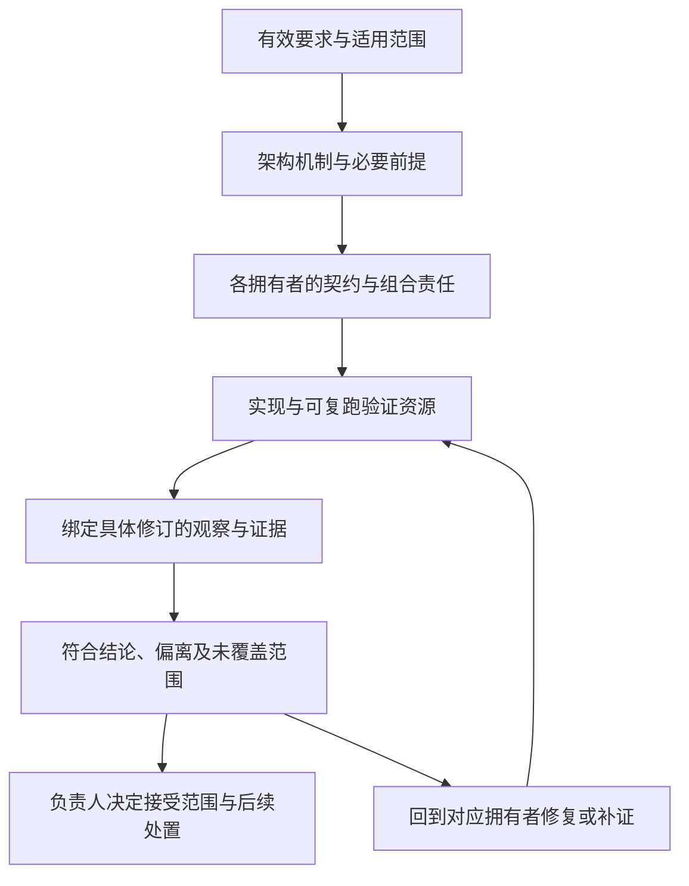

# 质量论证与符合性

本页说明架构怎样支撑系统质量要求，以及怎样判断具体交付是否符合这些要求。它连接系统承诺、实现责任与可核对的证据，供架构负责人、开发者、验证者和 agent 定位本次工作。

状态：目标架构正文已获项目负责人接受。本页规定论证和验证责任，不宣称现有实现已经达标。

[项目要求](../requirements.md)拥有系统目标，[目标与约束](drivers-and-constraints.md)拥有质量优先级，各架构专题拥有相应的目标设计。工程验证方法、命令和交付规则分别由[交付质量与证据](../engineering/quality.md)、[验证说明](../verification.md)和[整洁回路](../clean-loop.md)维护。本页引用这些规则，不维护第二套技能流程、工具命令表或合并门槛。

## 质量场景与判断条件

### 从质量目标到可判断的场景

“稳定”“快速”或“可恢复”需要落到具体场景，才能判断设计和交付是否满足要求。每个场景须明确：

- **目标与范围**：依据哪项有效要求，检查什么工作和边界。
- **环境与前提**：部署装配、数据规模、并发、权限、可用依赖及故障假设。
- **刺激与交错**：正常请求、持续负载、变更、故障，或它们发生的顺序。
- **预期响应**：系统必须保持什么，允许暂停什么，谁负责接续和收场。
- **判断条件**：可观察的业务结果、禁止发生的效果，以及适用的时间或资源预算。
- **证据与责任**：由谁提供什么验证资源，结果适用于哪些版本和配置。

场景中的数值预算由目标拥有者与验证责任方共同明确。没有阈值时，可以报告实际测量和增长趋势，但不能据此宣布性能达标。已有明确的权限、不变量和结果真实性要求，不能因性能阈值尚缺而一并搁置。

### 系统级代表场景

下表是验证选题和责任地图。各专题继续拥有精确行为，表中的场景不替代成员验收，也不要求每次改动全部执行。

| 质量场景 | 必须判断的结果 | 主要架构依据 |
|---|---|---|
| 长期会话持续积累数据 | 会话创建、恢复、日志读取及上下文组装在声明规模下的成本；工作集是否受控，结果是否完整，不只检查新会话。 | [数据与状态](data-and-state.md)、[请求上下文](runtime/request-context.md)。 |
| 多租户、多 Agent 持续并行 | 正确归属、单一有效推进、吞吐、排队和尾延迟；共享瓶颈与局部过载的影响范围。 | [Session 与 Run](runtime/session-and-run.md)、[执行与通信](deployment/execution-and-communication.md)。 |
| 待机、等待模型、后台工具或 HITL | 无须推进时的计算、内存、句柄和连接占用；重新唤醒时的资格、位置及结果承接。 | [Agent runtime](runtime/agent-runtime.md)、[控制与恢复](runtime/control-and-recovery.md)。 |
| Agent 撤除而模型或工具仍在运行 | 原执行、结果与取消责任不因观察者退出而丢失；独立生命周期及迟到结果的处理符合契约。 | [流式与消费](runtime/streaming-and-consumption.md)、[Cordis 与生命周期](deployment/cordis-and-lifecycle.md)。 |
| 运行时变更与重新装配 | 新旧版本采用边界明确，候选失败有相应处理；在途责任连续，无关工作不发生系统性停机。 | [装配与变化](runtime/assembly-and-change.md)。 |
| 进程崩溃、断连或关键服务不可用 | 已确认事实、原调用与未知效果被正确辨认；恢复不重复推进副作用，兜底及其副作用符合已接受范围。 | [控制与恢复](runtime/control-and-recovery.md)、[部署故障与演进](deployment/resilience-and-evolution.md)。 |
| 文字、图片和语音的组装与流式消费 | 实际输入、显示内容、持久结果与消费位置一致；中断、慢消费者和附件不可用按契约处理。 | [请求上下文](runtime/request-context.md)、[流式与消费](runtime/streaming-and-consumption.md)。 |
| 租户切换、撤权和人工决定 | 跨租户访问被拒绝，原对象归属不变；HITL 不绕过授权，等待后的动作重新满足有效条件。 | [身份与授权](security/identity-and-authorization.md)、[跨系统约定](cross-cutting-concepts.md)。 |
| 恶意代码、不可信内容和数据外传 | 在实际执行和传输边界观察禁止效果未发生；拒绝、终止与失败恢复符合威胁模型。 | [安全验证](security/assurance.md)。 |
| 单机服务与云端集群 | 分别在声明装配中验证工作路由、数据可达、故障域和接管；单机结果不外推为跨节点保证。 | [部署拓扑](deployment/README.md)。 |
| 独立模块与 SDK 消费 | 使用公开入口能完成承诺任务，领域能力独立于 Cordis；本地和远程接入保持适用的业务语义。 | [分层与依赖](layers-and-dependencies.md)、[结构与责任](structure.md)。 |
| 诊断、遥测和审计故障 | 能依据实际记录辨认结果与缺口；观测不重新执行动作，也不泄露无权采集或外传的数据。 | [工程观测与结果真实性](../requirements.md#工程观测与结果真实性)、[跨系统约定](cross-cutting-concepts.md)。 |

性能验证沿质量优先级选择代表路径。TTFT 明确起点和首内容判据，并区分受理、排队、加载、模型请求及消费耗时。吞吐同时报告错误、拒绝和未完成工作，不能把快速拒绝当作成功处理能力。平均值不能掩盖尾延迟、积压或持续增长的资源占用。

持续利益对齐按[已明确的阶段范围](README.md#已明确的阶段范围)暂缓专项设计和实现；它不被计为当前已验证能力，也不作为本轮全部交付的前置门槛。

## 保证与验证责任

### 论证一项保证需要什么

对影响交付的系统保证，设计须说明：适用条件、依靠的机制、各部分承担的性质、组合后仍须成立的性质，以及证据尚未覆盖的部分。组件分别通过，不能直接推出系统组合通过。

例如，“Agent 撤除不丢失已受理工具执行”不能只由工具单测支撑。论证还须说明谁拥有原调用、谁保留结果、观察者如何退出、结果怎样交接。验证要覆盖 Agent 撤除与工具完成交错，以及交接失败和结果迟到；只观察新 Agent 能启动，不能证明原执行已被承接。

图中的证据支持有范围的判断，不自动授予接受。若需要修改要求或架构，须回到原拥有者取得新依据；不能通过改测试预期、删场景或放宽范围来消除反例。

### 谁对什么负责

| 责任方 | 须维护的内容 |
|---|---|
| 要求与产品拥有者 | 可观察目标、适用范围、阶段边界及尚需确定的验收条件。 |
| 架构负责人 | 保证的分解、跨边界责任、关键前提及整体论证中的缺口。 |
| 公开契约与领域拥有者 | 具体行为、不变量、失败与恢复规则，以及对应验证资源。 |
| 提供者与装配维护者 | 实际依赖和环境、绑定与配置、实现及装配符合性；不能把环境限制隐去后声称满足公共契约。 |
| 跨边界协调责任方 | 端到端工作及失败交接的验证，防止两个组件各自通过却无人承接中间责任。 |
| 验证者与交付负责人 | 固定被验对象、选择相称方法、报告实际结果和局限；由有权负责人决定接受范围。 |

责任可以由同一人或团队承担，但须能定位。没有实现成员的有效要求仍由其产品或架构拥有者维护，不为填写映射而创建空包。独立评审和验收按[风险与影响](../engineering/quality.md#按成果和风险验证)选择，不要求每个小改动配置完整评审阵容。

## 文档与实现的符合性

### 三种问题分别检查

| 检查对象 | 要回答的问题 | 不能代替什么 |
|---|---|---|
| 文档体系 | 必要内容是否存在，版本、引用、拥有者和接受范围是否清楚；正文是否完整且相互一致。 | 文件可检查、链接有效，不等于语义正确或实现符合。 |
| 设计与实现 | 实际接口、依赖、装配和行为是否满足有效承诺，失败与演化时是否仍成立。 | 类型、静态关系及模型通过，不等于实际组合或物理隔离成立。 |
| 工作方法的遵循 | 本次是否取得正确上下文、使用适用方法并完成必要验证。 | 技能已安装、已读取或 hook 已执行，不等于交付结果正确。 |

### 给人和 agent 的定位路径

每项被评估的承诺须能沿以下关系定位：**要求或场景 → 架构条款 → 契约拥有者 → 实际消费者与装配 → 验证资源 → 本次证据**。映射可以分布在已有文档与工具中，用稳定标识和链接连接，不另抄一套要求或中央 SPEC。

agent 从[任务地图](../context-map.md)取得必要上下文，再沿受影响条款展开。能明确目标、拥有者、消费者及所需证据后，停止扩大阅读。发现目标与实现不符时，记录差距；目标含义冲突或缺少决定时，只暂停依赖该结论的行动。

目标关系与实际关系须分开维护。实际成员、导入、装配和覆盖关系应尽可能从源码、配置及验证资源提取，并标明被检查的修订。生成不了的语义映射由拥有者维护并复核，不能仅凭文件名或目录推断。

反向核对同样必要：检查实际入口、数据访问、跨边界调用及新依赖，是否都有有效契约和所需证据。只从已写出的条款向下查，会漏掉新增但未纳入设计的执行路径。没有找到映射时报告缺口，不把未映射路径默认视为无需检查。

## 证据与有效范围

### 方法按所需性质选择

| 方法 | 可以支撑的判断 | 主要限制 |
|---|---|---|
| 结构与静态检查 | 文档位置、引用、导入、依赖方向、公开形状及已配置规则。 | 不能单独证明权限执行、恢复、事务或运行时隔离。 |
| 设计论证与语义评审 | 责任是否完整，前提是否明确，跨边界行为是否矛盾。 | 不能替代真实实现和运行证据。 |
| 模型或形式验证 | 在明确模型、假设和检查范围内的性质。 | 须说明与实现的对应；有限探索不外推到任意规模。 |
| 公开契约与组合测试 | 所消费接口及动作链在被验场景下的实际行为。 | 替身的行为不自动证明真实提供者符合。 |
| 故障、并发和攻击验证 | 指定交错或攻击下的失败边界、禁止效果、交接与恢复。 | 只覆盖实际施加的故障和环境。 |
| 性能与持续运行测量 | 声明负载下的响应、吞吐、资源与增长趋势。 | 依赖数据、硬件、配置及测量方法；短时运行不证明无限期稳定。 |

方法互补，不排列成可互换的分数。选择能暴露目标缺陷的验证：拒绝分支检查禁止效果未发生，恢复检查原工作被正确接续，性能检查计时区域内确实完成了有效工作。适用时用受控错误、已知反例或故障注入确认检查能发现问题；不要求为每次文档修订运行变异测试。

过载、取消、崩溃、进程退出和物理断电使用不同的证据。一种方法的通过不代替另一种。没有写明负载和平台的数字不是性能承诺。A5 的 45 秒冷恢复仍未关闭，不能写成恢复时限。缺工程日志或遥测记录不证明业务结果失败，也不证明业务结果成功。业务账目、授权依据和恢复事实不沿用这条。

### 证据绑定与复用

报告须能辨认被验契约与源码修订、实际产物、装配、依赖及环境，说明方法版本、输入、命令或配置、实际结果和未覆盖范围。性能证据另外说明基线、样本、重复、噪声及资源代价。没有可比基线时，不生成虚构的改善百分比。

直接检查本次真实产物和实际效果。缓存报告、文件时间、代理自述或一次成功编译不能替代必要观察。复用既有证据时，说明相关代码、契约、依赖、配置及假设是否仍适用；改变了哪部分，就重新判断受影响证据，不能把旧版本的通过投影到新版本。

长期维护的内容是当前承诺、必要论证、适用范围及可复跑资源，随实际拥有者保存。单次输出、临时计划和评审记录留任务 `tmp/`。交付声明所引用的证据须在相应评审和接受期间可访问；临时材料丢失而无法复核时，保留未验证状态或重跑，不能用会话记忆补成通过。成果的跨会话保存沿[成果保存与接续](../engineering/publication.md#成果保存与跨会话接续)执行。

## 偏离与未覆盖范围

### 报告必须保留哪些事实

偏离报告同时给出以下视角：

1. **全量存量**：声明范围内的已知偏离及其影响，不只列本次碰到的部分。
2. **本次变化**：相对于明确基线新增、消除及发生变化的项目。
3. **未覆盖与无法判定**：未实现、未映射、未执行、执行受阻、证据失效或语义待裁的部分。

“全量”限定在已声明的检查范围，不表示工具认识整个系统。没有独立基线时，报告增减不可用。要求、规则、适用范围或检查方法变化时，分开解释口径变化和真实修复；删除要求、排除对象或改阈值，不自动计为缺陷消除。

每项偏离应能定位到目标条款、实际对象与修订、观察或反例、受影响路径、检查方法及处理责任。结构计数可以汇总，但符合性结论不能把不同严重程度与未知范围压成一个“完成百分比”。例如已执行并通过、尚未执行、依赖不可用和已知违反，是四种不同事实。

### 发现以后怎样处理

| 发现 | 处理方向 |
|---|---|
| 已知违反有效承诺 | 保留可复核反例，交实现或装配拥有者修复；需要改变承诺时由原拥有者决定。 |
| 缺少必要实现或验证 | 标明缺失责任和所影响的交付范围，不能以已有文档或其他通过项抵销。 |
| 运行失败或观测方法异常 | 区分被验系统失败、环境受阻和检查器失效，保留真实输出后定位。 |
| 语义冲突或验收条件尚缺 | 交对应要求、产品或契约拥有者裁定，只暂停依赖部分。 |
| 已有范围暂不交付 | 引用明确的阶段决定或延期依据；仍显示缺项，不删除记录制造完成。 |

### 尚未取得关闭依据的组合问题

下列问题沿原有效义务保留，当前未定位到足以关闭它们的输入与证据。它们不是新增项目要求，也不因旧施工页退出而销项。

| 问题 | 当前未知及承接责任 |
|---|---|
| QA-FAC-1，完整 W6 导出与 Schema 拥有者 | 须先恢复原问题的具体导出、Schema 输入和消费者，再定位实际共享形状拥有者及其验证；当前不能把裸 W6 标识当作完整契约或宣称已关闭。 |
| EIS 超时观察 | 因果与关闭依据未定位；由 [QA-V01 求值输入来源的超时观察](assurance.md#qa-v01)定位原观察及受影响组合。 |
| A5 冷恢复观察 | 原 45 秒冷恢复的因果缺口未关闭；须定位原装配、计时范围和恢复链，不能将该观察改写为全系统 SLA 或任意降低原阈值。责任在恢复组合拥有者，具体成员仍待定位。 |

取得当前输入、责任和相称证据后，将结果写回实际拥有者并同步本索引。未定位原输入时保留未知，不以其他场景通过代替。

### 旧技术整合中的目标符合性差距

旧技术材料只能在符合现行架构的前提下承接。源保全、旧接受记录和回归测试都不能证明符合；下列现有机制限制不作为架构例外。

| 差距 | 目标与继续承接的拥有者 |
|---|---|
| 固定代整代停止及串行重建 | [局部依赖范围](deployment/cordis-and-lifecycle.md#依赖换代与就绪)与[reload交接](runtime/assembly-and-change.md#reload-与推进权交接)要求无关工作保持运行。当前限制分别见[LIFECYCLE-M01 关闭机制的局部依赖范围](deployment/cordis-and-lifecycle.md#lifecycle-m01)、[LIFECYCLE-M02 插件加载与换代的影响范围](deployment/cordis-and-lifecycle.md#lifecycle-m02)及[LIFECYCLE-M03 治理宿主的装配停止范围](deployment/cordis-and-lifecycle.md#lifecycle-m03)；由相应机制及装配拥有者共同修复，验证真实消费者范围。 |
| 无Session的完整模型消费协议覆盖 | [独立调用](runtime/model-runtime.md#独立调用)不要求隐式Session。现有Session关联十五操作及单次invokeModel不能代替独立的可靠消费、ACK和恢复；[MODEL-V01 无 Session 的完整消费协议覆盖](runtime/model-runtime.md#model-v01)由模型公共契约及提供者拥有者承接。 |
| 双清理失败的保留 | [有序清理](deployment/cordis-and-lifecycle.md#有序退出与清理失败)要求分别保留结果。当前[CLIENT-M01 本地状态关闭中的多重失败保留](layers-and-dependencies.md#client-m01)会覆盖前一失败；提供者及组合关闭拥有者须修复并验证双失败。 |
| 业务确认与提供者弱耐久配置 | [确认保存的耐久边界](data-and-state.md#已确认保存的耐久边界)不能由SQLite NORMAL的提交返回替代。当前限制及承接责任见[耐久差距](deployment/infrastructure-policy.md#耐久目标与提供者保证)，由Storage、SQL提供者及业务确认协调者继续处理。 |

这些是符合性事项，不是尚未决定的目标语义。文档纠正不等于实现修复；实际反例、工具覆盖和验证完成分别报告，不能把静态读数的未知或零新增偏离当作这些事项已关闭。

## 持续反馈与交付约束

### 与 pstack 和 clean-loop 的分工

本页定义系统保证与证据责任。pstack 提供 agent 的执行方法，clean-loop 提供本仓的持续观察与处置回路。三者通过[工程质量](../engineering/quality.md)衔接，不各自生成一套保证或审批流程。

- **pstack 方法**按任务触发。`principle-prove-it-works` 用于检查真实产物，`principle-test-behavior-not-implementation` 用于判断测试能否发现相关缺陷，`benchmark-checklist` 用于性能证据，`blast-radius` 用于识别改动的外部影响。版本、可用入口和项目采用差异由[工程技能](../engineering/skills.md#pstack-方法入口)统一维护，不把整个技能集设为每次交付的必跑清单。
- **clean-loop**持续反馈可以测量的事实，区分本次变化和存量，并把问题交给有权处理的人。可确定的规则交给传感器；需要语义判断的性质使用有依据的评审；产品取舍和接受范围归负责人。工具发现与修复建议分别表达。
- **系统专项验证**补足回路不能直接测出的性质。代码复杂度、依赖检查或测试数量不能证明长期稳定性、租户隔离或跨进程恢复；这些保证继续由上文的场景与实际证据支撑。

新增检查须说明检测对象、适用范围、失败含义和未覆盖部分。检查器自身也需要已知违规样例或其他相称验证，避免配置漏项、空输入、错误基线或跳过目标仍显示正常。没有观测数据时报告缺失，不能默认没有偏离。

### 交付判断与阶段边界

现有硬线、带位及处置责任由[整洁回路](../clean-loop.md#回路怎么转)拥有。本页保留这些约束，不新增通用门禁。负责人已要求对明确的高风险规则增加交付阻断；每条新增规则仍须确定拥有者、适用交付、判断条件、失败与无法判定的处理及解除依据，再正式采用。没有完成这些定义，不能宣称门禁已经启用。

告警不一律等于禁止合并，工具正常也不一律等于可以交付。是否满足实际接受标准，仍须结合必要验证、有效承诺和未覆盖范围判断。局部修改按风险与影响选择检查；复用有效证据和不执行无关检查不等于降低保证，也不能把必要检查跳过后记为通过。

当前处于 `0.0.0 → 0.1.0`，允许带来正向收益的破坏性重构。符合性检查应跟随明确接受的新承诺和同批消费者迁移，不要求为旧实现维持无依据的兼容。快速迭代仍须保护已承诺的身份、授权、事实与恢复边界。

## 后续细化与维护

本页给出目标架构的验证组织方式。下列事项由对应拥有者继续设计，不能据本页存在推断已经实现。

| 待细化事项 | 承接责任 |
|---|---|
| 性能、规模、持续运行及恢复的数值验收条件 | 项目与产品目标拥有者、相关能力及性能验证责任方；沿[项目要求的待定条件](../requirements.md#尚待明确的验收条件)逐项明确。 |
| 要求、契约、实际对象和验证资源的精确映射 | 各契约与成员拥有者维护语义关系，架构与工具维护者连接现有关系数据；不另建契约副本。 |
| 跨边界故障、并发、攻击和持续负载的验证设施 | 相应协调方、提供者及验证责任方，按交付范围提供可复跑场景。 |
| 语义偏离报告与证据有效性检查 | 文档、架构及验证工具维护者；复用现有传感器，未覆盖部分明确由人工判断。 |
| 新增高风险阻断的具体规则 | 保证拥有者与交付负责人，明确适用范围及失败处理后采用。 |

文档位置、引用与必要章节先沿[文档治理](../engineering/documentation.md)和现有 inventory 检查。完整语义、设计与实现的符合性，以及技能遵循的判断还需对应工具或评审；结构状态为 `inspectable` 不能替代这些结论。

架构、契约、依赖、装配或验证方法变化时，同批更新相关映射、验证资源和本页入口中的责任。系统级未决事项由[架构总入口](README.md#未决事项与后续设计入口)集中导航；单次测量和通过快照不写回本页长期累积。

## 未决问题与待办事项

以下事项沿本页已接受要求继续承接。来源定位不表示现行契约已经完整或验证已通过。

### QA-V01 求值输入来源的超时观察

本项为来源与验证待办。原超时观察的输入、装配、计时范围及因果仍未取得关闭依据。须定位实际求值输入来源和受影响组合，不能以其他正常场景通过代替原问题复核。

承接责任为求值输入来源、求值组合及验证拥有者。待办是恢复可复跑输入，核对现行实现是否仍受影响，并取得与原观察对应的原因和关闭证据。

[封存来源](../../packages.0.0.1.legacy/assets/evaluation-input-store/verification/README.md)仅供核对原范围和消费者；旧接受记录、归档位置与已有测试不能授予冲突设计继续采用。实际限制、待设计输入及验证结果须由各自当前拥有者确认。
