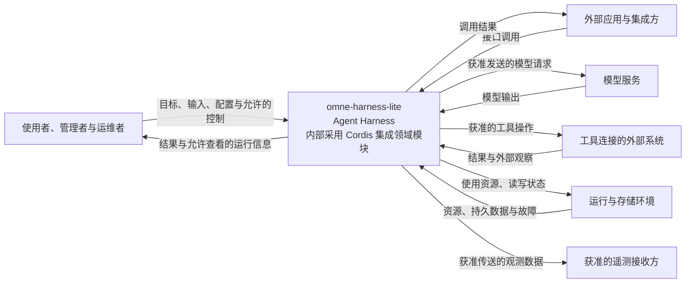

# 系统边界与外部环境

本页说明 omne-harness-lite 负责什么、与谁交互，以及系统内外如何划分责任。目标和全局约束以[项目要求](../requirements.md)为依据；这里说明这些要求形成的系统边界。

状态：已接受的目标架构。下文描述系统应当满足的边界，不表示能力已经实现或验证。具体未决项和旧源切换按[架构入口](README.md#采用状态与当前有效源)处理。

## 范围与外部参与者

### 系统是什么

omne-harness-lite 是一个服务组织或个人的 agent harness。它组织模型、工具、上下文、状态与执行过程，使智能体能够接收目标、采取行动、处理结果并持续工作。

系统承担智能体运行和治理责任。模型提供推理能力，工具连接实际操作对象，harness 负责将这些能力组织成受权限和资源约束的执行过程。模型输出、工具调用和最终产生的外部效果分别判断。

第一版完整交付采用单机范围。关键模块的边界须支持未来独立扩展到分布式、异构节点和微服务部署，且不改变领域语义。当前处于 `0.0.0 → 0.1.0` 研发阶段，最终产品目标与各阶段实际交付范围分别确认。

系统须通过发布时的装配设置支持用户个人设备和云端集群。两类环境保持相同的领域语义，由具体装配承接运行条件；环境支持目标与各阶段交付范围分别说明。

### 系统承担哪些责任

| 责任 | 本系统负责的范围 |
|---|---|
| 智能体执行 | 提供 Agent Runtime 与执行循环，组织输入、模型调用、工具调用及结果处理，管理工作如何继续、停止或恢复。 |
| 模型与工具接入 | 提供能力的公开接口及必要适配，控制调用过程，区分调用结果、失败和实际外部效果。 |
| 多模态输入与输出 | 原生支持多模态内容按接口契约参与输入、上下文、能力调用及输出交付；具体支持范围由相应能力声明。 |
| 上下文与长期状态 | 组织上下文，保存运行记录与需要延续的状态。单个会话的数据持续增长时，累积、加载和读取仍须满足相应性能要求。 |
| 用户感知与利益对齐 | 原生提供对用户的感知与观测能力，支持这些能力持续自主演进，在不违背组织公共利益的前提下，持续最大程度地与个人租户的利益对齐。 |
| 能力组合与生命周期 | 管理能力的定义、实现、绑定与组合，以及运行资源的创建、变化和释放，衔接受变化影响的工作。 |
| 身份、权限与数据保护 | 在数据访问和跨边界操作中落实身份、租户与权限约束，保护数据处理全过程中的安全与隐私。 |
| 人在回路 | 在规定节点向获准的人提供审阅与决策入口，按其决定继续、调整、拒绝或停止工作，管理介入期间的等待与接续。 |
| 稳定运行与恢复 | 分别落实智能体、模型和工具运行时的稳定性与故障恢复责任，协调状态和执行资源，使中断的工作能够按约定接续。 |
| 工程观测与遥测 | 记录运行事实、关联调用与结果，提供查询和获准的远程观测能力，使失败、记录缺失和结果不确定可被识别。 |

用户感知与工程观测各有目的。前者支持理解服务对象与保持利益对齐，后者支持诊断系统运行和核对结果。两者的数据使用均受权限、处理目的和隐私要求约束。

### Cordis 与领域模块的关系

系统使用 Cordis 提供装配、组合、依赖注入与生命周期管理能力。Cordis 位于系统内部，集成代码负责将领域模块接入这些机制，集成时须遵循相应契约。

领域模块的职责、公开接口与实现独立于 Cordis。模块满足自身声明的依赖和资源条件后，可以通过公开接口单独使用，无须启动 Cordis 运行环境。模块的独立使用与本系统中的集成使用，均须遵循其自身行为契约。

完整系统通过组合提供的保证，由相应集成与协调部分承担。例如，跨模块的授权、状态衔接和恢复不能仅由某个模块可独立调用推导出来。采用 Cordis 也不自动兑现这些系统责任。

### 谁与系统交互

以下参与者按系统边界上的交互区分。同一个人或程序可以承担多个角色，具体权限由其身份及操作决定。

| 外部参与者 | 与本系统的交互 |
|---|---|
| 使用者 | 提供目标与输入，接收结果，在权限范围内观察和干预运行。所服务的组织或个人也是用户感知与利益对齐的对象。 |
| 管理者与运维者 | 管理配置、身份、能力和运行环境，诊断故障。管理身份仍受适用的权限与数据保护约束。 |
| 外部应用与集成方 | 通过运行系统的接口提交任务、消费结果，或直接使用公开模块构建自己的应用。 |
| 模型服务 | 接收模型请求并返回输出，对其提供的推理服务负责。 |
| 工具连接的外部系统 | 提供文件、代码仓库、网络服务或业务数据等操作对象，产生并保存相应外部效果。 |
| 运行与存储环境 | 提供进程、计算、网络及存储资源，承载系统运行和持久数据。 |
| 遥测接收方 | 按配置和授权接收观测数据，用于远程监测与诊断。 |

模型训练和外部业务系统的内部实现分别由其拥有者负责。本系统负责与模型服务及外部业务系统交互时的调用、数据和结果处理。本仓的开发工具与 agent skills 属于研发环境，不是产品运行时组成部分。

## 外部交互与信任边界

### 人与外部应用

完整运行系统接收用户操作和应用请求，返回结果及允许查看的运行信息。入口需识别操作主体、所属租户和适用权限。受租户所有权约束的对象及跨边界操作显式携带租户身份，跨租户访问默认拒绝。自然人的全局身份与租户成员关系分别表达。

直接调用公开模块时，调用方须满足模块声明的前提。模块契约与调用方的集成责任共同说明身份、权限、持久化和恢复由谁负责，不能默认获得完整 harness 才能提供的保证。

### 模型服务

本系统负责组织请求、适配传输、处理响应与调用失败，模型服务负责推理。模型接入方式由具体技术采用决定，系统边界不依赖某个固定请求通道。

发送给模型的上下文受数据使用和对外传送权限约束。模型返回的内容与工具调用意图是后续处理的输入，不授予操作权限，也不证明操作已经完成。系统仍须按相应规则决定是否执行，并根据执行结果记录事实。

### 工具与外部效果

本系统负责工具接入、调用控制、执行跟踪和结果处理，外部系统负责其自身行为与数据。工具在本机执行或访问远端服务，都需要明确操作权限和效果归属。

调用返回、取消请求和释放执行资源，与外部效果是否发生是不同的事实。例如，写入外部系统后连接中断，不能仅凭调用失败判定写入未发生。可否重试、如何确认、能否补偿，以及恢复时怎样继续，由具体操作的契约规定。

### 运行环境与持久状态

运行环境提供资源，本系统负责所管理状态的含义、读写与恢复规则。逻辑责任边界与物理部署分别判断：共享同一台机器不会免除访问约束，拆到不同节点也不改变状态语义的归属。

运行时的存续与状态持久化分别管理。执行资源消失后，已保存的定义与状态仍应支持约定范围内的恢复。同构资源下的恢复与异构环境适配须分别说明成立条件；进程重启、重新装配或新建空白实例均不能单独证明既有工作已经恢复。

### 数据流转与遥测

数据保护覆盖采集、处理、保存、传输、共享、保留和删除。用户感知、模型请求、工具操作、持久状态与工程观测都受这一边界约束。读取数据的权限不自动包含向外传送或用于其他目的的权限。

遥测按配置向获准接收方传送指标、日志与调用链。系统须控制接收方、数据内容与用途，按需过滤或脱敏，避免秘密值进入普通日志和遥测。采集或传输失败及数据缺失须可识别，不能将缺失记录当作成功证据。

## 系统上下文图

下图表示完整 harness 的责任边界与主要交互，不表示包结构、进程数量或能力完成情况。Cordis 用于系统内部的集成；领域模块也可以按自身契约独立提供给外部应用使用。

一个外部系统可以同时承担多种角色。例如，某个服务既能接收工具操作，也能提供存储资源。每条交互仍分别遵循其调用、权限和数据契约。

## 尚待明确的接缝

<!-- documentation:placeholder -->

整体系统责任已在上文说明。以下交互尚缺少具体责任划分，后续专题须结合产品规则明确；这些缺口继续登记，不用现有实现补作默认答案。

| 接缝 | 需要明确的责任 | 承接的架构专题 |
|---|---|---|
| 用户与外部应用入口 | 提供哪些操作，哪些主体可以观察、控制或修改运行，各入口承担哪些保证。 | 总体结构、关键运行过程、安全与隔离 |
| 工具执行环境 | 系统管理到哪一层，外部执行者如何交付结果，资源、隔离与取消分别由谁负责。 | 总体结构、关键运行过程、部署拓扑 |
| 状态与恢复 | 必须保存哪些状态，恢复依赖什么资源，中断时由谁确认外部效果及接续位置。 | 数据与状态、关键运行过程、部署拓扑 |
| 外部依赖故障 | 模型、工具、存储及遥测接收方不可用时，由谁报告失败、决定继续或停止，以及如何处理未确认的结果。 | 关键运行过程、跨系统约定、安全与隔离 |

具体接口和行为由实际拥有者维护。性能数值、支持规模、恢复时间和数据保留期限等验收条件，随相关专题与规格细化；不要求在本页先全部定案。
