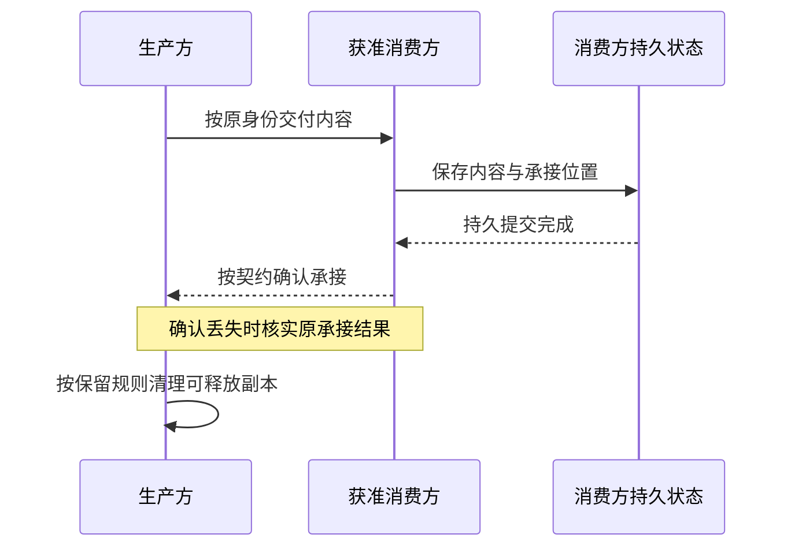
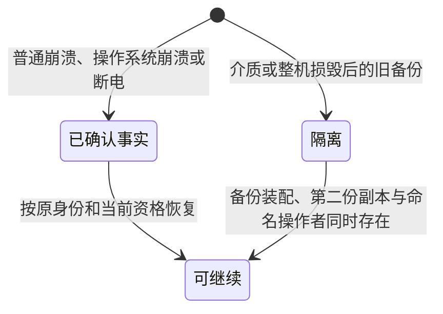

# 数据与状态架构

本页说明系统如何保存业务事实、表达当前状态，并在运行时替换和故障后接续工作。核心是明确每份数据的业务拥有者、持久保存确认和后续处理责任，使长期运行不依赖某个进程一直存活。

状态：已接受的目标架构。本页承接[项目要求](../requirements.md#持久状态与恢复)和已明确的产品规则，约束后续设计，不声明当前实现已满足要求。具体 Schema、存储接口和验证资源随实际拥有者维护，运行时序由[运行架构](runtime/README.md)维护。

## 数据所有权与事实源

### 业务拥有者与保存责任

业务拥有者决定数据的含义、合法变更、读取资格和保留义务。存储提供者负责按契约保存、读取和提交数据，不能因数据存入同一个数据库而取得全部业务决策权。Cordis 的实例、作用域和生命周期也不决定业务数据的归属或存续期。

同一业务事实只有一个权威来源。其他部分通过公开契约读取或提交变更请求，不直接修改拥有者的内部数据。为查询保存的副本须标明来源和覆盖进度，不能成为另一个独立裁定事实的来源。

| 数据范围 | 业务拥有者及其责任 | 跨边界约束 |
|---|---|---|
| 账号、组织、租户、成员与权限 | 身份和治理能力维护身份、关系及授权事实。全局账号与租户成员关系分别表达。 | 数据归属、当前成员资格和访问许可分别判断。退出组织不自动销毁租户私有数据。 |
| 资产、版本、持有、配值与分享 | 资产能力维护内容与版本，持有和分享关系的拥有者维护关系及附属配值。 | 分享引用源资产，复制产生独立版本线。读取副本不转移所有权。 |
| Session、Run 与执行尝试 | 会话能力维护会话历史、输入受理、推进资格和工作进度。 | 三类 runtime 各有生命周期，会话按逻辑工作关联它们。进程状态不能冒充工作事实。 |
| 模型调用、工具调用及结果 | 各调用能力维护原调用身份、执行事实、结果和交接状态。 | 结果、消费决定与账目分别归相应拥有者。观察者看到内容不等于消费方已承接。 |
| 装配与 Runtime Context | 各定义、选择和注册的拥有者保存相应依据，运行方保存本次实际采用的信息。 | 历史采用值解释原执行，当前可用性和授权来自当前权威来源。 |
| 工作区、实例与沙箱数据 | 工作区能力维护工作区及关联，执行环境按约定托管文件和资源。 | 解除关联不等于删除文件。短寿命实例不能承担租户长期数据的唯一保存责任。 |
| 日历、日程、Job 与通知 | 对应能力分别维护发布版本、触发规则、已接下的工作及交付事实。 | Job 的既有采用依据不随日程后来变更而改写。通知目的地不决定 Job 的所有权。 |
| HITL 决定与等待 | 原等待的拥有者维护有效答复及执行后果，决策池提供待办视图。 | 删除视图条目不删除历史，原执行终局后不能借旧卡片重新推进。 |

租户数据、共享内容和系统数据分别按自身作用域管理。跨边界记录须保留适用的组织、租户、工作区及原工作身份，不从当前连接、进程或接收者反推归属。读取和导出均须检查当前权限，历史上获准写入不构成永久读取资格。

### 事实、当前状态与读取视图

系统不要求所有领域统一采用事件溯源。拥有者可以维护当前状态、追加事实，或同时维护两者，但须说明哪份数据决定业务结论，以及两者如何保持一致。

会话历史中的消息和非消息事实按其追加规则保存。压缩生成摘要及排除信息，不覆写原历史。其他领域按各自契约维护可变状态，不将会话的追加规则扩大为全系统一律只追加。

工程日志和遥测用于解释行为，不能替代应持久保存的业务事实。对同一事实的用户展示、审计查询和运行恢复应能追溯到同一权威依据；不同读取者仍可获得不同的获准视图。

## 状态分类与持久边界

### 按用途确定持久范围

是否持久保存取决于业务责任和恢复需要，不能仅按对象所在的内存或数据库分类。

| 状态类别 | 典型内容 | 保存与恢复责任 |
|---|---|---|
| 业务事实与处理进度 | 已受理输入、尝试开始、调用结果、有效答复、消费位置和账目。 | 按各自确认边界持久保存，恢复后保留原身份和已发生结果。 |
| 当前定义、选择与关系 | 资产内容、持有、配值、模式选择、注册和授权关系。 | 保存无法重新推导的值及版本。恢复时按原语义解释，使用时核对当前有效性。 |
| 本次执行的采用依据 | 资产与定义版本、装配清单、固定的请求输入及适用执行条件。 | 保存重建原工作和解释结果所必需的信息，不能用最新定义假装原先采用值。 |
| 派生状态 | 待处理列表、当前进度索引、查询投影和可重建缓存。 | 明确权威输入、更新进度和重建方法。持久保存投影可以改善性能，但不改变事实归属。 |
| 运行资源 | runtime 实例、连接、订阅、锁和内存中的句柄。 | 允许重建。重新获得资源前核对工作资格，不把旧句柄恢复为有效授权。 |
| 尚未承诺持久的在途内容 | 未完成交接的流片段和临时计算结果。 | 按原调用的保留与交付契约处理，不因读到内容就宣称已可靠保存。 |

恢复输入还包括当前仍有效的选择和注册、所引用的共享数据，以及必须重新查询的当前条件。只保存历史日志不足以恢复全部行为。反过来，连接状态、瞬时可用性及已失效的权限不能照搬历史快照。

### 已确认保存的耐久边界

[SYS-DURABILITY](../requirements.md#已确认业务事实的持久性sys-durability)要求系统在普通进程崩溃、操作系统崩溃或断电后保留已确认持久保存的业务事实。业务拥有者须将对外确认放在所需数据达到这一耐久边界之后，不能把写入进程缓冲区或收到队列通知当作完成。

这一保证以保存介质仍可读取、部署满足所声明存储条件为前提。提供者须明确同步、刷新及设备能力方面的依赖，装配须核对这些条件。仅有进程重启测试、事务原子性或同机备份，均不能单独证明断电后数据不丢失。

多模态内容的引用和实际内容须共同满足业务承诺。如果已经确认持久保存图片、语音或制品，仅保存一个指向临时文件或即将失效地址的引用不够。若内容由外部来源托管，须明确该来源的保留保证和引用失效后的处理责任。

尚未承诺持久的在途片段、可重建缓存与物理介质损毁分别判断。已展示在途内容应保留到什么程度，由流式交付契约明确；收场后的保存和 ACK 不能证明收场前的耐久性。

### 身份、关联与版本

Session、Run、执行尝试和原调用的身份须跨进程及实例更换保持可识别。一次重试或恢复是否属于原工作，由原拥有者的契约决定，不能通过换一个调用标识绕过重复执行检查。

跨边界事实保留必要的因果关联、所属工作、生产者和消费者身份。attempt 来自 Run 的尝试开始事实，不能另造一套与历史无关的计数。时钟时间用于诊断和产品时间语义，不能单靠时间戳先后裁定并发操作的业务顺序。

资产内容版本、数据格式版本、装配采用版本和查询投影代际分别表达。版本号相同或不同，都不能代替明确的兼容性判断。固定的原请求输入与本次采用依据用于恢复和解释原调用，后续动作仍须核对当前权限。

## 事务与一致性

### 共同成立的业务事实

先确定哪些事实必须共同成立，再选择存储和协调机制。典型边界包括输入与去处责任共同受理、日程定义的完整更新，以及有效答复与原等待状态的一致变更。需要原子提交的组合须明确参与者、存储能力和失败结果。

同一数据库、同一配置或同一文件路径不代表自动参与同一事务。采用共同事务时，各拥有者须通过显式参与契约使用同一提交边界。跨数据库或跨服务时，协调方须定义中间状态、重试和责任移交，不能沿用本地事务的承诺。

系统不要求所有领域共用一个数据库或把完整业务流程放入一个事务。多步业务可以逐步提交，前提是每步留下可解释的状态，故障后能判断谁仍有责任。外部模型请求、工具效果和文件发送不自动成为数据库事务的一部分。

| 提交结果 | 可以得出的结论 | 后续处理 |
|---|---|---|
| 已提交 | 承诺范围内的事实已保存。 | 按原身份读取和推进；重复确认不能重复产生业务效果。 |
| 已回滚或明确未提交 | 该提交没有保存所声明的变更。 | 按原操作规则决定是否重试，仍需单独核对外部效果。 |
| 结果未知 | 尚不能断定提交或回滚。 | 保留原操作身份并查询、对账或等待明确结果，不把未知显示为失败后直接新建工作。 |

客户端断开、超时或取消等待不证明远端停止提交。读取不可用也不能伪装成空数据、未找到或旧缓存中的确定结论。取消业务工作与取消等待提交结果须分别处理。

### 事务域与异步SQLite执行

事务域由存储提供者绑定真实数据库身份、配置和能力，不从文件路径相等推导共同提交。本地SQLite提供者由专用Worker持有写连接，主控制线程只传版本化数据和原操作身份。读连接池由同一提供者管理，默认不增加读连接；需要独立读并发时按读负载和checkpoint前提显式增加有限只读连接。WAL只有一个写者，多写连接不能提高同库写并行度。

必须同提交的组合，由业务协调者登记具名参加者及组合版本。参加者随领域拥有者维护，在Worker内经受管模块装入，在同一连接的BEGIN IMMEDIATE内执行同步命令。命令的解析、授权依据及领域不变量由参加者核对，存储提供者限制参加域及事务资源。禁止跨线程传闭包、Cordis Context或数据库句柄，禁止持事务锁等待网络、模型、工具或HITL。公开业务入口隐藏SQL和运输，事务参加入口仅供有资格的组合协调者使用。

事务同时保存必要业务事实、原操作身份及其输入/组合依据、提交回执和待交接记录。原身份作用域至少区分租户、事务域、操作及协议版本。相同身份绑定不同内容拒绝；相同操作重入先取得旧回执，不能重复产生事实。对外确认只在达到所属耐久能力之后作出，记录包含恢复查询所需的内容或可靠引用。

回包前Worker退出、通信断开、超时及取消观察均可能留下已提交事实，调用方保持原身份并查询。查询无回执仅在旧代际已被排除、旧事务已确定终止、原数据库完成恢复、权威查询成功且该操作未仍在其他受理队列后才可判未提交。无法确证任何前提时保持结果未知，不以不存在或失败代替。新写代际不得与未排除的旧写者并存；跨进程提供者必须兑现相同资格和恢复屏障。

SQLite配置采用WAL、FULL及foreign_keys，并逐连接读回。内嵌引擎须含WAL-reset修复，具体版本及路线归[系统技术基础](technical-foundations.md#共同技术选择)。本地WAL不用于跨机共享网络文件系统。存储提供者记录VFS、文件系统和设备刷新前提，装配不满足时不能开放依赖断电确认的操作。FULL和普通kill验证仍不等于所有部署环境的断电证据。

Worker内同步SQL不占主控制线程，但占用本事务域。操作、分页、事务尺寸、锁等待和维护均有有限预算。排队取消可撤下尚未开始操作；node:sqlite路线不承诺AbortSignal中断在执行SQL。取消观察只释放观察资源，原操作仍有结果拥有者。需严格执行终止的契约必须另选已经验证的interrupt或独立进程边界，终止后仍按原身份认回提交。超时不伪报连接已经关闭。

### 可靠交接与消费确认

数据交接须消除生产方已释放、消费方尚未可靠接住的责任空档。消费方可以异步处理，但接下责任所需的内容和处理位置须先可靠保存。

图示描述消费方保存数据后继续处理的分支，已经完成处理的分支见下文。接口不要求使用同一种 ACK。模型结果按模型调用的消费确认协议处理；工具结果、输入接入和通知交付各自遵循对应契约。

原生产方在交接完成前按契约保管内容。消费方可靠接下后，从自己的保存位置继续处理。模型侧副本获准清理后，恢复不能再依赖从模型侧领取已删除全文。确认承接、完成业务处理与形成账目是不同事实，须分别可查询。

消费方已经完成处理时，保存其契约要求的结果和完成事实即可，不因确认承接而额外要求永久保留完整原始副本。尚需继续处理时，保存的内容或可靠引用须足以支撑原消费位置接续。

消息通知只提示接收方检查权威状态，不自行授予推进权。读取、观察、通知到达和开始处理都不等于完成消费。通知丢失后的补查与重复通知的去重须由相应协调契约承接。

并发恢复者、重复请求和迟到回调须在拥有者处裁定有效性。已经结束的 Run 可以补收属于原工作的结果或账目，但不能借迟到事实启动未经允许的新工作。已确认丢失的工具执行不能仅凭重试方便就自动重放，其外部副作用须单独判断。

### SQL与Streams可靠交接

正式消息队列沿Redis后端政策，Streams只负责通知运输及消费者组位置，不成为领域业务事实的第二权威。需要可靠交接的业务变更、稳定通知身份、具名接收责任和outbox同SQL事务保存。通知包含获准引用与事实位置，内容本身仍由原拥有者保管。不能把Redis入队回复或网络发送当作业务耐久受理。

relay从未承接outbox恢复扫描，在有限容量内向Streams发送并记录尝试及运输位置。发送成功不释放SQL责任。断信、重复发送及Redis数据丢失允许再次通知；通知不自行授予推进权，接收者回原事实源核对当前资格。

接收者将inbox去重身份、可靠承接内容或引用、后续处理责任及消费位置共同保存，再返回承接证明并XACK。承接证明可恢复，关联原通知、实际接收者及其提交依据。inbox同一作用域的重复请求返回同一承接结果，不重复执行业务推进。授权变化或无法保存时不发成功证明，保持原责任或形成明确拒绝，拒绝处置由原交接契约决定。

生产方仅在核实持久承接证明并持久记录解除依据后，按原保留规则清理outbox。XADD、XACK、Redis PEL或易失游标均不足以解除。接收方的承接记录和生产方解除记录不能在各自重放/恢复窗口内丢掉去重依据；删除或归档遵循数据拥有者的保留规则，不为省空间截掉恢复所需记录。缺少证明时继续保管、有限重投和对账。定期扫描未解除记录及拥有者待办索引，消除通知丢失造成的无限等待。

Streams认领只转移运输位置，不证明旧消费者停止。业务推进仍由原事实拥有者以持久条件更新检查有效代际；旧消费者不能推进新工作，但可报告自己原调用的真实收场及费用。外部效果不在inbox数据库事务内，必须由原调用查询或按明确恢复协议核实，不能声称exactly-once。

SQL outbox/inbox交接不依赖Redis独立断电耐久，SQL受理和outbox承担可靠责任。Redis应关闭无界离线排队、设置客户端队列和消息字节预算、按能力分离普通命令与阻塞读连接。若队列提供者自行承诺耐久受理，须固定AOF/刷盘/故障转移及回复条件，使用WAITAOF时在同连接核对应写入与返回阈值，超时返回不算满足；其语义也不成为强一致证明。

### 长期读取与派生状态

超长会话不能让一次当前状态读取、待处理资格查询或请求上下文准备反复扫描全部历史。当前值与待处理位置应有可直接访问的索引或投影，更新随新增事实推进。具体查询成本、恢复成本和数据规模由相应能力定义及验证。

点查询的目标不能扩大成任意列表或任意全文读取都为常数成本。分页、导出和模型上下文组装须按实际读取量控制成本，并明确内容大小、页界和历史范围。压缩摘要和缓存须对应确定的输入范围及版本，不能用来源不明的缓存改变模型输入。

每份跨边界投影须说明以下信息。

1. 权威来源、过滤规则和覆盖到的事实位置。
2. 更新、失效和重建条件，以及重建期间的读取表现。
3. 允许多大的延迟，何时必须回到权威来源核对。
4. 如何在不重复执行业务动作的情况下校验或修复。

权限判断、推进资格、消费确认等正确性条件不能只依赖允许滞后的展示投影。需要共同时间点的数据应使用一致读取边界，不能把来自不同提交的片段拼成从未存在过的状态。投影缺失或落后须可识别，不能把无法判断报告为当前没有工作。

### 缓存懒加载与预热

缓存由数据拥有者维护权威输入、租户和授权范围、源版本或事实位置、计项及计量大小、失效和重建。数据库投影、Schema编译、解析值和活体资源缓存分别设计，不能用一个全局key/TTL代替语义。资格、权限及推进条件使用权威当前值或有证明的版本检查，不能只用允许滞后的展示缓存。

Schema模块按实际使用需求动态加载，不在启动时遍历加载和编译全部Schema。需要校验或转换的消费者触发加载，编译型校验器在首次使用时编译并缓存；并发请求共享同一加载与编译任务，不重复编译。启动就绪所必需的Schema在对应就绪检查使用时加载，纯能力入口不能因懒加载而依赖Cordis装配。

公共 JSON 文本读取不是 Schema 编译，也不是缓存。它的签名和失败归[公共 JSON 文本读取](cross-cutting-concepts.md#json-text-reader)。

Zod提供者区分原生编译、运行时解析和异步解析。首次加载时核对支持子集，使用严格编译检查辨认不支持形状，再选择已经声明的运行时路径。[采用基线](technical-foundations.md#共同技术选择)的递归、异步refinement、coercion及callback catch不能计为原生编译成功，异步解析和codec反向编码也不能套用同步编译收益。refinement和codec函数必须符合对应的纯度要求；编译失败后的运行时回退不能以重复执行callback改变外部事实。TypeBox、Ajv或ArkType的Boolean check与check后clone适配分别计量，不能把适配后的parse当作原生parse等价证据。

纯Schema定义与编译产物由所属Schema提供者在同一进程或执行域全局复用，不为每个请求、Session或Cordis Context重建。缓存键包含Schema身份及内容修订、编译器版本、影响语义的选项和编译依赖修订。依赖范围包括递归引用的Schema、已解析的$ref目标、格式/关键字实现及参与校验的codec；提供者固定这些依赖的有效修订并跟踪其变更。这些输入均未变更时复用同一编译产物；定义、选项或依赖变更时，使受影响的编译缓存失效并建立新缓存项，旧产物保留到使用它的消费者释放；加载或编译失败不保存成功缓存。函数不能跨Worker直接共享，各执行域分别维护编译缓存。

全局复用只适用于可安全共享的纯定义和编译产物，不混入租户凭据、请求值或授权结果。租户专属Schema按租户和访问范围隔离。Schema登记及动态输入限制项数、构造深度、编译成本及缓存大小；仍有有效消费者的未变更编译产物不因普通LRU淘汰而重复构建，预算不足时限制新增Schema准入。运行时校验不默认coercion、填默认或删除字段。同一公共Schema的TS类型与编码由拥有源派生，转换无法保留字段语义时显式拒绝，不产生第二套“近似相同”形状。

编译提供者从不可变的定义与依赖快照构造产物。新版本只接收新消费者，旧租约继续引用旧快照，直到所有有效消费者释放。预算同时考虑定义、编译产物、引擎占用及仍持有的旧版本，不能只按定义JSON字节数宣称编译缓存内存有界。持续变更使旧版本占满预算时，限制新增准入并报告原因，不覆盖旧产物，也不以淘汰活跃条目换取重复编译。有限修订和新进程采样不能证明任意长寿命内存上界。

并发首次加载同一key共享受管的在途初始化。失败移除未成功条目并按有限退避重试，单个观察者取消不撤销其他有效消费者。缓存淘汰与资源关闭分开，持有租约的旧资源先停新借用，已有调用按原归属完成后释放。重建/失效事件可提示回源，通知丢失时仍由版本/进度核对恢复正确性。

长历史保持当前值、待处理资格、追加位置及上下文前缀的索引/投影，查询按游标、内容大小及实际读取范围付出成本。压缩和派生缓存固定源范围，不把展示缓存暗换成模型输入。附件大内容避免跨线程整体复制，受控引用的权限、寿命和读取失败明确承接。

冷启动先准备必需配置、身份依据、迁移、恢复屏障和可履约的基础连接；只对满足条件的能力开闸。罕用提供者、SDK、大历史或搜索索引按需准备。可选初始化失败只降低对应能力就绪，不伪报全部就绪。预热是有界受管工作，前台、控制与结果承接优先获得容量，退出时仍须排空或明确取消。默认仅本地准备；付费模型、外传租户内容或真实工具动作须由原授权和预算另行准入。

## 数据生命周期与演进

### 保留、归档与清理

数据寿命由业务用途、恢复责任、授权和保留规则决定，不跟随 runtime 或进程的寿命。[会话归档](runtime/session-and-run.md#生命周期与工作收束)、成员退出、工作区解除关联和资产分享终止，各自改变对应状态或关系，不自动删除所有相关数据。

归档、停止展示、失去访问资格、消费完成、副本可清理和物理删除是不同状态。清理方须说明删除哪份内容、依据什么条件，以及哪些身份、关系或事实仍需保留。不能用一个“已结束”标记代替全部判断。

模型 ACK 后按契约清理不再需要的模型侧副本，同时保留消费方仍承担的结果和账目责任。会话历史、日历发布版本及其他已有保留义务继续由原拥有者维护。这些规则不推出全系统永久保留，也不推出统一的到期时长。

多模态内容、制品和索引的清理须检查仍有效的引用和读取责任，避免保留记录却提前删除其唯一内容。共享数据须按真实引用及所有权处理，某个租户失去访问资格不等于可以删除其他合法使用者的数据。

凭据、私有内容及备份须遵循数据保护要求。保留用于恢复不自动授权日志打印、遥测上传或跨租户读取。具体保留期限、删除方式与例外由对应产品政策和数据拥有者明确。

### 恢复与备份

恢复须分别回答数据是否完整、工作能否合法继续，以及外部效果是否已经发生。重新创建实例只恢复计算资源，从备份读出字节只恢复某个历史数据状态，两者都不能单独证明业务已经恢复。

| 恢复对象 | 恢复时必须核对的条件 |
|---|---|
| 原逻辑工作 | 原身份、最后可靠承接位置、当前推进资格及尚未明确的提交结果。 |
| 调用及外部效果 | 原调用是否仍运行、是否已有结果、结果由谁保管，以及是否允许重新执行。 |
| 授权与安全关系 | 当前有效资格与撤销事实，避免旧备份复活已失效的凭据、登录和权限。 |
| 投影与缓存 | 权威输入、覆盖进度和重建方法，不能将旧投影视为最新事实。 |
| 内容与关联 | 多模态内容、制品及引用是否完整，所属租户和业务关系是否一致。 |

普通崩溃后的耐久恢复与存储介质损毁后的灾难恢复分别设计。备份须明确覆盖范围、可恢复位置、完整性核验和恢复测试。备份完成、备份可读取、恢复后验证通过和重新开放业务是不同结论。

治理中心已有的备份频率及灾备目标只约束其既定范围，不能直接扩成 Session 或全系统的统一指标。其他能力按所承担业务明确可容忍损失、恢复时限和独立副本要求；本页不预设全系统复制拓扑。

恢复安全状态时，须有足以判断撤销与当前资格的可信依据。依据不足时，相关能力应保持隔离或受限，不能因旧数据可读取就重新开放。介质或整机损毁后的旧备份不重新开放业务。普通崩溃、操作系统崩溃和断电后的已确认事实仍按耐久保证恢复。旧备份保持隔离。备份中的管理员身份不能批准重新开放。重新开放业务需要同时存在真实备份装配、独立的第二份副本和命名操作者。关键依赖不可用时的业务降级由[控制与恢复](runtime/control-and-recovery.md)承接。

### 数据格式与版本演进

数据拥有者维护持久格式、版本解释和迁移规则，存储提供者执行约定的存储操作。跨拥有者的变更须说明先后依赖及可恢复位置，不能由部署启动顺序偶然决定正确性。

迁移至少须明确读取前提、影响范围、完成标记和中断后的处理。失败时不能将半迁移数据交给按新格式运行的业务。能否重试、继续或从备份恢复须明确验证，不能笼统承诺所有迁移都能原地回滚。

业务版本和格式版本独立演进。发布新资产版本不自动替换已采用的旧版本，升级数据格式也不能改写原执行的采用事实。索引和缓存可重建时，优先按新规则重建，避免为可推导数据制造额外权威来源。

当前 `0.0.0 → 0.1.0` 阶段按[研发阶段政策](../requirements.md#当前研发阶段sys-experiment)推进破坏性重构，不为历史接口预留未经要求的兼容层。明确可丢弃的实验数据可以重建；业务数据的迁移、保留或删除须按其真实用途处理，不能默认清空。迁移义务在具名数据集和仍在使用的消费者同时存在时成立。二者缺一时，不删除真实数据。验证针对受影响的数据、提交和恢复路径展开，不要求每次文档或普通业务修改运行全量故障测试。

### 迁移维护与恢复屏障

业务拥有者提供版本化迁移及其必要不变量，存储提供者协调排他迁移、数据库格式、参加者版本和连接代际。先停受影响准入及写者，核原格式，按可恢复步骤执行，再记录完成标记并核对参与者与投影资格后开闸。使用Kysely迁移时检查返回的error及逐项结果，不能因未抛异常报告成功，具体接口见[官方迁移说明](https://kysely.dev/docs/migrations)。非事务步骤明确中断点和重入，不把多个库的迁移伪装成同提交。失败不带病确认已升级，也不因工程演进政策丢弃仍需保护的业务事实。

[采用基线](technical-foundations.md#共同技术选择)的Kysely SQLite默认迁移接缝在后续步骤失败时可能保留前一步DDL。提供者对需要原子的迁移显式建立同连接事务，并验证DDL、数据和迁移标记一起回滚。必须在事务外执行的步骤保留完成位置、部分变更与恢复依据。仅检查Migrator的error不足以证明库已恢复原状态。

checkpoint、备份、长读和清理使用有限维护窗口，实际busy/剩余页及失败可观察，不能只看方法无异常。备份使用SQLite受管备份或符合其协议的方式，不直接复制仍在写的主文件；备份和业务恢复仍分别验收。关闭前核在途读取、语句、备份和消息的责任，再观察连接关闭及Worker真实退出，必要详细状态归[生命周期](deployment/cordis-and-lifecycle.md#有序退出与清理失败)。

上述共同机制不关闭STORAGE-T01及SQL-T01的精确公开契约、提供者和符合性承接。实施任务须把实际行为与验证资源就近交给真实拥有者，不另建中央全模块SPEC。

### 承接与验证责任

各数据拥有者须在公开契约旁列明必需的持久状态、确认边界、原操作查询、保留规则和故障结果。装配方核对提供者的真实能力及部署条件，协调方验证跨边界不变量。测试范围须覆盖所宣称的故障类型，进程终止测试不能替代断电耐久验证。

符合性材料分别报告已兑现、偏离及尚未验证的保证。重点核对确认后数据丢失、结果未知后的重复执行、交接责任空档、旧备份复活权限，以及长期读取随历史增长而退化。存储后端、具体事务协议与故障注入方法由相应设计和验证承接，不以本页替代这些证据。

自定义并发交接的机制拥有者按[实施准入与持续验证](technical-foundations.md#实施准入与持续验证)维护行为模型和关键性质检查，实际参加者、提供者与协调者另取得真实组合及故障证据。模型已检查的有限范围不能替代提供者耐久或跨节点保证。

## 未决问题与待办事项

以下事项沿本页已接受要求继续承接。来源定位不表示现行契约已经完整或验证已通过。

### STORAGE-T01 公共事务与确认契约的承接

本项为契约承接待办。公共事务、存储实例身份、失败、确认、迁移与维护的精确契约尚须定位现行拥有者。提供者的成功返回不能自动证明全部业务共同成立或达到声明故障范围的耐久要求。

承接责任为Storage 公共契约、事实拥有者、提供者与提交协调者。待办是明确公开类型、必要行为和提供者能力映射，验证共同提交、未知结果、资源排空及相称故障范围，不复制封存 SQL 实现为公共政策。

[封存来源](../../packages.0.0.1.legacy/core/storage/SPEC.md)仅供核对原范围和消费者；旧接受记录、归档位置与已有测试不能授予冲突设计继续采用。实际限制、待设计输入及验证结果须由各自当前拥有者确认。
