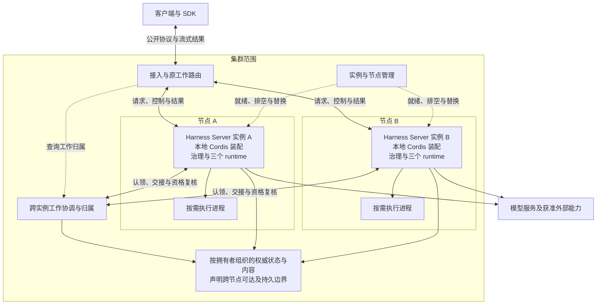

# 集群部署与工作协调

本页说明多份 Harness Server 如何组成集群，以及接入路由、工作协调、节点管理和共享资源分别承担什么责任。

状态：已接受的目标架构。采用范围及阅读路径见[部署入口](README.md)。

## 云端集群装配

云端集群以多份 Harness 服务实例为基础，在它们之外增加集群范围的接入路由、工作协调和节点管理。下图中的每份服务实例都可以沿用单机 daemon 的内部结构，包含治理、Agent 推进以及模型和工具 runtime。每份实例也可以使用辅助执行进程，无须先将三类 runtime 拆成不同的网络服务。

图按职责分组，不规定一个节点只能运行一份实例，也不要求每个框成为独立进程、网络服务或数据库。集群范围的职责可以使用已有基础设施实现，但仍须明确逻辑拥有者与失效行为。状态框表示各自有拥有者的权威数据，不要求所有领域共用一个存储实现。

| 集群增加的责任 | 必须保持的性质 |
|---|---|
| 接入与原工作路由 | 将新请求送往有资格且有容量的实例，将控制、查询与重连送到原工作的当前拥有者或可靠结果服务。连接位置不决定工作归属。 |
| 跨实例工作协调 | 认领、交接与接管遵循同一推进权规则；提交边界拒绝失效推进者。协调服务本身也不能靠单个进程内存独占权威。 |
| 实例与节点管理 | 区分进程健康、业务就绪和可接纳容量，执行排空、扩缩容及替换。实例失联不等于其在途动作已停止。 |
| 跨节点状态与资源 | 恢复实例能访问所需的权威状态和结果，执行位置满足数据、权限及环境约束。节点本地缓存或临时目录不自动成为共享资源。 |

接入路由不作为新增的权威结果副本。流式结果可以转发，也可以通过授权后的独立结果连接交付；重连沿原工作身份和消费位置恢复。会话粘性可以减少跳转，但不能成为单一有效推进或故障恢复的唯一依据。

集群工作协调与实例管理属于外层部署责任。Cordis 继续管理每个执行环境内的装配与生命周期，各实例不共享一棵跨节点 Fiber 树。集群资格变化通过业务协议及拥有者的提交检查生效，不能用远端卸载一个插件代替推进权失效或原调用收场。

## 分布式计算与存储

集群在服务实例之外组织两类资源：承接状态与内容的存储资源，以及承接实际任务的计算资源。两者可以位于相同或不同节点，扩容方式不要求一致。

| 部署责任 | 本层决定什么 | 详细设计 |
|---|---|---|
| 数据放置与跨节点访问 | 接管实例能访问必要状态，内容具有所需保留能力，节点本地目录不冒充共享数据。 | [分布式存储与数据放置](distributed-storage.md) |
| 工作与计算放置 | 分别选择 Run 推进实例和具体调用的执行位置，满足能力、权限、数据与容量条件。 | [分布式计算与执行调度](distributed-compute.md) |
| 两者协调 | 按数据可达性选择执行节点；移动数据、重建计算和接管原工作分别满足自己的契约。 | [访问关系与数据位置](distributed-storage.md#访问关系与数据位置)、[放置条件与准入](distributed-compute.md#放置条件与准入) |

计算节点增加不代表存储容量或可用性同步增加。存储副本增加也不授予新的执行资格。部署须分别说明瓶颈、故障域和恢复前提，再判断一次扩容是否有效。

## 从单机扩展到集群

单机多进程提供可复用的服务与执行边界。集群可以在这些边界之外增加一层协调，并将服务实例扩展到多个节点。这里复用的是服务契约和内部装配，不是将一台机器上的进程逐个搬到不同机器就完成集群化。

扩展前须具备以下条件：

1. 独立于运行实例的寿命保存所需的工作、推进资格、结果与消费位置；跨实例并发遵循拥有者的提交协议。
2. 路由能区分新请求分配与原工作定位，实例交接后不把重连当作重新发起工作。
3. 存储、内容和执行环境声明可达范围，必要资源在目标节点可取得且访问获准。
4. 进程通信可以由跨节点协议承接，处理分区、迟到结果和未知效果，不依赖原进程内存完成恢复。
5. 新实例就绪、旧实例排空、失联接管和旧资格撤销有可验证的协议。

所需能力可由单机提供者和集群提供者分别实现，单机不必预先运行整套集群基础设施。缺少上述条件时，仍可部署多份互不共享工作的独立服务，但不能据此宣称同一批工作能够跨实例扩容和接管。自动将个人设备上的既有工作迁入云端也属于单独的数据与资格交接，不由拓扑相似性保证。
