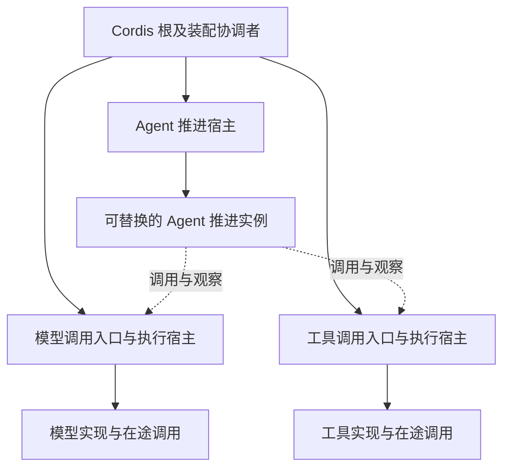

# Cordis 装配与服务生命周期

本页说明 Cordis 本地装配对执行位置、依赖换代、资源所有权和有序退出的约束。

状态：已接受的目标架构。采用范围及阅读路径见[部署入口](README.md)。

## Cordis 运行约束与装配边界

### 本地装配与执行位置

产品装配使用 Cordis 管理本地插件、服务依赖与受管资源。本文把一个根 Context 及其共享的注册、解析和事件设施称为一份 Cordis 装配。派生 Context 可以限制服务可见性，但不会因此成为新的进程、线程或故障域。

一个 JavaScript 执行环境可以运行多份独立装配。同一进程也可以包含多个执行环境。部署不强制一进程一根 Context，也不把 Session 或租户直接映射成一份根装配。按会话装上的插件落在 [IC-17](../cordis-integration-conventions.md#ic-17) 的会话作用域里，不另建一根 Context。各份装配怎样划分，应由独立的启停、配置、依赖换代和资源所有权决定。

同一根下的对象引用、服务解析和事件订阅是本地关系。独立根之间不会自动发现或共享服务。跨线程执行环境、进程或节点时，接收方重新建立自己的本地绑定，发送方通过实现业务接口的代理调用它。不能通过传递 Context、Fiber、函数闭包或 isolate 标签建立远程装配。

同一执行环境中的独立根，可以由装配入口显式绑定公开接口，直接委托本地调用，不要求额外序列化或网络通信。接口提供者仍须管理旧引用、权限和退出责任，独立根不会自动替它完成交接。

### 内核机制对部署的约束

下表依据项目采用的 Cordis 4.0.4 行为。内核事实与由其推导的部署要求分别列出。部署设计仍须满足领域语义，不能把内核不提供的能力直接写成已经存在。

| Cordis 机制或边界 | 对产品装配的要求 |
|---|---|
| Fiber 表示一次插件应用，直接在宿主 JavaScript 执行环境中运行。 | Fiber 不提供专用线程、多核并行或抢占。耗时计算与阻塞工作仍须交给相应执行器；多个根也不能解除同一线程上的阻塞。 |
| 父 Fiber 管理子 Fiber 的撤除。 | 生命周期独立的模型和工具执行不能因被 Agent 调用，就挂成其可撤除子树。装配树按资源所有权组织，调用关系另行表达。 |
| 必需服务未就绪会阻止依赖插件加载；提供者换代会使相关消费者卸载并重跑。 | `inject` 声明同时决定重装配影响范围。只有真正必需的依赖进入该关系，局部依赖放到对应局部生命周期中。重跑必须接回原工作。 |
| 同一服务名与 isolate 标签下不能并存两个提供者；多个根的服务表相互独立。 | 候选试装和新旧并存须分开服务可见范围，并显式选择生效的一份。不能把覆盖登记当成无损切换。 |
| effect 管理登记与清理；不同 effect 的释放可以并发，清理异常可能只记日志。 | 有次序要求的交接与关闭由协调者显式编排。`dispose()` 完成不证明业务已收场、结果已交接或全部资源已释放。 |
| Service 的方法调用可以采用调用方 Context。 | 执行资源由明确的执行拥有者接纳。不能因在方法内取得了 `this.ctx`，就将原调用的存活责任登记到调用者 Fiber。 |
| 事件派发调用本地监听器，不提供远程投递、持久队列或多核调度。 | 事件模式明确是否等待、顺序及失败处理。可靠消息、跨节点控制和工作协调由协议与存储承接，不能只换成 `emit` 或 `parallel`。 |

内核辅助依据的现行定位由[KERNEL-T01 已采用内核辅助边界的承接](cordis-and-lifecycle.md#kernel-t01)登记待办；已接受边界仍沿[Cordis 集成约定](../cordis-integration-conventions.md)及其指向的版本化事实维护。本页规定部署如何满足这些条件，不复制全部 API 规范。更换 Cordis 版本时，应复核依赖换代、调用方 Context、事件派发和清理行为，再判断装配是否仍成立。

Cordis `isolate` 控制服务可见性，不提供恶意代码安全隔离或进程故障隔离。主进程中的受限执行域由专门机制承接，其宿主桥接不能暴露原始 Context。运行监督也不能完全依赖被监督装配自身的事件循环。

## Cordis 生命周期与工作承接

### 执行拥有者与调用者

产品装配将调用入口、可替换的执行实现及已接纳调用的寿命分别管理。正常替换某项实现时，入口可以保留，由它将新调用交给新实现；原调用继续归旧执行拥有者，直至收场或完成可靠交接。“稳定入口”只表示这一职责分离，不表示它不会故障。

产品装配采用独立的工作拥有者承接长寿命执行。Agent 推进实例、模型调用执行和工具调用执行分别由其所属宿主管理；在同一装配中，它们可以是平级的受管分支。共享祖先只表示整个宿主退出时需要共同处置，不表示结束某个 Agent 就应卸载所有调用。

图中实线表示受管所有权，虚线表示调用关系。具体 `inject` 边另由装配声明；平级并不意味着不存在依赖换代引发的重跑。跨进程时，虚线经过本地代理及业务协议，不能变成跨进程父子 Fiber。调用不是必须落成独立 Fiber，图中的分支也不是固定包清单。

这里的执行拥有者是承担调用生命周期的服务或宿主，不是要求新增一种领域对象。它接纳一次调用后，持续负责其身份、控制、状态、结果及资源，直至完成或可靠交接。是否将单次调用实现为 Fiber，由执行提供者决定；纯计算函数和计算工作者不必因此启动 Cordis。

| 所属生命周期 | 可以管理的资源 | 不能隐含带走的责任 |
|---|---|---|
| Agent 推进实例 | 本次推进所需的局部缓存、观察订阅和临时计算。 | 已被模型或工具拥有者接纳的执行及未交接结果。 |
| 模型或工具执行拥有者 | 已接纳调用的执行资源、控制入口与结果保管。 | 消费者对结果的处理进度和 Run 的逻辑终态。 |
| 调用方的观察订阅 | 按原调用身份观察状态、接收通知的本地资源。 | 原调用的存活、持久结果和外部效果。 |
| 进程级装配协调者 | 插件启停、受管资源关系、就绪门槛与退出编排。 | 必须延续到新进程的工作事实、租户授权及业务完成判断。 |

Service 方法若使用调用方 Context，在其中通过 `this.ctx.effect()` 或 `this.ctx.plugin()` 建立的资源可能随调用方撤除。执行拥有者须通过自己管理的宿主接纳长寿命资源，只将应随观察者离开的订阅登记到调用方。恢复中的 Agent 根据原调用身份重新订阅，不能借重新订阅再发起一次原动作。

稳定模型和工具执行拥有者的寿命超过Agent观察者。Agent退出、reload或释放订阅只撤除观察，不将SDK AbortSignal直接绑定到观察者disposer。原调用的业务取消、结果保存、费用和可靠交接继续由原拥有者处理。旧推进者失效后不能推动新工作，但原调用收场及真实费用仍可按独立完成资格提交。

### 依赖换代与就绪

装配按真实需要声明必需依赖。可选能力缺席时，调用按自身契约处理，不能为了避免卸载而把必需依赖改称可选。仅局部工作依赖某项服务时，将受该依赖影响的生命周期限制在该工作范围，避免连带卸载无关能力。

远端暂时不可用不等于本地代理实现被撤除。代理可以保留控制与查询入口，按操作契约报告不可用或未知，而不因每次断连重建整棵依赖树。代理仍在场不代表远端已就绪，也不授权继续接纳必须依赖远端的新动作。

实际选中的模型、工具实现和执行环境，不因某次调用采用它们就自动成为整个 Agent 宿主的 `inject` 依赖。需要动态绑定时，由调用入口路由或局部绑定生命周期处理，并在调用准入时检查真实可用性。若某种装配将它们声明为 Agent 的整体必需依赖，就必须明确接受对应卸载范围，并验证重跑可以恢复原工作。

真正的本地提供者撤除或换代仍按 Cordis 依赖规则卸载相关消费者。能够重跑的插件体须从明确的工作记录恢复，不把创建插件误当成创建新业务。已接纳的独立调用由其拥有者继续承接；拥有者本身需要退出时，必须另行完成原调用交接或按契约终结。

候选装配先校验，再切换生效范围。需要试装或新旧并存时，使用分开的服务可见范围，并禁止候选提前取得业务推进资格。不能直接卸载旧提供者、加载失败后再宣称旧采用状态一直可用。新路由只影响新调用，不能追改已接纳调用的实现与环境。旧实现的必需依赖一旦撤除，其调用可能确实失去执行连续性；这时按确认丢失或未知处理，不假装已完成无损交接。候选失败、有效切换、旧实例退出分别处理，遵循[装配与变化](../runtime/assembly-and-change.md#reload-与推进权交接)。

实例就绪须同时满足相应 Fiber 加载状态和业务依赖条件。`ACTIVE` 不等于存储可写、远端可达或工作已恢复。启动协调者检查声明所需的就绪条件；缺失条件明确报告，不把长期 `PENDING` 当作已经启动成功。

每个物理资源具有拥有者、配置代际、准入状态、在途租约和关闭状态。资源池代际与领域对象版本、推进代际、runtime实例分别表达。创建者保证候选准备失败可定位并清理已创建部分；只在新候选能兑现该能力必要条件后切换新准入，旧租约保持原提供者和必需依赖。

罕用依赖按需初始化，只有已满足必要条件的能力开闸。可选初始化失败只降低对应能力就绪。预热与必需恢复的先后和资源限制归[缓存懒加载与预热](../data-and-state.md#缓存懒加载与预热)。

### 有序退出与清理失败

计划退出由装配协调者先停止相应新准入，再等待、交接或终结在途责任，最后撤除依赖分支和关闭共享后端。即使插件树是父子结构，也不能仅靠父级 `dispose()` 推断子级工作已经按业务次序完成。

有先后要求的动作在明确的关闭协议中顺序等待。可以用单个受管 effect 承接这份关闭协议，但不把步骤拆成若干独立 effect 后依赖其完成顺序。一个清理步骤失败时，协调者明确哪些后续步骤必须继续、哪些因前提失败而不能执行，并分别记录结果。清理结果由资源拥有者报告；协调者保留失败和未交接状态，不能把 Cordis 的卸载完成当成全部清理成功。

进入撤除阶段后，不能再依赖向正在卸载的 Fiber 登记新 effect 来补救。迟到结果、后续清理及恢复工作须已有仍有效的接收方或可靠记录。进程异常退出时，依靠进程外监督与持久记录恢复，不依赖 disposer 获得执行机会。

应用关闭协调者依据实际依赖分支先停相关新准入，再结束或持久交接在途责任，随后停止relay、关闭网络/MCP/执行环境、停止存储维护并关闭数据库。各分支的必要顺序显式等待，分别收集失败；disposer的注册顺序、Promise.all或Cordis卸载完成不能代替这个协议。

关闭报告区分停收、排空/交接、关闭已完成、关闭失败和结果未知，记录未释放资源、仍运行Worker/子进程、未承接调用与恢复定位。期限到达只产生超时或未完成，不能产生closed。node:sqlite同步SQL未提供本路线可用的interrupt保证，Worker terminate请求也不证明原生调用已经退出。宿主监督者可继续有限等待，或按已授权进程profile进行整进程终止及崩溃恢复；强制终止不称干净关闭，不证明提交回滚。

重建提供者先核旧执行者退出或被有效隔离、原操作的提交查询和持久待办，再开放新写者。尚不能排除旧写者时不放行冲突新写；依赖该设施的动作报告不可用，其余不受影响能力继续工作。可重建缓存的淘汰不能代替未完成义务的交接。

测试须覆盖候选准备失败、局部资源创建失败、旧租约晚到结果、观察者撤除而原执行继续、关闭超时、多项清理失败及实际进程退出。自定义换代/恢复协议维护行为模型与关键性质；有限模型与真实提供者的证据分别声明，不把声明字段或干净Git状态当作资源释放证明。

## 未决问题与待办事项

以下事项沿本页已接受要求继续承接。来源定位不表示现行契约已经完整或验证已通过。

### LIFECYCLE-M01 关闭机制的局部依赖范围

本项为已知符合性差距的修复待办。封存关闭机制按固定代整代停止。须定位现行关闭协调者及消费者，将停止范围与真实依赖关联；无关工作继续运行的架构要求不变。

承接责任为装配生命周期与关闭协调者。待办是完成当前消费者和契约承接，验证受影响分支排空、无关工作继续、初始失败和清理失败分别保留。

[封存来源](../../../packages.0.0.1.legacy/core/assembly-lifecycle/README_ZH.md#当前机制与架构偏离)仅供核对原范围和消费者；旧接受记录、归档位置与已有测试不能授予冲突设计继续采用。实际限制、待设计输入及验证结果须由各自当前拥有者确认。

### LIFECYCLE-M02 插件加载与换代的影响范围

本项为已知符合性差距的修复待办。封存插件树的加载与重建仍有固定代及串行限制。须核对现行加载提供者、候选试装与切换边界，不能以整代重建获得无关调用被连带终结的例外。

承接责任为插件加载提供者与换代协调者。待办是明确当前契约、候选失败处理及真实依赖范围，验证换代期间无关工作保持和旧调用按原采用依据承接。

[封存来源](../../../packages.0.0.1.legacy/core/cordis-plugin-tree/README_ZH.md#当前支持与架构偏离)仅供核对原范围和消费者；旧接受记录、归档位置与已有测试不能授予冲突设计继续采用。实际限制、待设计输入及验证结果须由各自当前拥有者确认。

### LIFECYCLE-M03 治理宿主的装配停止范围

本项为已知符合性差距的修复待办。封存治理宿主仍有固定装配代的限制。须定位现行宿主的共享资源、依赖分支及关闭责任，核对它们与局部撤除和工作承接要求的差距。

承接责任为治理宿主、装配及共享后端拥有者。待办是按实际组合验证依赖就绪、局部停止、在途工作与共享资源关闭，不将旧宿主的限定装配作为全系统规则。

[封存来源](../../../apps.0.0.1.legacy/tenancy-host/README.md#当前装配限制与架构偏离)仅供核对原范围和消费者；旧接受记录、归档位置与已有测试不能授予冲突设计继续采用。实际限制、待设计输入及验证结果须由各自当前拥有者确认。

### LIFECYCLE-T01 装配生命周期公共契约承接

本项为契约承接待办。装配生命周期的准入、参加、排空、完成与失败表达尚须与实际关闭协调者对账。插件释放与业务收场分别核验，不能由 disposer 的完成推断全部责任结束。

承接责任为装配生命周期公共契约、协调者及参加者。待办是定位现行类型和必要行为，验证撤除中的在途工作、次序和多重失败；固定代停止差距由本页对应修复待办维护。

[封存来源](../../../packages.0.0.1.legacy/core/assembly-lifecycle/SPEC.md)仅供核对原范围和消费者；旧接受记录、归档位置与已有测试不能授予冲突设计继续采用。实际限制、待设计输入及验证结果须由各自当前拥有者确认。

### KERNEL-T01 已采用内核辅助边界的承接

本项为来源与契约承接待办。目标成员是 `packages/assembly/kernel-basis`，位置归[产品包组织](../../package-organization.md)。该目录已是 workspace 成员。`./cordis` 导出 `definePlugin` 与 `resolveOptional`。根入口的操作结果和 `./testing` 仍只有入口登记，具名消费未定，因此未实现。`packages.0.0.1.legacy/core/kernel-basis` 只供核对原范围，不是现行成员。辅助函数行为与官方内核保证不能合并。目标位置不表示运行或生命周期已经验证。

承接责任为内核辅助成员、装配组及来源验证维护者。待办是固定实际采用版本，定位公共辅助契约与可复跑资源，分别核验调用方 Context、Fiber 状态、依赖撤除、事件及清理行为。

[封存来源](../../../packages.0.0.1.legacy/core/kernel-basis/SPEC.md)仅供核对原范围和消费者；旧接受记录、归档位置与已有测试不能授予冲突设计继续采用。实际限制、待设计输入及验证结果须由各自当前拥有者确认。
