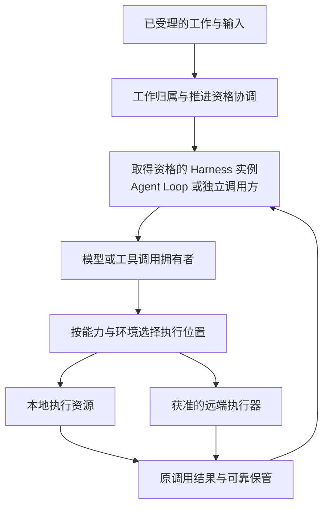

# 分布式计算与执行调度

本页说明工作怎样分配给不同实例与节点，以及执行位置变化时必须保持的责任。运行状态、取消和重试规则仍由[运行架构](../runtime/README.md)拥有。

状态：已接受的目标架构。采用范围见[部署入口](README.md)。本页不指定调度产品、队列、远程执行协议或资源数值。

## 服务扩容与计算扩容

集群可以增加完整的 Harness Server 实例，每份实例仍可承载治理和三个 runtime。也可以增加承接特定计算或工具任务的执行器。服务实例容量与执行器容量分别管理，不要求将 Agent、模型和工具 runtime 各拆成一个网络服务。

| 运行责任 | 可扩展的执行位置 | 分配时保留的边界 |
|---|---|---|
| 服务接入与工作治理 | 多份 Harness 实例。 | 依据原工作归属路由，保持身份、授权及唯一有效推进资格。 |
| Agent Loop 推进 | 取得对应 Run 推进资格的实例。 | 原推进者有效时继续同一次 attempt；接管时建立新 attempt，先对账原调用与消费位置。 |
| 模型请求 | 本地或独立部署的 Model runtime 提供者。 | 原调用身份、请求采用值、首内容及重试边界保持不变。 |
| 工具与内容计算 | 满足设施、权限和数据要求的执行环境或工作者。 | 由调用拥有者接纳执行，说明副作用、实际终止和结果保管。 |

一个任务是否允许远程执行，由其能力契约与执行环境共同决定。依赖本机设备、用户交互或不可迁移句柄的任务，不因集群有空闲节点就能转移。纯计算工作者可以不运行 Cordis；需要插件装配的执行进程建立自己的本地根。

## 工作分配与执行关系

图中的工作协调、调用拥有者和位置选择是不同责任，可以组合在同一进程。为 Run 选择推进实例，不等于为每次模型或工具调用选择同一节点；调用方等待结果也不取得执行器的生命周期所有权。

## 放置条件与准入

调度先筛选满足要求的候选位置，再按容量和代价选择。候选条件至少覆盖以下范围。

1. 实际任务所需的能力、版本、运行时及硬件设施。
2. 当前租户、操作与执行位置的授权，秘密的获准交付范围。
3. 输入、内容及工作目录的可达性、允许传输范围和保留条件。
4. CPU、内存、连接、执行槽及队列的可用额度。
5. 所需隔离、取消、终止、结果交接和故障恢复能力。

调度器不因位置合适而扩大授权。接收方在执行准入时复核仍适用的资格和条件，过期的候选信息只说明过去可用。没有合格位置时，按操作契约有界等待、拒绝或降级，不能静默更换任务语义或执行环境。

实际采用的资产、请求输入、环境与提供者按原执行契约记录。任务消息携带必要身份和受控数据引用，不序列化 Context、Fiber 或函数闭包。大内容的数据传输与本地化规则见[分布式存储](distributed-storage.md#访问关系与数据位置)。

## 认领、交接与结果

排队与发送任务不等于执行方已接下责任。调度及调用协议须辨认任务已受理、尚未受理和结果未知，并在交接空档保留原拥有者。通知可以重复或丢失，工作资格由权威协调与提交检查决定。

| 边界 | 必须明确的责任 |
|---|---|
| Run 推进实例变更 | 旧资格失效、新资格生效以及提交复核的顺序，防止两个实例同时有效推进。 |
| 模型或工具远端受理 | 调用拥有者能够按原身份查询实际执行及结果，不以发送成功代替可靠受理。 |
| 结果返回与观察者变化 | 原调用结果按保管契约交付，客户端或 Agent 退出不使结果无人负责。 |
| 排队取消与运行中停止 | 分别确认是否撤出队列、执行是否真的停止，以及已发生的外部效果。 |

Agent 推进资格失效，不自动取消它已经发出的模型或工具调用。接管者先对账原调用与结果，再按原消费位置继续。跨节点不承诺任意工具动作恰好执行一次，超时和节点失联不能授权调度器重放可能有副作用的动作。

## 容量、公平性与扩缩容

服务入口、Run 推进、模型连接和计算执行器分别限制并发及积压。控制、授权撤销、结果承接和资源清理仍须获得执行机会；增加节点不能掩盖无限队列或不可控重试。

租户及工作负载的总额度不能在每个副本上独立重复发放。全局额度可以分配给局部执行器执行，但必须明确分配、回收及失联时的边界。具体配额、公平算法与容量预留由调度提供者设计。

伸缩依据排队、吞吐、尾延迟、资源占用和下游容量共同判断。增加工作者前核对模型、存储和网络是否能够承载新增负载；缩容先停止新准入，再等待、交接或按契约终结既有责任。详细退出过程见[故障与演进](resilience-and-evolution.md#实例增减与工作交接)。

## 节点失联与恢复范围

节点不可达可能是网络分区，原进程仍可运行。调度器在无法确认执行状态时保留未知；新实例取得资格后，原实例仍须在相应提交边界被拒绝。具体资格协议由 Session/Run 与执行拥有者承接。

可重算的纯计算任务只有在契约明确允许时才重新调度。工具副作用、模型首内容后的请求、进程内不可恢复状态分别遵循自己的恢复边界。重新放置工作不等于迁移原进程、调用栈或任意在途计算。

节点恢复后先核对当前资格及实际未结调用，不按旧内存队列恢复全部任务。原执行的真实结果、费用和副作用仍沿原身份归集，不因节点被替换而丢弃。

## 提供者与验证责任

工作协调提供者负责认领、交接和提交资格协议；位置选择与调度提供者负责能力匹配、数据位置和容量控制；调用及执行器提供者负责真实受理、控制、结果与资源退出。节点管理器负责实例健康和替换，不直接裁定业务成功。

验证须覆盖多实例争抢、资格切换、发送后确认丢失、远端执行后失联、迟到结果、全局限额和缩容。负载验证分别记录队列、网络传输、内容准备、实际计算和结果消费成本，不用工作者数量推导吞吐。

后续设计须明确认领和失效协议、任务与结果传输、能力发现、调度策略、局部与全局额度，以及异构执行器的支持矩阵。这些设计归实际提供者，并登记到[架构后续设计入口](../README.md#未决事项与后续设计入口)。
