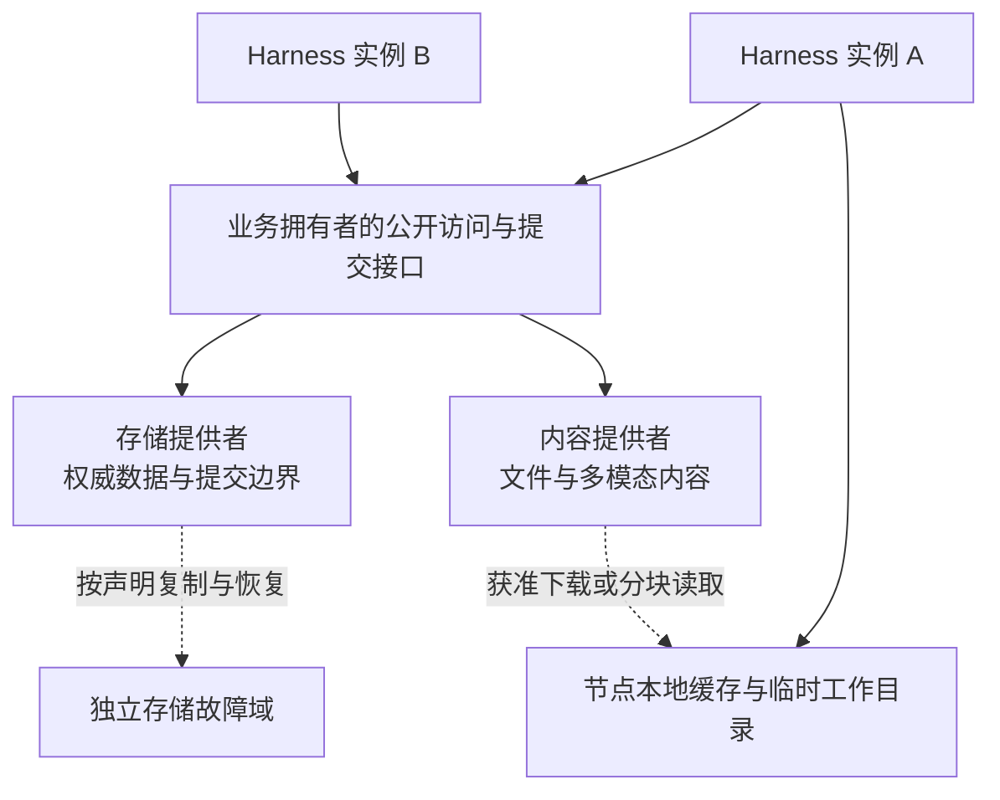

# 分布式存储与数据放置

本页说明集群中的数据放置、跨节点访问和存储故障边界。业务数据的含义、确认与保留规则由[数据与状态](../data-and-state.md)拥有，本页规定部署怎样满足这些要求。

状态：已接受的目标架构。采用范围见[部署入口](README.md)。具体后端、复制算法和容量参数由存储提供者设计，不在此指定。

## 部署范围与存储职责

单机可以使用本地持久存储和本地内容目录。集群允许由共享存储服务、分片服务或带复制的存储提供者承接数据，不要求每个 Harness 实例保存全量副本。部署须说明每份权威数据的可访问范围与失效条件。

跨节点可访问与能容忍节点丢失是两项能力。网络挂载本地磁盘不自动产生独立副本；多份副本也不自动满足提交确认与并发一致性。选择提供者时分别核对访问、提交、复制及恢复能力。

业务拥有者保持唯一，数据副本可以多份。存储服务负责保存和查询，不能取得组织授权、Run 推进或调用结果的业务裁定权。集群调度也不能通过直接改写业务数据绕过拥有者的接口。

## 数据分类与放置

| 数据类别 | 集群中的放置要求 | 本地副本的用途与限制 |
|---|---|---|
| 身份、资产及当前配置 | 获准实例能取得对应范围的权威数据与版本；当前授权核对满足安全契约。 | 可按声明缓存，不能以陈旧权限或不明版本决定新的敏感动作。 |
| 已受理输入、Run 进度及推进资格 | 原拥有者和合法接管者能访问恢复必需的状态；并发提交受同一资格协议约束。 | 内存状态可以加速推进，不能成为崩溃后唯一的工作依据。 |
| 调用结果、承接位置及结算事实 | 按原调用身份定位，在生产者退出后仍能按交付契约读取。 | 临时缓冲不替代持久承接，观察节点不自动成为结果拥有者。 |
| 图片、语音、文件及其他内容 | 元数据指向具备所需保留和访问能力的内容存储。 | 下载缓存和工作目录有明确寿命，不能作为已确认内容的唯一副本。 |
| 查询投影与索引 | 标明权威来源、覆盖进度、重建与陈旧读取边界。 | 可以按分片或节点局部维护，缺失时不能将未知解释为空数据。 |
| 工具工作目录与环境文件 | 按执行环境声明持久范围、访问节点及迁移限制。 | 节点临时目录只供约定中的任务使用，不默认与其他节点共享。 |
| 凭据与秘密 | 由获准的秘密服务或受保护提供者交付给实际使用者。 | 不随数据副本、任务参数或日志无差别复制到全部节点。 |

数据可以按租户、工作区或其他明确键分片。分片规则决定位置，不改变逻辑身份或读取资格；不能仅凭所在分片推断拥有权。共享资产和跨拥有者引用仍通过相应公开契约访问。

## 访问关系与数据位置

图中的业务接口表示逻辑所有权，不要求所有请求都经过一个中央服务进程。接口可以由不同实例中的提供者实现，底层存储仍须对共同写入执行相同的并发约束。复制框也不指定副本数量或某种复制协议。

调度前先核对数据可达、权限和执行环境，再比较把计算移到数据附近或把获准数据送到执行节点的代价。大内容优先使用受控引用和按需读取，不能在每次工作转交时复制整段会话历史或全部文件。

内容引用须能定位明确内容及其适用版本。下载地址、临时凭据与缓存键不成为内容的唯一身份；它们过期后，具备当前权限的消费者仍应按所属契约重新取得访问。重新授权不能复活已撤销的读取资格。

## 一致性、复制与提交边界

提供者分别声明权威写入、并发冲突处理、读取一致性、复制时机和持久确认条件。部署只能在这些能力满足拥有者契约时采用该提供者，不能通过“集群可用”推导每次读取都是最新值。

影响推进资格、敏感准入或持久确认的读取与提交，须满足相应拥有者的一致性要求。允许滞后的查询投影可以异步更新，但不能替代这些判断。网络分区期间无法确认资格的实例，不得仅凭本地缓存继续提交受保护推进。

确认成功后需要容忍哪些介质或节点故障，由具体装配与验收范围声明。确认前必须达到该范围所需的持久状态；如果承诺容忍某个节点丢失，唯一必要副本就不能仍只位于该节点。副本数和故障域数分别核对。

跨元数据与内容存储的提交须有可识别的中间状态。内容未达到保留条件时，不能把业务记录确认成已可靠保存；提交结果未知时，沿原操作身份查询。暂存内容的重试、回收和孤立对象清理由提供者与业务拥有者共同界定。

## 分片迁移、故障与恢复

分片迁移须保持逻辑身份和当前写入资格。切换期间明确哪一方接纳写入、怎样处理尚未复制的提交，以及旧路由如何找到新位置。不能让新旧位置因各有一份副本而同时独立裁定原工作。

| 情况 | 存储与部署的处理边界 |
|---|---|
| Harness 实例退出 | 新实例按权限恢复必需状态，不能要求原进程内存仍可访问。 |
| 存储节点不可达或发生分区 | 按受影响操作声明等待、拒绝或允许的读取降级，保留提交未知，不伪造空数据或成功。 |
| 副本或内容尚未可读 | 明确区分不存在、暂时不可访问和复制未完成；工作不能据此自动重发原外部动作。 |
| 介质损毁与备份恢复 | 按声明的恢复范围核对数据、当前资格及内容完整性，不把恢复旧字节直接等同于业务恢复。 |
| 节点缓存和临时文件丢失 | 只重建允许重建的数据；不可重建的原执行状态沿调用契约报告丢失。 |

备份不是在线副本。保留与删除规则须覆盖副本、缓存、索引和备份的各自范围；节点回归不能重新开放已撤销访问。具体安全限制沿[数据与隐私](../security/data-and-privacy.md)执行。

## 提供者与验证责任

存储提供者给出访问范围、分片与复制机制、提交及读取语义、恢复方式和容量约束。业务拥有者给出所需一致性、确认条件和保留规则。装配维护者核对两者是否匹配，并声明可容忍的故障范围。

验证须覆盖并发写入、复制延迟、分片切换、节点失联、提交未知、内容缺失以及旧备份中的撤销状态。长期会话的点查询、分页、内容读取和恢复分别测量，不以本地空载读取证明集群性能。

后续设计须明确后端选择、分片键与迁移协议、副本布局、元数据与内容提交协议、恢复指标和安全删除方式。这些条目进入[架构后续设计入口](../README.md#未决事项与后续设计入口)，不在本页预设数据库、对象存储产品或统一复制算法。
