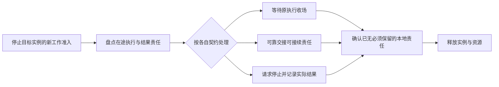

# 部署故障、扩缩容与演进

本页说明部署如何控制故障影响、恢复原工作，以及怎样增减实例和变更版本。

状态：已接受的目标架构。采用范围及阅读路径见[部署入口](README.md)。

## 资源与故障域

### 影响范围与监督责任

故障域由共享的真实资源决定。多个租户可以共享运行实例，但此时实例崩溃是它们共同的可用性风险，不能以租户逻辑隔离宣称独立故障域。

| 故障位置 | 监督与处置边界 |
|---|---|
| 一项任务或受限执行域 | 在其可终止边界内停止继续执行，保留已准入宿主调用的归属与收场责任。 |
| 一个线程或 runtime 实例 | 根据执行机制判断其宿主进程是否仍可信和可用；只替换实例不能掩盖进程状态损坏。 |
| 一个进程 | 由该进程之外的监督者识别退出、限制重启频率，并根据已保存状态协调恢复。进程内回调不是自身崩溃后的监督机制。 |
| 一个节点或个人设备 | 区分节点不可达、确认丢失和数据是否仍可访问。恢复按原工作的资格、状态与外部效果判断。 |
| 共享服务或基础设施 | 沿真实依赖限制受影响操作，实施容量受控的等待、拒绝与恢复，避免故障向无关能力扩散。 |

主进程内的不可信代码仍与宿主共享进程故障域。受限执行域须阻止其越权和无界占用，但不能据此承诺引擎缺陷或原生崩溃只影响该代码。部署通过实例分担、进程外监督和状态恢复控制影响；需要独立故障域的工作必须有相应的物理分离。

反复失败的工作或实例不能触发无界重启与重试。监督策略须能暂停其新准入、保留故障依据，并允许其他可用实例继续服务。重新尝试前仍须遵循原调用的效果与恢复边界。

### 原工作恢复与重复推进防护

节点不可达时，旧执行者可能仍在运行。接管方在推进前须通过工作拥有者的协调协议取得有效资格；提交边界必须能拒绝已失效推进者。仅凭心跳超时启动第二份相同工作不满足要求。

推进权失效与已发外部调用的生命周期分别处理。阻止旧 Agent 再发新工作，不证明旧模型、工具或宿主调用已停止。恢复方须查询或承接原调用；不能因无法联系旧实例就自动重放可能产生副作用的动作。

恢复可能是重新连接仍活跃的执行、取回原结果、从已承接内容继续消费，或按执行契约记录丢失并结束。具体分支沿[控制与恢复](../runtime/control-and-recovery.md)执行。恢复进程本身不能补出未保存的内容或把未知效果改成失败。

### 数据与存活的前提

长期运行不要求一个进程永远存活，而要求工作、结果及恢复责任能够跨进程寿命延续。持久状态、可重建缓存、在途缓冲和本地临时数据按[数据与状态](../data-and-state.md)分别处理。副本存在不证明持久确认已完成，备份存在也不等于即时可恢复。

装配必须说明可容忍的资源失效、仍需存活的依赖及超出范围时的行为。单机装配不能宣称设备毁损后仍能依赖该设备上的唯一数据副本恢复；集群装配也不能从实例数量推导独立存储故障域或全系统高可用。

业务安全与服务可用性分别评价。必要状态或准入依据不可取得时，可以暂停受影响工作，但不能为保持吞吐而接受重复推进、越权执行或虚假完成。恢复时间、数据损失边界和持续可用范围须在具体装配及验收条件中给出。

## 扩缩容与部署演进

### 实例增减与工作交接

扩容可以增加完整的 Harness 服务实例，也可以针对确有独立瓶颈的执行能力增加容量。接入、Agent 推进、模型调用、工具执行、环境和存储分别观察，不预设它们必须各自独立部署。扩容只有在新实例能访问获准资源、参与协调并承接工作时才有效，不能只观察 CPU 就复制全部服务。

缩容先停止目标实例接纳相应新工作，再处理在途工作与结果责任。可以等待完成、可靠交接或按契约终结；不能删除实例后才发现结果无人接收。后台执行与无关调用不因上层实例退出自动被销毁。

图表示计划退出的责任检查。异常崩溃走故障恢复，不能假定有机会完成图中的准备步骤。超过等待预算时，按明确策略报告未完成责任、转入恢复或终结，不伪造“正常退出”。

### 动态装配与版本变化

运行时的资产、模型、工具、扩展、权限及模式变化沿[装配与变化](../runtime/assembly-and-change.md)生效。部署可以重新实例化或替换运行单元，但应限制变化范围，并在新实例接纳工作前完成必要的状态、推进权与结果承接安排。一次局部重装配不得要求无关工作共同停机。

资产热加载、运行单元替换、软件版本升级和数据迁移分别设计。热加载的连续性要求不能用“进程已重启”证明，软件升级也不能自动假设所有版本的数据与协议互通。

需要新旧实例并存或滚动替换时，须明确其兼容范围、写入资格和不可逆变化边界。无法安全并存时，先选择经明确设计的协调切换或维护方式，不让部署工具自行混跑版本。当前阶段允许破坏性重构，不代表升级程序可以损坏已承诺保存的事实；也不由本页建立永久向后兼容或任意版本零停机升级承诺。

### 部署与恢复验证

验证针对真实装配和声明的负载范围进行，同时检查结果正确性、尾延迟与资源增长。个人设备和集群分别验证其前提，不能用单机正常路径替代跨节点故障证据。

| 场景 | 必须观察的结果与成本 |
|---|---|
| 多客户端连接同一 daemon | 客户端关闭、重连或切换后，后台已受理工作及原结果仍有拥有者，身份与审批资格不串用。 |
| 跨实例路由与节点接管 | 新请求、原工作控制及流式重连均到达合格拥有者，旧实例迟到不会造成重复推进；节点本地资源缺失明确报告。 |
| 待机、大量等待及 HITL | 活跃计算、内存、句柄与连接占用，等待恢复后身份和位置是否连续。 |
| 长会话与多模态流式输出 | 创建、加载、上下文组装、传输与消费成本，缓冲上限及慢消费者影响。 |
| 多租户和多 Agent 持续并行 | 吞吐、排队及尾延迟，公平性、共享瓶颈和单一有效推进者。 |
| Cordis 装配与依赖换代 | Agent 分支撤除不带走独立调用，必需提供者换代只影响真实依赖，候选失败不破坏旧合法采用，重跑不重复发起原工作。 |
| 有序退出与清理失败 | 故意打乱独立 effect 的完成次序、令 disposer 失败或中途杀进程，仍能辨认未交接工作、未关闭资源和恢复责任。 |
| 跨根与远程代理 | 原调用身份、授权、结果和取消语义保持，断连不被误判为原执行未发生，不能依靠 Context 或 isolate 标签取得远端权限。 |
| 计算饱和与恶意执行 | 取消、撤权和健康处理仍能运行，实际终止及进程故障影响符合声明。 |
| 网络分区、断连与重复通知 | 不重复发起副作用，不允许失效推进者提交新推进，保留原调用和未知状态。 |
| 存储、模型或环境失效后恢复 | 影响范围、兜底副作用、恢复积压及真实结果，不把可用性恢复当作业务成功。 |
| 缩容、重装配和实例替换 | 新旧责任交接、在途结果、费用及清理完整，无关工作不因局部变化停止。 |

性能报告分开记录受理、排队、加载、实际执行和消费耗时；TTFT 的起点与首内容判据沿[长期会话与并行工作](../drivers-and-constraints.md#长期会话与并行工作)。同时说明数据规模、持续时间、并发、硬件和故障注入条件。平均吞吐或一次成功重启不能独自证明长期稳定性。
