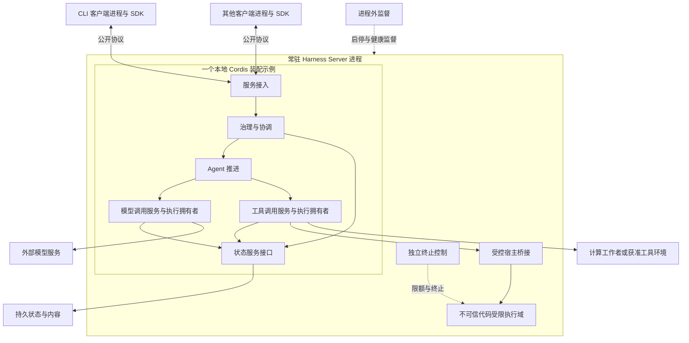

# 单机与常驻服务部署

本页说明客户端、常驻 Harness Server 与按需执行进程在单机上的组织方式，以及哪些边界可继续扩展。

状态：已接受的目标架构。采用范围及阅读路径见[部署入口](README.md)。

## 个人设备装配

个人设备以常驻 Harness Server 为基础装配。多个 CLI、桌面或 Web 客户端可以连接同一服务，仍按各自身份、授权与公开契约访问。daemon 表示服务独立于客户端连接持续运行。关闭客户端或连接断开，不隐式取消已经受理的工作；显式停止服务按计划退出或异常恢复规则处理。

下图展示一个设备内的客户端与服务进程。客户端与服务也可分处两台设备，通信位置变化不改变职责。客户端只通过公开契约访问服务，不能持有远端 Cordis 对象或直接改写服务内部状态。

图中的 Agent 推进、模型调用和工具调用均可留在 daemon 内。装配内的箭头表示调用，不表示 Fiber 父子所有权；治理、Agent 推进和调用执行分别管理生命周期。受限域桥接也可服务插件、provider 或 loop extension，工具调用只是一个接入示例。独立终止控制须能在受限代码阻塞时运行。

服务内部可以按需要使用多份 Cordis 装配，但多根不能消除共享线程和进程故障域。将能力直接嵌入应用的装配也可以复用相同接口与规则，不能据此要求所有客户端自带一套后台 runtime。

## 单机多进程的扩展边界

一个 Harness 服务实例可以按计算、隔离和资源需求增加执行进程。辅助进程可以承接内容处理、工具执行或其他明确任务，不要求从一开始就部署独立的 Agent 服务、模型服务和工具服务。

| 扩展方式 | 保持的边界 |
|---|---|
| 客户端与 daemon 分进程 | 客户端退出不带走后台工作，多个连接共享服务能力但不共享访问资格。 |
| daemon 使用工作者或工具进程 | 服务通过任务或能力契约交接工作，辅助进程的崩溃、结果及残留资源有明确拥有者。 |
| 同机运行多份 Harness 服务实例 | 每份实例有自己的装配和运行资源；若共同承接一批工作，仍须跨实例协调，不能各自独立认领。 |
| 按需拆出某项能力服务 | 明确调用、状态、取消与恢复契约；拆分不能改变该能力的领域语义。 |

后两种属于不同的扩展选择。增加 Harness 实例是在扩大同类服务的容量；拆出某项能力是在改变服务内部的部署边界。两者可以组合，也可以分别采用。

需要插件装配的进程建立自己的 Cordis 根。纯计算工作者可以只实现任务协议，不运行 Cordis。进程间不传递原始 Context、Fiber 或闭包；从同机传输换成网络传输，也不能依靠共享内存或共同父进程维持正确性。

本阶段尚未建立的单机状态目录不构成历史迁移来源。不新增迁移，也不删除真实数据。设备毁损后的唯一副本不能支撑重新开放业务。
