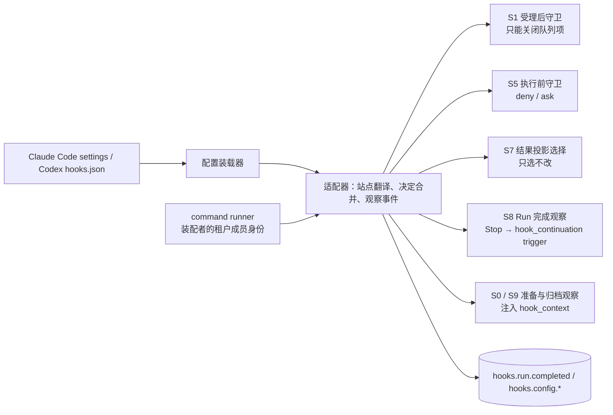

# 外部命令式 hooks 兼容层

本页是 Claude Code / Codex 命令式 hooks 兼容层的系统视图；选择依据见
[提案](../proposals/hooks-compat/README.md)与
[D-015](../decisions/D-015-tool-execution-message-stream-and-hooks.md)，精确承诺归
[external-hooks v1](../../spec/capabilities/external-hooks/v1/contract.md)，需求归
[PF-025](../requirements/product/agent/PF-025-external-hooks-compatibility.md)。进程内扩展点是
权威，命令式 hook 是它的一个适配器；兼容不改变两条边界：扩展点只有"收紧"与"选择投影"
两种权力，已耐久的输入、参数、结果不因 hook 改写。目标提供者尚未设计（候选包
`packages/agent/hooks-compat`）。

## 系统位置

## 已确认的选择

- **权力上界固定。** 兼容层的任何效果只能是关闭队列项、收紧门、排除模型投影、注入下一
  Step 的 `system_reminder{hook_context}`、入队 trigger、有资格的程序化作答；上游允许而这里
  不允许的效果逐项降级并可查，不静默忽略（U-40，决定 o～v）。
- **`Stop` 续跑是新 Run。** block 兑现为 `hook_continuation` trigger，连续续跑计数上限缺省 8
  且租户可配，`stop_hook_active` 作刹车输入；`superseded` 与 cancelled / failed 不触发 `Stop`。
- **S1 守卫在取用前求值。** 受理仍立即成功；开新 Run 时由调度者、取入既有 Run 时由驱动器
  在同一准备阶段求值，只能关闭项不能改写。
- **代人作答要有资格。** `PermissionRequest` 的程序化作答主体是装配 hook 资产的租户成员且须
  持有该请求的作答资格，否则降级为观察。
- **handler 首版只有 command，执行不声称隔离。** 命令在 live-agent v1 执行信任前提下运行；
  不给 hook 进程 records 写权、服务句柄或供应方凭据；不读宿主 settings 文件。

## Cordis 位置

候选包 `packages/agent/hooks-compat` 的 `HooksCompatPlugin` 装载一个 command runner、一个适配器
与两个配置装载器，向 session / tools / run-driver 的扩展点登记，向 `records.envelope.committed`
登记观察者；全部登记成功且 runner 可用才 ready，任一扩展点不可用即不 ready（不是 fail-open）。
装载效应与撤除（先封闭准入、撤登记、abort 进行中的进程并 drain、撤索引）、依赖变化政策见
[提案 Cordis 视角](../proposals/hooks-compat/README.md#cordis-视角)。

## 证据与缺口

本能力没有形式模型；性质 HK-1～ 的证据义务是 API 结构检查、run-driver 场景与每站点一个
"越权字段被记为 unsupported"的测试，见[验证范围](../../spec/capabilities/external-hooks/verification.md)。
尚未完成：提供者设计与实现；子 agent 事件（随 PF-004）；http / mcp_tool / prompt / agent
handler（各随其依赖能力）；`PreModelSwitch`、`PostToolBatch`、`transcript_path`。
